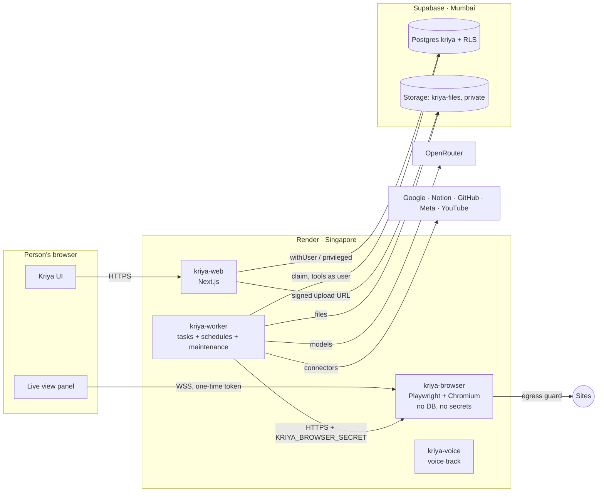

# Agent platform architecture

Extends `docs/kriya/architecture.md`; read that first. Nothing here replaces
the existing task path. It adds a scheduler loop, a policy engine, a verifier,
memory retrieval, files, a ledger, and one new service.

## 1. Services



| Service               | Change                                                                                                           | Holds secrets                                          | Talks to                                                   |
| --------------------- | ---------------------------------------------------------------------------------------------------------------- | ------------------------------------------------------ | ---------------------------------------------------------- |
| `kriya-web`           | New pages and actions (goals, inbox, files, login profiles, ledger), signed upload URLs, live-view token minting | Existing ones only                                     | Postgres, Storage, Auth                                    |
| `kriya-worker`        | Scheduler loop, maintenance jobs, new tools, browser driver, extraction, ledger                                  | Existing + `KRIYA_BROWSER_SECRET` + new connector keys | Postgres, Storage, OpenRouter, connectors, `kriya-browser` |
| `kriya-browser` (new) | Sessions, actions, snapshots, screenshots, PDF rendering, live view                                              | `KRIYA_BROWSER_SECRET` only                            | Sites through the egress guard; nothing internal           |

`kriya-browser` never sees a database URL, an OAuth token or a model key. It
gets one session's state from the worker and gives the refreshed state back
(AD-05, AD-08).

## 2. The agent loop, with the new pieces

```mermaid
sequenceDiagram
  participant S as Scheduler / person
  participant Q as kriya.tasks
  participant W as Worker (runTask)
  participant M as Memory
  participant P as Policy engine
  participant T as Tool
  participant V as Verifier
  participant E as Episodes
  S->>Q: enqueue (channel web | schedule | goal)
  W->>Q: claim
  W->>M: assemble context (budgets, retrieval)
  loop each step
    W->>W: model step (cache-friendly prompt)
    W->>P: classify tool call (R0–R5)
    alt R2–R4
      P-->>W: needs approval → reply ends waiting (Inbox)
    else R5
      P-->>W: refused → handoff / explain
    else R0–R1
      W->>T: execute
      T-->>W: result + verification
    end
  end
  W->>V: check claimed actions vs executions
  W->>E: write episode (derived, with evidence)
  W->>Q: finish; enqueue maintenance (summary, memory consolidation)
```

### 2.1 Context assembly (A1)

`loadContext` (in `run-task.ts`) gains one call:
`assembleContext(userId, agentId, threadId, query)` in `lib/memory/context.ts`.
It returns the prompt blocks of MEMORY_AND_CONTEXT.md §5, each within budget.
The query is the latest person message, or the schedule's prompt.

### 2.2 Policy engine (A3 for tool classes, A4 for browser actions)

`lib/agent/policy.ts` exports:

```ts title="lib/agent/policy.ts (contract)"
export type RiskClass = "R0" | "R1" | "R2" | "R3" | "R4" | "R5"
export function classifyTool(name: string, input: unknown, ctx: PolicyContext): RiskClass
export function classifyBrowserAction(
  action: BrowserAction,
  page: PageFacts,
  site: SiteRule
): RiskClass
export function approvalFor(cls: RiskClass): "none" | "user-approval" | "refuse"
```

It is pure, synchronous and table-driven. `run-task.ts` builds its
`toolApproval` map from it instead of the literal `APPROVALS` object.
Behaviour for existing tools stays identical: calendar and Gmail draft are R3
and need approval; web tools need approval after private content. A test
proves this (AT-POL-01).

### 2.3 Verification (A3, extended per tool)

Every R2–R4 tool returns `{ ..., verification: { status: "verified" |
"unverified" | "failed", method, evidence[] } }`. Methods: `api_readback`
(fetch the created object by id), `page_check` (re-read the field or the
confirmation text on the page), `file` (the generated file exists and
parses), `none`. The worker stores it in the new
`tool_executions.verification` column. It can't go inside `output_summary`,
which `summarize()` cuts at 500 characters (AF-10). `lib/agent/verify.ts`
then compares the reply's claims with executions, and checks citation quotes
verbatim against the cited tool outputs (K7, SIGNATURE_FEATURES.md). The reply text isn't changed. The "What I did" card shows only
verified executions, and lists unverified claims under "Not confirmed".

### 2.4 Scheduler (A3)

The worker gains a loop, separate from claiming tasks, with its own timer
(voice F6 lesson: no shared `running` map):

```ts title="worker/index.ts (sketch)"
// every 30 s, if KRIYA_SCHEDULES_ENABLED=1
const runs = await claimDueSchedules(50) // SQL: lock, record 'claimed', advance next_run_at
for (const run of runs) await enqueueScheduled(run) // TS: queue.ts prepare() + taskRow()
```

Scheduling happens in two steps (DATA_MODEL §2.3, AF-11):

1. **SQL claims.** `kriya.claim_due_schedules` locks due rows (`for update
skip locked`), records a `claimed` run per `(schedule, due_at)`, advances
   `next_run_at`, and pauses schedules whose goal's monthly ₹ cap or plan's
   schedule limit is reached.
2. **TS enqueues** through the same `prepare()` every person-started turn
   uses. That covers the thread lookup under RLS, `checkTaskAllowed` (daily
   tasks and allowance, invariant 7), tier resolution and budgets. The
   schedule's prompt becomes a `user` message with metadata `{ channel:
"schedule", scheduleId }` (rendered as "Scheduled run" in the thread), and
   the idempotency key is `schedule:<id>:<due_at>`.

A `TurnError` code maps to the run's outcome: `busy` → `skipped_active`, a
limit code → `skipped_limit` (and the schedule is paused with the reason).
Rewriting the tier and limit logic in SQL would drift from `queue.ts`, so it
isn't done. `claimed` runs older than 2 minutes are re-enqueued, and the
idempotency key makes that safe.

**Private-content guard in the background.** `guardWeb` (existing) makes web
tools wait for approval once mail or documents are in context. A watcher or
schedule that reads Gmail and then searches the web would therefore stop in
the Inbox. That's intended, not a bug: such prompts are written web-first,
and the stop is visible in the Inbox.

### 2.5 Maintenance jobs (A1, A3)

Maintenance is **not** a `kriya.tasks` row. A task would take the thread's
single active slot and refuse the person's next message
(`tasks_one_active_per_thread`, AF-12). It has its own table
(`kriya.maintenance_jobs`, DATA_MODEL §2.1) and its own worker loop with a
lease, on the budget tier. It covers:

- thread summary checkpoints;
- episode summaries;
- nightly memory consolidation.

Approval expiry is a plain SQL/TS pass with no model. Model usage goes to
`resource_usage` as `maintenance_model`. It's a platform cost, not a
customer charge, so `lib/agent/metering.ts` (protected) stays untouched.
Per-user daily cap: `agents.maintenanceCapMicroUsd`. When the cap is hit,
jobs wait until the next day. A thread then simply has no new checkpoint,
which costs tokens but loses nothing.

## 3. Module layout (new files)

| Path                                                                                                                        | Purpose                                                | Runs in                                                 |
| --------------------------------------------------------------------------------------------------------------------------- | ------------------------------------------------------ | ------------------------------------------------------- |
| `lib/memory/` (`context.ts`, `retrieve.ts`, `write.ts`, `consolidate.ts`, `summaries.ts`)                                   | Memory v2                                              | worker (and `actions/memory.ts` for the person's edits) |
| `lib/agent/policy.ts`                                                                                                       | Risk classes                                           | worker; also imported by tests                          |
| `lib/agent/verify.ts`                                                                                                       | Claims vs executions                                   | worker                                                  |
| `lib/agent/episodes.ts`                                                                                                     | Derived records                                        | worker                                                  |
| `lib/goals.ts`, `lib/schedules.ts`                                                                                          | Goal and schedule logic (pure next-run math in IST)    | web + worker                                            |
| `lib/browser/provider.ts`, `client.ts`, `sites.ts`, `profiles.ts`, `snapshot.ts`                                            | Browser driver side                                    | worker (`profiles.ts` only, for opening sealed state)   |
| `browser/` (`index.ts`, `session.ts`, `egress.ts`, `liveview.ts`)                                                           | The `kriya-browser` service                            | kriya-browser only                                      |
| `lib/files.ts`, `lib/extract.ts`                                                                                            | Files and extraction                                   | web (upload URLs), worker (extraction)                  |
| `lib/documents/` (`render.ts`, `templates/*.ts`)                                                                            | HTML templates → PDF via kriya-browser                 | worker                                                  |
| `lib/ledger.ts`, `lib/gst.ts`                                                                                               | Ledger maths, GSTIN check, invoice numbering           | worker + web                                            |
| `lib/connectors/github.ts` etc.                                                                                             | New connectors (A8), same shape as `lib/connectors.ts` | worker                                                  |
| `lib/skills.ts`                                                                                                             | Record, approve, replay                                | worker                                                  |
| `actions/goals.ts`, `actions/inbox.ts`, `actions/files.ts`, `actions/profiles.ts`, `actions/ledger.ts`, `actions/skills.ts` | Mutations                                              | web                                                     |
| `queries/goals.ts`, `queries/inbox.ts`, `queries/episodes.ts`, `queries/ledger.ts`                                          | Reads                                                  | web                                                     |

Boundaries:

- `browser/` imports nothing from `db`, `lib/secrets`, `lib/connectors`,
  `lib/auth`, `next/*` or `server-only`.
- `lib/memory`, `lib/ledger` and `lib/gst` import no `next/*`, so the worker
  can use them.
- Client components import none of these server modules (AGENTS.md
  convention).

Test AT-IMP-01 checks the browser boundary with a static import scan.

## 4. Failure modes and what happens

| Failure                                   | Behaviour                                                                                                                                                                                            |
| ----------------------------------------- | ---------------------------------------------------------------------------------------------------------------------------------------------------------------------------------------------------- |
| Worker dies mid browser session           | Lease expires; `recover_tasks` won't requeue if a side effect ran (existing rule; browser commits are side effects). `kriya-browser` closes sessions idle > 60 s without a heartbeat from the worker |
| `kriya-browser` down                      | Browser tools return a typed error; the task continues without them and says so; schedules that need the browser are deferred, with backoff                                                          |
| Site changed (locator not found)          | Action fails with `page_changed`; skills fall back to the model (AD-21); after 2 failures the step goes to the Inbox for the person                                                                  |
| Login profile expired                     | `login_required`; the person is asked to sign in again through take-over; the profile is marked `expired`                                                                                            |
| Approval never answered                   | Expires after 72 h → recorded as declined; goal check-in mentions it                                                                                                                                 |
| Extraction disagrees with totals          | Entry `needs_review` with the difference in rupees; never silently fixed                                                                                                                             |
| Model claims an action that didn't happen | Shown under "Not confirmed"; verifier metric V2 counts it                                                                                                                                            |
| Schedule storm (bug or many due)          | `claim_due_schedules` limit per call (50); `prepare()` limits per user (plan's daily tasks); paused with reason                                                                                      |
| Prompt injection on a page                | Untrusted notice; policy engine classifies the click regardless of model; cross-domain navigation needs approval when a login profile is in use (BROWSER §4)                                         |

## 5. Switches

| Name                                              | Kind                            | Default                    | Effect                                                               |
| ------------------------------------------------- | ------------------------------- | -------------------------- | -------------------------------------------------------------------- |
| `KRIYA_SCHEDULES_ENABLED`                         | env (worker)                    | unset                      | Scheduler loop runs                                                  |
| `KRIYA_BROWSER_URL`, `KRIYA_BROWSER_SECRET`       | env (worker, web for live view) | unset                      | Browser tools exist only when set                                    |
| `agents.memoryV2`                                 | setting                         | `off` → `on` after A1 eval | Context assembly uses retrieval; off = today's `memoryBlock`         |
| `agents.rolePacks`                                | setting                         | `off`                      | Onboarding offers "Meet your team" and creates the pack's squad (A2) |
| `agents.browser`                                  | setting                         | `off`                      | Browser tools offered (still needs plan `browser_minutes > 0`)       |
| `agents.loginProfiles`                            | setting                         | `off`                      | Login profiles and take-over (A6)                                    |
| `agents.ledger`                                   | setting                         | `off`                      | Ledger tools and pages (A7)                                          |
| `agents.skills`                                   | setting                         | `off`                      | Skills (A9)                                                          |
| `agents.maintenanceCapMicroUsd`                   | setting                         | 2000                       | Max maintenance model cost per user per day (platform cost)          |
| `agents.receipts`                                 | setting                         | `off`                      | Receipt chain and receipt cards (K1, A3)                             |
| `agents.quotes`                                   | setting                         | `off`                      | Quotes and ₹ caps (K2, A3)                                           |
| `agents.share`                                    | setting                         | `off`                      | Kriya Share links (K8, A5)                                           |
| `agents.undo`                                     | setting                         | `off`                      | Undo window (K3, A8)                                                 |
| `agents.watchers`, `agents.radar`, `agents.facts` | setting                         | `off`                      | Watchers, Radar, public facts commons (K4–K6, A13)                   |
| `profiles.lite_mode` (per person)                 | column                          | false                      | Lite mode (K10, A2), plus automatic when `saveData` is on            |

Every switch defaults off. Off means existing behaviour, byte for byte, for
the prompt and the tool set (AT-REG-01 snapshot).
