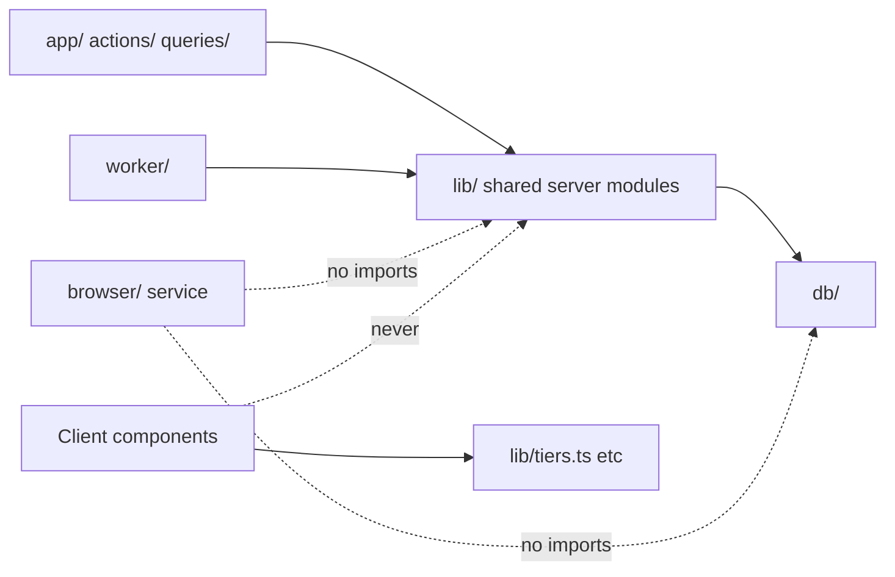

# Change impact and safe execution (agent platform)

What the agent-platform work may touch in the existing product, exactly how,
what could break, and the test that proves it didn't. A coding agent reads
this **before editing any existing file**. A change not listed here needs the
owner's approval and a new row in this file first.

The voice track has its own `docs/voice-assistant/CHANGE_IMPACT_AND_SAFETY.md`.
Where both list a file, **both** documents' rules apply, and the file is held
on the shared coordination board in `status.md` by one agent at a time.

Verified against commit `bdf223f` on 2026-10-17. Baseline: `npm run check`
passes (82 tests / 9 files).

## 1. Findings

See REPOSITORY_AUDIT.md §3 (AF-01…AF-07). Add new findings there with the
next AF id. A finding that affects the existing product is also added to §3
below as a rule.

## 2. Never touch without the owner's explicit approval

| Path                                                           | Why                                                | Exception                                                                                                                                                                                                       |
| -------------------------------------------------------------- | -------------------------------------------------- | --------------------------------------------------------------------------------------------------------------------------------------------------------------------------------------------------------------- |
| Applied migrations (`20261016…`, `20261017…`, `20261018…`)     | Immutable (invariant 2)                            | None; fix forward                                                                                                                                                                                               |
| `kriya.tasks`, `claim_task`, `heartbeat_task`, `recover_tasks` | Queue semantics proven by `tests/db/queue.test.ts` | None. Schedules insert ordinary tasks                                                                                                                                                                           |
| `lib/agent/metering.ts`, `kriya.usage_events`, `kriya.charges` | Agent metering                                     | None; browser and storage usage go to `resource_usage`                                                                                                                                                          |
| `lib/billing.ts`, `app/api/billing/webhook/route.ts`           | Payments                                           | None                                                                                                                                                                                                            |
| `lib/secrets.ts`                                               | Token encryption                                   | None needed: `seal`/`open` are reused as they are                                                                                                                                                               |
| `lib/connectors.ts`, `kriya.connections`                       | Token handling                                     | **A8 only, with the owner's approval at A8 start**: add providers additively (union type, authorize/exchange/refresh cases). Existing provider code unchanged; `tests/connectors.test.ts` unchanged and passing |
| `lib/auth.ts`, `lib/supabase.ts`, `db/index.ts`                | Identity and tenancy                               | None                                                                                                                                                                                                            |
| `app/api/events/route.ts`, `components/workspace/notifier.tsx` | Notifications (AD-20)                              | None: the notifier already fires when a reply finishes, which includes replies ending in an approval                                                                                                            |
| `.github/`, `LICENSE`, `NOTICE.md`                             | Governance                                         | Attribution rows for ported code only                                                                                                                                                                           |

## 3. Existing files that change, and how

| File                                                                                                                | Phase                                            | Allowed change                                                                                                                                                                                                                                                                                                                                                                                                                                                                                                                                                                                                                                                                                                                                                                                                                                                    | Risk                                                             | Proof                                                                                                                                        |
| ------------------------------------------------------------------------------------------------------------------- | ------------------------------------------------ | ----------------------------------------------------------------------------------------------------------------------------------------------------------------------------------------------------------------------------------------------------------------------------------------------------------------------------------------------------------------------------------------------------------------------------------------------------------------------------------------------------------------------------------------------------------------------------------------------------------------------------------------------------------------------------------------------------------------------------------------------------------------------------------------------------------------------------------------------------------------- | ---------------------------------------------------------------- | -------------------------------------------------------------------------------------------------------------------------------------------- |
| `db/schema.ts`                                                                                                      | A1, A3–A9                                        | Add tables. **A1**: edit the `memories` definition (nullable `agentId`, new columns) to mirror the migration. **A3**: widen the `tasks.input` type at `db/schema.ts:257` from `channel: "web"` to `channel: "web" \| "schedule"`, plus optional `scheduleId`, `workflowId`, `skillId` (type only; the column is already `jsonb`; AF-21). Add `verification` to the `toolExecutions` definition                                                                                                                                                                                                                                                                                                                                                                                                                                                                    | Type drift; callers assuming `agentId: string`                   | Typecheck; AT-RLS-MEM-01; existing memory tests                                                                                              |
| `lib/agent/tools.ts`                                                                                                | A1, A3–A9                                        | A1: **new** V2 memory tool factory (`memory_write` with kinds/slots, `memory_forget` = invalidate, `memory_update`, `memory_search`, `recall_episodes`), used only when `agents.memoryV2` is on; with it off the **existing** `createMemoryTools` is used unchanged, so tool definitions stay byte-identical (AF-16). Later: new `create*Tools` groups per TOOLS_AND_CONTRACTS. `SIDE_EFFECT_TOOLS` gains the R3/R4 tools. `KriyaTools` gains the new thread tools                                                                                                                                                                                                                                                                                                                                                                                                | Existing tools' behaviour; message type change                   | Existing tests unchanged; AT-POL-01; typecheck                                                                                               |
| `lib/agent/run-task.ts`                                                                                             | A1, A3, A4                                       | A1, always on: the existing memory query gains `isNull(memories.invalidAt)` and `not archived` (no-op until something is invalidated; AF-16); `notes.set(row.agentId!, …)` stays correct because the `inArray(agentId, …)` filter excludes nulls. A1, when `agents.memoryV2` is on: `loadContext` calls `assembleContext`; drop checkpoint-covered messages; record `memoryIds`; one batched usage update at the end; insert `maintenance_jobs` rows (never tasks, AF-12). A3: build `toolApproval` from `lib/agent/policy.ts`; write `approvals` rows when the reply ends waiting; write the episode (with receipt hash, K1); write `tool_executions.verification` in `onToolExecutionEnd` (AF-10; `summarize()` unchanged). A4: tool belt from loadouts; lazy browser session open on first browser tool, heartbeat with the task heartbeat, close in `finally` | Behaviour change for everyone                                    | AT-REG-01 (switches off = identical prompt and tools); `tests/pipeline.test.ts` unchanged and passing                                        |
| `lib/agent/instructions.ts`                                                                                         | A1, A4–A8                                        | A1: when `agents.memoryV2` is on, the new block order (MEMORY_AND_CONTEXT §5) with the date moved to block 4; off = today's output byte for byte. Capability lines generated from the final tool belt; line 87 stays as is for agents without the new capabilities (voice F4)                                                                                                                                                                                                                                                                                                                                                                                                                                                                                                                                                                                     | Prompt drift                                                     | AT-REG-01 snapshot with every switch off; a second snapshot per switch                                                                       |
| `lib/agent/queue.ts`                                                                                                | A3                                               | (1) In `enqueueApproval`: refuse with the existing `stale` 409 when the `approvals` row exists and isn't `pending` (AF-14), and update it inside the existing transaction, `privileged`, scoped by `user_id`. (2) New export `enqueueScheduled({ userId, threadId, agentId, prompt, scheduleId, dueAt, workflowId? })` that reuses `prepare()` and `insertTask()` and writes the prompt as a `user` message with metadata `{ channel: "schedule", scheduleId }` (AF-11). `taskRow` gains an optional `channel` argument whose default is `"web"`, so existing calls are unchanged. `enqueueTurn` itself is unchanged                                                                                                                                                                                                                                              | Approval flow                                                    | AT-INB-01; existing pipeline tests                                                                                                           |
| `lib/agent/messages.ts`                                                                                             | —                                                | No change                                                                                                                                                                                                                                                                                                                                                                                                                                                                                                                                                                                                                                                                                                                                                                                                                                                         | —                                                                | —                                                                                                                                            |
| `actions/memory.ts`, `queries/workspace.ts` (`getMemories`)                                                         | A1                                               | Handle shared notes (`agentId` null) and new columns; add confirm, pin, export, pause; the person's delete becomes chain delete. Owner-approved 2026-10-18 (AF-26): `addMemory`/`editMemory` refuse sensitive values (changes today's behaviour); `kriya.agents.memory_paused` added by migration `20261101000001` for Pause                                                                                                                                                                                                                                                                                                                                                                                                                                                                                                                                      | Existing UI                                                      | Existing behaviour for agent-private notes unchanged; RLS tests                                                                              |
| `lib/templates.ts`                                                                                                  | A2                                               | Add role packs, `loadout`, `profileSlots`, `starterGoals`; existing template fields and `suggestionsFor` unchanged                                                                                                                                                                                                                                                                                                                                                                                                                                                                                                                                                                                                                                                                                                                                                | Suggestions shown today                                          | A test that `suggestionsFor` returns today's results for existing roles                                                                      |
| `actions/account.ts`, `components/account/forms.tsx`, `app/onboarding/page.tsx`                                     | A2                                               | Behind `agents.rolePacks`: "Meet your team" creates the pack's agents and squad in one `withUser` transaction, respecting `plans.max_agents`                                                                                                                                                                                                                                                                                                                                                                                                                                                                                                                                                                                                                                                                                                                      | Onboarding regression; exceeding the agent limit                 | With the switch off, onboarding identical; limit enforced in the same transaction                                                            |
| `worker/index.ts`                                                                                                   | A3, A1                                           | A1: maintenance-job loop (own timer, own concurrency, own `running` map, voice F6) behind `agents.memoryV2`. A3: scheduler loop behind `KRIYA_SCHEDULES_ENABLED`, on its own timer, errors caught like the existing loop; approval expiry pass on a timer. A13: watcher checks inside the scheduler loop (no task unless the page changed). Janitor: screenshot and share retention                                                                                                                                                                                                                                                                                                                                                                                                                                                                               | Starving or crashing the task loop                               | AT-WRK-A1; `tests/db/queue.test.ts` unchanged                                                                                                |
| `lib/config.ts`                                                                                                     | A1+                                              | Add `agents.*` to `SETTINGS`, new secrets to `SECRETS`                                                                                                                                                                                                                                                                                                                                                                                                                                                                                                                                                                                                                                                                                                                                                                                                            | `/owner/config` patterns                                         | Each new setting has a pattern or is documented free text                                                                                    |
| `lib/env.ts`                                                                                                        | A4                                               | Add a `browser` service; new worker variables optional                                                                                                                                                                                                                                                                                                                                                                                                                                                                                                                                                                                                                                                                                                                                                                                                            | A required variable stopping the worker                          | Worker starts with none of the new variables set                                                                                             |
| `package.json`                                                                                                      | A4                                               | `playwright-core`, `ws` (if voice hasn't added it), scripts `browser`, `dev:browser`, `agent:eval`, `browser:capacity`                                                                                                                                                                                                                                                                                                                                                                                                                                                                                                                                                                                                                                                                                                                                            | Dependency risk, install size                                    | Review recorded in `status.md`; `npm ci` + build                                                                                             |
| `render.yaml`                                                                                                       | A4                                               | Add `kriya-browser` (Docker, private service) and worker variables as `sync: false`                                                                                                                                                                                                                                                                                                                                                                                                                                                                                                                                                                                                                                                                                                                                                                               | Blueprint sync prompting existing services                       | New keys only on the new service, optional on the worker                                                                                     |
| `proxy.ts`                                                                                                          | A3, A5, A6                                       | `/inbox`, `/goals`, `/accounts` in `PROTECTED`; `/api/files/` and `/api/browser/live/` in `PROTECTED_API`; exact prefixes. `/share/` stays **public** (K8). Checked 2026-10-17: the existing `"/s/"` entry doesn't match `/share/…`, because `startsWithAny` compares with the trailing slash; test AT-SHR-05 keeps it that way                                                                                                                                                                                                                                                                                                                                                                                                                                                                                                                                   | Over-broad matches                                               | A test that other paths behave as before                                                                                                     |
| `lib/log.ts`                                                                                                        | A6                                               | Add cookie, `Set-Cookie` and storage-state redaction                                                                                                                                                                                                                                                                                                                                                                                                                                                                                                                                                                                                                                                                                                                                                                                                              | Over-redaction                                                   | AT-SEC-03 with negative cases                                                                                                                |
| `lib/entitlements.ts`                                                                                               | A3, A5–A9                                        | New limit checks (goals, schedules, files, login profiles, skills, browser minutes); don't change existing checks                                                                                                                                                                                                                                                                                                                                                                                                                                                                                                                                                                                                                                                                                                                                                 | Allowance behaviour                                              | Existing pipeline tests; new tests per limit                                                                                                 |
| `components/thread/tool-call.tsx`, `components/workbench/activity.tsx`                                              | A1, A3–A9                                        | New `case`s and `TOOL_LABELS`/`TOOL_ACTIONS` entries                                                                                                                                                                                                                                                                                                                                                                                                                                                                                                                                                                                                                                                                                                                                                                                                              | None (defaults exist)                                            | Typecheck, lint                                                                                                                              |
| `components/workspace/bottom-nav.tsx`, `app/(workspace)/home/page.tsx`, `app/(workspace)/account/page.tsx`          | A3, A1, A5, A6                                   | Inbox entry; Today section; About you, Logins, Files sections                                                                                                                                                                                                                                                                                                                                                                                                                                                                                                                                                                                                                                                                                                                                                                                                     | 360 px layout                                                    | Screenshots at 360 px listed in `status.md`                                                                                                  |
| `lib/owner.ts`, `app/owner/*`                                                                                       | A3+                                              | Counts and statuses for goals, schedules, browser sessions, files, approvals; never content                                                                                                                                                                                                                                                                                                                                                                                                                                                                                                                                                                                                                                                                                                                                                                       | Owner privacy                                                    | AT-OWN-A1                                                                                                                                    |
| `kriya.tool_executions` (by new migration)                                                                          | A3, A8                                           | Add nullable `verification` (A3) and `undo`, `undo_until`, `undone_at` (A8). No existing column changes; Drizzle selects declared columns, so existing queries are unaffected                                                                                                                                                                                                                                                                                                                                                                                                                                                                                                                                                                                                                                                                                     | Owner pages listing executions                                   | `tests/db/queue.test.ts` and `pipeline.test.ts` unchanged and passing                                                                        |
| `kriya.memories` (by new migration)                                                                                 | A1                                               | `unique (id, user_id)` (AF-08), nullable `agent_id`, new columns, widened `source` check                                                                                                                                                                                                                                                                                                                                                                                                                                                                                                                                                                                                                                                                                                                                                                          | Existing memory actions                                          | AT-RLS-MEM-01; existing RLS tests                                                                                                            |
| `components/thread/transcript.tsx`                                                                                  | A1 (owner 2026-10-18)                            | Additive: `AgentMessage` renders the "Used N memories" chip (`components/thread/used-memories.tsx`) only when `metadata.memoryIds` is non-empty, which happens only with `agents.memoryV2` on                                                                                                                                                                                                                                                                                                                                                                                                                                                                                                                                                                                                                                                                     | Thread rendering                                                 | Typecheck; switch off = no `memoryIds` (runner test)                                                                                         |
| `components/thread/transcript.tsx`                                                                                  | A3                                               | A `user` message with `metadata.channel === "schedule"` is labelled "Scheduled run" instead of as the person                                                                                                                                                                                                                                                                                                                                                                                                                                                                                                                                                                                                                                                                                                                                                      | Thread rendering                                                 | Typecheck; a render test                                                                                                                     |
| `components/thread/transcript.tsx`                                                                                  | A3 (owner 2026-10-18)                            | Additive: `Transcript` fetches "What I did" records once per thread (`useWhatIDid`, `components/thread/what-i-did.tsx`) and `AgentMessage` renders the card under a finished reply; with `agents.inbox` off the action returns no records and nothing renders                                                                                                                                                                                                                                                                                                                                                                                                                                                                                                                                                                                                     | Thread rendering                                                 | Typecheck; render test `tests/agent/transcript.test.ts`                                                                                      |
| `lib/agent/instructions.ts`                                                                                         | A3 (owner 2026-10-18)                            | One K7 citation line in "How you work", only when `Capabilities.citations` is set, which `run-task.ts` sets only with `agents.inbox` on; absent otherwise, so the prompt is byte-identical                                                                                                                                                                                                                                                                                                                                                                                                                                                                                                                                                                                                                                                                        | Prompt drift                                                     | AT-REG-01 unchanged; runner test checks the line on and off                                                                                  |
| `app/api/threads/[threadId]/turn/route.ts`                                                                          | A3 (owner 2026-10-18)                            | K10: reads `x-kriya-lite: 1` or `?lite=1` and passes `{ lite }` to `streamTask`, which then waits 1,500 ms instead of 350 ms between empty reads; nothing else changes                                                                                                                                                                                                                                                                                                                                                                                                                                                                                                                                                                                                                                                                                            | Slower replies for Lite users only                               | `tests/agent/lite-route.test.ts`; `tests/agent/lite.test.ts`                                                                                 |
| `components/thread/thread-view.tsx`                                                                                 | A3 (owner 2026-10-18)                            | K10: the chat transport adds the Lite header on send and re-attach while Lite mode is on                                                                                                                                                                                                                                                                                                                                                                                                                                                                                                                                                                                                                                                                                                                                                                          | None when off (no header)                                        | Typecheck, lint; route test                                                                                                                  |
| `components/workspace/notifier.tsx`                                                                                 | A3 (owner 2026-10-18, §2 exception)              | K10 only: the existing `EventSource` handler is wrapped in `open()` and run through `followWhileVisible` (`lib/lite.ts`): in Lite mode closed while the tab is hidden, reopened when visible; unchanged otherwise. `app/api/events/route.ts` stays untouched                                                                                                                                                                                                                                                                                                                                                                                                                                                                                                                                                                                                      | Lite users get no notifications while the tab is hidden          | `tests/agent/lite.test.ts` (connection cases)                                                                                                |
| `lib/agent/tools.ts` `KriyaMetadata` type                                                                           | A1, A3                                           | Add optional `memoryIds`, `channel`, `scheduleId`                                                                                                                                                                                                                                                                                                                                                                                                                                                                                                                                                                                                                                                                                                                                                                                                                 | Saved message type                                               | Typecheck; optional fields only                                                                                                              |
| `lib/money.ts`                                                                                                      | A3                                               | Add `capToProviderMicroUsd` (K2); don't change existing functions                                                                                                                                                                                                                                                                                                                                                                                                                                                                                                                                                                                                                                                                                                                                                                                                 | Rounding                                                         | `tests/money.test.ts` existing cases unchanged + new                                                                                         |
| `actions/account.ts`, `kriya.profiles` (by new migration)                                                           | A2                                               | `profiles.lite_mode boolean default false` + column grant; `setLiteMode`                                                                                                                                                                                                                                                                                                                                                                                                                                                                                                                                                                                                                                                                                                                                                                                          | Profile form                                                     | Existing account tests; column grant test                                                                                                    |
| `tests/db/migrations.test.ts`                                                                                       | Each migration phase                             | Add down/up cases; keep existing cases                                                                                                                                                                                                                                                                                                                                                                                                                                                                                                                                                                                                                                                                                                                                                                                                                            | —                                                                | Itself                                                                                                                                       |
| `docs/kriya/deployment.md`                                                                                          | A4, A5, A8                                       | New variables, the `kriya-files` bucket, the `kriya-browser` service                                                                                                                                                                                                                                                                                                                                                                                                                                                                                                                                                                                                                                                                                                                                                                                              | —                                                                | —                                                                                                                                            |
| `app/owner/config/page.tsx` | Skill library (owner 2026-10-23) | The "Agent features" group also lists `skills.*` (kill switch and version pins) | None | Owner page renders the two keys |
| `AGENTS.md`                                                                                                         | A0, A6                                           | A0: agent-platform section (done). A6: the invariant 4 amendment in §7, only after AD-05 approval                                                                                                                                                                                                                                                                                                                                                                                                                                                                                                                                                                                                                                                                                                                                                                 | —                                                                | —                                                                                                                                            |
| `lib/agent/run-task.ts`                                                                                             | A8 (owner 2026-10-18)                            | Additive: `loadContext` sets `connected.github`/`meta` and keeps Sheets/YouTube only with `agents.connectors` on (keys absent otherwise); `onToolExecutionEnd` also writes `undo`/`undo_until` (from `lib/undo.ts`) only with `agents.undo` on                                                                                                                                                                                                                                                                                                                                                                                                                                                                                                                                                                                                                    | Prompt or tool drift                                             | `tests/agent/runner-a8.test.ts` (switch off: no GitHub tool or prompt line); AT-REG-01 unchanged                                             |
| `worker/index.ts`                                                                                                   | A8 (owner 2026-10-18)                            | `undoLoop`: own 5 s timer, errors caught, runs `runUndos()` only with `agents.undo` on                                                                                                                                                                                                                                                                                                                                                                                                                                                                                                                                                                                                                                                                                                                                                                            | Starving the task loop                                           | Typecheck; `tests/agent/undo.test.ts`                                                                                                        |
| `app/(workspace)/account/page.tsx`, `components/account/connections.tsx`                                            | A8 (owner 2026-10-18)                            | GitHub and Instagram cards and Sheets/YouTube options (unticked by default) only with `agents.connectors` on; the "connected" notice names all four providers                                                                                                                                                                                                                                                                                                                                                                                                                                                                                                                                                                                                                                                                                                     | 360 px layout                                                    | Typecheck; build; screenshots open                                                                                                           |
| `lib/agent/run-task.ts`                                                                                             | A9 (owner 2026-10-18)                            | One belt line: `createSkillTools(env, () => tools, browser)` only with `agents.skills` on, plus reading that switch                                                                                                                                                                                                                                                                                                                                                                                                                                                                                                                                                                                                                                                                                                                                               | Tool drift                                                       | `tests/agent/runner-a9.test.ts` (off: no skill tool); AT-REG-01 unchanged                                                                    |
| `queries/inbox.ts`, `app/(workspace)/inbox/page.tsx`, `components/inbox/controls.tsx`                               | A9 (owner 2026-10-18)                            | Inbox lists draft skills (Approve, Discard) and skills that stopped matching (Try again, Retire); counted in the badge. Empty unless skills exist, which needs `agents.skills`                                                                                                                                                                                                                                                                                                                                                                                                                                                                                                                                                                                                                                                                                    | 360 px layout                                                    | Typecheck; build; screenshots open                                                                                                           |
| `kriya.schedules`, `kriya.schedule_runs` (by migration `20261113000000`), `lib/schedules.ts`                        | A13 (owner 2026-10-18)                           | `schedules.watch` (only with kind `watch`, checked); run outcome `unchanged`; `createSchedule` takes `watch`; re-timing keeps a watcher's kind; `runDue` checks a watch before any task and pauses after 5 failed fetches (`pause_reason = 'fetch'`)                                                                                                                                                                                                                                                                                                                                                                                                                                                                                                                                                                                                              | Existing schedules                                               | `tests/agent/{scheduler,watch}.test.ts`; existing scheduler tests unchanged                                                                  |
| `lib/agent/tools.ts`, `lib/agent/policy.ts`, `lib/agent/run-task.ts`, tool labels                                   | A13 (owner 2026-10-18)                           | `schedule_create` gets an optional `watch` only with `agents.watchers` on (schema otherwise identical); `createRadarTools` (`facts_lookup` R0, `obligation_add` R1, `obligation_list` R0) behind `agents.facts`/`agents.radar`; `untrustedSeen` also treats a message carrying the watcher's untrusted-diff notice as untrusted (stricter quarantine); person-only writes add `obligations.status:done                                                                                                                                                                                                                                                                                                                                                                                                                                                            | dismissed`and`public_facts`                                      | Tool drift                                                                                                                                   | AT-REG-01 unchanged; `tests/agent/{radar,facts,watch,tool-policy}.test.ts` |
| `worker/index.ts`                                                                                                   | A13 (owner 2026-10-18)                           | Scheduler loop: `markMissed()` with `agents.radar`, `runFactJob()` with `agents.facts`, errors caught                                                                                                                                                                                                                                                                                                                                                                                                                                                                                                                                                                                                                                                                                                                                                             | Starving the loop                                                | `tests/agent/{radar,facts}.test.ts`                                                                                                          |
| `components/owner/nav.tsx`, `app/(workspace)/account/page.tsx`, `proxy.ts`                                          | A13 (owner 2026-10-18)                           | "Facts" in the owner nav (`/owner/facts`, Retract audited); "Open Radar" with the switches on; `/radar` in `PROTECTED`                                                                                                                                                                                                                                                                                                                                                                                                                                                                                                                                                                                                                                                                                                                                            | Owner privacy: facts hold no personal data                       | Typecheck; build                                                                                                                             |
| `lib/agent/run-task.ts`                                                                                             | A7 (owner 2026-10-18)                            | One belt line: `createLedgerTools(env)` only with `agents.ledger` on **and** the plan's `ledger_enabled`, plus reading them                                                                                                                                                                                                                                                                                                                                                                                                                                                                                                                                                                                                                                                                                                                                       | Tool drift                                                       | `tests/agent/runner-a7.test.ts` (off and plan-off: no ledger tool, same prompt); AT-REG-01 unchanged                                         |
| `lib/agent/tools.ts`, `lib/agent/policy.ts`, `components/thread/tool-call.tsx`, `components/workbench/activity.tsx` | A7 (owner 2026-10-18)                            | `createLedgerTools`: `ledger_list` (R0, a private read), `ledger_draft_entry` and `invoice_draft` (R1, drafts only); classes and writes in the policy tables; labels                                                                                                                                                                                                                                                                                                                                                                                                                                                                                                                                                                                                                                                                                              | An agent confirming or issuing                                   | AT-POL-07, AT-LED-06 (`tests/agent/{tool-policy,ledger,runner-a7}.test.ts`)                                                                  |
| `app/(workspace)/account/page.tsx`, `proxy.ts`                                                                      | A7 (owner 2026-10-18)                            | An "Open Accounts" entry only with `agents.ledger` on; `/accounts` in `PROTECTED`                                                                                                                                                                                                                                                                                                                                                                                                                                                                                                                                                                                                                                                                                                                                                                                 | 360 px layout                                                    | Typecheck; build; `tests/agent/proxy.test.ts`                                                                                                |
| `worker/index.ts`                                                                                                   | A7 (owner 2026-10-18)                            | `crossCheckLoop`: own 30 s timer, errors caught, runs only with `agents.crossCheck` on and `agents.crossCheckModel` set; within the daily maintenance cap                                                                                                                                                                                                                                                                                                                                                                                                                                                                                                                                                                                                                                                                                                         | Starving the task loop; spend                                    | `tests/agent/crosscheck.test.ts` (AT-XCK-02)                                                                                                 |
| `lib/documents/templates.ts`                                                                                        | A7                                               | Adds `renderTaxInvoice` (CGST Rule 46 particulars) and `renderLedgerReport`; existing templates unchanged                                                                                                                                                                                                                                                                                                                                                                                                                                                                                                                                                                                                                                                                                                                                                         | —                                                                | `tests/agent/ledger.test.ts`                                                                                                                 |
| `tests/db/migrations.test.ts` A3 and A5 cases                                                                       | A7                                               | Roll A7 back first (newest first; A7 uses `check_transition()` and references `files`)                                                                                                                                                                                                                                                                                                                                                                                                                                                                                                                                                                                                                                                                                                                                                                            | —                                                                | Itself                                                                                                                                       |
| `lib/env.ts`, `render.yaml`                                                                                         | A5 (owner 2026-10-18)                            | Optional only: web `KRIYA_BROWSER_URL`/`SECRET` (PDFs), worker `NEXT_PUBLIC_SUPABASE_URL`/`SUPABASE_SECRET_KEY` (files); nothing becomes required                                                                                                                                                                                                                                                                                                                                                                                                                                                                                                                                                                                                                                                                                                                 | A required variable stopping a service                           | Typecheck; services start with none set (optional list)                                                                                      |
| `worker/index.ts`                                                                                                   | A5 (owner 2026-10-18)                            | `extractLoop`: own 5 s timer, errors caught, runs only with `agents.files` on; janitor calls `purgeExpired()` with the switch on                                                                                                                                                                                                                                                                                                                                                                                                                                                                                                                                                                                                                                                                                                                                  | Starving the task loop                                           | `tests/agent/files.test.ts` (claim, lease, cache); typecheck                                                                                 |
| `lib/memory/maintenance.ts`                                                                                         | A5 (owner 2026-10-18)                            | `withinCap` exported (no other change) so model reads of files share the daily maintenance cap                                                                                                                                                                                                                                                                                                                                                                                                                                                                                                                                                                                                                                                                                                                                                                    | None                                                             | Existing maintenance tests unchanged                                                                                                         |
| `actions/inbox.ts`, `components/thread/what-i-did.tsx`                                                              | A5 (owner 2026-10-18)                            | Each record gets `shareable` (receipts and `agents.files` both on); the receipt line then shows Download PDF and Share (`components/thread/receipt-actions.tsx`). False otherwise, so nothing renders                                                                                                                                                                                                                                                                                                                                                                                                                                                                                                                                                                                                                                                             | Thread rendering                                                 | Typecheck; build                                                                                                                             |
| `browser/{protocol,index,session}.ts`, `lib/agent/policy.ts`                                                        | A5 (owner 2026-10-18)                            | `upload` action: always R4 (R5 on a sensitive field), only into a file field, only with bytes the worker took from `kriya.files`; request body limit 16 MB. No tool offers it yet (runner read-only, AF-27)                                                                                                                                                                                                                                                                                                                                                                                                                                                                                                                                                                                                                                                       | A file sent to a site                                            | AT-BRW-10 (`tests/agent/files.test.ts`, `tests/browser/service.test.ts`)                                                                     |
| `tests/db/migrations.test.ts` A3 case, `tests/agent/proxy.test.ts`, `tests/browser/service.test.ts` AT-BRW-07       | A5 (owner 2026-10-18)                            | A3 case rolls A5 back first (newest first, as for A9); AT-SHR-05 cases; AT-BRW-07 waits up to 1 s (100 ms steps) for the profile folder to go (owner)                                                                                                                                                                                                                                                                                                                                                                                                                                                                                                                                                                                                                                                                                                             | —                                                                | Themselves                                                                                                                                   |
| `AGENTS.md` invariant 4                                                                                             | A6 (owner 2026-10-18)                            | The §7 amendment applied word for word: login profiles join OAuth tokens as the sealed exceptions, opened only in `lib/browser/profiles.ts`                                                                                                                                                                                                                                                                                                                                                                                                                                                                                                                                                                                                                                                                                                                       | —                                                                | `tests/agent/profiles.test.ts` scans that `open` from `lib/secrets.ts` is imported only by `lib/connectors.ts` and `lib/browser/profiles.ts` |
| `browser/{protocol,index,session,snapshot}.ts`, new `browser/live.ts`                                               | A6 (owner 2026-10-18)                            | Sessions accept a profile's `state` and `allowedDomains` (main-frame navigation off those sites is aborted); `close` can return the storage state; `/live/<id>` WebSocket (take-over) checked by a one-time token before upgrade; fields report `maxLength`                                                                                                                                                                                                                                                                                                                                                                                                                                                                                                                                                                                                       | Session isolation; a public route on the service                 | AT-BRW-12, AT-BRW-07 unchanged, `tests/browser/{live,profiles}.test.ts`                                                                      |
| `lib/browser/{provider,client,session,snapshot}.ts`                                                                 | A6 (owner 2026-10-18)                            | `close(id, captureState)`; `TaskBrowser` takes `{ profiles }` (off = no state ever loaded) and loads the first page's site profile, expires it on a sign-in page, refreshes it on close; metering moved into `meterClosed` (same writes)                                                                                                                                                                                                                                                                                                                                                                                                                                                                                                                                                                                                                          | Browser minutes; profile misuse                                  | `tests/agent/profiles.test.ts`, `browser-tools.test.ts` unchanged                                                                            |
| `lib/agent/policy.ts`, `lib/agent/tools.ts`, `lib/agent/run-task.ts`, tool labels                                   | A6 (owner 2026-10-18)                            | `LoadedProfile`: open off the profile's site R3 (refused), typing there R4 (AT-BRW-08); `createKitTools` (`kit_prepare` R1, `kit_check` R0) behind `agents.kits`; a login hand-off points to Account → Logins; person-only writes add `login_profiles+`, `.status:active`, `.background_allowed`, `.label`                                                                                                                                                                                                                                                                                                                                                                                                                                                                                                                                                        | Tool drift                                                       | AT-REG-01 unchanged; `tests/agent/{kits,profiles,tool-policy}.test.ts`                                                                       |
| `lib/log.ts`                                                                                                        | A6                                               | Cookie and `Set-Cookie` header lines, storage-state JSON, sealed values and `storageState`/`localStorage`/`sealed` keys are redacted                                                                                                                                                                                                                                                                                                                                                                                                                                                                                                                                                                                                                                                                                                                              | Over-redaction                                                   | AT-SEC-03 with negative cases (`tests/agent/profiles.test.ts`)                                                                               |
| `worker/index.ts`                                                                                                   | A6 (owner 2026-10-18)                            | Janitor calls `profileJanitor()`: expired/unused state deleted, unfinished sign-ins cleared (DATA_MODEL §5), whatever the switch                                                                                                                                                                                                                                                                                                                                                                                                                                                                                                                                                                                                                                                                                                                                  | None (empty tables)                                              | `tests/agent/profiles.test.ts`                                                                                                               |
| `components/thread/thread-view.tsx`, `components/thread/tool-call.tsx`                                              | A6 (owner 2026-10-18, K9)                        | `SendContext` wraps the existing `ApprovalContext` with the view's own `send`, so a kit card's "I've applied it" sends that message; kit card with Copy buttons                                                                                                                                                                                                                                                                                                                                                                                                                                                                                                                                                                                                                                                                                                   | Thread rendering                                                 | Typecheck; build                                                                                                                             |
| `app/(workspace)/account/page.tsx`, `proxy.ts`, `lib/env.ts`, `render.yaml`                                         | A6 (owner 2026-10-18)                            | Logins section with `agents.loginProfiles` on; `/api/browser/live/` in `PROTECTED_API`; optional web `KRIYA_BROWSER_LIVE_URL`                                                                                                                                                                                                                                                                                                                                                                                                                                                                                                                                                                                                                                                                                                                                     | 360 px layout; nothing becomes required                          | `tests/agent/proxy.test.ts`; build                                                                                                           |
| `tests/fixtures/sites/index.ts`, `tests/db/migrations.test.ts` A3 case                                              | A6                                               | New paths only (`profile-editor` `/login`, `/account`, `/intro`, `/public`; `injection` `/signed-in`; host `exfil.test`); every site's `/` unchanged. The A3 case rolls A6 back first                                                                                                                                                                                                                                                                                                                                                                                                                                                                                                                                                                                                                                                                             | —                                                                | Themselves; AT-BRW-04 unchanged                                                                                                              |
| `lib/secrets.ts`                                                                                                    | A11 (owner 2026-10-18, §2 exception)             | Additive key rotation: new values `v2_<key id>.…` (still four parts), optional `KRIYA_TOKEN_KEY_PREVIOUS` opens values of the key being retired, `keyId`/`sealedKeyId`/`needsReseal`; `v1` values open unchanged                                                                                                                                                                                                                                                                                                                                                                                                                                                                                                                                                                                                                                                  | A value that won't open after the old key is removed             | `tests/connectors.test.ts` unchanged and passing; `tests/agent/key-rotation.test.ts`                                                         |
| `lib/browser/profiles.ts`, `lib/log.ts`, `lib/config.ts`, `lib/env.ts`, `render.yaml`                               | A11                                              | Saved logins re-sealed on use and by the janitor during a rotation; `v2_` values redacted in logs; `KRIYA_TOKEN_KEY_PREVIOUS` listed as an optional secret                                                                                                                                                                                                                                                                                                                                                                                                                                                                                                                                                                                                                                                                                                        | —                                                                | `tests/agent/key-rotation.test.ts`, `tests/readiness/readiness.test.ts`                                                                      |
| `app/legal/[doc]/page.tsx`, new `lib/legal.ts`                                                                      | A11 (owner 2026-10-18: drafts, clearly labelled) | Privacy notice, terms and AI disclosure from data; "Draft, pending legal review" on each; open legal points stated as open                                                                                                                                                                                                                                                                                                                                                                                                                                                                                                                                                                                                                                                                                                                                        | Public text read as settled law                                  | `tests/readiness/readiness.test.ts`                                                                                                          |
| `package.json`                                                                                                      | A11                                              | Script `readiness`                                                                                                                                                                                                                                                                                                                                                                                                                                                                                                                                                                                                                                                                                                                                                                                                                                                | —                                                                | Itself                                                                                                                                       |
| `components/thread/what-i-did.tsx`, `actions/inbox.ts`                                                              | A8 (owner 2026-10-18)                            | Each record carries its Undo states (empty unless `agents.undo` is on); a checked action with an undo record gets Undo/Close with a confirm dialog naming the effect                                                                                                                                                                                                                                                                                                                                                                                                                                                                                                                                                                                                                                                                                              | Thread rendering                                                 | `tests/agent/undo.test.ts` (AT-UNDO-03)                                                                                                      |
| `lib/connectors.ts`                                                                                                 | A11 (owner 2026-10-19, §2 exception)             | Rotation fixes only: a Google refresh also re-seals the refresh token when it's on an old key; a token that won't open (retired key, damaged) raises the reconnect `ConnectorError` (a missing or malformed key stays an error); Disconnect skips the revoke and still deletes the row when the token won't open. Tokens still opened only here                                                                                                                                                                                                                                                                                                                                                                                                                                                                                                                   | A person can't use or remove a connection after the old key goes | `tests/connectors.test.ts` and `tests/connectors/oauth.test.ts` unchanged and passing; `tests/connectors/rotation.test.ts`                   |
| `lib/memory/retrieve.ts`                                                                                            | A12 (owner 2026-10-19, AD-25)                    | `recallNotes` takes optional `weights` (recency, importance, own agent); default `RECALL_WEIGHTS` = the §5.1 numbers, so callers are unchanged. The unconfirmed penalty stays fixed                                                                                                                                                                                                                                                                                                                                                                                                                                                                                                                                                                                                                                                                               | Recall order drift                                               | AS-MEM unchanged (M1 40/50, M2/M4/M5 0)                                                                                                      |
| `lib/agent/instructions.ts`                                                                                         | A12                                              | `SAVE_GUIDANCE` exported (the baseline bundle's prompt wording); text unchanged                                                                                                                                                                                                                                                                                                                                                                                                                                                                                                                                                                                                                                                                                                                                                                                   | —                                                                | Typecheck; AT-REG-01 unchanged                                                                                                               |
| `db/schema.ts`, `tests/db/migrations.test.ts`, `tests/eval/memory.eval.test.ts`                                     | A12                                              | `policyVersions` table; A3 rollback chain rolls A12 back first plus an A12 down/up case; the AS-MEM runner takes weights and returns each top 5                                                                                                                                                                                                                                                                                                                                                                                                                                                                                                                                                                                                                                                                                                                   | —                                                                | Themselves                                                                                                                                   |
| `lib/agent/run-task.ts`, `lib/memory/maintenance.ts`                                                                | A12 (owner 2026-10-19)                           | With `agents.improvement` on: the policy bundle is read once per task (recall weights and candidate count, save-guidance wording), the task is stamped in `kriya.policy_task_versions` and its message metadata gets `policy: { version, hash }`; `enqueueSummary` uses the bundle's summary trigger. Off: `BASELINE_POLICY`, no stamp, prompt and metadata as before                                                                                                                                                                                                                                                                                                                                                                                                                                                                                             | Prompt drift with the switch off                                 | `tests/agent/runner.test.ts` (A12 block: off ignores an active version; on applies and stamps; untrusted-content section always present)     |
| `lib/agent/instructions.ts`, `lib/agent/tools.ts`                                                                   | A12 (owner 2026-10-19)                           | `buildInstructions`/`buildInstructionsV2` take an optional `saveGuidance` (default `SAVE_GUIDANCE`); `KriyaMetadata.policy` optional                                                                                                                                                                                                                                                                                                                                                                                                                                                                                                                                                                                                                                                                                                                              | —                                                                | AT-REG-01 unchanged                                                                                                                          |
| `worker/index.ts`, `lib/config.ts`, `components/owner/nav.tsx`                                                      | A12 (owner 2026-10-19)                           | Scheduler loop: `guardCanary()` every 10 minutes with `agents.improvement` on; setting `agents.improvement` (off); nav "Improve" → `/owner/improve`                                                                                                                                                                                                                                                                                                                                                                                                                                                                                                                                                                                                                                                                                                               | —                                                                | `tests/agent/improve.test.ts` (guard job)                                                                                                    |
| `lib/agent/run-task.ts` | Skill library (owner 2026-10-23, SKILLS_ENGINE.md) | Read `agents.skillLibrary`, `skills.disabled`, `skills.pins` once per task; `instructionsFor` appends `skillsFor(agent)` (resolved once per agent from the latest person message and the final belt, after `operator.disabledTools`); reply metadata `skills`; at settle, `settleActivations`. Off: `skillsFor` returns `""` and nothing is read or written | A resolver error failing tasks; a skill changing tools | Never throws (try/catch → no skills); belt built before resolution; `runner-skill-library.test.ts`, AT-REG-01 snapshots unchanged |
| `lib/agent/tools.ts` | Skill library (owner 2026-10-23) | `KriyaMetadata.skills` optional | None (type only) | `tsc` |
| `db/schema.ts`, `tests/agent/regression.test.ts` | Skill library (owner 2026-10-23) | `agents.skills` (nullable jsonb, `SkillPrefs`), `skillActivations` table; `agentInputSchema.skills` optional; the regression fixture's `Agent` literal gains `skills: null` (type completeness, snapshots untouched) | Agent type change | `tsc`; `regression.test.ts` passes unchanged |
| `actions/agents.ts`, `queries/workspace.ts` | Skill library (owner 2026-10-23) | `normalize` writes `skills` only when sent, through `checkSkillPrefs`; `getNavigation` returns `skills`; `getSystemStatus` adds `skills` (null with the switch off) | Saving an agent dropping its skills; bad ids stored | `agent-skills-actions.test.ts`, `skill-options.test.ts` |
| `components/dialogs/agent-dialog.tsx`, `components/thread/transcript.tsx` | Skill library (owner 2026-10-23) | Skills section (`SkillPicker`) only when `status.skills`; "Used N skills" under a reply only when its metadata has `skills` | Creator or transcript changing with the switch off | `skill-picker.test.ts`; field absent when off |
| `lib/config.ts` | Skill library (owner 2026-10-23) | Settings `agents.skillLibrary` (off), `skills.disabled`, `skills.pins` | None | Settings parse tests |
| `lib/owner.ts`, `app/owner/operations/page.tsx` | Skill library (owner 2026-10-23) | `skillActivity()` and the "Skills, last 7 days" section | Owner page query cost | Indexed by `skill_id, created_at`; `runner-skill-library.test.ts` |
| `AGENTS.md` | Skill library (owner 2026-10-23) | One Conventions bullet pointing to `skills/` and SKILLS_ENGINE.md | None | — |
| `lib/agent/queue.ts` | Production fix (owner 2026-10-23) | `prepare()` refuses a new turn (503 `unavailable`, "Kriya's task runner is offline…") when workers have registered but none heartbeat in the last 45 s; an empty `kriya.workers` (tests, a first deploy) isn't refused. Nothing else in the file changes | A live worker refused (heartbeat every 10 s, threshold 45 s) | `tests/agent/worker-offline.test.ts`; the full suite unchanged |
| `lib/connectors/sheets.ts`, `lib/agent/tools.ts`, `lib/agent/policy.ts`, `lib/agent/capabilities.ts`, `lib/agent/approvals.ts`, `lib/agent/instructions.ts`, `components/thread/tool-call.tsx`, `components/workbench/activity.tsx` | Google Sheets (owner 2026-10-23) | New tools `sheets_create` (R3, side effect, approval, read-back) and `sheets_total` (R0, private read, totals in integer hundredths by code); `rows` cells may be JSON numbers (still RAW, never formulas); write read-back uses `UNFORMATTED_VALUE`. Existing classes unchanged | Formula injection; model-made totals | `tests/connectors/sheets.test.ts`, `tests/connectors/google.test.ts`, `tests/agent/{connector-tools,tool-policy}.test.ts` |
| `lib/config.ts`, `lib/agent/run-task.ts`, `app/(workspace)/account/page.tsx`, `components/account/connections.tsx` | Google Sheets (owner 2026-10-23) | Setting `google.sheets` (`KRIYA_GOOGLE_SHEETS`, off): offers the Sheets box and tools without the rest of `agents.connectors`. Off = unchanged | Prompt/tool drift with it off | AT-REG-01 unchanged |
| `.env.example`, `lib/config.ts` hint, `components/owner/forms.tsx` placeholder, `scripts/{eval,sync}-models.ts` comments | Model (owner 2026-10-23) | Example model id `deepseek/deepseek-v4.1-flash-1017`; the live model is still chosen by `OPENROUTER_DEFAULT_MODEL` or `/owner/config` | None (text only) | `tsc` |
| `app/globals.css` | UI fix (owner 2026-10-23) | `.btn-glass::before`, `.btn-liquid::before`, `.gel::before`: the gloss is the control's top half inside its 1px edge with inherited top corners (was a width-based 6% inset with its own pill radius, which drifted inside long chips and rectangular buttons) | Look of every glass/liquid control | Before/after screenshots `screenshots/agent-platform/chips/` from the real rules, both themes |

Everything else is a **new** file in the paths of ARCHITECTURE.md §3, under
`tests/agent/`, `tests/browser/`, `tests/connectors/`, `tests/eval/`,
`tests/fixtures/sites/`, `tests/db/agent-*`, `supabase/migrations/202611*`,
`supabase/rollback/202611*`, `browser/`, and `scripts/agent-eval.ts`,
`scripts/browser-capacity.ts`.

## 4. Module boundaries

- `browser/` imports only Node built-ins, `playwright-core`, `ws`, and its
  own files (AT-IMP-01).
- `lib/memory/*`, `lib/ledger.ts`, `lib/gst.ts`, `lib/agent/policy.ts`,
  `lib/schedules.ts` import no `next/*` and no `server-only`, so the worker
  and tests can import them.
- Client components never import `db`, `lib/config`, `lib/models`,
  `lib/memory`, `lib/ledger` or `lib/browser`.

## 5. Preflight for every session

The same as voice §5, plus:

1. `git status --short`: anything you didn't make → stop and ask; never
   discard it.
2. `npm run check` passes before you start.
3. Your phase's decisions are Approved in `status.md`.
4. Every file you'll change is in §3 for your phase, and no other agent holds
   it on the board (either track).

## 6. Stop conditions

Stop and ask the owner when:

- you'd touch a §2 file or a file not in §3;
- an existing test fails and the cause isn't clearly your change;
- a site, API or library behaves differently from these documents;
- you need a secret, an account, money, a deploy, a real site or a real
  model call;
- a decision you depend on isn't approved;
- you're about to weaken a risk class, a site mode, an R5 rule or a
  quarantine rule for any reason.

## 7. Proposed amendments to AGENTS.md invariants (need owner approval)

Apply these only after the decision is approved and recorded in `status.md`.

**Invariant 4 (with AD-05)**: replace the last sentence's exception with:

> The exceptions are the OAuth tokens of connected accounts and the login
> profiles of the agent browser (sealed browser session state). Both are
> stored only as ciphertext from `lib/secrets.ts` (key in `KRIYA_TOKEN_KEY`)
> and are never selectable by the person's session. Tokens are opened only
> in `lib/connectors.ts`; login profiles only in `lib/browser/profiles.ts`,
> and are passed only to `kriya-browser` for one session.

**Invariant 5 (with AD-03, AD-08)**: append:

> Browser actions are classified by `lib/agent/policy.ts`, never by the
> model; commits (R4) need approval of the exact action; R5 actions
> (passwords, OTPs, CAPTCHAs, payments, identity documents) are never
> available. The browser runs only in `kriya-browser`, which has no
> database access and no secrets.

**New invariant 8 (with AD-16)**:

> Agents extract money figures; code computes them. Totals and taxes are
> calculated in `lib/ledger.ts` and checked in SQL. Only the person
> confirms ledger entries; issuing an invoice number is R2; Kriya never
> files returns or pays.
