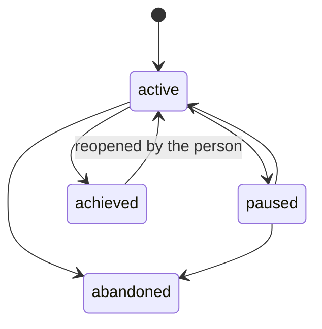
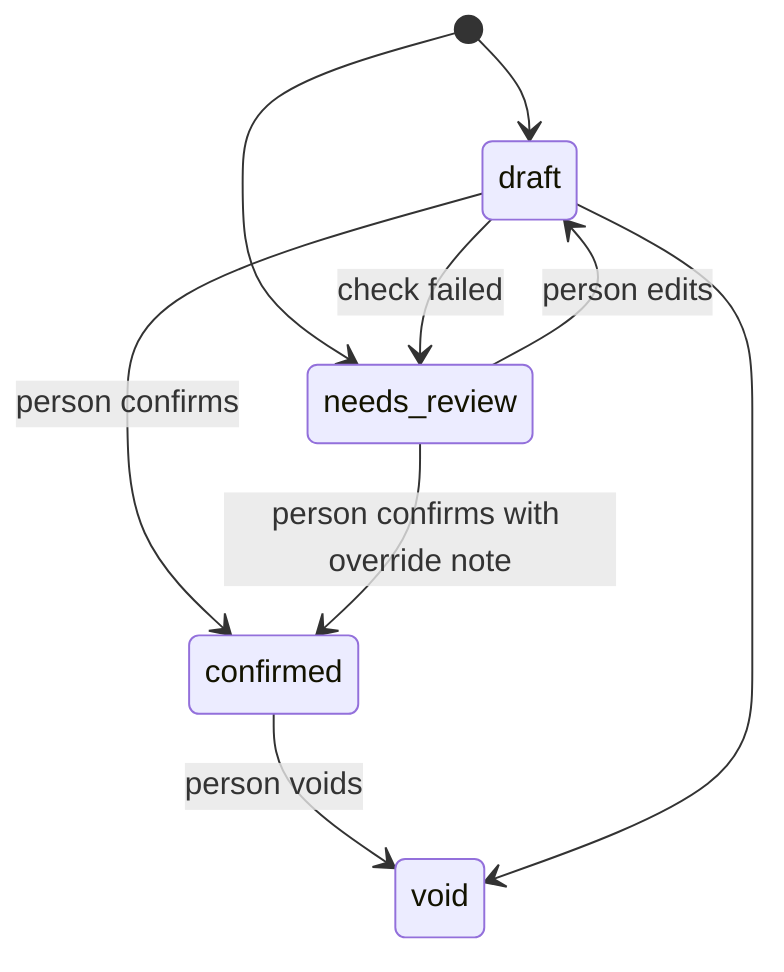

# Data model and state machines

All tables are in schema `kriya` (never exposed through the Data API,
invariant 2), with RLS enabled and a policy. `db/schema.ts` mirrors the SQL,
and the SQL is the source of truth.

## 0. Migration rules (read before writing any migration)

1. **New files only.** Never edit an applied migration. Each phase's
   migration is `supabase/migrations/2026110D000000_<name>.sql` (agent track
   range `202611**`; the voice track uses `2026102*`). Claim the timestamp
   on the coordination board before writing it. The file name must sort
   after every migration that exists when you write it. **The timestamps in
   this document are placeholders that show order within the track.**
   Phases run in parallel (A13 may finish before A5), so the real name is
   the next free timestamp after the newest existing file (either track),
   recorded on the board and in the phase's session result. Tables of
   different phases don't depend on each other's migration order, except
   where a phase's Preconditions say so.
2. **A rollback for every migration**: `supabase/rollback/<same>.down.sql`
   that drops only what it added and deletes its own row from
   `supabase_migrations.schema_migrations` (voice F2 lesson). Test down + up
   on PGlite in `tests/db/migrations.test.ts`.
3. **PGlite and transaction safe**: no `create extension`, no `concurrently`,
   nothing that can't run in a transaction (voice F3). Hashing and
   encryption happen in app code.
4. **Composite tenancy keys, only where the parent allows them.** Every
   child row carries `user_id`. A composite FK `(parent_id, user_id)` needs
   `unique (id, user_id)` on the parent. Checked against the core migration
   on 2026-10-17:
   - `agents`, `squads` and `threads` have it;
   - **`memories` does not** (A1 adds it);
   - **`tasks` does not**, and `tasks` is protected.

   So references to `tasks` are single-column (`task_id → kriya.tasks (id)`),
   with `user_id` written by the privileged writer from the task row, the
   pattern `task_events` and `tool_executions` already use (AF-09, proven on
   PGlite: the composite form fails with "no unique constraint matching
   given keys"). For a nullable **composite** reference use `on delete set
null (parent_id)`, never plain `set null`, which would null `user_id`
   and fail (voice F1). Single-column references use plain `on delete set
null`.

5. **No cross-track references.** Agent-track tables never reference voice
   tables and vice versa. Both may reference core tables.
6. **Grants and policies are explicit per new table.** The core migration's
   RLS loop and grants cover only core tables, so every new migration
   writes, for each table:
   - `alter table … enable row level security`;
   - its own policy (`using (user_id = (select auth.uid()))`);
   - its own `grant`.

   Default: the person's session gets `select` (and the specific
   `insert`/`update`/`delete` the actions need). Anything holding secrets
   gets column-level `select` without the secret column, like
   `kriya.connections`. The existing test "turns on row level security for
   every kriya table" must pass.

7. **Arithmetic in constraints** where it's money (AD-16): totals are
   `check`ed in SQL, not trusted from code alone.
8. Mirror every table in `db/schema.ts` with an inferred type and, where the
   UI writes it, a zod input schema (as `memoryInputSchema` does).

## 1. Shared transition guard (A3 migration)

```sql
create table kriya.allowed_transitions (
  entity text not null,
  from_status text not null,
  to_status text not null,
  primary key (entity, from_status, to_status)
);
-- trigger function: raises unless (TG_ARGV[0], old.status, new.status) is allowed
create function kriya.check_transition() returns trigger ...;
-- usage: create trigger goals_transition before update of status on kriya.goals
--          for each row when (old.status is distinct from new.status)
--          execute function kriya.check_transition('goal');
```

The table is readable by `authenticated` and writable by no one but
migrations. Every state machine below is seeded into it.

## 2. Tables by phase

### 2.1 A1: `20261101000000_memory_v2.sql`

**`kriya.memories` (alter)**

| Column          | Type                                                                                                   | Notes                                                                                                                                                                                                                            |
| --------------- | ------------------------------------------------------------------------------------------------------ | -------------------------------------------------------------------------------------------------------------------------------------------------------------------------------------------------------------------------------- |
| `agent_id`      | `text` **null**                                                                                        | Drop `not null`. Null = shared (AD-26). The composite FK stays; null skips it                                                                                                                                                    |
| `kind`          | `text not null default 'fact'`                                                                         | `check in ('profile','preference','instruction','fact','decision','relationship')`                                                                                                                                               |
| `slot`          | `text`                                                                                                 | `check (slot ~ '^[a-z][a-z0-9_.\[\]-]{0,63}$')`                                                                                                                                                                                  |
| `trust`         | `text not null default 'trusted'`                                                                      | `check in ('trusted','unconfirmed')`                                                                                                                                                                                             |
| `importance`    | `smallint not null default 2`                                                                          | 1–3                                                                                                                                                                                                                              |
| `pinned`        | `boolean not null default false`                                                                       |                                                                                                                                                                                                                                  |
| `valid_from`    | `timestamptz not null default now()`                                                                   |                                                                                                                                                                                                                                  |
| `invalid_at`    | `timestamptz`                                                                                          | Set when superseded or forgotten by an agent                                                                                                                                                                                     |
| `superseded_by` | `text`                                                                                                 | Self-reference; composite FK `(superseded_by, user_id)` `on delete set null (superseded_by)`. **Requires** `alter table kriya.memories add constraint memories_id_user_key unique (id, user_id)` first (AF-08, proven on PGlite) |
| `task_id`       | `uuid`                                                                                                 | Provenance; single-column FK `→ kriya.tasks (id) on delete set null`                                                                                                                                                             |
| `archived`      | `boolean not null default false`                                                                       |                                                                                                                                                                                                                                  |
| `last_used_at`  | `timestamptz`                                                                                          |                                                                                                                                                                                                                                  |
| `use_count`     | `integer not null default 0`                                                                           |                                                                                                                                                                                                                                  |
| `content_hash`  | `text`                                                                                                 | sha256 of normalised content, set in app code                                                                                                                                                                                    |
| `search`        | `tsvector generated always as (to_tsvector('simple', coalesce(slot,'') \|\| ' ' \|\| content)) stored` | GIN index                                                                                                                                                                                                                        |

Indexes:

- `unique (user_id, slot) where slot is not null and invalid_at is null
and slot !~ '\[\]$'` (one current value per single-valued slot);
- `(user_id, agent_id) where invalid_at is null and not archived`;
- GIN on `search`.

`source` gains `'derived'` (consolidation output): widen the check in this
migration by dropping and re-adding the constraint. Read its real name from
`pg_constraint` in a test first, and don't assume `memories_source_check`.

Proven on PGlite 18.6 (2026-10-17, scratch test against the real
migrations, since deleted):

- `agent_id drop not null` works with the existing composite FK;
- the generated `tsvector('simple', …)` column and its GIN index work;
- the partial unique index with the `\[\]$` regex works;
- an OR `to_tsquery('simple', 'telugu | हिंदी | ravi')` matches romanised
  Telugu, Devanagari Hindi and English notes;
- RLS hides shared (`agent_id` null) notes from other users.

**`kriya.agents` (alter, `20261101000001_memory_pause.sql`)**:
`memory_paused boolean not null default false`. Set only by the person
(Account → About you); while true, the agent's v2 `memory_write` and
`memory_update` save nothing. Added by the owner's decision on AF-26
(2026-10-18); the agent form's input schema leaves it out.

**Existing loader.** With `agents.memoryV2` off, the agent still loads
memory through today's query in `run-task.ts`. That query gains `and
invalid_at is null and not archived`, a no-op until something is
invalidated. Without it, turning V2 on and back off would bring superseded
facts back into prompts (AF-16).

**`kriya.thread_summaries` (new)**: `id text pk`, `user_id uuid`,
`thread_id text`, `covers_through timestamptz` (the `created_at` of the last
covered message), `summary jsonb` (MEMORY_AND_CONTEXT §7 shape), `chars
integer check (chars <= 3200)`, `model text`, `created_at`. FK `(thread_id,
user_id) → threads on delete cascade`. Unique `(thread_id,
covers_through)`. Person: `select`. Writes by the worker only.

**`kriya.maintenance_jobs` (new)**: background model work that must
**not** be a `kriya.tasks` row. A task would take the thread's single active
slot (`tasks_one_active_per_thread`) and refuse the person's next message
(AF-12).

- Columns: `id uuid pk`, `user_id` (`on delete cascade`), `kind`
  (`thread_summary`, `episode_summary`, `consolidate`), `ref text` (thread or
  task id), `status` (`queued`, `running`, `done`, `failed`), `attempts
integer default 0 check (attempts <= 3)`, `available_at`, `lease_until`,
  `error`, `created_at`.
- Unique `(kind, ref) where status in ('queued','running')`.
- The worker claims them with `for update skip locked` in its own loop.
- Model usage is recorded in `resource_usage` (`kind =
'maintenance_model'`, quantity = input + output tokens, `cost_micro_usd`
  from the provider's reported cost, else null). It is a **platform cost**,
  not a customer charge, capped per user per day by
  `agents.maintenanceCapMicroUsd`. `lib/agent/metering.ts` (protected) is
  not touched.
- Person: no access.

### 2.2 A2: `20261102000000_profiles_lite.sql`

Role packs are code (`lib/templates.ts`). The migration adds
`profiles.lite_mode boolean not null default false` (K10) and, if onboarding
needs it, `profiles.role_pack_version text`. Both get a column grant extending
the existing `grant update (display_name, locale, use_case, onboarded_at)`.
That grant is replaced by a new `grant update (…)` that keeps the four
existing columns, which a test checks.

### 2.3 A3: `20261103000000_goals_schedules.sql`

**`kriya.goals`**

| Column                                  | Type                          | Notes                                                                                                                                      |
| --------------------------------------- | ----------------------------- | ------------------------------------------------------------------------------------------------------------------------------------------ |
| `id`                                    | `text pk`                     | nanoid                                                                                                                                     |
| `user_id`                               | `uuid not null`               |                                                                                                                                            |
| `agent_id`                              | `text`                        | Lead agent; FK `(agent_id, user_id)` `on delete set null (agent_id)`                                                                       |
| `squad_id`                              | `text`                        | Optional team; same FK form                                                                                                                |
| `thread_id`                             | `text not null unique`        | The goal's own thread; FK cascade                                                                                                          |
| `title`                                 | `text`                        | 1–200                                                                                                                                      |
| `success_criteria`                      | `text`                        | ≤ 2000                                                                                                                                     |
| `plan`                                  | `jsonb not null default '[]'` | `[{ id, text, status: todo\|doing\|done\|blocked, evidence?: episodeId }]`, ≤ 30 items (checked in app; `jsonb_array_length` check in SQL) |
| `status`                                | `text`                        | `active`, `paused`, `achieved`, `abandoned`                                                                                                |
| `check_in`                              | `jsonb`                       | Schedule rule for check-ins (or null)                                                                                                      |
| `monthly_budget_micro_inr`              | `bigint`                      | Null = plan allowance only; `check (> 0)`                                                                                                  |
| `created_at`, `updated_at`, `closed_at` |                               |                                                                                                                                            |

**`kriya.schedules`**

| Column                                                                         | Type                                   | Notes                                                                                                                                                                                 |
| ------------------------------------------------------------------------------ | -------------------------------------- | ------------------------------------------------------------------------------------------------------------------------------------------------------------------------------------- |
| `id`                                                                           | `text pk`                              |                                                                                                                                                                                       |
| `user_id`, `agent_id` (not null), `thread_id` (not null), `goal_id` (nullable) |                                        | Composite FKs; goal `on delete cascade`                                                                                                                                               |
| `kind`                                                                         | `text`                                 | `once`, `recurring`, `watch`                                                                                                                                                          |
| `prompt`                                                                       | `text`                                 | 1–2000: what the run should do                                                                                                                                                        |
| `rule`                                                                         | `jsonb not null`                       | `{ freq: "once"\|"daily"\|"weekly"\|"monthly"\|"interval", at?: "HH:MM", days?: [1..7], dayOfMonth?: 1..28, everyMinutes?: ≥ 60, startAt?: ISO }` validated by zod; interval ≥ 60 min |
| `timezone`                                                                     | `text not null default 'Asia/Kolkata'` |                                                                                                                                                                                       |
| `next_run_at`                                                                  | `timestamptz`                          | Null when ended or paused                                                                                                                                                             |
| `last_run_at`                                                                  | `timestamptz`                          |                                                                                                                                                                                       |
| `status`                                                                       | `text`                                 | `active`, `paused`, `ended`                                                                                                                                                           |
| `pause_reason`                                                                 | `text`                                 | e.g. `limit`, `budget`, `login_expired`, `person`                                                                                                                                     |
| `background_allowed`                                                           | `boolean not null default false`       | Required true to use a login profile when the person isn't present                                                                                                                    |
| `runs`, `max_runs`                                                             | `integer`                              | `max_runs` null = unlimited                                                                                                                                                           |
| `approved_at`                                                                  | `timestamptz not null`                 | Schedules exist only after approval (R2)                                                                                                                                              |
| `created_at`, `updated_at`                                                     |                                        |                                                                                                                                                                                       |

Index `(next_run_at) where status = 'active'`.

**`kriya.schedule_runs`**: `schedule_id`, `user_id`, `due_at`, `task_id`
(nullable until enqueued), `outcome` (`claimed`, `enqueued`,
`skipped_active`, `skipped_limit`, `skipped_budget`, `failed`), `error`,
`created_at`. Primary key `(schedule_id, due_at)`, which gives idempotency.

Two steps, so the plan, tier and limit logic in `lib/agent/queue.ts`
(`prepare`, `checkTaskAllowed`) isn't duplicated in SQL (AF-11):

1. `kriya.claim_due_schedules(max)` (SQL) locks due rows (`for update skip
locked`), inserts `schedule_runs (…, outcome = 'claimed')`, advances
   `next_run_at`, and returns the claimed runs.
2. The worker calls `enqueueScheduled()` (TS, new export in `queue.ts`) per
   run with idempotency key `schedule:<id>:<due_at>`. That writes the
   schedule's prompt as a `user` message with metadata `{ channel:
'schedule', scheduleId }` and the task, through the same `prepare()`
   checks. Then it sets `outcome` (`enqueued` with `task_id`, or the skip
   reason from the `TurnError` code).

A worker crash between the steps leaves `claimed` rows. A recovery pass
re-runs step 2 for `claimed` rows older than 2 minutes, and the task's
idempotency key makes that safe.

**`kriya.approvals`** (an index of pending approvals; the decision itself
still flows through the message parts and `enqueueApproval`)

| Column                                   | Type    | Notes                                                                                      |
| ---------------------------------------- | ------- | ------------------------------------------------------------------------------------------ |
| `id`                                     | `text`  | The AI SDK approval id                                                                     |
| `user_id`, `thread_id`, `task_id`        |         | `(thread_id, user_id)` composite FK cascade; `task_id → tasks (id)` single-column, cascade |
| `tool_name`                              | `text`  |                                                                                            |
| `risk_class`                             | `text`  | `check in ('R2','R3','R4')`                                                                |
| `title`                                  | `text`  | One line for the inbox ("Save LinkedIn headline")                                          |
| `preview`                                | `jsonb` | Redacted input + screenshot file id                                                        |
| `status`                                 | `text`  | `pending`, `approved`, `declined`, `expired`                                               |
| `created_at`, `expires_at`, `decided_at` |         | `expires_at` default now() + 72 h                                                          |

Primary key `(thread_id, id)`. Person: `select`. Writes: the worker (when a
reply ends waiting) and `enqueueApproval`, both `privileged` scoped by user
id. The worker's expiry pass (`lib/agent/approvals.ts`) runs in one
transaction per thread:

1. Mark `pending` rows past `expires_at` as `expired`.
2. Rewrite the matching message part to `approval-responded` with
   `approved: false, reason: "Expired"`. **No task is enqueued.** The next
   turn in that thread carries the denial to the model.

`enqueueApproval` also refuses (409 `stale`) when the approvals row isn't
`pending`. Without both, an expired approval could still be approved from
an old tab (AF-14). Test AT-INB-03.

**`kriya.episodes`**: `id uuid pk`, `user_id`, `task_id unique`
(single-column FK `→ tasks (id) on delete cascade`), `thread_id`,
`agent_id`, `goal_id` (nullable), `done jsonb` (`[{ executionId, tool,
title, risk, verification, evidence: [fileId|url|providerId] }]`),
`unconfirmed jsonb` (claims without executions), `files uuid[]`, `titles
text` (the `done` titles joined, written by the worker), `summary text`
(≤ 300, filled later), `search tsvector generated always as
(to_tsvector('simple', coalesce(summary,'') || ' ' || coalesce(titles,'')))
stored`, `created_at`.

Receipt chain (K1, AD-27): `seq bigint not null`, `prev_hash text`, `hash
text not null`, unique `(user_id, seq)`. Written under
`pg_advisory_xact_lock(hashtext(user_id::text))`. Person: `select`. **No
`update`**: an episode is immutable, which keeps the chain valid. Deleting
is allowed, and the chain then shows the gap honestly ("record n deleted by
you on …"): the person's `delete` sets `deleted_at` and clears `done`,
`unconfirmed`, `titles` and `summary` through a server action, keeping
`seq` and `hash`. Mechanism:

- column `deleted_at timestamptz`;
- `grant update (deleted_at, done, unconfirmed, titles, summary)` to
  `authenticated`;
- a trigger `episodes_guard` that allows exactly one change: `deleted_at`
  from null to a time, together with `done`/`unconfirmed` set to `'[]'`
  and `titles`/`summary` set to null. Any other update raises (AT-RCP-02).

Writes: worker.

**`kriya.tool_executions` (alter, A3)**: add `verification jsonb`. The
worker sets it from the tool result in `onToolExecutionEnd`. Today
`summarize()` keeps only the first 500 characters of the output
(`run-task.ts:724`), so a `verification` object inside `output_summary`
would be cut (AF-10). A8 adds `undo jsonb`, `undo_until timestamptz` and
`undone_at timestamptz` (K3). The person's session keeps its existing
`select`.

### 2.4 A4: `20261104000000_browser.sql`

**`kriya.browser_sessions`**: `id uuid pk`, `user_id`, `task_id`,
`login_profile_id` (nullable, added as FK in A6), `status` (`open`,
`paused`, `closed`, `failed`), `opened_at`, `closed_at`, `seconds integer`,
`provider text`. Person: `select`.

**`kriya.resource_usage`**: `id uuid pk`, `request_key text unique`,
`user_id` (`on delete set null`), `task_id` (`on delete set null`), `kind`
(`browser_seconds`, `pdf_render`, `storage_bytes`, `embedding_tokens`,
`maintenance_model`, `web_fetch`). The table is created in **A1** (needed by
maintenance jobs); A4 only uses it.
`quantity bigint check (>= 0)`, `cost_micro_usd bigint` (null = unpriced,
never zero by default), `created_at`. Person: `select` own. Same idempotency
model as `usage_events`.

### 2.5 A5: `20261105000000_files.sql`

**`kriya.files`**

| Column            | Type            | Notes                                                        |
| ----------------- | --------------- | ------------------------------------------------------------ |
| `id`              | `uuid pk`       | Also the storage object name: `kriya-files/<user_id>/<id>`   |
| `user_id`         | `uuid not null` |                                                              |
| `name`            | `text`          | 1–255, sanitised                                             |
| `mime`            | `text`          | Allow-list: pdf, png, jpeg, webp, csv, txt, docx (read only) |
| `size_bytes`      | `bigint`        | ≤ plan limit (`plans.max_file_mb`, new column)               |
| `sha256`          | `text`          | Content-hash cache (T8)                                      |
| `origin`          | `text`          | `upload`, `generated`, `screenshot`, `email_attachment`      |
| `status`          | `text`          | `pending`, `ready`, `extracted`, `rejected`, `failed`        |
| `text`            | `text`          | Extracted text, ≤ 200,000 chars                              |
| `extraction`      | `jsonb`         | Model, pages, warnings                                       |
| `task_id`         | `uuid`          | Producer, `→ tasks (id) on delete set null`                  |
| `retention_until` | `timestamptz`   | Screenshots default now() + 30 days                          |
| `created_at`      |                 |                                                              |

The storage bucket `kriya-files` (private) is created in the deployment steps
(`docs/kriya/deployment.md`), not in a migration: PGlite has no storage
schema. Uploads use signed URLs created server-side, and downloads are
signed URLs valid for 60 s.

### 2.6 A6: `20261106000000_login_profiles.sql`

**`kriya.login_profiles`**: `id text pk`, `user_id`, `domain text`
(registrable domain, lowercase), `label text`, `status` (`pending`,
`active`, `expired`, `revoked`), `state_sealed text` (null unless active),
`background_allowed boolean default false`, `confirmed_at`, `last_used_at`,
`expires_at`, `created_at`, `updated_at`. Unique `(user_id, domain, label)`.
Grants:

- `select (id, user_id, domain, label, status, background_allowed,
confirmed_at, last_used_at, expires_at, created_at, updated_at)`;
- `update (label, background_allowed)`;
- `delete`.

**Never** `state_sealed`. Plans gain `max_login_profiles integer not null
default 0`.

### 2.7 A7: `20261107000000_ledger.sql`

**`kriya.ledger_entries`**

| Column                                                                  | Type                        | Notes                                                                                                       |
| ----------------------------------------------------------------------- | --------------------------- | ----------------------------------------------------------------------------------------------------------- |
| `id`                                                                    | `uuid pk`                   |                                                                                                             |
| `user_id`                                                               | `uuid not null`             |                                                                                                             |
| `kind`                                                                  | `text`                      | `expense`, `income`                                                                                         |
| `status`                                                                | `text`                      | `draft`, `needs_review`, `confirmed`, `void`                                                                |
| `entry_date`                                                            | `date not null`             | Document date                                                                                               |
| `counterparty`                                                          | `text`                      | ≤ 200                                                                                                       |
| `counterparty_gstin`                                                    | `text`                      | `check (counterparty_gstin ~ '^[0-9]{2}[A-Z0-9]{10}[0-9A-Z]Z[0-9A-Z]$')`; checksum in `lib/gst.ts`          |
| `document_no`                                                           | `text`                      | ≤ 40                                                                                                        |
| `category`                                                              | `text`                      | From a fixed list per role pack                                                                             |
| `place_of_supply`                                                       | `text`                      | Two-digit state code                                                                                        |
| `taxable_paise`, `cgst_paise`, `sgst_paise`, `igst_paise`, `cess_paise` | `bigint not null default 0` | `>= 0`                                                                                                      |
| `round_off_paise`                                                       | `bigint not null default 0` | `between -100 and 100`                                                                                      |
| `total_paise`                                                           | `bigint not null`           | `check (total_paise = taxable_paise + cgst_paise + sgst_paise + igst_paise + cess_paise + round_off_paise)` |
| `line_items`                                                            | `jsonb`                     | `[{ description, hsn_sac, qty_milli, rate_paise, amount_paise, tax_rate_bps }]`                             |
| `review_reasons`                                                        | `text[]`                    | Why it needs review                                                                                         |
| `file_id`                                                               | `uuid`                      | Source document                                                                                             |
| `extraction`                                                            | `jsonb`                     | Model, confidence per field                                                                                 |
| `created_by`                                                            | `text`                      | `agent`, `user`                                                                                             |
| `task_id`                                                               | `uuid`                      | Single-column FK `→ tasks (id) on delete set null`                                                          |
| `created_at`, `updated_at`, `confirmed_at`                              |                             |                                                                                                             |

Unique `(user_id, kind, counterparty_gstin, document_no) where status <>
'void' and counterparty_gstin is not null` (duplicate bill detection).

**`kriya.invoice_series`**: `user_id`, `series` (e.g. `INV`), `fy` (e.g.
`2026-27`, `check (fy ~ '^[0-9]{4}-[0-9]{2}$')`), `prefix`, `next_number
integer not null default 1`. Primary key `(user_id, series, fy)`.

**`kriya.invoices`**:

- `id uuid pk`, `user_id`, `series`, `fy`;
- `number integer`, `number_text text` (`char_length <= 16`), both null
  until issued;
- `status` (`draft`, `issued`, `paid`, `void`), `issue_date`, `due_date`;
- `supplier jsonb` (snapshot of the person's business profile at issue),
  `client jsonb` (`name, gstin?, address, state_code`), `place_of_supply`;
- `items jsonb`, plus the same paise columns and total `check` as ledger
  entries;
- `notes`, `pdf_file_id`, `ledger_entry_id`, `created_at`, `updated_at`,
  `issued_at`.

Unique `(user_id, series, fy, number)`. Issuing happens in one `withUser`
transaction: lock `invoice_series` `for update`, set
`number = next_number`, increment, set `status = 'issued'` (AD-17).

### 2.8 A8: `20261108000000_connectors_v2.sql`

Widen `kriya.connections.provider`: drop and re-add the check with `google`,
`notion`, `github` and `meta`. Read the constraint's real name from
`pg_constraint` in a test first. **YouTube and Sheets are not providers**:
they are extra Google scopes on the existing `google` connection
(`connections.scopes`, `googleServices()` in `lib/connectors.ts`), added by
incremental consent. `unique (user_id, provider)` would otherwise allow only
one Google-family row (AF-15). Sensitive Google scopes (Sheets,
`youtube.upload`) need Google's app verification before public use (AB-06).
Nothing else changes in connections.

### 2.9 A9: `20261109000000_skills.sql`

**`kriya.skills`**: `id text`, `version integer`, `user_id`, `agent_id`,
`name` (1–80), `description`, `status` (`draft`, `approved`, `retired`),
`site_domain` (nullable), `max_risk` (`R0`–`R4`), `slots jsonb` (`[{ name,
type, description, required }]`), `steps jsonb` (`[{ tool, input with
{{slot}} placeholders, expect?, locator? }]`), `acceptance jsonb`,
`source_task_id`, `approved_at`, `runs`, `successes`, `created_at`. Primary
key `(id, version)`. Unique `(user_id, name, version)`.

### 2.10 Plan columns (added in the phase that first needs each)

| Column                                      | Phase | Default              |
| ------------------------------------------- | ----- | -------------------- |
| `max_goals integer`                         | A3    | 3                    |
| `max_schedules integer`                     | A3    | 3                    |
| `min_schedule_interval_minutes integer`     | A3    | 1440 (daily) on Free |
| `max_file_mb integer`, `storage_mb integer` | A5    | 10, 100              |
| `max_login_profiles integer`                | A6    | 0                    |
| `ledger_enabled boolean`                    | A7    | false                |
| `max_skills integer`                        | A9    | 0                    |
| `max_watchers integer`                      | A13   | 2                    |
| `max_shares integer`                        | A5    | 5 active             |

All are conservative placeholders. The owner sets real values in `/owner`.
Each is enforced in SQL or `lib/entitlements.ts` (invariant 7).

### 2.11 Signature-feature tables (SIGNATURE_FEATURES.md)

**A5, `20261105000000_files.sql` (same migration as files)**

- **`kriya.share_links`** (K8): `id text pk`, `user_id`, `token_hash text
unique`, `kind` (`receipt`, `report`, `goal`, `ledger_export`), `ref text`,
  `snapshot_file_id uuid` (FK `→ files (id) on delete cascade`), `file_ids
uuid[]`, `expires_at timestamptz not null check (expires_at <= created_at
  - interval '30 days')`, `revoked_at`, `views integer default 0`,
`created_at`.
- **`kriya.share_views`**: `share_id` (FK cascade), `user_id`, `at`,
  `ip_hash text` (HMAC with a server key, never the raw IP).

**A13, `20261113000000_radar_watch.sql`**

- **`kriya.watch_state`** (K5): `schedule_id text pk` (FK `→ schedules (id)
on delete cascade`), `user_id`, `last_hash text`, `last_text text check
(char_length(last_text) <= 20000)`, `checked_at`, `changed_at`,
  `failures integer default 0`.
- **`kriya.obligations`** (K4):

  | Column                                                                                  | Notes                                             |
  | --------------------------------------------------------------------------------------- | ------------------------------------------------- |
  | `id text pk`, `user_id`, `goal_id` (nullable, composite `on delete set null (goal_id)`) |                                                   |
  | `kind text`                                                                             | From the role pack's template list                |
  | `title text`                                                                            | 1–200                                             |
  | `due_at timestamptz not null`                                                           |                                                   |
  | `quote text not null`                                                                   | ≤ 500; the exact text the date came from          |
  | `source_kind`                                                                           | `official_page`, `public_fact`, `gmail`, `person` |
  | `source_ref text not null`                                                              | URL, fact key, Gmail message id, or `person`      |
  | `read_at timestamptz not null`                                                          |                                                   |
  | `verified boolean not null`                                                             | Quote found verbatim by the deterministic check   |
  | `lead_days integer[] not null default '{7,1}'`                                          |                                                   |
  | `status`                                                                                | `upcoming`, `done`, `dismissed`, `missed`         |
  | `created_at`, `updated_at`                                                              |                                                   |

  Unique `(user_id, kind, due_at, source_ref)`.

**A13, same migration**

- **`kriya.public_facts`** (K6): `key text pk` (`check (key ~
'^[a-z0-9_.-]{3,120}$')`), `value text`, `quote text not null`,
  `source_url text not null`, `source_domain text not null`, `fetched_at`,
  `expires_at not null`, `confirmations integer not null default 1`,
  `retracted_at`, `retracted_by uuid`, `updated_at`. **No `user_id` by
  design.** Served only when `confirmations >= 2`, not expired, not
  retracted. A trigger rejects writes whose `source_domain` isn't in
  `kriya.fact_sources` (a domain allow-list table, seeded by migration and
  edited only through an audited owner action).

## 3. State machines

Allowed transitions are seeded into `kriya.allowed_transitions`. Anything not
listed raises.

### 3.1 Goal



`achieved` is set by the person, or by the agent through `goal_update` with
every checklist item `done` **and** each item linked to an episode. The
agent can't mark a goal achieved without evidence.

### 3.2 Schedule

`active → paused → active`, `active → ended`, `paused → ended`. The scheduler
may set `paused` (with `pause_reason`) but never `active`. Only the person
resumes.

### 3.3 Approval

`pending → approved | declined | expired`. Terminal states never change.

### 3.4 File

`pending → ready → extracted | failed`, `pending → rejected`, and
`ready → failed`.

### 3.5 Ledger entry



Only the person moves an entry to `confirmed`, through a server action. No
agent tool can set `confirmed`, because none exists that writes that status;
`ledger_add` writes only `draft`/`needs_review` (see the note in §4).
`confirmed_at` is set only by the action. Reports count only `confirmed`.

### 3.6 Invoice

`draft → issued → paid`, `issued → void`, `draft` deleted freely. A number,
once given, is never reused.

### 3.7 Skill version

`draft → approved → retired`. Approving is R2 (the person, in the inbox).
Editing an approved skill creates a new `draft` version.

### 3.8 Login profile

See BROWSER_AND_LOGIN_PROFILES.md §6.

### 3.9 Obligation

`upcoming → done | dismissed | missed`, `missed → done`. The worker sets
`missed` after `due_at` passes. Only the person sets `done` or `dismissed`.

### 3.10 Maintenance job

`queued → running → done | failed`, `running → queued` (lease lost, attempts
< 3). There is no transition table: the worker is the only writer, and the
transitions are guarded by `where status = …` in each update.

### 3.11 Share link

There is no status column. A link is live while `revoked_at is null and
expires_at > now()`. `revoked_at` is set once and never cleared (trigger).

## 4. RLS summary

| Table                                                                                 | Person's session                                                                                         | Worker / privileged                                           |
| ------------------------------------------------------------------------------------- | -------------------------------------------------------------------------------------------------------- | ------------------------------------------------------------- |
| `memories` (altered)                                                                  | All on own rows (as today)                                                                               | Consolidation, scoped by user id                              |
| `thread_summaries`, `episodes`, `schedule_runs`, `browser_sessions`, `resource_usage` | `select` own (`episodes` also `delete`)                                                                  | Writes                                                        |
| `goals`, `schedules`                                                                  | `select`, `insert`, `update`, `delete` own (through actions); status changes pass the transition trigger | `claim_due_schedules`                                         |
| `approvals`                                                                           | `select` own                                                                                             | Writes                                                        |
| `files`                                                                               | `select`, `delete` own; `update (name)`                                                                  | Inserts, status, text                                         |
| `login_profiles`                                                                      | Column `select` without `state_sealed`; `update (label, background_allowed)`; `delete`                   | Insert, state, status                                         |
| `ledger_entries`, `invoices`, `invoice_series`                                        | All own (business records), through actions                                                              | Agent tools write `draft`/`needs_review` only, via `withUser` |
| `skills`                                                                              | `select`, `update (status)` through the approval action, `delete`                                        | Insert drafts                                                 |
| `allowed_transitions`                                                                 | `select`                                                                                                 | —                                                             |

| `maintenance_jobs` | None | All |
| `obligations`, `watch_state` | `select` own; `obligations`: `update (status)` (done/dismissed), `delete` | Writes |
| `share_links` | `select` (without `token_hash`), `insert` through the share action, `update (revoked_at)` | `/share/[token]` lookup by hash |
| `share_views` | `select` own | Inserts |
| `public_facts` | `select` (no personal data) | Writes only from the fact job |

Every table gets a test in `tests/db/agent-rls.test.ts`: another user's id
finds nothing and changes nothing, and the forbidden columns are not
selectable.

> **Same identity, different powers.** Agent tools run under
> `withUser(userId)`, the same database role and `auth.uid()` as the
> person's own server actions. So RLS separates **users**, not "the person"
> from "their agent". What an agent may do is limited by the tools that
> exist, their zod schemas and the policy engine (AD-03). Never add a tool
> that writes a column only the person should set: `ledger_entries.status
= 'confirmed'`, `skills.status = 'approved'`, `memories.trust`, or any
> `share_links` row. Test AT-POL-07 lists every tool's writable columns and
> fails if one of these appears.

## 5. Retention

| Data                                        | Default                                            | Owner-configurable      |
| ------------------------------------------- | -------------------------------------------------- | ----------------------- |
| Screenshots (`files.origin = 'screenshot'`) | 30 days                                            | Yes                     |
| Extracted text of a deleted file            | Deleted with the file                              | —                       |
| Episodes                                    | Kept until the person deletes them or the account  | Proposed: 1 year (AQ-3) |
| Login profile state                         | Deleted on revoke, expiry or 90 days unused        | —                       |
| Superseded memories                         | Kept (history) until the person forgets the note   | —                       |
| Thread summaries                            | Deleted with the thread (cascade)                  | —                       |
| Share snapshots                             | Deleted 7 days after expiry or revocation          | —                       |
| Share view log                              | Deleted with the share                             | —                       |
| `watch_state.last_text`                     | Overwritten each change; deleted with the watcher  | —                       |
| `maintenance_jobs`                          | `done` rows deleted after 7 days                   | —                       |
| Public facts                                | Kept until expired + 90 days (audit), then deleted | —                       |

The janitor (`worker/index.ts`) deletes expired screenshots (storage objects
first, then rows) in batches.
