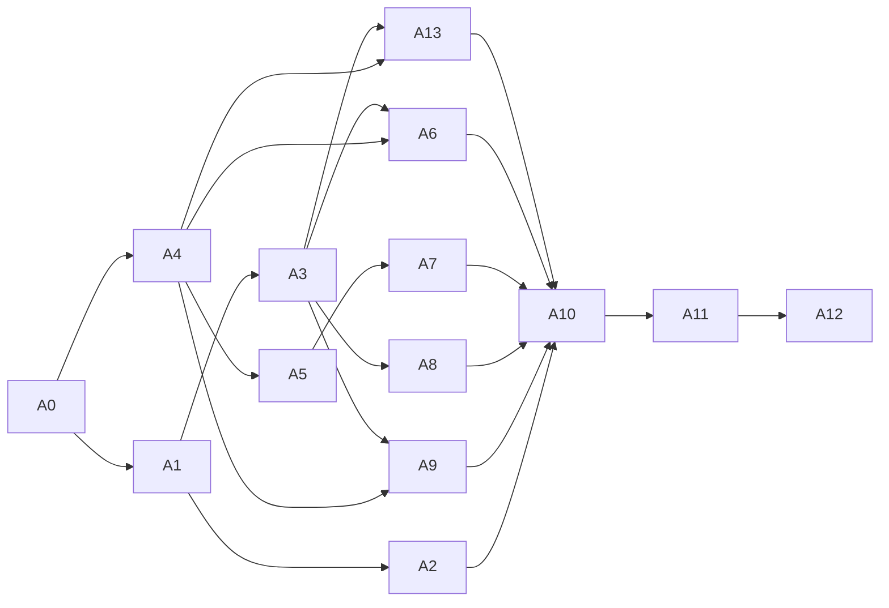

# Implementation plan (agent platform)

The per-phase checklist (objective, files, tests, exit, status) is in the
root **`status.md`**, section "Agent platform (track A)", which is canonical.
This document explains the order, parallelism, configuration, rollout and
rollback that the checklist assumes.

## 1. Phase order and why

| #   | Phase                                                                           | Why here                                                                                                               | External needs                                              |
| --- | ------------------------------------------------------------------------------- | ---------------------------------------------------------------------------------------------------------------------- | ----------------------------------------------------------- |
| A0  | Blueprint and decisions                                                         | —                                                                                                                      | Owner approval                                              |
| A1  | Memory v2 and context economy                                                   | Every later capability relies on memory; cheapest big win; no new service                                              | None (scripted model)                                       |
| A2  | Role packs and teams                                                            | Makes the roles real with today's tools; small                                                                         | None                                                        |
| A3  | Goals, schedules, background runs, inbox, "What I did", policy engine for tools | Background work and approvals are the backbone for browser, ledger and connectors                                      | None                                                        |
| A4  | Browser runtime on fixtures                                                     | Biggest risk; proven on fixtures before any login exists                                                               | Staging service for capacity (RG-1)                         |
| A5  | Files and documents                                                             | Needs `kriya-browser` for PDFs; needed by the ledger and resumes                                                       | Supabase Storage bucket (owner)                             |
| A6  | Login profiles, take-over, live view                                            | Needs A3 (inbox) and A4; the most sensitive data                                                                       | AD-05 approval + invariant amendment                        |
| A7  | Accounts: bills, ledger, GST, invoices                                          | Needs A5                                                                                                               | RG-5 primary sources                                        |
| A8  | Official-API connectors                                                         | Needs A3 (R4 approvals); some need app review (Meta, Google)                                                           | OAuth apps, app review (owner)                              |
| A9  | Skills (+ embeddings only if M1 < 0.90)                                         | Needs real successful runs from A3–A8                                                                                  | None (embeddings: OpenRouter key)                           |
| A10 | Controlled pilot on real sites                                                  | Only after fixtures, security tests and terms reviews                                                                  | Owner present, test accounts, AB-04, counsel AQ-1           |
| A11 | Security, compliance, recovery, readiness                                       | Gates for opening beyond the pilot                                                                                     | External review, counsel                                    |
| A12 | Governed improvement loop                                                       | Needs production signals                                                                                               | Counsel for content use                                     |
| A13 | Watchers, Radar, public facts commons (K4–K6)                                   | Needs schedules (A3); browser watch needs A4; delivers Kriya's most distinctive cost-cutting features before the pilot | Firecrawl quote (RG-11); phone reminders need voice Phase 6 |

The A-number is an id, not an order. A13 runs **before** A10 (see the graph).
The signature features ride in existing phases where they belong:

| Feature                                             | Phase |
| --------------------------------------------------- | ----- |
| K10 Lite mode                                       | A2    |
| K1 receipts, K2 quotes/caps, K7 deterministic check | A3    |
| K8 shares, receipt PDF                              | A5    |
| K9 kits                                             | A6    |
| K7 model cross-check                                | A7    |
| K3 undo                                             | A8    |



## 2. Parallelism rules

1. After A0 is approved: **A1 and A4 may run in parallel**. They share only
   `package.json` (A4), `db/schema.ts` (both, additive) and `lib/config.ts`
   (both, additive). Hold each briefly, one at a time.
2. After A1: **A2 and A3 may run in parallel**. A2 touches templates and
   onboarding; A3 touches the runner, worker and queue. Both edit
   `lib/agent/tools.ts` only if A2 adds nothing there (it shouldn't).
3. A5 after A4. A6 after A3 and A4. A7 after A5. A8 after A3. A9 after A3
   and A4. A13 after A3 and A4; it may run in parallel with A5–A9 (it holds
   `worker/index.ts` for the watcher step, so not at the same time as
   another phase holding that file).
4. A10, A11, A12 run alone.
5. **Across tracks (voice and agent):**
   - one migration writer at a time across both tracks;
   - `lib/agent/run-task.ts`, `lib/agent/tools.ts`,
     `lib/agent/instructions.ts`, `worker/index.ts`, `proxy.ts`,
     `render.yaml`, `package.json` are held by one agent at a time across
     both tracks;
   - `ws` is added once, by whichever track needs it first.
6. Never fix another phase's or track's failing test. Record it on the board
   and tell the owner.

## 3. Configuration introduced

Settings go in `SETTINGS` (`lib/config.ts`, editable in `/owner/config`),
secrets in `SECRETS` and `render.yaml` as `sync: false`. Full list of
switches: ARCHITECTURE.md §5.

| Name                                                                                  | Kind                 | Service              | Phase |
| ------------------------------------------------------------------------------------- | -------------------- | -------------------- | ----- |
| `agents.memoryV2`                                                                     | setting              | worker               | A1    |
| `agents.maintenanceCapMicroUsd`                                                       | setting              | worker               | A1    |
| `agents.rolePacks`                                                                    | setting              | web                  | A2    |
| `KRIYA_SCHEDULES_ENABLED`                                                             | env                  | worker               | A3    |
| `agents.approvalTtlHours`                                                             | setting (default 72) | worker               | A3    |
| `KRIYA_BROWSER_URL`, `KRIYA_BROWSER_SECRET`                                           | env/secret           | worker, web, browser | A4    |
| `BROWSER_MAX_SESSIONS`, `BROWSER_SESSION_MAX_SECONDS`                                 | env                  | browser              | A4    |
| `agents.browser`                                                                      | setting              | worker               | A4    |
| `agents.screenshotRetentionDays`                                                      | setting (default 30) | worker               | A4    |
| Supabase Storage bucket `kriya-files`                                                 | deployment step      | —                    | A5    |
| `agents.loginProfiles`                                                                | setting              | web, worker          | A6    |
| `agents.ledger`                                                                       | setting              | web, worker          | A7    |
| `GITHUB_CLIENT_ID/SECRET`, `META_APP_ID/SECRET`, Google scopes for YouTube and Sheets | secret               | web, worker          | A8    |
| `agents.skills`                                                                       | setting              | worker               | A9    |
| `agents.receipts`, `agents.quotes`                                                    | setting              | worker, web          | A3    |
| `agents.share`                                                                        | setting              | web                  | A5    |
| `agents.undo`                                                                         | setting              | web, worker          | A8    |
| `agents.watchers`, `agents.radar`, `agents.facts`                                     | setting              | worker, web          | A13   |

## 4. New service on Render (A4 sketch)

```yaml title="render.yaml (A4 addition, sketch)"
- type: pserv
  name: kriya-browser
  runtime: docker
  region: singapore
  dockerfilePath: ./browser/Dockerfile
  envVars:
    - key: KRIYA_BROWSER_SECRET
      sync: false
    - key: BROWSER_MAX_SESSIONS
      value: "3"
```

The live view needs a public WebSocket. If a private service can't accept
public connections, the live-view endpoint either goes on a separate small
public web service in the same image (same secret), or is proxied. Decide in
A6 from what Render supports, and record it in `status.md`. Don't guess.

## 5. Rollout per phase

Every phase ships dark: switch off, then owner's account only, then a list of
allowed users (`agents.allowList` setting, comma-separated user ids), then
everyone on plans that include it. Each step is recorded in `status.md` with
the date.

## 6. Rollback

| Phase                       | Rollback                                                                                                                                                                  |
| --------------------------- | ------------------------------------------------------------------------------------------------------------------------------------------------------------------------- |
| A1                          | `agents.memoryV2 = off` (prompt and tools back to today's). Down migration tested; note that rolling back after people wrote shared notes drops those notes. Export first |
| A2                          | `agents.rolePacks = off`; created agents and squads stay (they are ordinary rows)                                                                                         |
| A3                          | Unset `KRIYA_SCHEDULES_ENABLED` (no new runs); pause all schedules with the owner action; down migration                                                                  |
| A4                          | `agents.browser = off`; unset `KRIYA_BROWSER_URL`; remove the Render service                                                                                              |
| A5                          | Hide upload UI; files remain downloadable until deleted                                                                                                                   |
| A6                          | `agents.loginProfiles = off`; owner action "delete all login profile state" (one SQL statement through an audited owner action)                                           |
| A7                          | `agents.ledger = off`; records stay for the person to export                                                                                                              |
| A8                          | Remove a provider's tools by unsetting its client id; connections stay revocable                                                                                          |
| A9                          | `agents.skills = off`                                                                                                                                                     |
| A10–A12                     | —                                                                                                                                                                         |
| A13                         | `agents.watchers`, `agents.radar`, `agents.facts` off; watchers pause (no tasks); facts stop being served; down migration                                                 |
| Signature features in A2–A8 | Each has its own switch (ARCHITECTURE §5): `agents.receipts`, `agents.quotes`, `agents.share` (revoke all links with one audited owner action), `agents.undo`             |

## 7. Branching and commits

- One branch per phase (`agent/a<N>-<slug>`), only when the owner
  authorizes commits. Otherwise leave changes uncommitted and report them.
- Conventional Commits (`feat(agent): …`, `test(agent): …`,
  `feat(browser): …`).
- Never push to the `origin` remote.
- A10 and every later real-site change need the owner's explicit go-ahead,
  recorded in `status.md` with the date and the sites and test accounts
  used (no credentials, no personal data).
