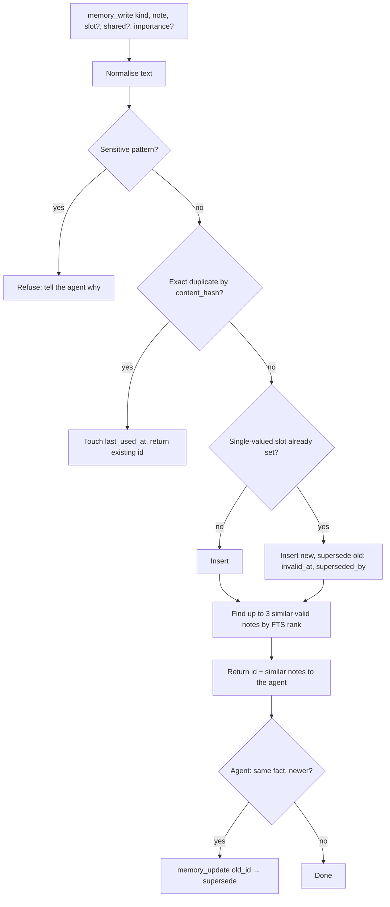

# Memory and context economy

Memory decides whether Kriya feels like it knows the person. Context
decides what every step costs. Both are designed together: the prompt is
assembled from small, budgeted, mostly cached blocks, and memory is typed,
dated and sourced, so the right few facts reach the model instead of
everything.

Decisions: AD-09 (Postgres, full-text first), AD-10 (reconcile and
consolidate, keep history), AD-11 (quarantine), AD-12 (cache layout and
budgets), AD-13 (summaries off the critical path), AD-26 (scopes).

## 1. What "good memory" means, measurably

| Property  | Meaning                                                                   | Metric (TEST_AND_EVALUATION §3)                           |
| --------- | ------------------------------------------------------------------------- | --------------------------------------------------------- |
| Recall    | The relevant fact reaches the model when needed                           | M1 recall@5 ≥ 0.90 on AS-MEM                              |
| Currency  | A changed fact replaces the old one; the old one is never used as current | M2 stale-fact answers = 0 on AS-MEM                       |
| Precision | The always-loaded block holds only what applies everywhere                | M3 ≥ 0.9 of always-on notes rated relevant                |
| Safety    | Injected or secret-shaped content never becomes trusted memory            | M4 quarantine bypass = 0; M5 sensitive-pattern writes = 0 |
| Control   | The person can see, edit, confirm and erase everything                    | UX + RLS tests                                            |
| Cost      | Fewer input tokens per task at equal quality                              | C1–C3 vs the A1 baseline                                  |

## 2. Kinds of memory

| Kind                                      | Example                                                   | Scope           | Loaded                                        |
| ----------------------------------------- | --------------------------------------------------------- | --------------- | --------------------------------------------- |
| `profile` (with a `slot`)                 | `profile.course` = "B.Tech CSE, 3rd year, JNTU Hyderabad" | Shared          | Always (profile card)                         |
| `preference`                              | "Short answers in Telugu-English"                         | Shared or agent | Always                                        |
| `instruction`                             | "Never schedule anything on Sundays"                      | Shared or agent | Always                                        |
| `fact`                                    | "Client Ravi pays within 15 days"                         | Shared or agent | Retrieved                                     |
| `decision`                                | "Chose Razorpay over Cashfree on 2026-10-02 because…"     | Agent           | Retrieved                                     |
| `relationship` (slot `contact.<name>`)    | "Priya Sharma — CA, priya@… (shared by the person)"       | Shared          | Retrieved                                     |
| Episode (table `episodes`)                | "Applied headline to LinkedIn, verified 14:32"            | —               | Retrieved when the question is about the past |
| Goal (table `goals`)                      | "Get an internship by March" + checklist                  | —               | Always (active goals, one line each)          |
| Thread summary (table `thread_summaries`) | Checkpoint of older turns                                 | —               | Always in that thread                         |
| Skill (table `skills`)                    | "Monthly GST summary"                                     | —               | Listed by name when the loadout has skills    |

Profile slots per role come from the role pack (ROLE_PLAYBOOKS.md). A slot is
single-valued unless it ends in `[]` (`profile.skills[]`). Writing a
single-valued slot supersedes the current value automatically.

## 3. Storage

`kriya.memories` gains columns (DATA_MODEL §2.1): `kind`, `slot`,
`trust` (`trusted` | `unconfirmed`), `importance` (1–3), `pinned`,
`valid_from`, `invalid_at`, `superseded_by`, `task_id`, `last_used_at`,
`use_count`, `content_hash`, and a generated
`search tsvector = to_tsvector('simple', coalesce(slot,'') || ' ' || content)`
with a GIN index. `agent_id` becomes nullable (null = shared).

Why `simple`: Indian users write in English, romanised Hindi or Telugu, and
native scripts. Language stemmers mangle romanised words. `simple`
lowercases and splits, which is predictable across all of them.

Why no separate memory service: personal data stays in our Postgres under
RLS (invariant 1), the person's erasure is one `delete`, and there is
nothing new to secure.

## 4. Write path



Rules (all enforced in `lib/memory/write.ts`, tested in AT-MEM-*):

1. **Sensitive patterns are refused**, not stored. Deterministic checks for:
   passwords and OTP phrases ("password is", "OTP"), card numbers (Luhn),
   Aadhaar-shaped 12-digit numbers (Verhoeff check), bank account plus IFSC
   pairs, CVV, UPI PINs. The refusal message tells the agent to keep such
   values out of memory. PAN and GSTIN are allowed only in the slots
   `profile.pan` and `profile.gstin`, and only when `source = 'user'`.
2. **Trust.** `unconfirmed` when the turn saw untrusted content before the
   write (`privateContentSeen` or any web/browser/file tool result in the
   step history), `trusted` otherwise. Notes the person writes are always
   trusted.
3. **Size.** Agent-written notes: 1–1000 characters, enforced in the write
   path (long notes are usually documents and belong in files). The
   database check stays at 2000. Narrowing it would fail on existing rows,
   and person-written notes keep the 2000 limit.
4. **Provenance.** `task_id` of the writing task. The thread, model and
   inputs are reachable from there.
5. **Who can delete.** `memory_forget` from an agent **invalidates** the note
   (it stays in history). The person's "Forget" **hard-deletes** the note and
   its superseded chain (erasure, DPDP).
6. **With `agents.memoryV2` off, nothing above applies.** The agent gets
   today's `memory_write` and `memory_forget` definitions and semantics
   (forget = delete), so the tool set stays byte-identical (AT-REG-01). The
   only always-on change is the loader filter `invalid_at is null and not
archived` (DATA_MODEL §2.1, AF-16).

## 5. Context assembly and budgets

`assembleContext` returns these blocks, in this order (AD-12). Token counts
are estimated as characters ÷ 4 (no tokenizer dependency). Budgets are
constants in `lib/memory/context.ts`, changed only through the improvement
loop (AD-25).

| #   | Block                                                               | Stability                                       | Budget (tokens) | Contents                                                                  |
| --- | ------------------------------------------------------------------- | ----------------------------------------------- | --------------- | ------------------------------------------------------------------------- |
| 1   | Identity, role pack, standing orders, capabilities, rules, language | Stable per agent                                | ≤ 2,000         | As today, minus the date                                                  |
| 2   | Profile card                                                        | Changes rarely                                  | ≤ 500           | Valid trusted `profile` slots, as `key: value` lines                      |
| 3   | Always-on notes                                                     | Changes rarely                                  | ≤ 600           | Trusted `preference` + `instruction` + pinned, newest first within budget |
| 4   | Now                                                                 | Changes daily                                   | ≤ 60            | Date and time in IST, the person's locale                                 |
| 5   | Goals                                                               | Changes weekly                                  | ≤ 300           | Active goals: title, next step, next check-in                             |
| 6   | Recalled notes                                                      | Per turn                                        | ≤ 800           | Top notes for this turn's query (§5.1), unconfirmed ones marked           |
| 7   | Recalled episodes                                                   | Per turn, only when the query is about the past | ≤ 400           | Top 3 episodes                                                            |
| 8   | Thread summary                                                      | Per checkpoint                                  | ≤ 800           | Present only after a checkpoint (§7)                                      |
| —   | Messages since checkpoint                                           | —                                               | Rest            | `compactContext` as today                                                 |

Blocks 1–3 form the cached prefix. Block 4 is deliberately after them, so the
date doesn't break the prefix each day.

Total memory overhead (blocks 2–8) is at most about 3,500 tokens. Today the
memory block alone can reach 12,000 characters (about 3,000 tokens) of
_every_ note regardless of relevance. The gain is relevance and, with long
threads, summaries. Don't claim savings until C1–C3 are measured.

### 5.1 Retrieval ranking

For each turn, the query is turned into tokens in TypeScript:

1. Lowercase it.
2. Split on anything that isn't a Unicode letter, combining mark or digit
   (`/[^\p{L}\p{M}\p{N}]+/u`). That removes every `to_tsquery` operator (`& | !
( ) : * '`), so user text can't cause a syntax error or change the query
   (AF-17). Marks must stay: Indic vowel signs are marks, and without them
   Hindi and Telugu words split apart (AF-23).
3. Drop a small English + Hinglish stop-word list.
4. Keep at most 12 distinct tokens.

The tokens are passed as **one bound parameter**, joined with `|`, to
`to_tsquery('simple', $1)`. No tokens means no FTS candidates, so block 6
gets only recency-ranked notes. The OR form was proven on PGlite with
romanised Telugu, Devanagari and English (DATA_MODEL §2.1). Candidates are
valid, not archived, same user, and shared or this agent's.

```text
score = 1.0 * ts_rank_cd(search, q, 32)        -- normalised rank, 0..1
      + 0.3 * exp(-days_since(last_used_at or updated_at) / 30)
      + 0.2 * (importance - 1) / 2
      + 0.2 * (agent_id = current agent)
      - 0.3 * (trust = 'unconfirmed')
```

**Matches first** (owner's decision, 2026-10-18, after AS-MEM measured M1 =
0.72): a note that shares a word with the question always ranks above one
that doesn't, and the score orders each group. Without it, a fresh
unrelated note (about 0.59 from recency and the agent bonus) beat an old
matching one (about 0.17 from the text term).

The top notes fill block 6 within its budget. One SQL query, no model call.
The weights are a starting point. A1 records M1 with them, and the
improvement loop changes them only with evidence.

The `memory_search(query, kinds?, include_history?)` tool lets the agent look
deeper on purpose (for example, older or superseded notes when asked "what
did I say before?").

### 5.2 Used-memory record

The ids injected into blocks 2, 3 and 6 are saved in the reply's metadata
(`KriyaMetadata.memoryIds`). The reply shows a "Used N memories" chip the
person can open. At task end, one batched update sets `last_used_at` and
`use_count`.

## 6. Token economy: techniques and how each is measured

| #   | Technique                                                                                                                                                                             | Where                     | Measured by                                                                                         |
| --- | ------------------------------------------------------------------------------------------------------------------------------------------------------------------------------------- | ------------------------- | --------------------------------------------------------------------------------------------------- |
| T1  | Cache-friendly prompt prefix (§5)                                                                                                                                                     | `instructions.ts` order   | C3 cache ratio = Σ`cached_tokens` / Σ`input_tokens` on the eval suite, for providers that report it |
| T2  | Tool loadouts: only the role pack's tools, connected accounts, and enabled capabilities                                                                                               | `run-task.ts` tool belt   | Tool-definition tokens per step (count once per loadout in the eval)                                |
| T3  | Thread summary checkpoints (§7)                                                                                                                                                       | maintenance job           | C1 input tokens per task on long-thread scenarios                                                   |
| T4  | Retrieval instead of all notes (§5.1)                                                                                                                                                 | `context.ts`              | C1, with M1 not worse                                                                               |
| T5  | Browser observations: accessibility snapshot, interactive and visible elements only, text capped, diff against the last snapshot; screenshots stored, not sent, unless the model asks | `lib/browser/snapshot.ts` | Tokens per browser step (AS-BRW suite)                                                              |
| T6  | Existing `compactContext` (6 full outputs, 600-char stubs), plus per-tool output caps                                                                                                 | `messages.ts`, tools      | — (existing)                                                                                        |
| T7  | Structured outputs for extraction (zod), not prose                                                                                                                                    | `lib/extract.ts`          | Output tokens per extraction                                                                        |
| T8  | Content-hash cache: a file with a known `sha256` reuses its extraction                                                                                                                | `kriya.files`             | Extraction calls avoided                                                                            |
| T9  | Budget tier for summaries, consolidation, extraction; escalation only on failure (existing)                                                                                           | maintenance, `models.ts`  | C2 cost per task                                                                                    |
| T10 | Skills replay without the model (AD-21)                                                                                                                                               | `lib/skills.ts`           | Model calls per replayed run                                                                        |
| T11 | Delegation briefs and `assign` results capped (existing `RESULT_CHARS`)                                                                                                               | existing                  | —                                                                                                   |

**Baseline first.** A1 starts by running the AS-CTX and AS-MEM suites with
today's code on the scripted model (token counts come from prompt sizes) and
records C1–C3. Targets for A1 exit: C1 −30 % on long-thread scenarios
(owner, 2026-10-18: on threads that reach a checkpoint), no
drop in M1, measured not estimated. If a target isn't met, record the number
and the reason. Don't round.

## 7. Thread summary checkpoints

- **Trigger:** after a task ends, if the thread's messages since the last
  checkpoint exceed 12,000 characters (lowered from 24,000 by the owner on
  2026-10-18 after AS-CTX: at 24,000 only 4 of 20 long threads got a
  checkpoint), insert a `maintenance_jobs` row
  (`thread_summary`). It's never a `kriya.tasks` row (AF-12).
- **Covers** everything except the last 6 person turns and their replies.
  The cut is always just before a `user` message (a turn boundary). It never
  falls inside an assistant reply, so a tool call is never separated from
  its result. A reply with an `approval-requested` or `approval-responded`
  part is never covered: the cut moves earlier (AF-20).
- **Format** (zod): `facts[]`, `decisions[]`, `open_questions[]`,
  `pending_actions[]`, `numbers[]` (every amount, date, id, URL kept
  verbatim). At most 3,200 characters.
- **Check (deterministic):** every amount (₹…), date and URL in the
  covered messages' **person** text must appear in `numbers[]` or the
  summary text. If not, the summary is rejected and retried once on the
  balanced tier. Failing again, no checkpoint is written (the thread costs
  more, but nothing is lost).
- **Use:** `loadMessages` stays unchanged. `run-task.ts` drops messages
  covered by the checkpoint from the model input and adds block 8. The
  person still sees the full thread.

## 8. Consolidation (nightly, maintenance)

1. **Exact duplicates** (same `content_hash`, same scope): keep the oldest,
   move use counts, invalidate the rest. No model.
2. **Slot conflicts** left by old data: the newest valid wins; others are
   superseded. No model.
3. **Near duplicates** (same kind, FTS similarity above a threshold, both
   agent-written): the budget model proposes one merged note. It's applied
   only if every number and name in both notes survives (deterministic
   check). Otherwise it goes to "New memories to review".
4. **Contradictions** with person-written notes are never auto-resolved; they
   go to review.
5. **Archive:** importance 1, not used for 180 days, agent-written → archived
   (excluded from retrieval, still searchable, never deleted automatically).

Cost cap per user per night: `agents.maintenanceCapMicroUsd`.

## 9. Episodes

Written by code at task end (`lib/agent/episodes.ts`) from the task's tool
executions. Fields: what was done (one line per verified R1–R4 execution),
what wasn't confirmed, files produced, goal id, cost. A one-line `summary` is
added by the maintenance job, on the budget tier. Episodes are searchable by
the same FTS and feed "What I did" (UX_SPEC.md §4).

Recall trigger for block 7: the query mentions the past ("last week", "did
you", "what happened", "earlier", "पिछले", "ముందు") or the thread is a
goal thread.

## 10. Embeddings (conditional, A9)

Only if M1 < 0.90 after A1 tuning. Then: pgvector on Supabase, the PGlite
extension verified (RG-8), and a nullable `embedding vector(…)` column with
the dimension of the chosen model, filled by a maintenance job through
OpenRouter `/embeddings`. Ranking becomes reciprocal-rank fusion of FTS and
vector ranks. Costs go to `resource_usage`. The eval must show M1 improving
by more than its noise before rollout.

## 11. What the person controls

- **About you** (Account): profile slots and shared notes; edit, pin, forget.
- **Agent memory** (each agent): as today, plus kind, trust and history.
- **New memories to review**: unconfirmed notes and merge proposals:
  confirm, edit or delete.
- **Export**: all memory as JSON (DPDP access).
- **Pause memory** per agent: `memory_write` and `memory_update` save
  nothing and say "memory is paused by the person". Stored in
  `agents.memory_paused` (migration `20261101000001_memory_pause`, owner's
  decision on AF-26).
