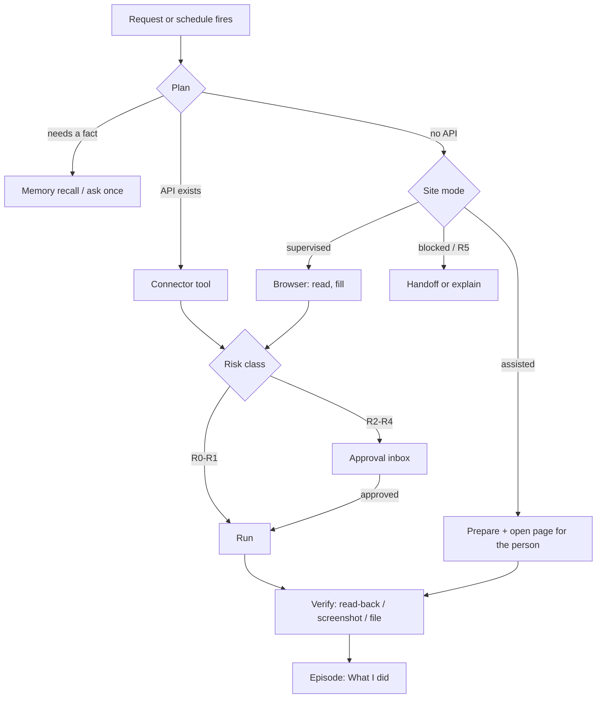

# Role playbooks

What each kind of person gets, workflow by workflow. The playbooks share one
engine; a role is a pack of templates, tools, profile slots and starter goals
(AD-14). Every workflow lists its **channel** (official API, browser mode, or
a document Kriya produces), its highest **risk class** (AD-03), and the
**phase** that makes it possible.

Workflow ids (`ST-`, `DV-`, `FD-`, `FL-`, `CR-`, `BZ-`) are used by the
evaluation scenarios in TEST_AND_EVALUATION.md.

## 0. What every team has

| Capability                                                                 | Phase         |
| -------------------------------------------------------------------------- | ------------- |
| Shared profile ("About you"), preferences, decisions, history              | A1            |
| Goals with check-ins; schedules and watchers; Approval inbox; "What I did" | A3            |
| Web research with citations (exists today)                                 | —             |
| Google Calendar, Gmail (read + drafts), Drive, Notion (exist today)        | —             |
| Files: upload a PDF, photo or sheet; get a PDF back                        | A5            |
| Browser with the person's login profiles, in the site's mode               | A4, A6        |
| Reminders as phone calls (voice track)                                     | Voice Phase 6 |

## 1. Student: "Vidya" team

**Team.** Vidya (study partner, exists), Disha (career and profile coach,
new), Khoj (scholarships, internships and admissions watcher, new).
**Profile slots:** institution, course and year, exam targets with dates,
subjects, skills, projects, certifications, career interests, languages,
city, LinkedIn/GitHub URLs.

| Id    | Workflow                                                                                                                           | Channel                                                                                                 | Risk                                | Phase      |
| ----- | ---------------------------------------------------------------------------------------------------------------------------------- | ------------------------------------------------------------------------------------------------------- | ----------------------------------- | ---------- |
| ST-01 | Build and maintain a LinkedIn profile (walk-through §1.1)                                                                          | Document + browser `assisted`                                                                           | R1 (Kriya side); the person applies | A1, A5, A6 |
| ST-02 | Resume/CV: collect facts, write an ATS-friendly resume, PDF, tailor per job                                                        | Document (AD-18)                                                                                        | R1                                  | A5         |
| ST-03 | Study plan by week, with study blocks put on Google Calendar                                                                       | Calendar API                                                                                            | R3                                  | A3         |
| ST-04 | Exam watcher: official notifications (JEE, NEET, GATE, CAT, UPSC, university portals); registration windows, admit cards, results  | Web read, schedule                                                                                      | R0                                  | A3         |
| ST-05 | Scholarship finder: National Scholarship Portal and state portals; eligibility checked against the profile; checklist of documents | Web read + document                                                                                     | R0/R1                               | A3         |
| ST-06 | Internship and job tracker: find openings matching skills, tracker of applications, tailored cover letters, follow-up drafts       | Web read, Gmail draft, Sheets (A8)                                                                      | R3                                  | A3, A8     |
| ST-07 | Apply to an internship                                                                                                             | Browser `assisted` (Internshala, Naukri, LinkedIn); `supervised` only for sites cleared by terms review | R4                                  | A6, A10    |
| ST-08 | Assignment research with citations; notes from Drive turned into flashcards and practice questions                                 | Drive + web                                                                                             | R0/R1                               | — / A5     |
| ST-09 | Mock interview by phone                                                                                                            | Voice track (owner call)                                                                                | —                                   | Voice      |
| ST-10 | Deadline reminders (fees, forms, exams)                                                                                            | Phone call reminder (AD-20)                                                                             | —                                   | Voice      |

### 1.1 Walk-through ST-01: "Create and maintain my LinkedIn profile"

What the person asked for: "create my LinkedIn account with my email, set a
password, fill everything, and keep it updated". What Kriya does, and why
each step is shaped this way:

1. **Interview and import (A1, A5).** Disha asks for missing profile slots
   one question at a time and reads the uploaded resume (`file_read`). Facts
   become **shared memory** with slots (`profile.education[0]`,
   `profile.skills`), so every agent can use them.
2. **Drafts (R1).** Disha writes a headline, About, experience and education
   entries, projects, certifications, and a skills list ordered by relevance
   to the stated career goal. Each section is checked against LinkedIn's
   current length limits, which are read from LinkedIn's help pages at run
   time, never from memory. Output: a profile pack (document + copy blocks),
   with a PDF version (A5).
3. **Account creation (person, in the live view, A6).** Kriya opens
   `linkedin.com/signup` in the live view (BROWSER_AND_LOGIN_PROFILES.md §5).
   The person types their email and a password; Kriya's UI can offer a
   strong password generated in **their** browser, never sent to Kriya
   (AD-04). LinkedIn's email code and any CAPTCHA are done by the person.
   Kriya never sees the password.
4. **Login profile (A6).** With the person's consent, the signed-in session
   is saved as a sealed login profile for `linkedin.com` (AD-05).
5. **Apply the profile (`assisted`, AD-06).** For each section Kriya opens
   the exact LinkedIn edit page in the live view and shows the copy-ready
   text beside it. The person pastes and saves. Kriya reads the public
   profile afterwards, in a read-only session, and marks each section
   **verified** when the page shows it. "What I did" then lists "Headline
   drafted; applied by you; verified on your profile at 14:32".
6. **Maintenance (goal, A3).** A goal "Keep my LinkedIn current" checks
   monthly: new projects (GitHub, A8), courses, results, events in Calendar.
   It drafts updates and puts them in the Inbox.

Why not let the agent click Save itself: LinkedIn's User Agreement §8.2
forbids bots and unauthorized automated methods, and LinkedIn restricts
accounts that use them (RESEARCH.md §4). Moving LinkedIn to `supervised` (agent
fills, person approves each Save) needs a terms review and the owner's
decision (AB-04). The design supports it without code changes: it's one
registry row.

## 2. Developer: "Arjun" team

**Team.** Arjun (engineer, exists), Setu (GitHub and release assistant, new),
Meera (research, exists).
**Profile slots:** languages, frameworks, repos, employer/OSS projects,
timezone, review preferences.

| Id    | Workflow                                                                     | Channel                                 | Risk               | Phase |
| ----- | ---------------------------------------------------------------------------- | --------------------------------------- | ------------------ | ----- |
| DV-01 | Daily digest of GitHub notifications, PRs waiting for review, failing checks | GitHub API (A8)                         | R0                 | A8    |
| DV-02 | PR review by reading the diff; comments drafted, posted on approval          | GitHub API                              | R4                 | A8    |
| DV-03 | Issue triage: labels and duplicate detection, proposed; applied on approval  | GitHub API                              | R4                 | A8    |
| DV-04 | Release notes and changelog from merged PRs                                  | GitHub API + document                   | R1 (R4 to publish) | A8    |
| DV-05 | Dependency and CVE watcher for the person's repos                            | GitHub API + web (advisories), schedule | R0                 | A8    |
| DV-06 | Standup or weekly report from commits, PRs and calendar                      | GitHub + Calendar                       | R1                 | A8    |
| DV-07 | Docs research, API comparison, migration plans with sources                  | Web                                     | R0                 | —     |
| DV-08 | Portfolio/README updates as a PR on the person's repo                        | GitHub API                              | R4                 | A8    |
| DV-09 | Run code, tests, builds                                                      | **Deferred** (AD-24)                    | —                  | —     |

## 3. Founder: "Your company" team

The founder asked for "employees": an accountant, an assistant, and others.
Each is an agent with its own memory and tools; the team works through
`assign`/`delegate`.

**Team.** Lekha (accounts: bills, ledger, GST, reports), Saathi (executive
assistant: calendar, mail, meeting prep), Meera (research), Kabir (sales and
proposals, exists), Tara (marketing, exists), Niyukti (hiring, new).
**Profile slots:** company name, legal form, GSTIN (if any), state (place of
supply), financial year, bank names (never numbers), team size, products,
customers, investors, CA's name and email.

| Id    | Workflow                                                                                                  | Channel                       | Risk  | Phase  |
| ----- | --------------------------------------------------------------------------------------------------------- | ----------------------------- | ----- | ------ |
| FD-01 | Accountant: bills in, ledger out (walk-through §3.1)                                                      | Files + ledger                | R1/R2 | A5, A7 |
| FD-02 | "Total bills this month / quarter, by category and vendor, GST input" with a PDF report                   | Ledger + document             | R1    | A7     |
| FD-03 | Payables and receivables: what's due, overdue invoices, follow-up drafts                                  | Ledger + Gmail draft          | R3    | A7     |
| FD-04 | Compliance calendar: GST, TDS and ROC due dates from official sources, read and dated; reminders by phone | Web read + voice              | R0    | A3     |
| FD-05 | Monthly investor update draft from ledger, metrics sheet and highlights                                   | Ledger + Sheets + Gmail draft | R3    | A7, A8 |
| FD-06 | Meeting prep: who, last emails, open items, one-page brief before each meeting                            | Calendar + Gmail + web        | R0    | A3     |
| FD-07 | Hiring: JD drafts, candidate tracker, interview scheduling on approval                                    | Document + Sheets + Calendar  | R3    | A8     |
| FD-08 | Competitor and market watch with sources, weekly                                                          | Web, schedule                 | R0    | A3     |
| FD-09 | Export for the CA: ledger CSV + bill PDFs + summary for the period                                        | Files + document              | R1    | A7     |

### 3.1 Walk-through FD-01: "Be my accountant"

1. The founder forwards or uploads bills (PDF or phone photo), or Lekha
   finds them in Gmail (`gmail_search "invoice OR bill newer_than:30d"`)
   and saves the attachments as files (A5).
2. Extraction (budget tier, vision-capable model) fills a zod schema:
   vendor, GSTIN, invoice number and date, line items, HSN/SAC, taxable
   value, CGST/SGST/IGST, total.
3. `lib/ledger.ts` (code, AD-16) recomputes: sum of lines, taxes, total. It
   checks the GSTIN format and checksum, catches a duplicate invoice number
   from the same vendor, and checks place of supply against IGST versus
   CGST+SGST. Anything that doesn't reconcile becomes `needs_review`, with
   the reason.
4. Entries are saved as `draft`. The founder confirms in one tap per batch
   (R1, undoable). Only confirmed entries count in reports.
5. "What's the total of bills this quarter?" `ledger_summary` returns totals
   computed by SQL in paise. The agent words the answer around those
   numbers and never computes them. `document_render` produces the PDF
   (AD-18) with every figure traceable to entries.
6. Kriya never pays, files returns or claims to give tax advice. Reports
   carry "Prepared by Kriya from your records. Review with your CA."

## 4. Freelancer: "Kabir" team

**Team.** Kabir (proposals and clients, exists), Lekha (invoices and
payments), Tara (portfolio and posts).
**Profile slots:** services, rates, GSTIN (if registered), state, payment
terms, portfolio links, platforms used.

| Id    | Workflow                                                                     | Channel                                                                             | Risk               | Phase  |
| ----- | ---------------------------------------------------------------------------- | ----------------------------------------------------------------------------------- | ------------------ | ------ |
| FL-01 | Job feed watcher: new matching jobs on the person's platforms, ranked by fit | Web read / browser read-only; schedule                                              | R0                 | A3, A4 |
| FL-02 | Proposal drafts tailored to each job, using portfolio memory                 | Document                                                                            | R1                 | A1     |
| FL-03 | Submit a proposal                                                            | Browser `assisted` (Upwork's terms reportedly need a human to send; RESEARCH.md §4) | R4                 | A6     |
| FL-04 | GST invoice: numbered, PDF, sent as a Gmail draft                            | Ledger + document + Gmail draft                                                     | R2 (numbering), R3 | A7     |
| FL-05 | Payment follow-ups at 7/15/30 days, as drafts the person sends               | Ledger + Gmail draft                                                                | R3                 | A7     |
| FL-06 | Client memory: contacts, rates agreed, preferences, history                  | Memory (shared, slot `client.<name>`)                                               | R1                 | A1     |
| FL-07 | Time and earnings summary per client and month                               | Ledger                                                                              | R1                 | A7     |
| FL-08 | Contract and SOW drafts from templates (marked "not legal advice")           | Document                                                                            | R1                 | A5     |

## 5. Creator: "Tara" team

**Team.** Tara (content, exists), Srota (research and trends, new), Lekha
(brand-deal invoices).
**Profile slots:** platforms and handles, niche, audience language, posting
cadence, voice samples, brand-deal rates.

| Id    | Workflow                                                                         | Channel                             | Risk | Phase  |
| ----- | -------------------------------------------------------------------------------- | ----------------------------------- | ---- | ------ |
| CR-01 | Content calendar for the month, in the creator's voice and language              | Document + Calendar                 | R3   | A3     |
| CR-02 | Scripts, captions, hooks, hashtags; Hinglish and regional scripts                | Model                               | R1   | —      |
| CR-03 | Publish a post or reel to Instagram (professional account) or a video to YouTube | Official APIs (A8)                  | R4   | A8     |
| CR-04 | Weekly analytics digest (reach, views, top posts)                                | Official APIs                       | R0   | A8     |
| CR-05 | Brand-deal inbox triage and reply drafts                                         | Gmail                               | R3   | —      |
| CR-06 | Media kit PDF from analytics and profile                                         | Document                            | R1   | A5, A8 |
| CR-07 | Comment reply drafts for the creator to post                                     | Official API read; the person posts | R1   | A8     |
| CR-08 | Trend research with source and date                                              | Web                                 | R0   | —      |

Not built: auto-like, auto-follow, auto-DM, engagement pods (AD-06).

## 6. Small business: "Dukaan" team

**Team.** Saathi (customer inbox), Lekha (accounts), Tara (marketing),
Meera (research).
**Profile slots:** business name, category, city, GSTIN, hours, products and
prices (sheet), delivery areas, return policy.

| Id    | Workflow                                                                       | Channel                                     | Risk | Phase    |
| ----- | ------------------------------------------------------------------------------ | ------------------------------------------- | ---- | -------- |
| BZ-01 | Customer email triage and reply drafts, from the price sheet and policy memory | Gmail + Sheets                              | R3   | A8       |
| BZ-02 | Sales and expense ledger, GST summary, monthly PDF                             | Ledger + document                           | R1   | A7       |
| BZ-03 | Invoices for customers (B2B with GSTIN)                                        | Ledger + document                           | R2   | A7       |
| BZ-04 | Stock sheet updates from bills (Sheets)                                        | Sheets write (A8)                           | R3   | A8       |
| BZ-05 | Offers and festival posts (Diwali, Pongal, Eid…) published via official APIs   | Instagram/YouTube                           | R4   | A8       |
| BZ-06 | Google Business Profile review replies                                         | Official API (later; needs access approval) | R4   | after A8 |
| BZ-07 | Supplier comparison with sources                                               | Web                                         | R0   | —        |

WhatsApp Business customer messaging is a separate channel design, not
in this plan (AD-20 forbids it as a reminder channel; a customer-messaging
channel needs its own decision).

## 7. Other

The general pack: Meera (research), Kabir (writing), Vidya (learning), plus
"build your own agent" (exists). All shared capabilities (§0) apply.

## 8. How a request becomes action (every role)

## 9. Where the signature features show up (SIGNATURE_FEATURES.md)

| Role           | Feature in daily use                                                                                                                                                                               |
| -------------- | -------------------------------------------------------------------------------------------------------------------------------------------------------------------------------------------------- |
| Student        | K4 Radar + K5/K6 for exam and scholarship dates (ST-04, ST-05); K9 kits for LinkedIn and internship portals (ST-01, ST-07); K8 share the study plan with a parent; K10 lite mode on a budget phone |
| Developer      | K3 undo a GitHub comment (DV-02); K5 watch a dependency's release page (DV-05); K1 receipts for what was posted where                                                                              |
| Founder        | K4 Radar for GST/TDS/ROC dates (FD-04); K8 share the quarter with the CA (FD-09); K2 ₹ caps on the team's monthly work; K7 cross-check on investor-update figures (FD-05)                          |
| Freelancer     | K2 quote before a proposal batch; K9 kits for Upwork (FL-03); K1 receipt as proof a follow-up draft was prepared (FL-05)                                                                           |
| Creator        | K3 undo where the API allows (RG-10); K5 watch brand-deal pages; K1 receipts for every publish (CR-03)                                                                                             |
| Small business | K4 Radar for GST returns and licence renewals; K8 share monthly accounts with the CA (BZ-02); K10 lite mode in the shop                                                                            |
