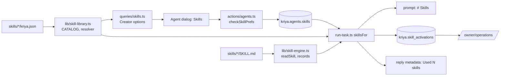

# Skill library (Skills Engine)

Curated instruction packs that teach an agent **how** to approach a kind of
work: planning, research, verification, recovery, the browser, cost,
security, spreadsheets, GST, calendar, GitHub and call follow-ups. Behind
`agents.skillLibrary` (default **off**). Built 2026-10-23.

> Not the same as A9 **skills** (`kriya.skills`, `lib/skills.ts`,
> `skill_run`): those are a turn's tool calls saved as a replayable
> procedure the person approves. Library skills are text; they never call a
> tool themselves. The two never share a table or a code path.

## 1. What a skill is and isn't

| Concept   | In Kriya                                                                                     |
| --------- | -------------------------------------------------------------------------------------------- |
| Skill     | Procedural guidance in `skills/<id>/SKILL.md`, loaded into the prompt when relevant          |
| Tool      | A capability in `lib/agent/tools.ts`, on the belt only if switches, plan and accounts allow  |
| Connector | An account in `lib/connectors.ts` (Google, Notion, GitHub, Meta)                             |
| Policy    | `lib/agent/policy.ts`: risk classes R0–R5, approvals, refusals; decided by code              |
| Agent     | `kriya.agents`: name, role, standing orders, tier, and now `skills` (assignments)            |
| Task      | `kriya.tasks`: one run with its budget, deadline, lease, events, `tool_executions` and now `skill_activations` |

A skill can only point at tools the task already has. It never adds a tool,
an account, a permission, an approval or a grant; it can't mark anything
complete; and it is placed after every platform section of the prompt, with
a preamble saying the person's orders, Kriya's rules and the real tools come
first.

## 2. How it connects



Lifecycle per task (`lib/agent/run-task.ts`, worker only):

1. **Discovery.** `CATALOG` is built once from the manifests; a malformed
   one throws at import, so tests and the build fail.
2. **Assignment.** Required skills ∪ the agent's `skills.on`, or, when
   `skills` is null (every agent created before this), the role's
   recommended defaults (`recommendedFor`).
3. **Eligibility (deterministic).** Retired, switched off by the owner
   (`skills.disabled`), missing tools on the **final** belt (after
   `operator.disabledTools`), or a dependency that can't run → skipped,
   with the reason recorded.
4. **Relevance.** `auto: true` (default): an optional skill loads only if a
   keyword (whole word, simple plural/tense) or, for the browser skill, a
   link is in **the person's latest message**. Tool results, pages, mail
   and earlier assistant text are never read. Two kinds of "user" message
   that Kriya writes are cut back to the person's words: a crew's join or
   brief (`channel: "crew"`, members' reports) counts as no text, and a
   watcher run counts only up to `The watched page changed:` (the page's
   diff follows it, `lib/watch.ts`). So untrusted content can't pull a
   skill in. `auto: false`: every assigned eligible skill loads.
   Required safeguards with `activation.always` load on every task.
5. **Activation.** Instructions are read from disk (`readSkill`) only for
   the selected skills, within the budget (`SKILL_LIMITS`: 5 skills, 12,000
   characters; required first, then manual, then auto). Dependencies load
   with their dependent or the dependent is skipped.
6. **Execution.** Normal: same tools, same `toolApproval`, same grants,
   same budget, deadline, heartbeat, cancellation and recovery.
7. **Record.** One `kriya.skill_activations` row per skill per agent per
   attempt (active or skipped, mode, reason, characters added). At settle
   the rows get the attempt's outcome. The reply's metadata lists the
   active skills and why ("Used N skills" under the reply).
8. **Verification.** Unchanged and authoritative: tool read-backs in
   `tool_executions.verification`, the claim check (`lib/agent/verify.ts`),
   job verdicts (`reviewMandates`). Join `skill_activations` to
   `tool_executions` on `task_id` for evidence per skill.

Resolution never throws into the task: a loader or resolver failure means no
skills for that agent, an error log (`skill resolution failed`), and skipped
rows saying "couldn't be loaded". The task runs as it would with the switch
off.

## 3. The curated library (v1.0.0)

| Skill                            | Required        | Needs (belt)                                     | Directs (risk from code)                  | Source                                                         |
| -------------------------------- | --------------- | ------------------------------------------------ | ----------------------------------------- | -------------------------------------------------------------- |
| `verification-before-completion` | yes, always on  | —                                                | — (R0)                                    | Superpowers 6.4.2 `verification-before-completion` (MIT)       |
| `security-untrusted-content`     | yes, always on  | —                                                | — (R0)                                    | Kriya; informed by ECC 2.2.3 `security-review` (MIT)           |
| `task-planning`                  | no, every role  | —                                                | — (R0)                                    | Superpowers 6.4.2 `writing-plans` (MIT)                        |
| `research-verification`          | no              | `web_search` or `web_fetch`                      | R0                                        | ECC 2.2.3 `search-first`, `documentation-lookup` (MIT)         |
| `debugging-recovery`             | no              | —                                                | — (R0)                                    | Superpowers 6.4.2 `systematic-debugging` (MIT)                 |
| `cost-aware-execution`           | no, every role  | —                                                | — (R0)                                    | Kriya (ECC 2.2.3 as installed has no cost skill)               |
| `browser-workflow`               | no              | `browser_open`, `browser_snapshot`, `browser_handoff` | R0 (commits are refused by policy)   | Kriya                                                          |
| `structured-data`                | no              | `sheets_read` or `file_read`                     | `sheets_append`, `sheets_update` (R3)     | Kriya                                                          |
| `gst-invoices`                   | no              | `ledger_list`, `ledger_draft_entry`, `invoice_draft` | R1                                    | Kriya                                                          |
| `calendar-operations`            | no              | `calendar_events`                                | `calendar_create_event` (R3)              | Kriya                                                          |
| `github-workflow`                | no              | `github_search`, `github_read_issue`, `github_read_pr` | `github_comment` … `github_open_pr` (R4) | Kriya                                                    |
| `voice-follow-up`                | no              | `propose_call`                                   | `propose_call` (no class: its own confirm flow, OF-12) | Kriya                                       |

Provenance was read from the installed copies, not assumed: Superpowers
`~/.claude/plugins/cache/anthropic-plugin-directory/superpowers/6.4.2-8ca22dba9a94`
(commit `8ca22dba9a`, MIT, © 2025 Jesse Vincent); ECC
`~/.claude/ecc/install-state.json` (`repoVersion` 2.2.3, `repoCommit`
`07971588f8…`, MIT per its `plugin.json`, repository
`https://github.com/affaan-m/ECC`). Only the wording of the principles was
adapted and rewritten for Kriya's tools; no file was copied, and nothing
that depends on Claude Code hooks, a terminal, subagents or commands was
carried over. Each adapted `SKILL.md` names its source in the frontmatter
and its `kriya.json` records project, version, commit, path, licence and URL.

Not built (no tool exists for them, so a skill would only describe
something Kriya can't do): a desktop/computer-use skill, form filling,
payments, filing returns, SMS/WhatsApp/email reminders.

## 4. Manifest (`kriya.json`) and versioning

Validated by `manifestSchema` (zod, strict: unknown fields are rejected).

| Field                         | Meaning                                                                                  |
| ----------------------------- | ---------------------------------------------------------------------------------------- |
| `id`                          | Stable, `^[a-z][a-z0-9-]{2,40}$`, equals the directory and the `SKILL.md` `name`        |
| `name`, `description`         | Shown in the Creator                                                                     |
| `version`, `previous`         | Semver; older versions live in `versions/<version>/SKILL.md` for a rollback pin         |
| `status`                      | `active` or `retired`                                                                    |
| `trust`                       | Only `curated` parses. There is no import path for external or user skills.             |
| `license`, `source[]`         | Licence and adapted-from provenance (empty = Kriya-native)                               |
| `required`                    | Always assigned; the person can't remove it                                              |
| `categories`, `roles`         | Roles: words in an agent's role that make it a recommended default (`*` = all)           |
| `activation`                  | `always` (required safeguards), `keywords`, `urls`                                       |
| `tools.all` / `.any` / `.uses`| Belt requirements; `uses` = other tools the instructions direct. Every backticked tool in `SKILL.md` must be declared (test). Risk = highest class among them, computed by `skillRisk` from `TOOL_CLASSES`; never declared |
| `dependsOn`                   | Other skill ids; unknown ids and cycles fail the catalogue                               |
| `prerequisites`               | What the person must set up, shown when tools are missing                                |
| `verification`                | How the outcome is verified, in Kriya's terms                                            |
| `limits.maxChars`             | Size cap for the instructions (≤ 6,000)                                                  |
| `evals[]`                     | Asks that must activate / skip it (run by the test suite)                                |

A skill directory (itself not a symlink) may contain only `SKILL.md`, `kriya.json`, `LICENSE`/
`NOTICE` (`.md`) and `versions/<semver>/SKILL.md`. `readSkill` refuses
anything else (scripts, binaries, symlinks), unsafe ids, versions not in the
manifest, missing frontmatter, a `name` mismatch and oversized bodies.
**Nothing in a skill is ever executed.** Running trusted skill scripts would
need a separate sandboxed design first.

## 5. The Creator (agent dialog)

With the switch on, `getSystemStatus().skills` (`queries/skills.ts`) lists
every active skill with its availability **for this person** (mirroring the
belt's switches, plan and connections; the worker checks again on every
task) and the dialog shows a **Skills** section:

- **Pick for each task** (`auto`): checked = only the relevant checked skills load;
  unchecked = all checked skills load every time, up to the 5-skill budget
  (says it costs more).
- **Always on**: required safeguards, lock icon, no checkbox.
- **Optional**: a named checkbox each, a "recommended" tag for the role,
  "Not available yet: <prerequisite>" or "Switched off by Kriya for now",
  and **details** (version, source, tools, risk, which tools wait for the
  person's approval).
- A new agent, or an existing one with no saved choice, shows its role's
  recommendations live as the role is typed. `skills` is saved only once
  the person changes something in the section; otherwise it stays null and
  the agent keeps following its role's recommendations, including skills
  added later. Ids Kriya has since retired drop out of a save instead of
  blocking it. With the switch off the section is absent and the server
  ignores any `skills` sent (`normalize` reads the switch).

`actions/agents.ts` validates through `checkSkillPrefs`: known, active,
curated ids only; no duplicates; strict shape; required ids dropped
(always on anyway). Writes go through `withUser` (RLS on `kriya.agents`).

## 6. Security boundaries (and their tests)

| Boundary                                                     | Enforced by                                                    | Test                                                                 |
| ------------------------------------------------------------ | -------------------------------------------------------------- | -------------------------------------------------------------------- |
| Skills never add tools                                       | Belt built before resolution; skills only read `Object.keys`   | `runner-skill-library`: "never adds a tool"                         |
| Missing tool or dependency → not loaded                      | `resolveSkills` eligibility                                    | `skill-library` resolution; `runner-skill-library` "skips a skill…" |
| Untrusted content can't pick skills                          | Only the person's latest message; crew joins and watcher diffs cut | `runner-skill-library` "only the person's latest message…", "a crew's join or a watched page's diff…" |
| Risk and approvals unchanged                                 | `TOOL_APPROVALS`/grants untouched; risk computed from code     | `skill-library` "risk is computed…"; existing policy suites         |
| Malformed / untrusted / executable skills rejected           | `manifestSchema`, `readSkill` audit                            | `skill-library` registry and loading                                 |
| Cross-tenant assignments and records                         | `kriya.agents` RLS; `skill_activations` select-own, no client writes | `tests/db/skill-library-rls.test.ts`; `agent-skills-actions`  |
| Prompt order: platform first                                 | `skillsBlock` appended last with a precedence preamble         | `runner-skill-library` (index of `# Untrusted content` < `# Skills`) |
| Failure is safe                                              | try/catch → no skills; skipped rows                            | `runner-skill-library` "a loader failure…"                          |
| No secrets or private text logged                            | Records hold ids, versions, reasons, sizes only               | Code review                                                          |

## 7. Cost and observability

A library skill costs nothing to exist. When it loads, its characters are
input tokens of the same model call, metered by the existing
`onLanguageModelCallEnd` → `recordUsage` → `chargeTask` path; nothing new is
charged. `skill_activations.chars` records what each skill added, so its
share of a task's input is measurable. Cost limits stay in code
(`costBudgetMicroUsd`, step budget, deadline); the cost skill only guides.

Owner views: **/owner/operations → Skills, last 7 days** (task attempts
that loaded or skipped each skill version, so a squad's agents count once;
the latest skip reason; outcomes, where a reply waiting for approval counts
as succeeded; average size). People
see "Used N skills" with the reasons under each reply. Logs: `skill
resolution failed`, `skill record failed`, `skill outcome failed`.

## 8. Working on skills

```bash
npx vitest run tests/agent/skill-library.test.ts   # registry, loader, resolver, evals
npx vitest run tests/agent/runner-skill-library.test.ts tests/agent/agent-skills-actions.test.ts \
  tests/agent/skill-options.test.ts tests/agent/skill-picker.test.ts tests/db/skill-library-rls.test.ts
npm run check                                       # before finishing
```

- **Add a skill:** create `skills/<id>/SKILL.md` (frontmatter `name: <id>`,
  `description:`) and `kriya.json`; import it in `skills/index.ts`; give it
  at least one activate and one skip eval; run the tests. Mention tools in
  backticks only if they exist and are declared.
- **Update a skill:** copy the current `SKILL.md` to
  `versions/<old version>/SKILL.md`, add the old version to `previous`, edit
  `SKILL.md`, bump `version`.
- **Disable for everyone:** `/owner/config` → `skills.disabled` (or
  `KRIYA_SKILLS_DISABLED`), e.g. `github-workflow`. Takes effect on the next
  task (settings cache ≤ 15 s). The person's assignment is kept.
- **Roll back a version:** `skills.pins` = `<id>@<previous version>`. An
  invalid pin makes the skill skip with "couldn't be loaded", never a
  failed task. Removing the pin returns to the current version.
- **Retire:** `status: "retired"`; existing assignments are skipped and new
  ones rejected.
- **Turn the whole library off:** `agents.skillLibrary` = off. Prompts are
  then byte-identical to before (AT-REG-01 snapshots), the Creator hides
  the section, and saved assignments stay in the database unused.

## 9. Database and deployment

Migration `supabase/migrations/20261202000000_skill_library.sql` (additive):
`kriya.agents.skills jsonb` (null default, object ≤ 4 KB) and
`kriya.skill_activations` (RLS, select-own, `server_only_writes` /
`server_only_changes` deny policies; writes by the worker only).
Rollback: `supabase/rollback/20261202000000_skill_library.down.sql` (drops
both; switch the library off first).

Rollout:

1. Apply the migration on staging (`npm run db:migrate` with
   `MIGRATION_DATABASE_URL` pointing at staging), then production in a
   normal deploy window. Additive; existing code ignores the new column.
2. Deploy web and worker together. The worker reads `skills/` from its
   working directory (repository root on Render: `npm run worker`).
3. Turn `agents.skillLibrary` on for staging; run the Creator check (§10)
   and a few real tasks; read **Skills, last 7 days**.
4. Production: switch on; watch the operations table and task failure rate
   for a day. Kill switches: `skills.disabled`, `skills.pins`, or the whole
   switch.

## 10. Known limitations

- Relevance is keyword-based (English plus words like "gst", "itc"); a
  Hindi or Telugu request may not pick an optional skill unless the agent's
  `auto` is off. Required safeguards load regardless. A model-assisted
  selector could be added later, but must only choose among eligible
  skills.
- Squad members working on an `assign` part get no library skills (their
  belt is memory + web only and they run 8 steps).
- The Creator's availability view mirrors the belt's switch logic in
  `queries/skills.ts`; the worker's check on the real belt is
  authoritative.
- `outcome` is the task attempt's end state, not a per-skill verdict;
  per-action evidence is in `tool_executions`.
- No external or user-uploaded skills, and no execution of skill scripts.
