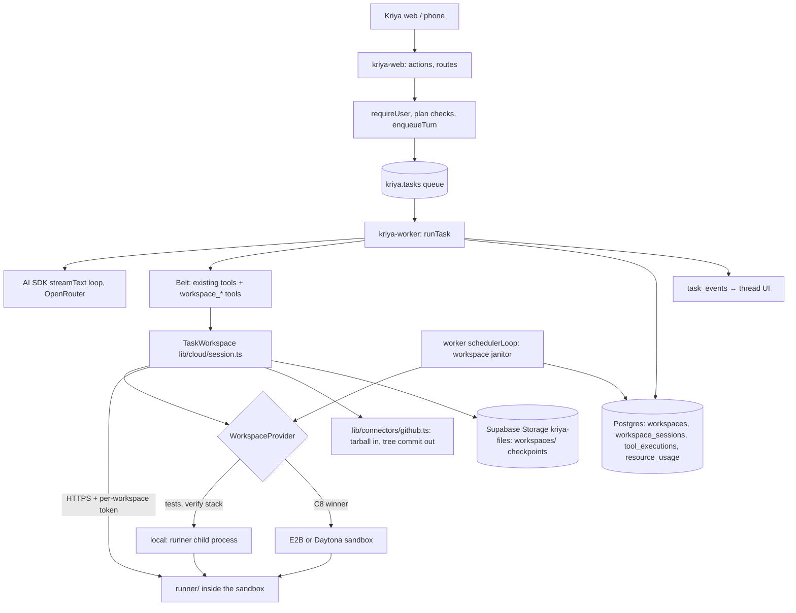
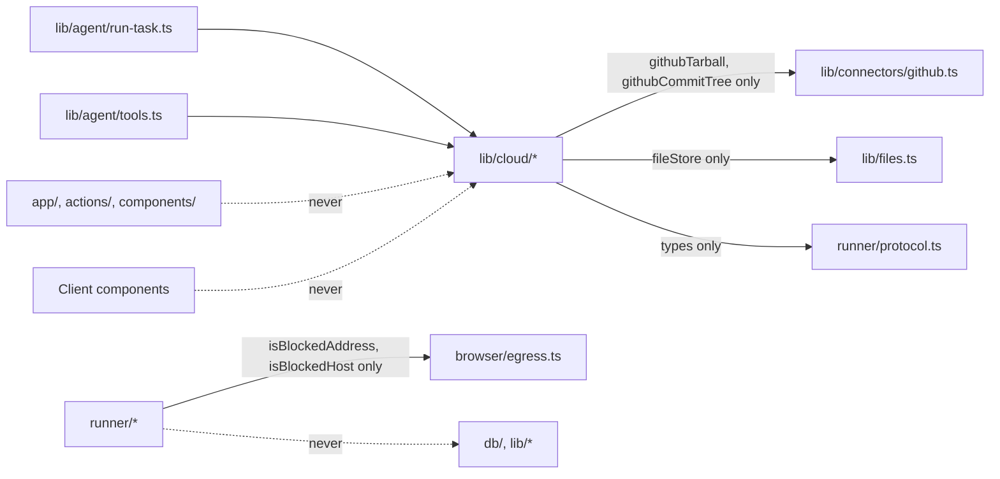

# Architecture (track C: cloud workspaces)

How a Kriya agent gets a cloud code workspace inside the existing product.
Decisions are in DECISIONS.md (CD-…); the baseline in REPOSITORY_AUDIT.md.

## 1. The integrated picture



What is new is small: one directory of worker-side modules
(`lib/cloud/`), one service directory that runs inside the sandbox
(`runner/`), one migration, and additive lines in the files listed in
CHANGE_IMPACT §3. Everything else (identity, queue, loop, model gateway,
approvals, Inbox, metering, UI shell) is the existing system.

## 2. Components

| Component | Path | Runs in | Responsibility |
| --- | --- | --- | --- |
| Runner | `runner/index.ts`, `runner/{protocol,exec,files,patch,search,changes,checkpoint,import}.ts` | The sandbox (Node 24 image) | Executes operations on `/workspace` for one workspace: commands, file reads and edits, patches, search, change sets, checkpoint and restore, tarball import. No database, no Kriya secret, bearer token only (CD-09) |
| Runner image | `runner/Dockerfile` | Provider template build | CD-21 |
| Provider interface | `lib/cloud/provider.ts` | Worker | `WorkspaceProvider` lifecycle (CD-05) |
| Adapters | `lib/cloud/providers/local.ts` (C3), `…/e2b.ts`, `…/daytona.ts` (C8) | Worker | Create/resume/pause/destroy/extend/list for one vendor; return the runner URL |
| Runner client | `lib/cloud/client.ts` | Worker | Typed HTTP client for the runner protocol, timeouts, NDJSON streaming; operation surface structurally compatible with AI SDK `Experimental_SandboxSession` |
| Task session | `lib/cloud/session.ts` (`TaskWorkspace`) | Worker | One task's workspace: lazy open, SQL session row, heartbeat, checkpoint + pause at the end, metering (CD-16) |
| Tools | `lib/cloud/tools.ts` → `createWorkspaceTools` re-exported from `lib/agent/tools.ts` | Worker | The `workspace_*` tools (TOOLS_AND_CONTRACTS §3) |
| Publish | `lib/cloud/publish.ts` + additive `githubTarball`, `githubCommitTree` in `lib/connectors/github.ts` | Worker | Import at an exact commit; one tree commit + draft PR (CD-09, CD-10) |
| Checkpoints | `lib/cloud/checkpoint.ts` | Worker | Upload/download patches to `kriya-files` under `workspaces/` (CD-13) |
| Janitor | `lib/cloud/janitor.ts`, one `try` block in `worker/index.ts` `schedulerLoop` | Worker | Orphaned sessions, paused-too-long sandboxes, retention, close requests, provider reconcile |
| Skill | `lib/cloud/skill.ts` | Worker | `cloud-coding` manifest and text, injected per task (CD-20) |
| Paths | `lib/cloud/paths.ts` | Worker and web | Pure helpers: checkpoint object path, sequence naming; the only `lib/cloud` module the web side may import (track H handoff, PX-02) |
| Person's reads | `queries/cloud.ts` (`withUser`) | Web | Workspace strip, usage line |
| Person's actions | `actions/cloud.ts` (`"use server"`, zod, `withUser`) | Web | "Close workspace" sets `close_requested_at` only |
| Owner page | `app/owner/cloud/page.tsx` (`requireOwner`) | Web | Running and paused workspaces, minutes, platform cost |
| UI | `components/thread/cloud-strip.tsx`, cases in `tool-call.tsx`, labels in `activity.tsx` | Browser | CD-18, UX_SPEC |

### Module boundaries (enforced by CT-IMP-01…03)



`runner/` imports only Node built-ins, `zod`, its own files and the two
egress predicates (CT-IMP-02). `lib/cloud/` is imported only by worker
code (`lib/agent/*`, `worker/index.ts`, its own tests); the web side reads
workspaces through `queries/` and never holds a provider key (CT-IMP-03).

## 3. A workspace task, end to end

```mermaid
sequenceDiagram
  participant P as Person
  participant K as runTask (worker)
  participant TW as TaskWorkspace
  participant DB as Postgres
  participant PR as Provider
  participant R as Runner
  participant G as GitHub (person's app token)
  P->>K: "Fix the failing date test in acme/web" (task claimed)
  K->>K: cloud.workspaces on, plan minutes > 0, provider set → belt has workspace_*
  K->>TW: workspace_open {repo: acme/web}
  TW->>DB: insert workspaces (status new) for this thread
  TW->>DB: open_workspace_session() — minutes, running cap, one open per workspace
  TW->>PR: create(image, size, network, token) → runner URL
  TW->>G: githubTarball(acme/web, default branch → sha)
  TW->>R: POST /v1/import (stream) → base commit
  TW->>DB: workspaces running, base_sha
  K->>TW: workspace_run "npm test" (streams tail every second)
  TW->>R: POST /v1/exec (NDJSON)
  K->>TW: workspace_read / workspace_edit / workspace_run …
  K->>TW: workspace_changes → changeSetId, files, +/−
  K-->>P: reply; asks to publish (approval card for workspace_publish)
  K->>TW: finally: close("end")
  TW->>R: POST /v1/checkpoint → patch
  TW->>DB: upload to storage; workspaces.checkpoint_*; status paused
  TW->>PR: pause
  TW->>DB: session closed, seconds; resource_usage workspace_seconds
```

Every `workspace_*` call is also an ordinary tool call: `onToolExecutionStart`
and `onToolExecutionEnd` write its `tool_executions` row, the stream reaches
the thread through `task_events`, and "What I did" derives from it.

### 3.1 Approval and publish

1. The turn ends on the `workspace_publish` approval (it is R4, so
   `TOOL_APPROVALS` asks); the Inbox lists it; the sandbox is paused with a
   checkpoint.
2. The person approves; `enqueueApproval` starts a new task in the thread.
3. The tool runs: `TaskWorkspace` resumes the same sandbox (or restores it
   from the checkpoint), asks the runner for the current change set, and
   compares its sha256 with the approved `changeSetId`. A mismatch refuses
   with "The workspace changed after you approved; review the new changes."
4. `githubCommitTree` creates blobs, a tree on `base_sha`, one commit and a
   new branch `kriya/<name>`; a draft PR is opened into the base branch and
   read back; the result carries a `verification` (`api_readback`).
5. The task that ran it has a side effect, so it is never retried
   (`recover_tasks`, invariant 5).

### 3.2 Resume after the sandbox is gone

When `workspaces.status = paused` but the provider says the sandbox no
longer exists (destroyed after `cloud.pausedHours`, or lost), `TaskWorkspace`
increments `generation`, creates a fresh sandbox, imports the tarball at
`base_sha` (same commit, so the same tree), and applies the latest
checkpoint. Ignored files (dependencies, builds) are reinstalled by the
agent when a command needs them; the state line in the prompt says the
workspace was restored.

### 3.3 Interruptions

| Event | What happens | Bound |
| --- | --- | --- |
| Person cancels | Heartbeat sees `cancel_requested`, the controller aborts, the runner kills the command's process group, `close("canceled")` checkpoints and pauses | Heartbeat 5 s + kill grace 5 s + checkpoint timeout 30 s |
| Deadline or budget | Same as cancel with that stop reason | Same |
| Worker deploy (`SIGTERM`) | `close("shutdown")` pauses without checkpoint (fast); task released; recovery requeues it (no side effect); next attempt resumes the same sandbox. Uses one attempt (CF-04) | Shutdown grace 25 s |
| Worker crash | No `close`. The session's `heartbeat_at` goes stale; the janitor checkpoints and pauses it, meters to the last heartbeat; recovery requeues the task | `cloud.orphanSeconds` (120 s) + janitor cadence (30 s) |
| Sandbox dies mid-task | The runner call fails; the tool returns an error the model sees; the next workspace call restores from the last checkpoint (§3.2) with `generation + 1`. Work since the last checkpoint is lost and said so | One tool call |
| Provider outage | `workspace_open` / resume fails with a clear message; the rest of the belt still works | — |
| Plan minutes used up | `open_workspace_session` raises; the tool says "This month's cloud workspace minutes are used up." | Before any spend |

## 4. The lines `runTask` gains

Kept to the browser's pattern so a reviewer can line them up
(CHANGE_IMPACT §3 has the exact rows):

1. With the other settings: read `cloud.workspaces`; if on, the plan has
   `workspaceMinutes > 0` and `workspaceProvider()` returns an adapter,
   build `new TaskWorkspace(provider, task, settings)`; else `null`.
2. Heartbeat: after `await browser?.heartbeat()`, `await workspace?.heartbeat()`.
3. Capabilities: `...(workspace && { workspace: await workspace.describe() })`,
   one line from the database row (no provider call). Absent when off, so
   the prompt is byte-identical (CT-REG-01).
4. Belt: `...(workspace ? createWorkspaceTools(env, workspace, { publish }) : {})`
   after the browser tools. Members of `assign` get none (CD-19).
5. Skills: with a workspace, the `cloud-coding` injection (CD-20) next to the
   Skill Studio block.
6. `finally`: `await workspace?.close(stopReason).catch(log)` after the
   browser close.

Nothing else in `runTask` changes: approvals come from `TOOL_CLASSES`
(`workspace_publish` R4), side effects from `SIDE_EFFECT_TOOLS`, records from
the existing hooks, retries from the existing rule.

## 5. State the model sees

The workspace line in the instructions (`lib/agent/instructions.ts`,
`Capabilities.workspace?`):

> - **Cloud workspace.** You have a workspace for this thread: acme/web at
>   a1b2c3d (main), 3 files changed since then, paused 2 hours ago. Use the
>   workspace_ tools to look, edit and run commands there; nothing leaves it
>   until the person approves `workspace_publish`. Say a test passed only
>   when a workspace_run result shows it.

Before a workspace exists the line says the thread has none and
`workspace_open` makes one. Outputs from the workspace carry `FOREIGN` and
count as private content (CD-11).

## 6. Capacity and cost shape

| Resource | Bound | Where |
| --- | --- | --- |
| Running sandboxes, platform-wide | `cloud.maxRunning` (3) | `open_workspace_session` |
| Running sandboxes per person | One per task; tasks per person by `max_concurrent_tasks` | `claim_task`, unique open session per workspace |
| Compute per task | Task deadline (`max_task_seconds` ≤ 7200) | `runTask` |
| Compute per month | `plans.workspace_minutes` | `open_workspace_session` |
| One command | `cloud.commandTimeoutSeconds` (600, ≤ 1800) | runner |
| Import size | `cloud.maxImportMb` (200) | worker stream + runner |
| Checkpoint size | `cloud.maxCheckpointMb` (50) | runner |
| Worker slots | `WORKER_CONCURRENCY` (4) held for the turn | `worker/index.ts` |

Worker slots are the first capacity limit for long code turns: a 20-minute
turn holds one of four slots while mostly waiting on the model and the
runner. Raising `WORKER_CONCURRENCY` or adding worker instances is the lever;
measured in C10 (EVALUATION_PLAN M8).

## 7. Failure modes and their handling

| Failure | Detection | Handling | Test |
| --- | --- | --- | --- |
| Runner unreachable after create | Health probe with deadline | Destroy the sandbox; session `failed` with its measured seconds (metered like any session); workspace back to `paused` or `failed` (TOOLS_AND_CONTRACTS §4 step 5); tool error | CT-WS-06 |
| Import too big or bad archive | Size counter, tar listing check | Refuse, nothing extracted; workspace failed with reason | CT-RUN-14, CT-RUN-15 |
| Path traversal in a tool path or archive | Runner resolves inside `/workspace` | Refuse | CT-RUN-12 |
| Edit without a read, or stale read | P4 rule | Refuse with "read it again" | CT-RUN-06 |
| Huge output | Byte caps | Head + tail + log path | CT-RUN-03 |
| Hung command | Timeout | Kill group, "timed out" result | CT-RUN-04 |
| Checkpoint upload fails | Storage error | Keep sandbox paused (not destroyed) and mark `checkpoint_failed_at`; janitor retries; the sandbox is never destroyed without a checkpoint newer than the last change | CT-CKP-03 |
| Provider orphan (sandbox without a row) | Janitor `list()` reconcile | Destroy | CT-JAN-03 |
| Row without a sandbox | Provider says unknown | Restore path (§3.2) | CT-CKP-02 |
| Change set drifted after approval | Hash compare | Refuse publish | CT-PUB-02 |
| Person deleted account | Rows cascade | Janitor reconcile destroys sandboxes and deletes `workspaces/<user_id>/` objects | CT-JAN-04 |
