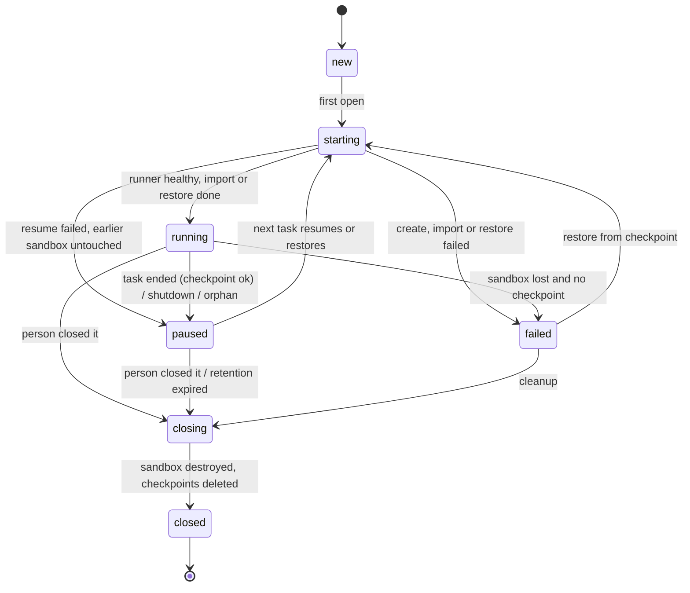

# Data model and state machines (track C)

One migration, `supabase/migrations/20270201000000_cloud_workspaces.sql`, with
its rollback `supabase/rollback/20270201000000_cloud_workspaces.down.sql`
(phase C1). Track C claims the `202702DDhhmmss` range on the coordination
board; it sorts after every existing migration (last today:
`20270103000000_skill_studio.sql`).

## 0. Rules (from AGENTS.md and the existing migrations)

1. Tables in `kriya`, RLS enabled, at least one policy each (`tests/db/lint.test.ts`
   keeps "0 RLS tables without a policy" and "0 unpinned functions").
2. Functions `set search_path = ''`, every name schema-qualified; revoke from
   `public, anon, authenticated` unless the person calls them.
3. Postgres holds metadata, ownership, state and money; bytes go to Storage
   (brief §7.2). No code, logs, archives or patches in a table.
4. Money in micro-USD `bigint`, null when unpriced (invariant 6).
5. Status changes only along `kriya.allowed_transitions` (entity `workspace`),
   checked by the existing `kriya.check_transition()` trigger.
6. Add-only: no applied migration, existing column or existing check is
   changed except the `resource_usage` kind list, which is widened by
   drop-and-recreate exactly as `20270103000000_skill_studio.sql` did.
7. `db/schema.ts` mirrors the SQL in the same phase.

## 1. `kriya.workspaces`

One durable workspace per thread at a time. Survives every sandbox.

```sql
create table kriya.workspaces (
  id uuid primary key default gen_random_uuid(),
  user_id uuid not null references auth.users (id) on delete cascade,
  -- The thread it serves; a deleted thread leaves the row for the janitor
  thread_id text,
  -- The agent that opened it (provenance; squads share the thread's workspace)
  agent_id text,
  -- owner/name, the lib/connectors/github.ts REPO pattern; null = blank workspace
  repo text check (repo ~ '^[A-Za-z0-9-]{1,39}/[A-Za-z0-9._-]{1,100}$'),
  base_ref text check (char_length(base_ref) <= 100),
  base_sha text check (base_sha ~ '^[0-9a-f]{40}$'),
  provider text not null check (provider in ('local', 'e2b', 'daytona')),
  -- The provider's sandbox id; not a secret, never shown to the person
  provider_ref text check (char_length(provider_ref) <= 200),
  image text not null check (char_length(image) between 1 and 200),
  size text not null check (size ~ '^[1-8]c-[1-9][0-9]?g$'),
  network text not null default 'registries' check (network in ('registries', 'offline')),
  status text not null default 'new'
    check (status in ('new', 'starting', 'running', 'paused', 'closing', 'closed', 'failed')),
  -- +1 for every fresh sandbox (create or restore); part of the runner token
  generation integer not null default 0 check (generation >= 0),
  -- Latest checkpoint in kriya-files: workspaces/<user_id>/<id>/<generation>-<seq>.patch
  checkpoint_path text check (char_length(checkpoint_path) <= 300),
  checkpoint_sha256 text check (checkpoint_sha256 ~ '^[0-9a-f]{64}$'),
  checkpoint_bytes bigint check (checkpoint_bytes >= 0),
  checkpoint_at timestamptz,
  checkpoint_seq integer not null default 0 check (checkpoint_seq >= 0),
  -- Set when an upload failed; the sandbox is never destroyed while set
  checkpoint_failed_at timestamptz,
  -- For the strip: { files, added, removed } since base, written by code
  changes jsonb check (changes is null or jsonb_typeof(changes) = 'object'),
  -- The person asked to close it (their only write, column grant below)
  close_requested_at timestamptz,
  error text check (char_length(error) <= 500),
  last_active_at timestamptz not null default now(),
  created_at timestamptz not null default now(),
  updated_at timestamptz not null default now(),
  closed_at timestamptz,
  foreign key (thread_id, user_id) references kriya.threads (id, user_id) on delete set null (thread_id)
);
create unique index workspaces_one_open_per_thread on kriya.workspaces (thread_id)
  where status not in ('closed', 'failed');
create index workspaces_user_idx on kriya.workspaces (user_id, last_active_at);
create index workspaces_janitor_idx on kriya.workspaces (status, last_active_at);
create trigger touch before update on kriya.workspaces
  for each row execute function kriya.touch_updated_at();
create trigger workspace_transition before update of status on kriya.workspaces
  for each row when (old.status is distinct from new.status)
  execute function kriya.check_transition('workspace');
```

Notes, each checked against existing code:

- `on delete set null (thread_id)` needs Postgres ≥ 15 (voice B10, resolved:
  the project runs 17; PGlite in tests supports it, as the voice migration
  already uses the form).
- `threads` has the composite key `(id, user_id)` that tasks already
  reference (`kriya_core.sql`).
- `agent_id` has no foreign key: agents can be deleted while the workspace
  history stays (as `tasks.agent_id`).

## 2. `kriya.workspace_sessions`

One row per running interval of a sandbox, the browser-session pattern.

```sql
create table kriya.workspace_sessions (
  id uuid primary key,
  workspace_id uuid not null references kriya.workspaces (id) on delete cascade,
  user_id uuid not null references auth.users (id) on delete cascade,
  task_id uuid references kriya.tasks (id) on delete set null,
  provider text not null check (provider in ('local', 'e2b', 'daytona')),
  generation integer not null check (generation >= 0),
  status text not null default 'open' check (status in ('open', 'closed', 'failed')),
  opened_at timestamptz not null default now(),
  heartbeat_at timestamptz not null default now(),
  closed_at timestamptz,
  seconds integer check (seconds >= 0),
  close_reason text check (close_reason in
    ('end', 'canceled', 'deadline', 'budget', 'shutdown', 'lease_lost', 'orphan', 'error', 'closed'))
);
create unique index workspace_sessions_one_open on kriya.workspace_sessions (workspace_id)
  where status = 'open';
create index workspace_sessions_open_idx on kriya.workspace_sessions (status, heartbeat_at);
create index workspace_sessions_user_idx on kriya.workspace_sessions (user_id, opened_at);
-- Covers the task foreign key (the P-2 advisor finding class)
create index workspace_sessions_task_idx on kriya.workspace_sessions (task_id);
```

## 3. Plan column and usage kinds

```sql
-- Conservative: no plan gets workspaces until the owner sets minutes (CD-14)
alter table kriya.plans
  add column workspace_minutes integer not null default 0 check (workspace_minutes >= 0);

alter table kriya.resource_usage drop constraint resource_usage_kind_check;
alter table kriya.resource_usage add constraint resource_usage_kind_check check (kind in (
  'browser_seconds', 'pdf_render', 'storage_bytes', 'embedding_tokens',
  'maintenance_model', 'web_fetch', 'skill_design',
  'workspace_seconds', 'workspace_storage_bytes'
));
```

`workspace_storage_bytes` records checkpoint bytes stored (one row per
checkpoint, `request_key = workspace-ckpt:<workspace>:<generation>-<seq>`)
so the owner sees storage growth; unpriced unless a rate is entered later.

## 4. Opening a session (limits in SQL)

```sql
-- Called by the worker only, before the provider is asked for compute.
-- Refuses when the IST month's metered seconds plus the running sessions'
-- elapsed time reach the plan's minutes, when the platform cap of running
-- sandboxes is reached, or when the workspace already has an open session
-- (the unique index). Unlike the browser function, open sessions count.
create function kriya.open_workspace_session(
  p_id uuid, p_task uuid, p_workspace uuid, p_provider text, p_max_running integer
) returns void language plpgsql set search_path = '' as $$
declare
  v_user uuid;
  v_minutes integer;
  v_used bigint;
  v_generation integer;
begin
  select t.user_id, p.workspace_minutes into v_user, v_minutes
    from kriya.tasks t join kriya.plans p on p.id = t.plan_id
    where t.id = p_task;
  if v_user is null then
    raise exception 'workspace session for an unknown task';
  end if;
  select w.generation into v_generation from kriya.workspaces w
    where w.id = p_workspace and w.user_id = v_user
    for update;
  if v_generation is null then
    raise exception 'workspace session for another person''s workspace';
  end if;
  -- One lock for the platform-wide count, so two workers can't both pass it
  perform pg_advisory_xact_lock(hashtext('kriya.workspace_sessions'));
  if (select count(*) from kriya.workspace_sessions where status = 'open') >= p_max_running then
    raise exception 'cloud workspaces are all busy';
  end if;
  select coalesce(sum(quantity), 0) into v_used from kriya.resource_usage
    where user_id = v_user and kind = 'workspace_seconds'
      and created_at >= (date_trunc('month', now() at time zone 'Asia/Kolkata') at time zone 'Asia/Kolkata');
  v_used := v_used + coalesce((select sum(extract(epoch from now() - opened_at))::bigint
    from kriya.workspace_sessions where user_id = v_user and status = 'open'), 0);
  if v_used >= v_minutes::bigint * 60 then
    raise exception 'cloud workspace minutes used up for this month';
  end if;
  insert into kriya.workspace_sessions (id, workspace_id, user_id, task_id, provider, generation)
    values (p_id, p_workspace, v_user, p_task, p_provider, v_generation);
end $$;
revoke all on function kriya.open_workspace_session(uuid, uuid, uuid, text, integer)
  from public, anon, authenticated;
```

`TaskWorkspace` maps the three messages to plain sentences, as
`TaskBrowser` does for "browser minutes" (`lib/browser/session.ts`):
"This month's cloud workspace minutes are used up.", "Cloud workspaces are
busy right now; try again in a few minutes.", "The workspace couldn't be
started for this task."

## 5. State machine



```sql
insert into kriya.allowed_transitions (entity, from_status, to_status) values
  ('workspace', 'new', 'starting'),
  ('workspace', 'starting', 'running'),
  ('workspace', 'starting', 'failed'),
  ('workspace', 'starting', 'paused'),
  ('workspace', 'running', 'paused'),
  ('workspace', 'running', 'failed'),
  ('workspace', 'running', 'closing'),
  ('workspace', 'paused', 'starting'),
  ('workspace', 'paused', 'closing'),
  ('workspace', 'failed', 'starting'),
  ('workspace', 'failed', 'closing'),
  ('workspace', 'closing', 'closed');
```

`failed` is resumable only when a checkpoint exists or the workspace is
blank; `TaskWorkspace` checks that before moving `failed → starting`.

## 6. Access

```sql
alter table kriya.workspaces enable row level security;
alter table kriya.workspace_sessions enable row level security;

create policy read_own on kriya.workspaces for select to authenticated
  using (user_id = (select auth.uid()));
create policy close_own on kriya.workspaces for update to authenticated
  using (user_id = (select auth.uid())) with check (user_id = (select auth.uid()));
grant select on kriya.workspaces to authenticated;
-- The person's only write: asking to close (the worker does the rest)
grant update (close_requested_at) on kriya.workspaces to authenticated;

create policy read_own on kriya.workspace_sessions for select to authenticated
  using (user_id = (select auth.uid()));
grant select on kriya.workspace_sessions to authenticated;
```

Writes besides `close_requested_at` come from the worker through
`privileged`, always filtered by `user_id` (invariant 1). Tools never write
`close_requested_at`: `PERSON_ONLY_WRITES += "workspaces.close_requested_at"`.

`TOOL_WRITES` rows (AT-POL-07, which requires a row for every classified tool):

| Tool | Writes |
| --- | --- |
| `workspace_open` | `workspaces+`, `workspaces.status:starting\|running\|paused\|failed`, `workspaces.base_sha`, `workspaces.generation`, `workspaces.provider_ref`, `workspaces.error`, `workspace_sessions+` |
| `workspace_run`, `workspace_read`, `workspace_list`, `workspace_search`, `workspace_changes`, `workspace_write`, `workspace_edit`, `workspace_patch` | `workspace_sessions+`, `workspaces.status:starting\|running\|paused\|failed`, `workspaces.generation`, `workspaces.provider_ref`, `workspaces.error`, `workspaces.last_active_at`, `workspaces.changes` (a call may start, resume or restore the sandbox; `paused` is a failed resume) |
| `workspace_publish` | Same as the row above (it may resume the sandbox); GitHub itself is outside Kriya's tables |

Pausing, checkpoint columns and session closing are written by
`TaskWorkspace.close` and the janitor (code, not tools).

## 7. Retention

| Data | Kept | Removed by |
| --- | --- | --- |
| Provider sandbox | While running; paused up to `cloud.pausedHours` (24) | Janitor `destroy` (after a successful checkpoint) |
| Checkpoints in Storage | Latest two per workspace while open | Janitor after a newer one uploads; all on close |
| `workspaces` row | For history after `closed` | Account deletion (cascade) |
| Workspace unused | `cloud.retentionDays` (14) after `last_active_at` | Janitor → `closing` → `closed` |
| `workspace_sessions` | With the workspace | Cascade |
| `resource_usage` rows | As today (platform ledger) | Not deleted |
| Runner logs inside the sandbox | Sandbox lifetime | Destroyed with it |

## 8. Rollback (`20270201000000_cloud_workspaces.down.sql`)

```sql
delete from kriya.allowed_transitions where entity = 'workspace';
drop function if exists kriya.open_workspace_session(uuid, uuid, uuid, text, integer);
drop table if exists kriya.workspace_sessions;
drop table if exists kriya.workspaces;
delete from kriya.resource_usage where kind in ('workspace_seconds', 'workspace_storage_bytes');
alter table kriya.resource_usage drop constraint resource_usage_kind_check;
alter table kriya.resource_usage add constraint resource_usage_kind_check check (kind in (
  'browser_seconds', 'pdf_render', 'storage_bytes', 'embedding_tokens',
  'maintenance_model', 'web_fetch', 'skill_design'
));
alter table kriya.plans drop column if exists workspace_minutes;
```

Before running the rollback on a real project: switch `cloud.workspaces`
off, let the janitor close every workspace (destroying sandboxes and
checkpoints), then roll back. The rollback deletes the workspace usage
rows because the old check would reject them; export them first if the
owner wants the history (runbook).

## 9. SQL tests (`tests/db/cloud-rls.test.ts`, C1)

| Id | Assertion |
| --- | --- |
| CT-DB-01 | Person B can't select, update or see person A's workspaces or sessions; A can update only `close_requested_at` (other columns: permission denied) |
| CT-DB-02 | Every listed transition passes; `new → running`, `closed → starting`, `paused → running` raise |
| CT-DB-03 | `open_workspace_session` refuses at the plan's minutes, counting closed seconds and open sessions' elapsed time, per IST month |
| CT-DB-04 | It refuses at `p_max_running`; two concurrent calls with one slot left: exactly one succeeds |
| CT-DB-05 | It refuses another person's workspace and a second open session for one workspace |
| CT-DB-06 | Migration down then up on PGlite leaves the schema identical; older migration cases still pass (`tests/db/migrations.test.ts` rolls track C back first) |
| CT-DB-07 | `lint.test.ts` stays at zero (functions pinned, policies present) |
