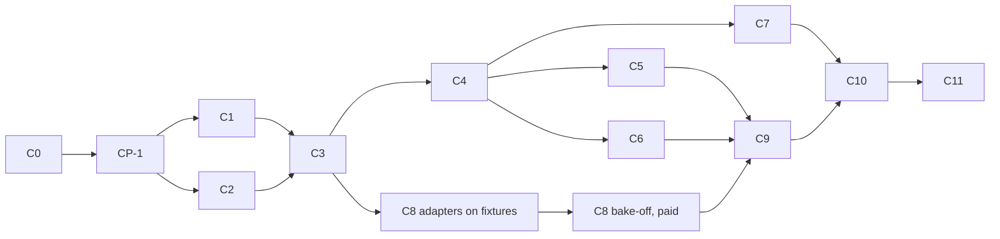

# Implementation plan (track C)

Phases, the order and lanes they may run in, the files each holds, exit
checks, configuration, rollout and rollback. The brief's vertical slice
(§13.7) is C1→C10; its Phase 3 ideas beyond the slice are C12+ (deferred).

## 1. Phases

| Phase | Name | Depends on | Decisions (approved first) | Holds (existing files) | Exit checks |
| --- | --- | --- | --- | --- | --- |
| C0 | Blueprint and decisions | — | — | `AGENTS.md`, `status.md` | (1) documents consistent (REAUDIT.md); (2) `npm run format:check` passes; (3) owner marks CD-01…CD-25 under "Track C owner approvals" (owner-gated ones by id) |
| CP-1 | Baseline re-check; docs truth | C0 | CD-25 | `docs/kriya/status.md`, `docs/kriya/architecture.md` | `npm run check` exit 0, counts ≥ baseline; CF-01, CF-02 rows corrected |
| C1 | Data model (one migration) | CP-1 | CD-14, CD-15 | `db/schema.ts`, `tests/db/migrations.test.ts`, `lib/config.ts` | CT-DB-01…07 pass; migration down+up on PGlite; `lint.test.ts` zero; settings block parses; CT-REG-01 (settings part) |
| C2 | Runner service, protocol, image, ports | CP-1 | CD-03, CD-05, CD-12, CD-21, CD-22 | none (new files only; `NOTICE.md` new) | CT-RUN-01…19, CT-IMP-02 pass; image builds locally (`docker build -f runner/Dockerfile .`, owner machine if Docker is missing, OB-06); SBOM produced; port headers and `NOTICE.md` present |
| C3 | Provider boundary, `local` adapter, client, `TaskWorkspace` | C1, C2 | CD-04, CD-05, CD-07, CD-09, CD-16 | `lib/config.ts` (`SECRETS`), `lib/env.ts` | CT-PRV-01, CT-WS-01…09, CT-IMP-01, CT-RUN-20 (with `lib/cloud/client.ts`, CF-14) pass |
| C4 | Tools in the runner loop | C3 | CD-11, CD-17, CD-19, CD-20, CD-23 | `lib/agent/{run-task,tools,policy,capabilities,instructions}.ts` | CT-REG-01, CT-POL-01…03, CT-TOOL-01…08, CT-SKL-01/02 pass; AT-REG-01, OT-REG-01, NT-REG-01, AT-POL-*, OT-CAP-* unchanged and passing |
| C5 | Import and publish | C4 | CD-09, CD-10 (owner-gated: `lib/connectors/github.ts`) | `lib/connectors/github.ts`, `lib/agent/{policy,capabilities,tools,approvals,run-task}.ts` | CT-PUB-01…06 pass; existing `tests/connectors/*` unchanged |
| C6 | Checkpoints, restore, janitor | C4 | CD-04, CD-13, CD-16 | `worker/index.ts` | CT-CKP-01…04, CT-JAN-01…05 pass |
| C7 | UI, usage, owner pages, plan field | C4 (C5 for the publish card) | CD-14, CD-18 | `components/thread/{thread-page,tool-call}.tsx`, `components/workbench/activity.tsx`, `app/(workspace)/usage/page.tsx`, `app/owner/config/page.tsx`, `components/owner/{nav,forms}.tsx`, `actions/owner.ts` | CT-UI-01…04, CT-MTR-01…03; browser check on the isolated stack (UX_SPEC §6) with screenshots; `npm run build` with `.env.verify` |
| C8 | Provider adapters and bake-off | C3 (code), owner accounts (runs) | CD-06, CD-07, CD-12 (all owner-gated) | `scripts/verify-guard.ts`, `tests/operator/verify-guard.test.ts`, `render.yaml`, `docs/kriya/deployment.md`, `lib/config.ts` (`SECRETS`), `lib/env.ts` | CT-PRV-02…06 on recorded responses; must-haves checked from docs; bake-off results (EVALUATION_PLAN §3–4) in `status.md`; chosen provider recorded |
| C9 | Security and isolation readiness | C5, C6, C8 | — | none | CT-ISO-01…08 on the chosen provider; CR-1, CR-2, CR-3, CR-5, CR-7; runbook drills recorded |
| C10 | Staging vertical slice (laptop off) | C7, C9, staging (NB/OB-01) | CD-24 | `README.md` | CR-4 (CT-E2E-01), M1–M11 recorded for W1; CR-6, CR-8 status recorded |
| C11 | Controlled pilot | C10, counsel CQ-1/CQ-2 | new decision for any public copy | — | 14 days, named test users, no incident; numbers in `status.md` |
| C12+ | Deferred | — | new decisions | — | Persistent terminal (DSH terminal), LSP, computer use, automatic continuation with jobs, compute overage pricing, git history via installation tokens, per-tenant dependency caches, a Render Workflows batch profile |

## 2. Parallel lanes

| Lane window | Phases at the same time | Why they don't collide |
| --- | --- | --- |
| After CP-1 | **C1** and **C2** | C1 holds `db/schema.ts`, `lib/config.ts`, migrations; C2 writes only `runner/**`, `NOTICE.md`, `tests/cloud/runner.test.ts` |
| After C3 | **C4** and **C8 adapters** | C4 holds `lib/agent/*`; C8 writes `lib/cloud/providers/{e2b,daytona}.ts` + tests; `SECRETS`/`lib/env.ts` rows for C8 wait until C4 releases `lib/config.ts` |
| After C4 | **C5**, **C6**, **C7** | C5: `lib/connectors/github.ts`, `lib/cloud/publish.ts`, policy rows (hot spot, short hold); C6: `lib/cloud/{checkpoint,janitor}.ts`, `worker/index.ts`; C7: UI files. Only C5 touches `lib/agent/*`; C7's publish card waits for C5's tool to exist |

Hot spots, one holder at a time across **all** tracks (status.md rules):
`lib/agent/run-task.ts`, `lib/agent/tools.ts`, `lib/agent/policy.ts`,
`lib/agent/instructions.ts`, `lib/config.ts`, `db/schema.ts`,
`worker/index.ts`, `package.json`, `status.md`. Hold for the shortest edit,
run the narrow tests, release. One migration writer at a time; track C
timestamps `202702DDhhmmss`.

## 3. Per-phase test-first list

| Phase | Write these failing first |
| --- | --- |
| C1 | CT-DB-01…05 |
| C2 | CT-RUN-02, -04, -06, -11, -12, -14, -16 |
| C3 | CT-PRV-01, CT-WS-02, -04, -05, -08, -09, CT-RUN-20 |
| C4 | CT-REG-01, CT-POL-01…03, CT-TOOL-07, -08, CT-SKL-01/02 |
| C5 | CT-PUB-02, -03, -04 |
| C6 | CT-CKP-03, CT-JAN-01, -03 |
| C7 | CT-MTR-02 |

## 4. Configuration and rollout

| Step | Who | What |
| --- | --- | --- |
| 1 | Agent (C1–C7) | Code ships with every `cloud.*` switch off, `plans.workspace_minutes = 0`, `cloud.provider = none` |
| 2 | Owner | Apply the migration to staging (never production first) |
| 3 | Owner | Provider accounts (C8), `KRIYA_WORKSPACE_SECRET` (32 random bytes, base64) and the provider key on the staging worker; build and register the image (runbook) |
| 4 | Owner | Staging: `cloud.provider`, `cloud.image`, `cloud.costMicroUsdPerHour` (from the rate card), a test plan with minutes, `cloud.workspaces = on`; later `cloud.publish = on` with a test repository |
| 5 | Agent + owner | C9 and C10 on staging |
| 6 | Owner | Production: same steps, minutes only on chosen plans; pilot users (C11) |

## 5. Rollback

| Level | Action | Effect |
| --- | --- | --- |
| Tool | Add a tool name to `operator.disabledTools` (existing O1 kill list) | That tool leaves every belt on the next task |
| Publish | `cloud.publish = off` | No new PRs; workspaces keep working |
| Feature | `cloud.workspaces = off` | Tools leave the belt; janitor pauses running sandboxes; nothing else changes (CT-REG-01, CT-JAN-05) |
| Provider | `cloud.provider = none` after the janitor has paused everything | No sandbox can start |
| Data | Close all workspaces (janitor destroys sandboxes and checkpoints), then the down migration (DATA_MODEL §8) | Schema as before C1 |
| Code | Revert the track C commits; the migration's rollback first | As before |

## 6. Runbooks to write with the phases

C8 and C9 extend OPERATIONS_RUNBOOK.md: image build and template
registration; provider key rotation; `KRIYA_WORKSPACE_SECRET` rotation;
orphan and cost-runaway response; disabling a provider during an outage;
data deletion on request (close the person's workspaces; verify the
provider lists none and the storage prefix is empty).
