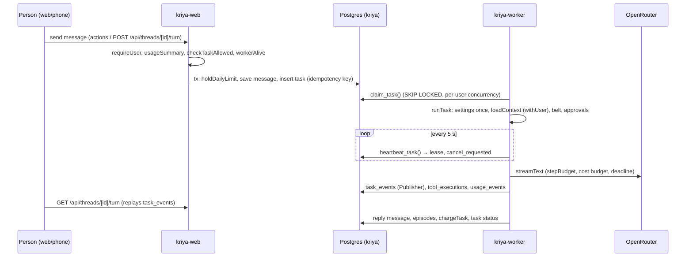

# Repository audit: the baseline cloud execution builds on (track C)

What exists today, verified in the code on 2026-10-31, and what that means
for adding cloud workspaces. Every later document in `docs/cloud-execution/`
cites this one. Where a document and the code disagree, the code is the fact
(AGENT_MASTER_PROMPT §1).

## 1. Baseline

| Item | Value (2026-10-31) |
| --- | --- |
| Checkout | `main` at `508bb6a` ("feat(skills): Skill Studio end-to-end design harness…"), one remote `origin` (`zuko14/Kriya-Tavi`). Two local worktree branches: `claude/dreamy-noether-dd685d`, `claude/remote-control-5de9d7` |
| Working tree | Clean except the untracked brief `kriya_tavi_cloud_excecution.md` |
| `env -u OPENROUTER_API_KEY npm run check` | typecheck pass; lint **0 errors, 6 warnings** (`_run`, `_results` in `tests/operator/golden/harness.ts`, reported three times because eslint also walks `.claude/worktrees/*`, see CF-09); format pass; **Test Files 185 passed, 3 skipped (188); Tests 2289 passed, 42 skipped (2331)**; exit 0; 340 s |
| `npm run build` | Not run: it reads the live database's settings (operator rule 6) and nothing under `app/` changed |
| Production | Owner report 2026-10-23: production ran `6d16b44` on Render (`status.md`, "Production report 2026-10-23"). Whether `508bb6a` is deployed is **unknown**; no Render or live database access was used (operator rule 6) |
| Supabase | Production project in Mumbai (`ap-south-1`), Postgres 17; 20 migrations applied as of 2026-10-21 (`status.md`). Whether the 9 later migrations (`20261201…`–`20270103…`) are applied is **unknown** here |
| Node | Local v24.22.0; Render web and worker `NODE_VERSION=22` (`render.yaml` `kriya-shared`); `kriya-browser` image Node 24.20.0 (`browser/Dockerfile`); `package.json` engines `>=20.9.0` |

## 2. Services and entry points

| Service (`render.yaml`) | Entry | Holds | Talks to |
| --- | --- | --- | --- |
| `kriya-web` (web, Singapore) | `next start`; routes in `app/`, mutations in `actions/*.ts`, reads in `queries/` | Supabase Auth session, `DATABASE_URL`, `SUPABASE_SECRET_KEY`, billing and OAuth secrets, `KRIYA_TOKEN_KEY` | Postgres, Supabase Storage, `kriya-browser` (PDFs, take-over) |
| `kriya-worker` (worker, Singapore) | `worker/index.ts` | `DATABASE_URL`, `OPENROUTER_API_KEY`, `FIRECRAWL_API_KEY`, `KRIYA_TOKEN_KEY`, Google client, `KRIYA_BROWSER_SECRET`, storage key | Postgres, OpenRouter, Firecrawl, connected accounts, `kriya-browser` |
| `kriya-browser` (pserv, Docker) | `browser/index.ts` | Only `KRIYA_BROWSER_SECRET`; no database | Websites through its own egress proxy (`browser/egress.ts`) |
| `kriya-voice` (web) | `voice/index.ts` | `DATABASE_URL`, `KRIYA_VOICE_STREAM_SECRET` | Telephony media stream |

## 3. The task lifecycle (what a cloud task must ride on)

Facts the design depends on, each read in the code:

1. **One owner of task state.** `kriya.tasks` with `claim_task`,
   `heartbeat_task`, `recover_tasks` (`20261016000000_kriya_core.sql`). Lease
   30 s, heartbeat 5 s (`run-task.ts` `HEARTBEAT_MS`), recovery every 15 s
   (`worker/index.ts`). Protected by tracks A, O and N.
2. **Retry rule.** `recover_tasks` requeues a lost task only if no
   `tool_executions` row has `side_effect`; otherwise it fails. `runTask`
   retries a provider or quality failure only when `!sideEffects`.
3. **Limits.** `plans.max_task_seconds` (default 300; owner form allows 30–7200,
   `actions/owner.ts`), `max_steps` (1–200; global ceiling `agent.maxSteps`
   default 60), `max_task_cost_micro_usd`, `max_concurrent_tasks` (in
   `claim_task`), `max_tasks_per_day` (in the insert transaction).
   `deadlineAt = now + maxTaskSeconds + grace` is fixed at enqueue.
4. **Cancel.** `cancel_requested_at` is read by the heartbeat; `runTask`
   aborts its `AbortController`, which reaches every tool's `abortSignal`.
5. **Shutdown.** `SIGTERM` aborts with reason `shutdown`; `runTask` releases
   the lease (`leaseExpiresAt = 0`) and recovery requeues the task, **using up
   one of `max_attempts` (default 3)**. Grace 25 s (CF-04).
6. **One task per thread.** Unique index `tasks_one_active_per_thread`;
   a second turn gets 409 `busy`.
7. **The belt is built per task** in `runTask` from switches read once; the
   kill list (`operator.disabledTools`) and the belt guard
   (`unclassifiedTools`, ND-21) remove tools; `wrapReads` adds retries only for
   idempotent reads.
8. **Approvals.** `TOOL_APPROVALS` derives from `TOOL_CLASSES` (R2–R4 →
   `user-approval`); an approval ends the turn; the Inbox records it
   (`recordApprovals`) and `enqueueApproval` starts a new task that resumes.
   So **anything an approved tool needs must survive between tasks**.
9. **Streaming.** `Publisher` batches `UIMessageChunk`s into `task_events`;
   generator tools stream preliminary results (`createAssignTool` yields
   snapshots), which is how long-running output reaches the screen.
10. **Metering.** Model calls: `usage_events` → one `charges` row per task
    (`lib/agent/metering.ts`, protected). Everything else (browser seconds,
    embeddings, skill design, web fetch) goes to `kriya.resource_usage`, a
    platform-cost ledger with nullable `cost_micro_usd` ("null means
    unpriced"), never a customer charge.

## 4. The precedent: the agent browser (A4)

Track A already solved "an isolated execution service the worker drives for
one task". Cloud workspaces copy its shape wherever it fits:

| Browser piece | File | Cloud workspace counterpart |
| --- | --- | --- |
| Provider interface | `lib/browser/provider.ts` `BrowserProvider` | `lib/cloud/provider.ts` `WorkspaceProvider` |
| HTTP client to the service | `lib/browser/client.ts` | `lib/cloud/client.ts` (runner protocol) |
| Per-task session object, lazy open, heartbeat, metered close | `lib/browser/session.ts` `TaskBrowser` | `lib/cloud/session.ts` `TaskWorkspace` |
| Service with no database, no secret but its own | `browser/index.ts` | `runner/index.ts` inside the sandbox |
| Wire types shared by both sides | `browser/protocol.ts` | `runner/protocol.ts` |
| Egress guard | `browser/egress.ts` (`isBlockedAddress`, `isBlockedHost`) | Imported read-only by the runner image's fallback proxy (CD-12), as track N does (ND-10) |
| SQL limit when a session opens | `kriya.open_browser_session` (plan `browser_minutes`, IST month) | `kriya.open_workspace_session` (plan `workspace_minutes`) |
| Usage | `resource_usage` kind `browser_seconds`, unpriced | kind `workspace_seconds`, priced only from the owner's rate |
| Image | `browser/Dockerfile` (Debian trixie, Node 24.20, non-root, tini) | `runner/Dockerfile` (same base; the service runs as root inside the VM and drops to the non-root `kriya` user for every command, CD-21) |
| Switch | `agents.browser` + plan minutes + env | `cloud.workspaces` + plan minutes + env |

The difference that matters: `kriya-browser` runs **Kriya's** code (Chromium
driven by a fixed action set) for several tenants in one container, which is
acceptable because nobody runs arbitrary code there. A code workspace runs
**arbitrary** code the model writes, so it needs one isolated machine per
workspace (CD-06). That is why the workspace provider is external.

## 5. Feature truth table (cloud-relevant)

Status words: **Active** (on in code paths without a switch), **Switch**
(built, behind a switch that defaults off), **Fixtures** (tested on fixtures
or PGlite only), **Live-unverified** (never run against the real service
here), **Absent**.

| Capability | State | Evidence |
| --- | --- | --- |
| Auth, tenants, RLS on every `kriya` table | Active; RLS tests | `tests/db/rls.test.ts`, `lint.test.ts` (0 tables without RLS) |
| Durable queue, leases, recovery, cancel | Active; tested | `tests/db/queue.test.ts`, `tests/pipeline.test.ts` |
| Model tiers, fallback, metering, charges | Active; OpenRouter live use reported by owner | `lib/models.ts`, `lib/agent/metering.ts` |
| Memory v1 / v2 | v2 Switch (`agents.memoryV2`) | A1 |
| Squads, `delegate`, `assign` | Active | `run-task.ts` |
| Schedules, goals, Inbox, "What I did" | Switch (`agents.inbox`, `agents.goals`, env `KRIYA_SCHEDULES_ENABLED`) | A3 |
| Agent browser (`kriya-browser`) | Switch (`agents.browser` + plan minutes + env); Fixtures; capacity unmeasured (AB-08) | A4; `tests/browser/*` (skipped without Chromium) |
| Files (`kriya-files` bucket) | Switch (`agents.files`); bucket creation is AB-05 | A5 |
| GitHub connector (GitHub App user token, R4 writes, `github_open_pr` one commit per file) | Switch (`agents.connectors`); Fixtures; live needs AB-06 | A8; `lib/connectors/github.ts` |
| Skill library, skills v2, Skill Studio | Switch (`agents.skillLibrary`, `next.skillsV2`, `next.skillStudio`) | `lib/skill-library.ts` |
| Jobs, grants, crews (track O) | Switch (`operator.*`) | O1–O11 |
| MCP apps (track N) | Switch (`next.mcp`); fixture server only | N5–N7 |
| Shell, terminal, code workspace, file system for agents | **Absent** ("Hosted Kriya has no shell, desktop, file system or payment tools yet: they arrive with an isolated execution provider", `lib/agent/tools.ts:140`) | — |
| Computer use (desktop) | **Absent** | — |
| `workstation/` image named in `docs/kriya/architecture.md` | **Absent** from the repository (CF-02) | `ls workstation` fails |

## 6. Security and data boundaries that must not move

| Boundary | Where enforced | Consequence for track C |
| --- | --- | --- |
| Person's data through `withUser` (RLS) | `db/index.ts` | Workspace reads for the person: `queries/` with `withUser` |
| `privileged` only scoped by user id or after `requireOwner()` | Invariant 1 | Worker bookkeeping on `workspaces`/`workspace_sessions` always filters `user_id` |
| Tokens sealed, opened only in `lib/connectors.ts` | Invariant 4 | The GitHub tarball and the publish commit are fetched/sent by the worker through `lib/connectors` code; **no token enters a sandbox** (CD-09) |
| Side-effect tools: approval, worker only, never retried | Invariant 5 | `workspace_publish` is R4 and in `SIDE_EFFECT_TOOLS` (CD-10, CD-11) |
| Risk classes decided by code | `lib/agent/policy.ts` | New `TOOL_CLASSES` rows only; no existing value changes |
| `kriya-browser` has no DB and no secret but its own; egress guard never relaxed | Track A rule 6 | The runner has the same rules; `browser/egress.ts` is imported read-only, never edited |
| Limits on the server | Invariant 7 | Minutes and running-sandbox caps in SQL |
| Money integers; reported vs estimated vs charge apart | Invariant 6 | Compute cost in micro-USD `bigint`, null when unpriced |

## 7. Findings (CF-01…)

Numbered so other documents and `status.md` can refer to them. None blocks
writing the blueprint.

| Id | Finding | Evidence | Proposed handling |
| --- | --- | --- | --- |
| CF-01 | `docs/kriya/status.md` is stale: names branch `kriya-saas`, says browser tasks and skills are "Not started" and "no approval UI" | `docs/kriya/status.md` lines 3, 42–46 | CP-1 corrects those rows from the truth table (§5); CHANGE_IMPACT row |
| CF-02 | `docs/kriya/architecture.md` "Execution capabilities" cites a `workstation/` directory that doesn't exist, and describes the browser as "planned" | lines 155–167; `ls workstation` | CP-1 rewrites that section to point at A4 and this track |
| CF-03 | `README.md` says agents can't use a browser yet | `README.md:33` | Changed only when C10 passes, so the README never claims what isn't verified |
| CF-04 | A worker deploy releases running tasks and each release uses one of `max_attempts` (3). A long code task interrupted three times fails | `run-task.ts` shutdown path; `recover_tasks` increments nothing but `claim_task` does | Accepted for v1 (queue is protected); runbook: deploy the worker when no long task runs; measured in C10. A queue change is an owner decision, not track C |
| CF-05 | Owner plan form doesn't edit `browser_minutes` or the A-track plan columns; owners set them in SQL | `actions/owner.ts` plan schema | Track C adds `workspaceMinutes` to the form (C7), the first such column the form edits |
| CF-06 | Render web/worker run Node 22; DSH requires Node ≥ 24.9 | `render.yaml`; DSH `AGENTS.md` | One reason DSH code is ported into the runner image (Node 24), not imported by the worker (CD-03) |
| CF-07 | `kriya.charges` holds model cost only; browser seconds are unpriced platform cost | `metering.ts`, `profiles.ts` `meterClosed` | Compute follows the browser precedent (CD-14) |
| CF-08 | `github_open_pr` writes one commit per file through the contents API (its own comment: "a Git tree commit if multi-file PRs need to be atomic") | `lib/connectors/github.ts:228` | `workspace_publish` uses a new additive tree-commit function; `githubOpenPr` unchanged (CD-10) |
| CF-09 | `eslint` walks `.claude/worktrees/*`, so warnings in stale worktrees count in `npm run lint` | baseline log | Note only; not track C's to change |
| CF-10 | `max_task_seconds` tops out at 7200 in the owner form; `deadlineAt` is fixed at enqueue | `actions/owner.ts`, `queue.ts` `taskRow` | A workspace task is one turn bounded by its plan; longer work continues in the next turn (CD-17) |
| CF-11 | The curated skill `skills-v2/code-assistance` says "Kriya can't run code, a terminal or tests", which becomes false when workspace tools are on the belt; it activates on the same coding asks | `skills-v2/code-assistance/SKILL.md` line 10, `kriya.json` activation | CD-20: on workspace turns only, `runTask` swaps it for an injected `cloud-coding` skill; the curated skill and its tests are unchanged |
| CF-12 | Existing tests pin the tool tables: `TOOL_WRITES` keys = `TOOL_CLASSES` keys (AT-POL-07), `CAPABILITIES` keys = `TOOL_CLASSES` keys (OT-CAP), `SIDE_EFFECT_TOOLS` = exactly the R3/R4 tools (AT-POL-01), no tool name containing `share` but `drive_share` (`tests/agent/share.test.ts`), `skills-v2/` holds exactly nine directories (NT-SKL-04), and two skill suites resolve against every classified tool | the named tests | Every workspace tool gets a `TOOL_CLASSES`, `TOOL_WRITES` and capability row together; `workspace_publish` joins `SIDE_EFFECT_TOOLS`; no name contains `share`; no `skills-v2/` directory (CD-20) |
| CF-13 | "Workspace" already names the app shell in code: `app/(workspace)/`, `components/workspace/` (nav, notifier), `queries/workspace.ts` (`getSystemStatus`) | `ls` | Track C code lives under `cloud` names (`lib/cloud/`, `queries/cloud.ts`, `actions/cloud.ts`, `components/thread/cloud-strip.tsx`, `/owner/cloud`, `tests/cloud/`); only the tables (`kriya.workspaces`, `kriya.workspace_sessions`) and the model-facing tool names (`workspace_*`) say "workspace" |

## 8. Files read for this audit

`AGENTS.md`; `status.md` (coordination board, all track overviews and
blockers); `docs/next-platform/{AGENT_MASTER_PROMPT,CHANGE_IMPACT_AND_SAFETY}.md`;
`docs/agent-platform/CHANGE_IMPACT_AND_SAFETY.md` §2;
`docs/operator/CHANGE_IMPACT_AND_SAFETY.md` §1; `docs/kriya/{architecture,status}.md`;
`README.md`; `render.yaml`; `worker/index.ts`; `lib/agent/run-task.ts` (whole);
`lib/agent/queue.ts` (prepare, taskRow, enqueueTurn, enqueueScheduled);
`lib/agent/metering.ts`; `lib/agent/policy.ts` (classes, writes,
person-only writes); `lib/agent/capabilities.ts`; `lib/agent/tools.ts`
(env, side effects, browser, private/untrusted reads, assign, types);
`lib/agent/instructions.ts` (`Capabilities`); `lib/agent/approvals.ts`
(`actionTitle`); `lib/browser/{provider,session}.ts`; `lib/browser/profiles.ts`
(`meterClosed`); `browser/{index,egress}.ts` (exports), `browser/Dockerfile`;
`lib/connectors/github.ts`; `lib/connectors.ts` (GitHub OAuth);
`lib/config.ts` (shape, keys, `SECRETS`); `lib/files.ts`; `lib/entitlements.ts`
(exports); `lib/env.ts`; `actions/owner.ts` (plan schema);
`app/owner/config/page.tsx` (`GROUPS`); migrations `20261016000000_kriya_core.sql`
(plans, tasks, tool_executions, queue functions, grants),
`20261101000000_memory_v2.sql` (`resource_usage`),
`20261101000002_browser.sql`, `20261101000003_goals_schedules.sql`
(`allowed_transitions`), `20270103000000_skill_studio.sql` (kind check);
`tests/next/regression.test.ts`; `tests/db/harness.ts`;
`node_modules/ai` 7.0.137 docs (`03-ai-sdk-harnesses/*`) and
`@ai-sdk/provider-utils` 5.0.58 `SandboxSession` type.
