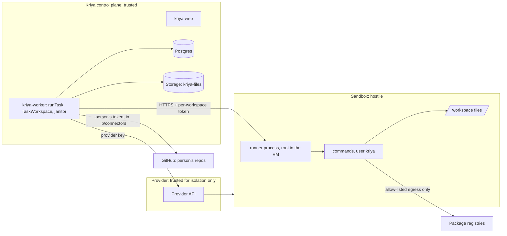

# Security and threats (track C)

Cloud workspaces let model-written code run. This document fixes what may
never happen, how each threat is stopped, and the gates before any real
person uses it. It adds to, and weakens nothing in, the security documents
of tracks A, O and N and `docs/kriya/security.md`.

## 1. Trust boundaries

Everything inside the sandbox is treated as hostile after the first
command runs: files, outputs, the runner's replies (they are parsed with
zod and bounded), and anything the model wrote there.

## 2. Invariants never weakened

1. No secret of Kriya's or the person's enters a sandbox (CD-09). The only
   value there is the per-workspace runner token.
2. One sandbox serves one workspace of one person; never reused, never
   shared (CD-06).
3. Nothing leaves the sandbox toward a third party except through
   `workspace_publish`, after the person approves the exact change set
   (CD-10).
4. Risk classes, `approvalFor`, `GRANTABLE`, R5 rules, `guardWeb`,
   `untrustedSeen` rules, `receiptHash` and `verify.ts` are unchanged; track
   C only adds rows (CD-11).
5. `browser/egress.ts` is imported, never edited or relaxed.
6. Workspace tools run only in `kriya-worker`; the web server holds no
   provider key and imports no `lib/cloud` module (CT-IMP-03).
7. Limits (minutes, running cap, one open session per workspace) are in
   SQL (invariant 7).
8. "What I did" and delivery come from `tool_executions`, never from model
   text; "tests passed" is only ever a `workspace_run` result.

## 3. Threats

| Id | Threat | Stopped by | Test |
| --- | --- | --- | --- |
| CS-1 | Sandbox escape to the host or another tenant | Provider microVM per workspace (CD-06); non-root commands; provider choice gated on M1 | CT-ISO-01 (escape probes: `/proc`, kernel info, metadata) |
| CS-2 | Cross-tenant access through Kriya: workspace A's tool reaches workspace B | `TaskWorkspace` loads only the task's thread's workspace with `user_id = task.userId`; SQL refuses another person's workspace; runner token bound to `(workspace, generation)` | CT-WS-08, CT-DB-05, CT-RUN-11 |
| CS-3 | Network reach from the sandbox to Kriya, Supabase, Render private network, metadata, other sandboxes | Egress allow-list (CD-12); provider network isolation; private/link-local/metadata always denied | CT-ISO-03…05 |
| CS-4 | Secret theft from the sandbox environment | Runner token removed from the runner's env after start; commands start with a scrubbed environment as another user (P1); no other secret exists there | CT-SEC-01, CT-RUN-02 |
| CS-5 | Prompt injection in repository files or command output (e.g. a README telling the agent to fetch a URL with data) | Outputs carry `FOREIGN`; workspace reads are private content, so web tools ask first (`guardWeb`); memory after them is unconfirmed; publish needs approval of the exact change set | CT-POL-03, CT-TOOL-07 |
| CS-6 | Exfiltration through a package registry or DNS | Registries need credentials to write (none present); DNS channel is residual (CRG-08); `offline` profile for sensitive repos | CT-ISO-05; residual recorded |
| CS-7 | Malicious archive (absolute paths, `..`, links, devices, zip bombs) | Import validates every entry before extraction; byte and file-count caps; extraction as `kriya` into `/workspace` only | CT-RUN-14, CT-RUN-15 |
| CS-8 | Path traversal through tool paths or symlinks created by commands | `realpath` inside `/workspace` on every call; writes to `.kriya/` refused | CT-RUN-12 |
| CS-9 | Resource abuse (mining, fork bombs, disk fill, endless loops) | Size per sandbox, plan minutes, platform running cap, command timeout, task deadline, provider disk; `ulimit -u` and a cgroup pids limit in the image | CT-ISO-06, CT-RUN-04 |
| CS-10 | Runner protocol abuse from inside (a command calls the runner's port) | Token required on every route but the data-free `health`; the token lives only in the root-owned runner process, out of `kriya`'s reach; commands can't signal or trace a root process | CT-RUN-11, CT-SEC-01 |
| CS-11 | Publishing something other than what was approved | `changeSetId` hash re-checked at execution; repo pinned to the workspace; new `kriya/` branch only; draft PR; read-back verification | CT-PUB-01…05 |
| CS-12 | Writes to protected branches or merges | No merge, no push to existing refs; GitHub branch protection still applies | CT-PUB-03 |
| CS-13 | Orphaned sandboxes running up cost | Janitor orphan sweep and provider reconcile; provider-side auto-stop (`timeoutSeconds`) as a backstop | CT-JAN-01…03 |
| CS-14 | Lost work (sandbox destroyed without a checkpoint) | Destroy only after a successful checkpoint newer than the last change; `checkpoint_failed_at` blocks destroy | CT-CKP-03 |
| CS-15 | Checkpoints readable by others | Private bucket, server key only, path under `workspaces/<user_id>/`; never a signed URL to the browser in v1 | CT-CKP-04 |
| CS-16 | Provider compromise or data residency | Provider gated on M1, M10; counsel question CQ-1; only the person's repository content goes there, no Kriya data | Readiness CR-6 |
| CS-17 | Logs leaking content | `lib/log.ts` gets ids and codes only; tool inputs redacted by `redactInput`; runner logs stay in the sandbox | CT-SEC-02 |
| CS-18 | Supply-chain code in dependencies the agent installs | Runs inside the isolated sandbox only; never on Kriya hosts; nothing installed is trusted by Kriya | CT-ISO-01 |
| CS-19 | Key rotation of `KRIYA_WORKSPACE_SECRET` | All runner tokens change; running sandboxes become unreachable and are restored from checkpoints (runbook) | CT-WS-09 |
| CS-20 | The `local` provider used in production (no isolation) | Refuses unless `KRIYA_WORKSPACE_LOCAL=1` and a localhost `DATABASE_URL`; `verify:guard` flags provider keys | CT-PRV-01 |
| CS-21 | Squad member mixes private repo content with the web | `assign` members get no workspace tools (CD-19) | CT-TOOL-08 |
| CS-22 | Account deletion leaves code at the provider or in storage | Rows cascade; janitor reconcile destroys sandboxes and deletes prefixes without rows | CT-JAN-04 |

## 4. Isolation suite (C9, real provider, owner-approved runs)

| Id | Probe from inside a sandbox | Pass |
| --- | --- | --- |
| CT-ISO-01 | Read `/proc/1/environ`, the runner's environ, host kernel modules; list other sandboxes' processes | No Kriya value readable; only the sandbox's own processes |
| CT-ISO-02 | Two people's workspaces: from A, scan the network for B's runner port | Unreachable |
| CT-ISO-03 | `curl` metadata addresses (169.254.169.254, fd00:ec2::254), RFC 1918 ranges, the Render private network names | All fail |
| CT-ISO-04 | `curl` Supabase, `KRIYA_APP_URL`, `kriya-browser` | Fail |
| CT-ISO-05 | With `registries`: npm and PyPI install succeed, `curl https://example.com` fails; with `offline`: all fail | As stated |
| CT-ISO-06 | Fork bomb, 100 % CPU loop, fill the disk | Contained; sandbox still answers or is destroyed; host and other sandboxes unaffected; minutes accounted |
| CT-ISO-07 | Kill the runner from a command | Refused (other user) |
| CT-ISO-08 | After `destroy`, `resume(ref)` returns null and the provider lists nothing | As stated |

## 5. Questions for counsel

| Id | Question |
| --- | --- |
| CQ-1 | May a person's private source code be processed by a foreign sandbox provider under DPDP, with which terms (DPA, sub-processor list, deletion on request)? |
| CQ-2 | Wording for the consent the person gives when connecting a repository to cloud workspaces (what runs, where, retention) |

## 6. Readiness gates before any real person (C9/C10)

| Gate | Evidence |
| --- | --- |
| CR-1 | CT-REG-01 and the whole existing suite pass with every `cloud.*` switch off |
| CR-2 | CT-ISO-01…08 pass on the chosen provider |
| CR-3 | CT-PUB-01…06 pass on a test repository the owner controls |
| CR-4 | Laptop-off run on staging: a task started from a phone completes with the browser closed (EVALUATION_PLAN §5) |
| CR-5 | Recovery drills: worker killed mid-task, sandbox destroyed mid-task, checkpoint upload failure; no duplicate side effects, no corrupted task state |
| CR-6 | Provider M1–M10 documented; CQ-1 answered |
| CR-7 | Cost: plan minutes and platform cap enforced in SQL on staging; janitor leaves no orphan after 24 h of runs |
| CR-8 | An external review of the runner protocol and the import/publish paths |
