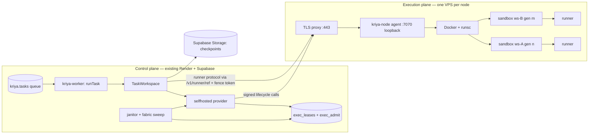

# Self-hosted execution fabric: architecture

How Kriya runs cloud workspaces on machines it operates (a Hostinger KVM
VPS first), as one more provider of the existing track C system. Decisions
CD-28…CD-37 (`DECISIONS.md`); audit in `SELF_HOSTED_ARCHITECTURE_AUDIT.md`;
threats in `SELF_HOSTED_THREAT_MODEL.md`; operations in
`SELF_HOSTED_OPERATIONS_RUNBOOK.md`; measurements in
`SELF_HOSTED_BENCHMARK_PLAN.md`.

## 1. The picture



What is new: `cloud-node/` (the agent, ~700 lines, Node built-ins and zod
only), `lib/cloud/providers/selfhosted.ts`, `lib/cloud/fabric.ts`, one
migration (`20270501000000_cloud_fabric.sql`), `selfhosted.*` settings and
one secret. Everything else — identity, the task queue and its leases,
the model loop, tools, approvals, publish, checkpoints, metering, plan
minutes, the runner and its image — is the existing system, unchanged.

## 2. Logical sessions vs execution slots

| State | Holds | Where |
| --- | --- | --- |
| Thread idle, waiting for approval, waiting for the person | Nothing | `kriya.threads`, `kriya.approvals` |
| Task queued | A row | `kriya.tasks` (`claim_task`, per-person fairness, plan concurrency) |
| Task running, model thinking | A worker slot (`WORKER_CONCURRENCY`) | `kriya-worker` |
| First `workspace_*` call | A workspace session (plan minutes, platform cap) | `open_workspace_session` |
| Waiting for node capacity | A `waiting` lease, polled | `kriya.exec_leases` |
| Sandbox running | A `granted`→`running` lease: CPU, memory, disk reserved on one node | node + `exec_leases` |
| Task ended | Checkpoint, container stopped: disk only (`stopped` lease) | node disk + Storage |
| Paused past `cloud.pausedHours`, or node draining | Checkpoint only; container and volumes removed | Storage |

So 500 logical agents cost rows; only workspaces actively in a turn hold
CPU and memory, and only while the turn runs.

## 3. Capacity admission (CD-29, CD-32)

```mermaid
sequenceDiagram
  participant TW as TaskWorkspace
  participant P as selfhosted provider
  participant DB as Postgres
  participant N as kriya-node
  TW->>DB: open_workspace_session (minutes, platform cap) — unchanged
  TW->>P: create(spec) / resume(ref)
  P->>DB: exec_request → lease id (waiting) or "queue is full"
  loop until granted or maxWaitSeconds
    P->>DB: exec_admit(lease) — try-lock; pass only if something changed
  end
  DB-->>P: granted on node n, ref sh-n-ws-gen, fence = lease id
  P->>N: POST /v1/sandboxes/open {ref, fence, limits, env}
  N-->>P: 200
  P->>DB: lease running
  P-->>TW: runnerUrl https://node/v1/runner/ref + proxy token(ref, fence)
```

The pass (one at a time, by whichever waiter polls first after a change):

1. Expire waiters silent for `abandonSeconds`.
2. Snapshot eligible nodes: `active` (or `draining` for their own resumes),
   healthy, stats fresher than `staleSeconds`, isolation allowed
   (`gvisor`, or also `runc` under `trusted-runc`), PSI `some avg10` under
   the ceilings (CPU 60, memory 10, I/O 40 by default). Free = capacity −
   reservations; CPU × `cpuOvercommitPct`; memory and disk never
   overcommitted; a new sandbox also needs its disk quota free on the node.
3. Rank waiters: starving (waited ≥ `starvationSeconds`) first; then the
   person's live leases + their earlier waiters (fewest first); then
   priority; then age.
4. Each waiter in order: skip if the person is at `maxPerUser`; else the
   best-fit node (least memory left after placing); grant and update the
   snapshot. A starving waiter that fits nowhere stops the pass.

Skip rule: a version counter in `kriya.exec_state` is bumped by triggers on
anything that can change a decision (a lease leaving `granted`/`running`, a
new waiter, a node row change, a re-ranked waiter). A pass runs when the
version or the policy changed, or at least once a second. Measured effect
(benchmark plan §4.2): at 250 polling waiters, grants/s 6.5 → 22.4 and
admit p99 700 ms → 1.9 ms on Postgres 17.

Backpressure: `exec_request` refuses beyond `maxQueued` total or
`maxQueuedPerUser`; a wait past `maxWaitSeconds` cancels the lease. Both
surface as "Kriya's workspace machines are busy; try again in a few
minutes." Nothing is dropped silently; the task's other tools still work.

## 4. kriya-node and its protocol (CD-28, CD-31, CD-33, CD-36)

| Route | Auth | Does |
| --- | --- | --- |
| `GET /v1/health` | none | `{ok, protocol}` only |
| `GET /v1/node` | signed | Allocatable CPU/memory/disk, measured free memory/disk/inodes, PSI, isolation proven by the probe, image digest, agent version, ready + reasons |
| `GET /v1/sandboxes` | signed | Refs, running, current fence |
| `POST /v1/sandboxes/open` | signed | Fresh: create + start (refuses an existing ref). Resume: start, or **restart** if running (the older holder's processes end). Idempotent for the same fence. Refuses older fences (409), when not ready (503), when the host is short of memory (507) |
| `POST /v1/sandboxes/stop` / `touch` | signed + fence | Stop (disk kept) / reset the idle clock |
| `POST /v1/sandboxes/destroy` | signed (+ fence unless reconcile) | Container and both volumes removed |
| `* /v1/runner/<ref>/<path>` | proxy token = HMAC(node key, `ref:fence`) for the **current** fence | Streams to the runner; the runner's own bearer token is still required; a client that disconnects aborts the upstream request (cancellation) |

Signing: HMAC-SHA256 over method, path, timestamp, nonce and body hash;
±60 s; each nonce once. Node key = HMAC(`KRIYA_NODE_SECRET`, node id): a
node holds only its own key. Fences are persisted (`fences.json`, atomic
rename) so a restarted agent still refuses an older holder.

The node's own safety nets: a sandbox with no traffic and no request in
flight for `idleSeconds` is stopped even if the control plane is gone; a
sandbox over its disk quota (measured with `du` every minute) is stopped;
the agent re-probes every minute and stops taking sandboxes while any
probe fails.

## 5. The sandbox (CD-30, CD-34)

One container per workspace generation, `docker create` from
`dockerCreateArgs` (pure, tested):

`--runtime runsc` · own bridge network, ICC off · `--read-only` root ·
tmpfs `/tmp` (nosuid, nodev, size) and `/run` (noexec) · two named volumes
(`/workspace`, `/home/kriya`) · `--cap-drop ALL` + the runner's seven
(CHOWN, DAC_OVERRIDE, FOWNER, KILL, SETUID, SETGID, NET_ADMIN) ·
`no-new-privileges` · `--pids-limit` · `--memory` = `--memory-swap` ·
`--cpus` · `nofile` ulimit · `--restart no` · the runner's token passed by
name only (value in the CLI's environment, never argv) · the pinned image ·
the runner started as `node --import tsx runner/index.ts`.

Inside, the existing runner (CD-21) switches every command to uid 1000
under `prlimit` and installs its own egress firewall and registry proxy
(CD-12). Outside, the host's `KRIYA-SBX` chain drops sandbox traffic to
private, loopback, link-local/metadata, CGNAT and multicast ranges, the
host's INPUT drops everything from the bridge except replies, and IPv6 is
off for the bridge. Measured on Docker (runc): uid 1000, `CapEff 0`, bounding
set exactly the seven, read-only root, memory/pids/CPU cgroup limits, OOM
contained (runner survives), fork bomb capped, fence restart kills the old
holder's command (`SELF_HOSTED_THREAT_MODEL` §6).

## 6. Recovery

| Failure | Detection | Handling | Test |
| --- | --- | --- | --- |
| Worker dies mid-command | Session heartbeat stale | Janitor resumes under a **new fence** (old holder locked out, runner restarted), checkpoints, stops; next task resumes same disk | REC-01 |
| Worker alive but partitioned (lease lost) | Same | Same; its late `pause` gets 409 and touches nothing | REC-01 |
| Node unreachable | Signed call fails / sweep | Node unhealthy → no new grants; resume throws → workspace stays paused (not "gone") | REC-02, REC-03 |
| Node lost the sandbox (disk gone) | `open` 404 | Restore path: generation + 1 from Git + checkpoint | REC-02 |
| Node rebooted | Containers stopped (`--restart no`) | Treated as paused; next resume starts them; fences survive (on disk) | CT-SH-NODE-02 |
| Agent restarted | — | Sandboxes keep running; fences reloaded; idle clocks restart at "now" | CT-SH-NODE-02 |
| Granted but never started (worker died between grant and open) | Sweep: granted > 180 s | Lease released | REC-03 |
| Lease says running, node has nothing | Sweep: node reachable, ref not listed | Lease released | REC-03 |
| Waiter died | `polled_at` > abandonSeconds | Lease expired by the next pass (≤ 1 s safety pass) | CT-SH-DB-04 |
| Retried open (network blip) | Same ref + fence | Idempotent 200, one container | CT-SH-NODE-02 |
| Grant lands as the wait times out | Cancel affects 0 rows | Re-read; the grant is used, not leaked | provider code path |
| Drain | `selfhosted.drain` | No new sandboxes; paused ones checkpointed and removed by the janitor; resumes allowed until then | REC-04 |
| Storage down at publish | Existing CD-13 rule | Publish refused, sandbox kept | C9 drill 4 (unchanged) |

## 7. Provider routing (CD-35)

`cloud.provider = selfhosted` turns it on for the deployment, with
`selfhosted.users` (`*` or ids) gating **new** sandboxes. There is no silent
overflow to E2B/Daytona: a workspace's disk lives on one node, a vendor
sandbox is a different data processor (counsel question CQ-1), and a
silent switch would spend money the owner didn't approve. A future
explicit routing rule (per plan, per workload class) fits in
`workspaceProvider()` without touching the rest.

## 8. Reliability targets (proposed; owner to approve)

| SLI | Numerator / denominator | Window | Target (single node) | Error budget | Alert |
| --- | --- | --- | --- | --- | --- |
| Workspace start success | Starts that reached `running` / starts admitted (excludes "busy" and minutes used up) | 28 days | 99.0% | 1.0% | > 2% failed in 1 h |
| Queue wait | Granted leases with wait ≤ 30 s / granted leases | 28 days | 95% | 5% | p95 > 60 s for 15 min |
| Busy refusals | Starts refused busy / starts requested | 7 days | ≤ 5% | — | > 10% in 1 h → capacity review |
| State durability | Workspaces resumable after a worker crash or node restart / such events | Pilot | 100% of events; RPO = last checkpoint | — | Any loss is an incident |
| Cleanup | Closed workspaces with no container or volume after 1 h / closed | 7 days | 99.9% | — | Reconcile releases > 5/day |
| Isolation suite | Probes passing on the node / probes | Per image or node change | 100% | 0 | Any failure stops admission |

**What one node cannot guarantee:** availability through a host, disk or
provider outage (the node is a single point of failure for *running*
work); work since the last checkpoint if the disk is lost; capacity beyond
one machine. During a node outage the control plane stays up, threads and
history remain readable, new starts say "busy", and paused workspaces
resume from their checkpoint on another node when one exists. The
cheapest credible step up is a second node of the same size (≈ doubling
compute rent) — justified only when the start-success or queue-wait SLO is
breached, or an availability target is set (benchmark plan §6).
