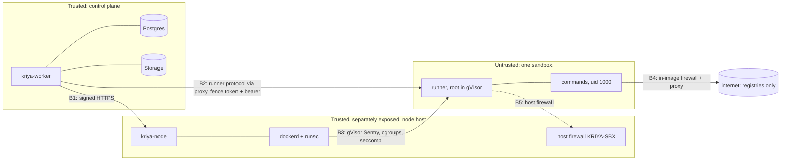

# Self-hosted execution fabric: threat model

Extends `SECURITY_AND_THREATS.md` (CS-1…22, CT-ISO-*) to machines Kriya
operates. The attacker of record is **a person's task running arbitrary
code** (the model's code, a malicious repository, a compromised package),
plus a network attacker between the worker and a node, plus a stale or
buggy worker. Evidence ids point at tests; "UNVERIFIED" means the control
exists in code or configuration but hasn't been exercised on the target
host.

## 1. Trust boundaries

| Boundary | Crossed by | Controls |
| --- | --- | --- |
| B1 worker → node | Lifecycle calls | HMAC signature over method/path/body, ±60 s, single-use nonce, per-node key derived from an env-only secret; TLS by the node's reverse proxy; agent on loopback |
| B2 worker → runner | Tool operations | Proxy token bound to (ref, current fence) + the runner's bearer token bound to (workspace, generation) |
| B3 sandbox → host kernel | Every syscall | gVisor `runsc` (systrap): the workload talks to the Sentry, not the host kernel; plus cgroup limits, capability drop, no-new-privileges, read-only root |
| B4 command → network | Egress | CD-12 in-image: uid 1000 may reach loopback only; root proxy CONNECTs to the registry allow-list on 443 only |
| B5 sandbox → host / private network | Packets leaving the container | `KRIYA-SBX` drops private, loopback, link-local (metadata), CGNAT, multicast; INPUT from the bridge allows only replies; ICC off; IPv6 off |

## 2. Assets

Other tenants' code and checkpoints; Kriya's secrets (`KRIYA_NODE_SECRET`,
`KRIYA_WORKSPACE_SECRET`, database, model and provider keys — none on a
node except the node's own derived key); the node itself (shared by every
sandbox on it); the control plane's database; Kriya's bill.

## 3. Threats, mitigations, evidence

| # | Threat | Mitigation | Evidence | Residual |
| --- | --- | --- | --- | --- |
| SH-T1 | Container escape via a host-kernel bug | gVisor: the host kernel sees the Sentry's small syscall set, not the workload's | **UNVERIFIED on target** (needs runsc on the VPS, OA-2/OA-5); fail-closed probe proven: without runsc the node is not ready (CT-SH-DOCKER-07) | A gVisor Sentry bug plus a host bug; Docker/runsc CVEs → patch cadence in runbook §7 |
| SH-T2 | Privilege escalation inside the sandbox | Commands uid 1000 with `CapEff 0`; bounding set = 7 runner caps; no-new-privileges; no sudo/setuid path | CapEff 0, CapBnd `0x10eb` (CT-SH-DOCKER-02); CT-ISO-01 (C9) | Root inside the sandbox (the runner) is reachable only through a runner bug |
| SH-T3 | Runtime socket abuse | Socket never mounted; flags tested to contain no bind mounts | CT-SH-SEC-03; `/var/run/docker.sock` absent in the sandbox (DOCKER-02) | — |
| SH-T4 | Host or private network access, metadata, SSRF, DNS rebinding | B4 + B5: commands can't open sockets out except via the proxy, which re-resolves and refuses private/metadata addresses (`isBlockedAddress`); host chain drops those ranges anyway | CT-ISO-03/04 (C9, image); host rules applied and verified on real iptables (`hostsetup` run, §6) | UNVERIFIED under runsc on the VPS (gVisor netstack iptables, issue #9917 class) → runbook §2 step 6 |
| SH-T5 | IPv6 bypass | Bridge IPv6 disabled; ip6tables drops in/out of the bridge; image firewall has v6 rules | host-setup run (§6) | UNVERIFIED on target |
| SH-T6 | Another tenant's sandbox | One container per workspace generation; ICC off; separate volumes; fresh opens refuse an existing ref | ICC probe (DOCKER-07); CT-SH-NODE-02 ("never adopts an existing disk") | Side channels on shared CPUs (out of scope; dedicated hosts for high-risk tenants) |
| SH-T7 | Memory exhaustion / host OOM | `--memory` = `--memory-swap`; admission never overcommits memory; PSI memory ceiling; node refuses opens when short (507) | OOM contained, runner survives (DOCKER-03); CT-SH-DB-06 | gVisor's own memory overhead must be included in the reserve (measure on VPS) |
| SH-T8 | Fork bomb / PID exhaustion | `--pids-limit`; per-command `prlimit` nproc | DOCKER-04 (pids stayed < limit, runner alive); CT-ISO-06 | — |
| SH-T9 | CPU starvation of neighbours | `--cpus` quota; CPU overcommit bounded; PSI CPU ceiling stops new grants | cpu.max `50000 100000` (DOCKER-02) | Overcommit 150% means contention under full load, by design |
| SH-T10 | Disk / inode exhaustion | Read-only root, tmpfs sizes, per-sandbox quota enforced by `du` sweep (stop over quota); admission needs disk free; node reserve | CT-SH-NODE-04 (quota stop) | **Soft quota**: a burst between sweeps (60 s) can fill the disk → XFS project quotas recommended (OA-2) |
| SH-T11 | Stale worker overwrites newer state | Fence = lease id; node refuses older fences on proxy and stop; resume restarts the runner | REC-01, CT-SH-NODE-02, DOCKER-05; mutation-checked | — |
| SH-T12 | Forged or replayed control call | HMAC + nonce + skew; per-node keys | CT-SH-NODE-01 | Node key theft from the host → that node only; rotate (runbook §4) |
| SH-T13 | Secret exposure | Token passed by env name only; never in argv, labels, logs, DB rows, list or stats; node holds no Kriya secret | CT-SH-SEC-04, CT-SH-NODE-04, SEC (E2E), slice log check | `docker inspect` on the host shows container env to host root (accepted: host root = node operator) |
| SH-T14 | Residual data on reuse | Destroy removes container + both volumes; refs never reused (generation in the ref) | DOCKER-06 | Deleted blocks on the host disk (full-disk encryption at the provider is UNKNOWN, OA-2) |
| SH-T15 | Malicious package lifecycle scripts | Same sandbox as everything else; registries only; no credentials inside | CD-09, CD-12 | Supply-chain compromise of a public package still runs inside the sandbox |
| SH-T16 | Log / output exfiltration of secrets | No secret enters the sandbox; output capped (runner limits) | CD-09 | — |
| SH-T17 | Control-plane DoS by polling | One pass at a time, skip when nothing changed; queue caps | Benchmark §4.2 | 250 waiters ≈ 7k cheap calls/s at 20–40 ms polling; production polls at 0.25–2 s |
| SH-T18 | Abandoned sandboxes keep billing/holding capacity | Node idle stop; sweep reconcile; janitor orphan/idle/retention | CT-SH-NODE-04, REC-03 | — |
| SH-T19 | Node compromise | Node holds only its key; sandboxes can't reach the control plane except their own runner traffic (inbound only); workspace data on that node is exposed | — | Treat a compromised node as a breach of every workspace on it: runbook §9 |
| SH-T20 | Hostinger acceptable-use / legal | — | **UNKNOWN** (OA-4) | Must be settled before the pilot |

## 4. Workload eligibility (security release rule, spec §7.6)

| Workload class | Runtime required | Status today |
| --- | --- | --- |
| Kriya's own internal scripts (owner-trusted) | `trusted-runc` allowed | Eligible on a staging node after OA-1…OA-3 |
| People's code (agents running repositories and packages) | `gvisor` only | **Not eligible** until CT-ISO-01…08 + CT-SH-DOCKER-01…07 pass with runsc on the target node (OA-5) and CD-30 is approved (it interprets CD-06) |
| High-risk / hostile code (security research, unknown binaries) | A microVM provider (E2B/Daytona) | Never on self-hosted nodes |

## 5. What would change this model

A Kata/Firecracker-capable host (nested KVM or bare metal) → microVM
runtime instead of gVisor; more than one node → mTLS between worker and
nodes; any request to give a sandbox credentials → a scoped broker design
first (CD-09 still forbids it).

## 6. Evidence index

| Run | File | Result |
| --- | --- | --- |
| Unit + security flags | `tests/cloud/cloud-node.test.ts` | 18 passed |
| SQL admission | `tests/db/cloud-fabric.test.ts` | 14 passed |
| End to end + recovery | `tests/cloud/selfhosted.test.ts` | 8 passed |
| Real Docker (runc) | `tests/cloud/node-docker.test.ts` → `screenshots/cloud-execution/SH5/node-docker.json` | 7 passed |
| Vertical slice (agent process + Docker) | `tests/cloud/selfhosted-docker.test.ts` → `screenshots/cloud-execution/SH6/selfhosted-docker-slice.json` | 1 passed |
| Host firewall script on real iptables | `cloud-node/host-setup.sh` in a privileged throwaway container (status.md SH5) | applied, idempotent, `--check` OK |
| Mutation checks | proxy fence check, own-fence pause, starvation stop, allow-list | each removal fails its test |
