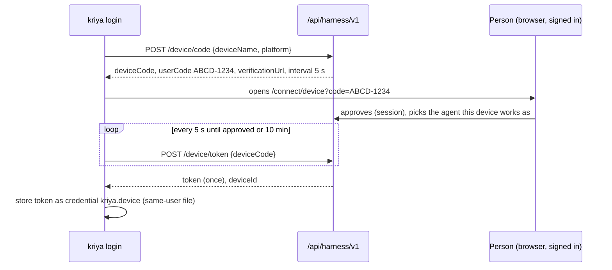
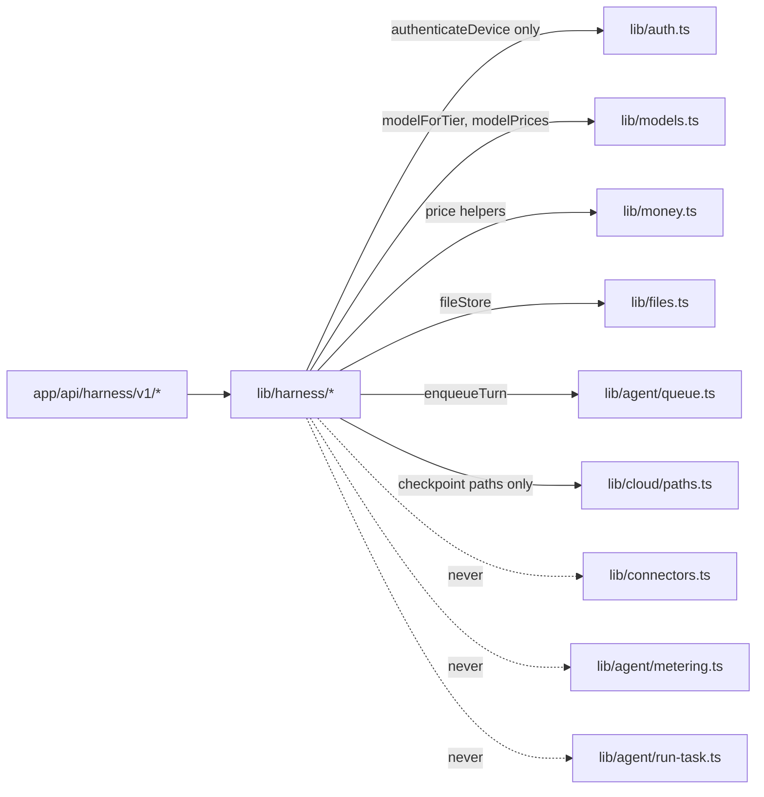

# Architecture (track H: Kriya Harness)

## 1. Picture

```mermaid
flowchart LR
  subgraph machine[The person's machine]
    UI[DSH Web UI on 127.0.0.1 / kriya run / ACP editor]
    LOOP[DSH agent loop + DSH tools]
    PL[Kriya plugins: auth, gateway, approvals, sync, skills, tools, world]
    UI --> LOOP --> PL
  end
  subgraph web[kriya-web]
    API[/api/harness/v1/*]
    AUTH[authenticateDevice lib/auth.ts]
    GW[gateway: tier models, reserve/settle]
    API --> AUTH
    API --> GW
  end
  PL -- HTTPS + device token --> API
  GW -- platform key --> OR[OpenRouter]
  API --> DB[(Postgres: harness_*, threads, memories, workspaces)]
  API --> ST[(Storage: handoff checkpoints)]
  API -- handoff: enqueueTurn --> Q[(tasks)] --> K[kriya-worker + track C workspace]
  P[Person's phone: Inbox, mirror thread, Account → Devices] --> web
```

The machine runs DSH; Kriya's servers run only what they already run
(web, worker) plus new routes on `kriya-web`. No new Render service until H10.

## 2. Components

| Component | Where | Responsibility |
| --- | --- | --- |
| `@kriya-ai/harness` | Repository `kriya-harness` | Profiles, plugins, `kriya` command (DSH_DISTRIBUTION) |
| Harness API | `app/api/harness/v1/**/route.ts` (this repo) | Device flow, gateway, approvals, mirror, skills, memory, handoff, pull |
| Contract | `lib/harness/contract.ts` | zod schemas for every request and response; exported to `docs/kriya-harness/contract.json` (`scripts/harness-contract.ts`) |
| Device auth | `lib/auth.ts` `authenticateDevice` (owner-gated) + `lib/harness/devices.ts` | Token hash lookup, idle expiry, revocation, `last_used_at` |
| Gateway | `lib/harness/gateway.ts` | Alias → tier model, plan checks, reserve, forward, stream, parse usage, settle |
| Ledger | `lib/harness/metering.ts` | `harness_usage` rows; prices with `lib/money.ts`; never touches `lib/agent/metering.ts` |
| Approvals | `lib/harness/approvals.ts`, `actions/harness.ts` (answer), Inbox list | Requests from devices; answers only from a session |
| Mirror | `lib/harness/mirror.ts` | Device sessions → a thread of the device's agent; idempotent turns by sequence |
| Handoff | `lib/harness/handoff.ts` | Patch upload → `workspaces` row + checkpoint + `enqueueTurn` (track C restores it) |
| Person's pages | `app/connect/device/page.tsx`, Account → Devices (`components/account/devices.tsx`), `queries/harness.ts` | Approve a device, see and revoke devices, cap usage |

## 3. Flows

### 3.1 Sign-in



### 3.2 A model call

1. DSH loop → `llm-pi-ai` route → `POST /chat/completions` (model `balanced`).
2. `authenticateDevice` → device and profile active; `harness.api` and
   `harness.gateway` on; plan's `harness_monthly_micro_inr > 0`.
3. Rate limits (`harness.rpm` per device and user; 3 concurrent streams).
4. `balanced` allowed by the plan → `modelForTier("balanced")`.
5. `reserve_harness_spend` with an upper estimate (input tokens counted by
   characters / 3 + `max_tokens` × output price); refused when it would pass
   the month's cap ("This month's Kriya Harness limit is reached").
6. Forward to OpenRouter (stream, tools unchanged, `usage.include = true`),
   pipe chunks to the client.
7. Final usage chunk → settle the reservation to the real cost and charge;
   no usage chunk (aborted stream) → settled at the reservation as
   `estimated`, flagged for reconciliation; never zero.

### 3.3 Approval from the phone

DSH asks for approval → P-APR `POST /approvals` (tool, a short summary, the
redacted input, the folder) → the Inbox shows it (and the notifier, with the
owner-approved `/api/events` change, PX-03) → the person taps Approve on the
phone → `actions/harness.ts` (session, `withUser`) marks it → the client's
long-poll (`GET /approvals/{id}?wait=25`) returns `approved` → DSH runs the
tool once. A local answer first: the client cancels the server request.

### 3.4 Handoff and pull (needs track C C5/C6)

`kriya handoff "finish the tests"` → the client checks the base commit is on
GitHub, builds the checkpoint patch, `POST /handoff` (multipart, sha256) →
server verifies size and hash, writes the patch to
`workspaces/<user>/<workspace>/0-1.patch`, inserts `workspaces` (repo,
base_sha, checkpoint, provider from `cloud.provider`) and a thread for the
device's agent, then `enqueueTurn` with the note. The worker's
`TaskWorkspace` finds no sandbox, creates one, imports at `base_sha` and
restores the patch (track C §3.2). `kriya pull` → `GET /workspaces/{id}/checkpoint`
→ `git apply` on `kriya/pull-<id>`.

## 4. Boundaries



HT-IMP-01 enforces these imports. The harness API never runs agent tools on
the web server (invariant 5): the gateway forwards model calls; memory reads
and writes are plain `withUser` queries; handoff only enqueues.

## 5. Scale

| Concern | Design |
| --- | --- |
| Many devices | Stateless routes; one indexed lookup per request (`token_hash` unique) |
| Long streams on `kriya-web` | IO-bound pipes; measured in H3 (HT-GW-09: 200 concurrent streams on one instance); if CPU or memory limits bite, the gateway moves to its own Render service with the same paths (HF-03) |
| OpenRouter limits on one key | HQ-01; per-user caps and limits; a second key per tier is a config change |
| Database load | One insert + one update per model call; no polling except approvals long-poll (25 s, indexed) |
| Approval long-polls | Bounded to 25 s; at most 2 per device |
