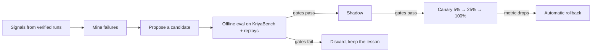

# Kriya Harness: Kriya's own engine modules and Kriya Evolve

Status: **Approved** (2026-11-02): the owner decided HD-21 (keep Beta),
HD-22 (E1 promotes itself through the gates), HD-23 (MIT, npm once the
account is connected) and HD-24 (opt-in replays, 30 days); recorded in
`DECISIONS.md`. Track H rules apply in
full; nothing here changes a risk class, an approval, a limit or a price.

## 1. What the owner asked for (2026-11-02, in chat)

1. Take Kriya Harness from beta to production for a wide launch.
2. Don't stop at DeepSeek Harness (DSH): build Kriya's own modules so the
   harness can compete with Claude Code, Codex, Hermes Agent and OpenClaw.
3. A harness that improves itself every day, with nothing fixed by hand.
4. Production readiness end to end, cloud included.

## 2. What stays fixed

- DSH stays a pinned dependency composed through its documented seams
  (profiles, bundle patch rows, plugins), never forked or edited (track H
  rule 5). Every Kriya module below is a Kriya plugin, a Kriya bundle row or
  server code in this repository. If a module needs a seam DSH lacks, we ask
  upstream or wait. We never patch DSH.
- Risk classes stay decided by `lib/agent/policy.ts`, modes by HD-20, and
  R5 never becomes a tool.
- "Done", "tests passed" and "delivered" stay computed by code from tool
  results (`lib/delivery/status.ts`, `workspace_run`), never from model text.
- The beta label. As of 2026-11-02, DSH's `latest` on npm is
  `0.2.1-rc.5` (a release candidate; `npm view @deepseek-ai/dsh dist-tags`),
  and DSH describes itself as an unaudited developer preview. HD-02 ties
  `ga` to a stable, audited DSH line. HD-21 below is the owner's choice of
  how to launch before that exists.

## 3. Kriya's own modules (K1–K8)

Each module ships behind its own `harness.*` switch, default off
(HT-REG-01). "Where" says which repository holds it.

| Id | Module | What it does | Where | Evidence that it works |
| --- | --- | --- | --- | --- |
| K1 | Repo map | A symbol index of the folder (files, exports, call sites) kept fresh on file changes. The agent reads a ranked slice instead of whole files. | client plugin | KriyaBench context tasks: fewer tokens read for the same pass rate |
| K2 | Plan → act → verify loop | Each job carries a written plan and a verify step: the project's own test, lint or build command, discovered once and confirmed by the person. The job counts as passed only from that command's exit code. | client plugin + `/api/harness/v1/sessions` | Exit codes in the session mirror; a job with no verify command is labelled "not checked" |
| K3 | Step checkpoints | A shadow git commit (on a ref under `refs/kriya/`) before every file-changing step. `kriya undo` goes back one step. The person's branches are never touched. | client plugin | Undo tests on fixture repos, including dirty working trees |
| K4 | Step router | Picks the model per step from the plan's tier aliases only (HT rule 4): a fast tier for search and reading, the strong tier for edits and review, inside the reserved spend. | server gateway (`lib/harness/`) | Cost per passed KriyaBench task, by tier |
| K5 | Parallel crew | Independent sub-tasks in separate git worktrees, each in its own mode, merged only after each one's verify step passes. | client plugin | Merge-conflict and verify-gate tests |
| K6 | Context compaction | Long sessions keep a structured summary (decisions, files touched, open questions) instead of raw history. Old turns move to session memory. | client plugin + memory API (unconfirmed, track-A rule 8) | Long-session KriyaBench tasks still pass after compaction |
| K7 | Cloud continuation | Builds on H8 handoff and H10 device world: a job started on the laptop continues in a track C sandbox and comes back as a branch. | existing H8/H10 + track C | Existing CT/HT tests, plus a round-trip drill |
| K8 | KriyaBench | Kriya's own evaluation suite (§4.3), run in track C sandboxes. K1–K7 and Kriya Evolve are measured on it. | this repository (`lib/harness/bench/`, new) | Its own fixtures; a fixed seed set per release |

Order: K8 first (nothing else can be judged without it), then K2 and K3
(trust), then K1 and K6 (quality and cost), then K4, K5 and K7.

Competitors: this table sets parity targets, not claims. No document or
screen may say a competitor lacks something without an RG-9 check (track-A
rule 12).

## 4. Kriya Evolve: a harness that improves every day

### 4.1 The loop

1. **Signals.** Only from verified tool results and person actions:
   verify-step exit codes, undo use, approvals declined, jobs abandoned,
   "not checked" endings, cost per passed job, latency. Model text is never
   a signal. Device sessions contribute only if the person opted in to
   sharing (HD-17). Without opt-in, only counts and exit codes leave the
   device.
2. **Mine.** Each night a job clusters failures by tool, error class and
   step: the same failing pattern seen across N people becomes a case.
3. **Propose.** A model writes one candidate change for a case, limited to
   the artifact classes in §4.2. It sees redacted cases only.
4. **Offline eval.** The candidate runs on the fixed KriyaBench seed set
   plus replays of the case's recorded inputs, in track C sandboxes, against
   the current version. Results are pass rate, cost and safety probes.
5. **Shadow.** The candidate runs beside live sessions without acting (its
   proposed steps are scored, not executed).
6. **Canary.** 5%, then 25%, then 100% of eligible sessions, each stage
   held for a minimum run count, with automatic rollback when any guard
   metric falls below the incumbent.
7. **Record.** Every version is immutable, numbered and diffable: who or
   what proposed it, every eval result, every promotion and rollback. The
   owner sees it at `/owner/harness/evolve` (new) and can freeze the loop
   with one switch.

The same idea appears in public work on self-improving agents (Sakana AI's
Darwin Gödel Machine; "A Self-Improving Coding Agent", Robeyns et al.,
2025; Google DeepMind's AlphaEvolve; GEPA-style reflective prompt
evolution). The owner's reference, "Harness² / AlphaEvolve" (Google
DeepMind), is recorded as the owner gave it; only AlphaEvolve is checked
here.

### 4.2 What may change by itself, and what never does

| Class | Examples | Promotion |
| --- | --- | --- |
| E1: guidance | Prompt fragments, tool descriptions, skill text, the repo-map ranking weights, compaction thresholds, step-router tier choice within the plan's aliases | **Automatic** when every gate in §4.4 passes (HD-22) |
| E2: behaviour | New verify-command heuristics, new K-module defaults, a new skill | Owner's one-click approval after the gates pass |
| E3: never | Risk classes, modes, approvals, sandbox policy, egress guard, limits, caps, prices, plan entitlements, disclosures, the beta/AI notices, R5 handling, anything in `lib/agent/policy.ts` | Never proposed. The proposer's output is checked by code against an E3 path list and dropped if it touches one |

### 4.3 KriyaBench

- **Seed set (fixed per release):** about 200 tasks across languages,
  with a verify command each. Sources: synthetic tasks on fixture repos,
  public permissively licensed benchmarks (check each licence first), and
  never a person's private code without consent.
- **Replay set (rolling):** redacted recordings of opted-in failing
  sessions. They are replayed with recorded tool outputs where a live call
  would be a side effect.
- **Safety probes:** prompt-injection files, requests to leave the folder,
  secret bait. A candidate that does worse on any probe is rejected,
  whatever its pass rate.
- **Grading integrity (built in H13):** hard tasks hide their tests and
  checkers (in the folder only while the verify command runs); protected
  files are restored before grading, so a task is graded on the original
  tests: an edited test is reported (`tampered`) but doesn't fail a correct
  fix, while a file the task forbids changing (`constraints`) does (owner,
  2026-11-04: "Grade on originals"; harness upgrade HU-F-20). An evolving
  harness must never be able to learn the grader.

### 4.4 Gates (all must pass)

1. Seed pass rate ≥ incumbent, with a confidence interval that excludes a
   drop larger than 1 point (the method and run count are fixed before the
   first run).
2. No safety probe worse. Zero E3 paths touched.
3. Cost per passed task ≤ incumbent + 5%.
4. Shadow agreement and canary guard metrics (verify pass rate, undo rate,
   declined approvals, abandonment) not worse than the incumbent's.
5. Budget: the loop's own spend is a platform cost in
   `kriya.resource_usage` with a daily cap in SQL. When the cap is reached
   the loop stops; it never charges a customer.

## 5. Production readiness before a wide launch

Found on 2026-11-02. "Owner" means it needs an account, a decision or
production access that only the owner has.

| # | Gap | Who | Done when |
| --- | --- | --- | --- |
| P1 | Production `DATABASE_URL` used Supabase's session pooler (15 clients across web, worker and voice) → "Something broke on this screen" (EMAXCONNSESSION) | Owner | All three services use the transaction pooler (port 6543); `npm run readiness` shows no `db.pooler` failure |
| P2 | Migrations after `20261202000000` are recorded as applied only on local and PGlite stacks, while switches for Skill Studio, harness and rooms are visible in production | Owner | `npm run readiness` against production shows `db.migrations` pass |
| P3 | CI failed on `main` since `adfed22` (CT-RUN-02, HT-DEV-03), and Render deployed anyway | Code (fixed 2026-11-02) + Owner | CI green. Render's Auto-Deploy set to "After CI checks pass" |
| P4 | The client can't be installed: `kriya-harness` is a private repo, `"private": true`, `UNLICENSED`, unpublished, and `npm whoami` isn't signed in | Owner (HD-14, HD-23) | A published package with provenance and an SBOM; `harness.installCommand` set |
| P5 | No error tracking beyond Render logs; digests are found by hand | Owner choice | One error tracker with PII scrubbing, or a log drain with alerting |
| P6 | Every plan's harness cap is 0 by default | Owner | Caps set per plan in `/owner/config` |
| P7 | H9 gates and the H12 pilot (HD-02) | Owner + pilot users | Recorded in `status.md` |

## 6. Proposed phases

| Phase | Content | Exit |
| --- | --- | --- |
| H13 | K8 KriyaBench seed set + runner on track C sandboxes | Baseline pass rate and cost recorded for the current client |
| H14 | K2 verify loop + K3 checkpoints | Bench: no regression; undo drills pass |
| H15 | K1 repo map + K6 compaction | Bench: same pass rate at lower tokens per task |
| H16 | Kriya Evolve offline: signals, mining, proposer, offline eval, E3 guard, version records | A candidate goes from case to evaluated version with no person involved; nothing is promoted |
| H17 | Kriya Evolve online: shadow, canary, automatic rollback, owner freeze switch | A forced regression is rolled back automatically in a drill |
| H18 | K4 router, K5 crew, K7 continuation | Bench cost per passed task down; crew merge tests pass |

## 7. Decisions for the owner

- **HD-21: launch label.** (a) Keep "beta" in the label until DSH ships a
  stable line (HD-02 as written). (b) Launch as `ga` now, keeping the
  engine's preview status in SAFETY.md and `--version`. Recommendation:
  (b) only after P1–P4 and P6 are done; the SAFETY.md disclosure stays in
  both cases. Option (b) changes AGENTS.md track H rule 5, which needs your
  explicit wording.
- **HD-22: automatic promotion.** Allow E1 changes to promote themselves
  through §4.4's gates, with automatic rollback and a freeze switch.
  Recommendation: yes. E2 needs your click; E3 is never touched.
- **HD-23: distribution.** Public npm `@kriya-ai/harness` with provenance
  from CI (HD-14), and a licence (today `UNLICENSED`). The npm scope and the
  licence are yours to choose.
- **HD-24: training signal consent.** Opt-in sharing of redacted failing
  sessions for replays, off by default, revocable, with a retention
  limit. Recommendation: yes, 30 days.

## 8. Unknowns

- ~~"Harness²": no citation checked yet.~~ Checked 2026-11-04: Xu et al.,
  arXiv:2610.14224 (Google Research), read in
  `RECURSIVE_HARNESS_EVOLUTION_RESEARCH.md`; H16 is being built as KRHE
  (`RECURSIVE_HARNESS_EVOLUTION.md`).
- Competitor features: not verified here (RG-9 needed before any claim).
- KriyaBench licences for public tasks: checked per source in H13.
