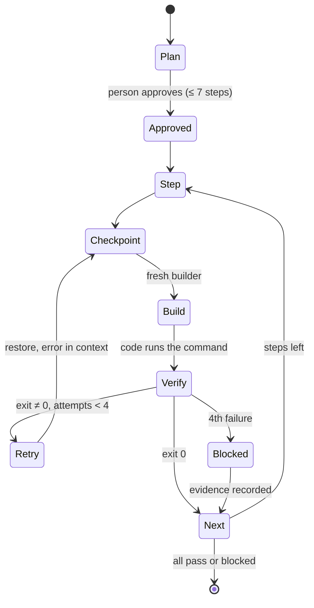

# The Kriya loop: a self-verifying agent loop (H14, K2 + K3)

Status: **H14a, H14b and H14c built** (2026-11-03, owner in chat: "Yes, start H14a", "Start H14b first", "Start H14c"); H14c's KriyaBench comparison waits for the owner's go-ahead on spend; H14d proposed. Implements K2 (plan → act → verify) and
K3 (step checkpoints) of `ENGINE_AND_EVOLUTION.md` §3 as phase H14. Track H
rules apply in full; nothing here changes a risk class, an approval, a mode,
a limit or a price.

## 1. What the owner asked for (2026-11-03, in chat)

A harness that is "the main intelligent one": it must finish real tasks
reliably on cheap and open models, not only on frontier ones. The owner's
reference is a self-verifying loop for Claude Code:

| # | Owner's reference | Meaning |
| --- | --- | --- |
| 1 | S = CLAUDE.md ⊕ rules(T) | Ground rules fixed before work starts |
| 2 | I = {i₁…i_k}, k ≤ 7 | The task split into at most 7 ordered, atomic steps |
| 3 | a_j = builder(i_j \| S) | One builder per step |
| 4 | v_j = verify(a_j) ∈ {pass, fail} | Verification outside the builder, never self-graded |
| 5 | a_j^(t+1) = M(P, a_j^t, error(a_j^t)), t ≤ 3 | At most 3 retries, each with the error |
| 6 | progress.md ← progress.md ∪ {(i_j, v_j)} | State outside the chat |
| 7 | CLAUDE.md_(n+1) = CLAUDE.md_n ⊕ rule(fail) | A failure seen twice becomes a rule |
| 8 | H = S ⊕ I ⊕ A ⊕ V ⊕ R | The harness is the composition |
| 9 | ∀j: v_j = pass ∨ blocked(i_j) | Done when every step passed or is blocked |

## 2. Why this makes a cheap model reliable

The loop moves the parts a weak model gets wrong into code:

- **Short contexts.** Each builder starts fresh with the rules, the plan,
  its one step and the files that step names. It never carries the whole
  history, so a small context window and weak long-range attention stop
  mattering.
- **Ground truth from code.** "Passed" is the exit code of the project's
  own test, lint, type or build command, run by the harness. The model
  can't talk itself into success.
- **Errors as input.** A failed step retries with the command's real
  output (trimmed to the failing part), which is the signal small models
  use best.
- **Bounded cost.** At most 7 steps × 4 attempts, inside the plan's
  reserved spend (track H rule 4). A step that can't pass is *blocked*
  with its evidence, not looped forever.
- **Undo for every step.** Each step starts from a checkpoint, so a bad
  attempt is thrown away whole instead of half-repaired.
- **Lessons that persist.** The same failure twice becomes a proposed
  project rule, so the next run avoids it.

## 3. How it maps onto DSH's seams (no fork, HD-02)

Everything is a Kriya plugin or bundle row over the pinned DSH (track H
rule 5). DSH already has most of the parts; Kriya composes them and owns
the verifier.

| Part | Built from | Kriya adds |
| --- | --- | --- |
| S rules | `dsh-agent-instructions` (AGENTS.md chain), Kriya skills | `.kriya/rules.md` read first; CLAUDE.md read as AGENTS.md when no AGENTS.md exists |
| I plan | `dsh-plan-mode`, `dsh-tool-todo` | A plan schema: ≤ 7 steps, each with files, a done-when sentence and a verify command; the person approves it (plan mode's review) |
| A builder | `dsh-subagent` + `dsh-subagent-spawn-in-process` | One fresh child per step, in the job's mode, with only S, the plan and its step |
| V verify | `ctx.on("tools/pre-execute")` (as `plugins/approvals`), DSH's sandboxed exec | `kriya_verify`: runs the step's command itself, records exit code, duration and trimmed output; the model can't call it with a different command |
| Retry | `dsh-goal` + `dsh-goal-round-driver` (rounds capped), `dsh-llm-retry` (transport only) | Round cap 3 per step; the next round gets the failure output |
| Progress | `dsh-goal` (durable state), `dsh-session-checkpoint-policy` | `.kriya/progress.md`: plan, each attempt, each verify result, written by code |
| Checkpoints (K3) | git | A shadow commit on `refs/kriya/<session>/<step>` before each step; `kriya undo` returns one step; the person's branches, index and stash are never touched |
| R rules | Kriya memory (unconfirmed, track-A rule 8) | A repeated failure class (same command, same error signature, twice) becomes a *proposed* rule; it reaches `.kriya/rules.md` only when the person confirms it |
| Context | `dsh-compaction`, `dsh-compaction-tool-result-pruner` | Per-step compaction thresholds tuned on KriyaBench (E1 class) |
| Done | — | Computed by code: every step `pass` or `blocked`; the session mirror shows "verified", "blocked at step n" or "not checked" (no verify command) |

Where the verify command comes from: discovered once per project from
`package.json` scripts, `Makefile`, `pyproject.toml`, `Cargo.toml` and
`go.mod`, shown to the person, and kept only when they confirm it. Without
one, the job still runs and ends "not checked", never "passed".

## 4. The loop

## 5. Phases and exit checks

| Phase | Content | Exit (measured, not claimed) |
| --- | --- | --- |
| H14a | `kriya_verify`, verify-command discovery and confirmation, `.kriya/progress.md`, "verified / blocked / not checked" | Unit tests on fixture repos; a forced failing test ends "blocked" with its output; no job with a failing command ever reads "passed" |
| H14b | K3 checkpoints and `kriya undo` | Undo drills on clean, dirty and mid-rebase fixture repos; the person's refs unchanged (checked by hash) |
| H14c | Plan schema, per-step fresh builders, retry cap | KriyaBench (H13): pass rate on the `budget` tier vs today's client on the same seed set, cost per passed task |
| H14d | Proposed rules from repeated failures, confirmation in Kriya | A failure class seen twice yields one proposal; nothing is written until confirmed |

Every capability ships behind a `harness.loop.*` switch, default off
(HT-REG-01): off means today's agent exactly.

## 6. What Kriya Harness has next to Claude Code (parity targets)

Parity targets, not claims about competitors (no RG-9 check here, track-A
rule 12).

| Capability | Kriya Harness today | Gap |
| --- | --- | --- |
| Plan mode, todos, subagents, goals, compaction, hooks | Yes, from DSH | — |
| Skills (SKILL.md, incl. Claude Code skills) | Yes (H7, Skills page) | — |
| Permission modes, phone approvals | Yes (HD-20, H5) | — |
| Editors (ACP), headless runs, cloud handoff | Yes (H11, `kriya run`, H8) | — |
| Project picker | Yes (Projects page, 2026-11-03) | — |
| Self-verifying loop | No | H14a, H14c |
| Per-step checkpoints and rewind | No | H14b |
| Learned project rules | No | H14d |
| Repo map | No | K1 (H15) |
| Parallel crew in worktrees | No | K5 (H18) |
| MCP servers | Kriya side only (track N) | Harness side not started |

## 7. Decisions for the owner

- **Start H14a now?** It is self-contained and testable without spending
  model allowance.
- **Default verify behaviour** when a project has no command: "not
  checked" (recommended) or ask the person for one at plan time.
- **Where proposed rules are confirmed:** in Kriya (phone, like memory;
  recommended) or in the harness UI.

## 7a. As built (H14c)

- Plan approval: `kriya_plan` records the plan; there's no extra approval
  gate on the plan itself. Every builder acts in the session's own mode,
  with its own approvals (risk classes unchanged), and plan mode (`/plan`)
  stays available when the person wants to review a plan first.
- A retry builds on the previous attempt's files (the owner's formula (5):
  the error goes back into context); it doesn't restore the checkpoint
  first. The checkpoint is there for `kriya undo`.
- Builders are DSH's in-process `spawn` children, awaited by the step
  (`delivery: "caller"`), one level deep; they may call `kriya_verify`
  (recorded under their own session, costing the step no attempts).
- At most 3 plans per session, so re-planning can't lift "blocked".
- KriyaBench with the loop: the loop's check must be the visible tests
  (`KRIYA_VERIFY_CHECK="node --test"`), never the hidden grader, or the
  agent would learn the grader (§4.3 grading integrity in
  `ENGINE_AND_EVOLUTION.md`).

## 8. Unknowns

- ~~Whether `kriya_verify` needs its own tool.~~ Settled in H14a: it is
  its own tool with no command parameter (only a step label), running the
  confirmed check through DSH's `ctx.shell` with the session's standing
  sandbox policy, as DSH's bash tool does. The switch is local
  (`kriya --loop`, `KRIYA_LOOP=on`; the `kriya-loop` row is disabled
  otherwise), because no feature flag reaches the client from Kriya
  without a contract change.
- Progress is kept in `~/.kriya/progress/`, not `.kriya/progress.md` in
  the project as §3 first said: the plugin runs outside the sandbox, so a
  write into the project would break Read only's "changes nothing".
- KriyaBench, measured 2026-11-03 (hard set, seed `7082ed2b6796`, budget
  tier, one run per arm): without `--loop` 12/12, ₹13.92, 24 min; with
  `--loop` 11/12, ₹6.52, 10 min. The one loop failure was the gateway
  answering HTTP 403 mid-run, not the loop. What this can't show yet:
  (1) no session made a plan, so `kriya_step` never ran with a real
  model; (2) the hard tasks hide their tests, so the visible check
  (`node --test`) had little to run and its passes are a weak signal;
  (3) cost varies a lot between runs (₹4.62 for the same arm the day
  before), so one run can't say the loop is cheaper. Needed for H14c's
  exit: multi-part tasks with visible tests (where planning and retries
  matter), and several runs per arm.
- Multi-part tasks added 2026-11-03 (`--level multi`, 5 tasks, seed
  `4af41d4c9de6`): an invoice with GST, a rate limiter, a rename with
  validation across files, a CSV report with Indian digit grouping, a
  checkout with four bugs in three files. Each has visible tests that fail
  as given and a hidden grader with more cases (HT-BEN-08). Next: three
  runs per arm on the `budget` tier (estimate ₹25–50 in all), with the
  owner's go-ahead.
