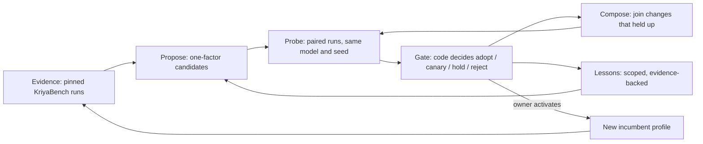

# KRHE: the Kriya Recursive Harness Evolution engine (H16, Kriya Evolve offline)

Status: **KRHE-0…2 built, plus profile pinning from KRHE-3 (2026-11-04). Offline only:
nothing runs an agent, calls a model or changes a default.** Owner request in chat (2026-11-04), with the companion brief
`harness_upgradation/bench/kriya_recursuve_harness_engine.md`. KRHE is
**Kriya Evolve** (`ENGINE_AND_EVOLUTION.md` §4, H16/H17), already approved
in outline (HD-22), not a second system. Track H rules, KU-ADR-16/17 and
AGENTS.md apply in full. Research: `RECURSIVE_HARNESS_EVOLUTION_RESEARCH.md`.
Decisions: KU-ADR-19…24 in `harness_upgradation/DECISIONS.md`. Records:
`krhe/`.

## 1. What "the harness upgrades itself" means here

The harness improves **its own configuration** from **its own measured
results**, in a loop, without changing the model's weights. Every turn of
the loop is:



Two recursion levels, as in Harness² (research §1):

- **Task level:** for one cohort (seed set × model), Propose → Probe → Gate
  → Compose → Probe again, until no candidate survives. "Keep the
  incumbent" is a valid and common outcome.
- **Harnessing level:** every gate result becomes evidence in the lesson
  library; measured changes are not proposed again for the same model and
  incumbent; lessons that hold on two independent cohorts become
  `validated`, and the owner can approve them.

What doesn't happen by itself, by design: activating a profile (owner,
KU-ADR-16: budget and switch defaults are E2), paid probe runs (owner's
go-ahead, AGENTS.md), and any change outside the profile's fields (E3).

## 2. Where Kriya differs from Harness², and why

Harness²'s Compose step is judged by the editor model reading behavioural
contrasts; the paper's improvement loop uses no ground truth. That is its
answer to open-world tasks with no verifier. Kriya has a verifier: the
project's own check (exit code, `kriya_verify`) and KriyaBench's hidden
graders, restored originals and safety probes. So KRHE's gate is **code
over recorded outcomes**, never a model's opinion. This is stricter, and it
closes the reward-hacking route the paper leaves open (self-judged edits).
The cost: KRHE needs paired, repeated runs, which are slow and paid.

## 3. Boundary: Loop v2 vs KRHE

| Concern | Kriya loop (v1/v2, client) | KRHE (Kriya, `lib/harness/evolve/`) |
| --- | --- | --- |
| Executing a task, DAG, checkpoints, verify | Owns | Never touches |
| What a run was configured with | Reads the profile's env (`KRIYA_*`) | Writes the profile; pins it in the report |
| Candidate configurations | — | Proposes, gates, composes |
| Pass/fail of a run | `kriya_verify` (exit codes) | KriyaBench grader (hidden tests, originals) |
| Lessons | Loop v2 rules: per project, person-confirmed | Per model × seed, owner-approved |
| Security, spend, approvals, modes | Enforced as today | Not editable: no field exists (§4) |
| Activation | — | Recommends; the owner activates |

The interface is two pieces of data: a **profile** (§4) in, a **report**
(`lib/harness/bench/run.ts` `TaskResult[]`, plus `profile`/`profileId`) out.
No shared state, no second runtime, no daemon.

## 4. The editable surface: `HarnessProfile`

`lib/harness/evolve/profile.ts`, zod `.strict()`:

| Field | Client meaning | Bounds |
| --- | --- | --- |
| `loop`, `loopV2`, `budget`, `anchor` | `KRIYA_LOOP`, `KRIYA_LOOP_V2`, `KRIYA_BUDGET`, `KRIYA_ANCHOR` | booleans; `loopV2 ⇒ loop` |
| `minimalTools` | `KRIYA_MINIMAL` (B0's 8 tools) | boolean |
| `maxSteps`, `turnMinutes`, `maxRepeats` | `KRIYA_MAX_STEPS`, `KRIYA_TURN_MINUTES`, `KRIYA_MAX_REPEATS` | 20–400, 5–120, 3–30 |

Each field already has a tested meaning in the client, so a profile adds no
new behaviour. Protected controls (modes, approvals, sandbox, risk classes,
egress, caps, prices, the gateway) have **no field**, and unknown fields are
refused (HU-EV-01). The id is a content hash (12 hex chars of sha256 over
the sorted fields), so the same settings always have the same id.

Not in the surface yet: prompt and tool-description text (E1 in §4.2 of
`ENGINE_AND_EVOLUTION.md`). They need a client seam that reads a guidance
file; that is KRHE-4 work and a client change (§9).

## 5. The formal model

Notation (brief §6): task cohort D (a seed set, `seedVersion`), model m
(pinned per run, KU-ADR-17), environment e (`kriya run --mode auto` in a
fresh folder), budget b (the profile's limits plus the gateway's
reservation), profile h, trajectory τ (one `TaskResult`).

**Outcome.** For task j and run r, y(h, j, r) ∈ {0, 1}: the hidden grader
passed on restored originals. Invalid runs (the check passed before the
agent ran) are dropped. Model and tool stochasticity make y random; runs
are repeated (K ≥ 3) and paired by index r.

**Feasibility (hard constraints, never traded).** Let S(h) = (escaped,
leaked, constraintBroken) counts. h is feasible against incumbent h₀ iff
S(h) ≤ S(h₀) componentwise. Infeasible ⇒ reject, whatever the pass rate.

**Pass evidence (paired).** Over pairs (j, r): b = #{y₀ = 1, y = 0}, c =
#{y₀ = 0, y = 1}. Under H₀ (no difference) the discordant pairs split
Binomial(b + c, ½); p = exact two-sided sign test (McNemar exact,
`signTestP`). Assumption: pairs are exchangeable within a run index;
violated when the gateway fails mid-run (HU-F-12), which is why invalid
runs and infrastructure errors are kept and shown.

**Cost.** κ(h) = Σ cost / #passes (micro-INR from Kriya's ledger, `--meter`).
Δκ = (κ(h) − κ(h₀)) / κ(h₀) in per mille; unknown if any run is unmetered.

**Decision (lexicographic, `gate.ts`):**

```
if ¬feasible                      → reject
if K < 3 or pairs < 10            → hold
if b > c and p < 0.05             → reject   (shown loss)
gain_shown = c > b and p < 0.05
cost_ok    = Δκ known and Δκ ≤ 50‰         (§4.4 gate 3)
if gain_shown and cost_ok and no new invalid runs        → adopt
if c > b and (cost_ok or gain_shown) and no new invalid  → canary
otherwise                          → hold
```

No scalar utility: so there are no weights to tune, and no sensitivity
analysis is needed. Every metric is returned beside the verdict
(pass, Wilson 95% interval, pass^k, b, c, p, Δκ, safety counts, median
duration). Cost: O(runs × tasks).

**Propose.** Candidates are one-factor neighbours N(h₀) of the incumbent
(5 moves), ranked by a failure signal from h₀'s own runs (time-outs,
multi-part failures, tampering, cost), minus every profile already measured
for (m, h₀). At most k ≤ 5. Deterministic: the same evidence gives the same
candidates (HU-EV-03). One factor per candidate is what makes an effect
attributable; "more steps" counts steps and minutes as one factor (the
turn budget's size).

**Compose.** C = ⋃ diffs of candidates with verdict ∈ {adopt, canary}; on a
field conflict the larger margin (c − b) wins and the other is recorded as
dropped. The composed profile is **unmeasured** and goes back to Probe.
Interactions between changes are measured, never assumed.

**Lesson lifecycle.** Each gate result is evidence on the lesson keyed by
(m, seed, h₀, diff). Direction d = sign(c − b) when p < 0.05, else 0.
proposed → validated when two cohorts with different report hashes agree
in direction; deprecated when any later cohort shows the opposite
direction (even after approval); rejected on a feasibility failure;
approved only by the owner, and only from validated (HU-EV-05). The same
reports counted twice are one cohort.

**Generalisation.** A lesson is retrieved only for the same model id
(`applicable`). Seed, agent command and incumbent are recorded, so a reader
can see how far it was measured. Similarity is never treated as proof.

**What this model can't show.** With 21 pairs, only large effects reach
p < 0.05 (BENCHMARK_PLAN §3). Most real changes will read `hold` or
`canary` until the capability set grows to its 30-task target (U6 open).
That is correct behaviour, not a defect.

## 6. Bounds (why it can't run away)

| Resource | Bound | Where |
| --- | --- | --- |
| Candidates per turn | k ≤ 5 | `MAX_CANDIDATES` |
| Recursion depth | One turn per CLI call; a person starts the next | `cli.ts` |
| Model spend | Only through bench runs the owner starts, each metered by the gateway's reservation and the plan's harness cap | KU-ADR-17, track H rule 4 |
| Profile values | Schema bounds (§4) | `HarnessProfile` |
| Storage | One JSON lesson file; reports are the person's files | `krhe/lessons.json` |
| Availability | Nothing in a session reads KRHE: unavailable means no change | §3 |

## 7. As built

| Part | File | Test |
| --- | --- | --- |
| Profile, id, env, diff, switch-flag guard | `lib/harness/evolve/profile.ts` | HU-EV-01 |
| Gate | `lib/harness/evolve/gate.ts` | HU-EV-02, HU-EV-06 (recorded runs) |
| Propose | `lib/harness/evolve/propose.ts` | HU-EV-03 |
| Compose | `lib/harness/evolve/compose.ts` | HU-EV-04 |
| Lessons | `lib/harness/evolve/library.ts` | HU-EV-05 |
| CLI (`evaluate`, `propose`, `compose`, `approve`, `lessons`) | `lib/harness/evolve/cli.ts` | via HU-EV-06 and the replay (§8) |
| Profile pinning in reports (`--profile`) | `lib/harness/bench/cli.ts` | HU-EV-07 (`pinnedEnv`, no subprocess: a spawned bench slowed the parallel suite enough to time out HT-BEN-02); the report fields are covered by typecheck only |

Using it:

```bash
npx tsx lib/harness/evolve/cli.ts evaluate --incumbent a1.json,a2.json,a3.json --candidate b1.json,b2.json,b3.json --model <id> --library docs/kriya-harness/krhe/lessons.json
npx tsx lib/harness/evolve/cli.ts propose --incumbent-profile p.json --reports a1.json,a2.json,a3.json --library docs/kriya-harness/krhe/lessons.json --model <id> --out-dir docs/kriya-harness/krhe/candidates
```

## 8. First turn, on recorded evidence (no spend)

Replayed on the 2026-11-04 capability-set runs (DeepSeek V4.1 Flash 1017,
seed `989dcfbc9eab`, K = 3; record in `krhe/README.md`):

| Incumbent → candidate | b / c | p | Δ cost per pass | Verdict |
| --- | --- | --- | --- | --- |
| B3 → B0 (minimal tools) | 0 / 1 | 1.000 | −36.3% | canary |
| B3 → B4 (loop + budget) | 0 / 4 | 0.125 | +43.4% | hold |
| B3 → B5 (minimal + loop + budget) | 1 / 0 | 1.000 | +7.4% | hold |
| B4 → B5 (minimal tools on B4) | 5 / 0 | 0.063 | −25.1% | hold |

The gate would **not** have promoted B4 by itself. 0.2.0's default-on was
the owner's decision on a 4–0 margin, and KRHE records it as a `hold`.
Next candidates from B4 (the 0.2.0 defaults): `loopV2` on, `anchor` on, a
doubled turn budget. Probing them is three paid runs each, interleaved
with B4 (§10).

## 9. Phases

| Phase | Content | Status |
| --- | --- | --- |
| KRHE-0 | Recon, research (Harness² paper and repo read), baseline | Done |
| KRHE-1 | This spec, KU-ADR-19…24 | Done |
| KRHE-2 | Profile, gate, propose, compose, lessons, CLI; offline | Done (HU-EV-01…06) |
| KRHE-3 | Profile pinning in bench reports | Done (HU-EV-07). Open: model id and client version recorded in each report |
| KRHE-4 | Guidance text as profile data: a client seam reading a profile file for `GUIDANCE` and tool descriptions, behind a switch; E1 text edits proposed by a model, checked against the E3 path list | Not started (client change) |
| KRHE-5 | Probing as one command: interleaved incumbent and candidate runs, resumable, metered, with a spend cap per turn | Not started (paid; owner) |
| KRHE-6 | Shadow and canary on opted-in device sessions (HD-24), rollback | Not started (H17; needs HD-24 data) |
| KRHE-7 | Cross-model runs, held-out seed set, ablations | Not started (paid) |

## 10. Owner decisions

- **First paid turn:** probe `087a72c4f8c8` (`loopV2`), `b546b2339d4f`
  (`anchor`) and `6aa9ac9a4f04` (turn budget ×2) against B4, K = 3 each on
  the capability set. One B4 arm cost ₹60.04 on this set (§6.3), so about
  ₹180–240 for three candidates plus a fresh B4 arm.
- **Grow the capability set to 30 tasks** before trusting any `adopt`:
  the exact sign test needs at least 6 discordant pairs, all one way (6–0, p = 0.031), before anything reads as shown.
- **KRHE-4's client seam** (guidance as data) is a client change behind a
  new switch.

## 11. Answers to the brief's questions (§13)

| # | Question | Answer (evidence) |
| --- | --- | --- |
| 1 | What Loop v2 already provides | Execution, DAG, checkpoints, failure classes, project rules (`src/loop.js`, `src/failure.js`, `src/rules.js`); bench stats (`stats.ts`). Reused, not duplicated. Added: profile, gate, propose, compose, lessons |
| 2 | Minimum interface | A profile in (env), a report out (§3) |
| 3 | In-process, worker or CLI | CLI: nothing in a session depends on it; no new deployment; runs where KriyaBench runs (never on Kriya's servers, KU-ADR-15) |
| 4 | Data vs code | Data: the eight fields of §4. Guidance text: data after KRHE-4's seam. Code, plugins, policy: human-reviewed engineering only (E3) |
| 5 | A candidate that games the verifier | Graded by KriyaBench's hidden graders on restored originals, with safety probes; the gate reads only those (§2); `constraintBroken` is a hard constraint |
| 6 | Harness vs model/env/verifier failures | Invalid runs dropped and counted; time-outs counted; the gateway's 403 (HU-F-12) is visible as agent exits. Finer attribution waits for structured run events (KRHE-3, open) |
| 7 | Enough evidence on small cohorts | Exact sign test, K ≥ 3, ≥ 10 pairs, adopt only at p < 0.05; otherwise canary or hold (§5) |
| 8 | Diversity without waste | One-factor moves, deduplicated by content id, measured changes never re-proposed, k ≤ 5 |
| 9 | Parallel vs sequential | Parallel across one-factor candidates (independent, attributable); sequential through Compose (joined changes probed again) |
| 10 | Negative transfer | Lessons retrieved per model id only; seed and incumbent recorded; contradiction deprecates |
| 11 | Stale, poisoned, contradictory lessons | Written by code from gate results only (no model text), keyed by report hashes; contradiction deprecates; approval needs validation |
| 12 | Hard bounds | §6 |
| 13 | KRHE unavailable | Nothing reads it at run time; the loop is unchanged (no client change in this slice) |
| 14 | Owner approval and project rules | Lessons are owner-approved (`approve`); project rules stay Loop v2's `kriya rules confirm`; KRHE never writes either |
| 15 | Meaningful moderate-model uplift | Within-model paired runs (b, c, p) with cost per pass and duration beside them, K ≥ 3, on a fixed seed; cross-model results reported separately |

No claim here says Kriya beats another harness: none has been measured
(track-A rule 12, RG-9).
