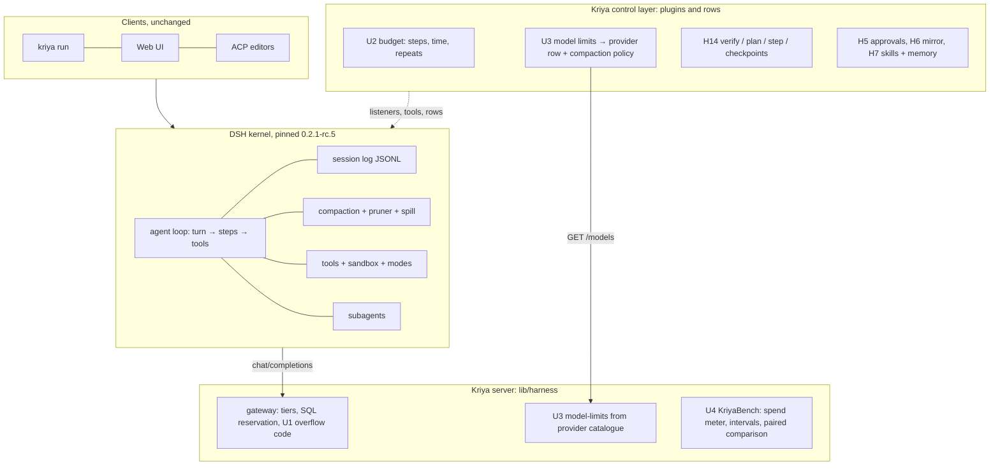
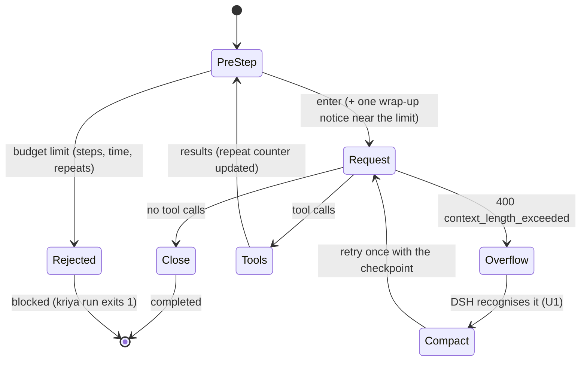

# Harness upgrade: target architecture

The target is **Option A+** (KU-ADR-01): DSH stays the execution kernel;
Kriya owns a thin, testable **control layer** of policy, truth and
measurement around it. No second loop, session store, queue or protocol.
The current state is in FORENSIC_AUDIT.md; why each piece is (or isn't)
here is in DECISIONS.md and RESEARCH.md.

## 1. Layers

## 2. Control points and who enforces them

| Concern | Enforced by (code, never the model) | Seam |
| --- | --- | --- |
| Identity, tenant | `authenticateDevice` + RLS (invariants 1, 3) | server |
| Spend | `reserve_harness_spend` (SQL), monthly cap, 3 open answers | server |
| Turn bound (stop invariant) | `plugins/budget` | `agent/pre-step` reject, `tools/post-execute` |
| Context truth | declared limits (U3), recognisable overflow (U1) | provider `models`, `compaction-basic.modelPolicies`, gateway error code |
| Side effects | modes, sandbox, approvals (HD-20, H5) | DSH sandbox policy, `tools/pre-execute` |
| Completion | exit code of the person's confirmed check (H14a); turn reason `blocked` for budget stops (U2) | `kriya_verify`, headless exit code |
| Undo | shadow refs (H14b) | `tools/pre-execute` |
| Untrusted content | memory quarantine, mirror marker, skills as guidance only | server + plugin |
| Evidence of improvement | KriyaBench-M (free) and KriyaBench-R (paid), paired, with intervals | `tests/upgrade-run.test.js`, `lib/harness/bench/*` |

## 3. The turn with the control layer (U1–U3 on)

Proactive compaction runs before a request when the conversation passes
`min(0.8·W, W − O − H)` with W, O and H now from the tier's real model,
capped at the 262,144 working window (U3).

## 4. Invariants (refined from the mandate §4.1 to this code)

1. **Identity**: only `authenticateDevice` (unchanged).
2. **Authorization at execution**: sandbox + approvals in `tools/pre-execute`.
3. **Isolation**: KriyaBench and agent commands never on Kriya's servers.
4. **Durability**: DSH JSONL is the session's truth; Kriya adds no store.
5. **Idempotency**: no Kriya tool retries a side effect; gateway retries only
   on 429/5xx and only before a response is streamed.
6. **Budget**: month (SQL) and turn (U2) bounds; neither can be raised by a
   model or a skill. The turn limits come only from the launch environment.
7. **Approval**: unchanged (risk classes in code).
8. **Trust**: provider error text never leaves the server (U1 returns a fixed
   sentence); catalogue numbers are data, validated as positive integers.
9. **Verification**: "completed" is not "verified"; a budget-stopped turn is
   `blocked`; verified comes only from `kriya_verify` exit codes.
10. **Compatibility**: contract changes are additive; a client without U3
    ignores `contextWindow`; a server without U3 sends none and the client
    keeps DSH's defaults.
11. **Observability**: per-request model, tokens and cost in `harness_usage`;
    per-task spend in KriyaBench reports (U4).
12. **Stop**: every loop Kriya adds is bounded (budget, ≤ 7 plan steps, ≤ 4
    attempts, ≤ 3 plans, 1 overflow retry, 1 fallback retry).

## 5. What is deliberately not in the architecture

Multi-agent crews, ToT/GoT search, learned routing, CodeAct in the coding
loop, a Kriya JSON-RPC server, a second event store or queue, a Kriya
summariser. Each has a falsifying experiment in RESEARCH.md §2; none is
built until one passes.
