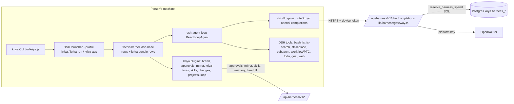

# Kriya Harness: forensic architecture audit (U0)

Date: 2026-11-04. Author: Claude Code (Opus 5.5), harness-upgrade programme
(track HU). Method: source reading of both repositories and of the pinned
DSH packages in `node_modules`, the recorded profile dumps, existing tests
and bench reports, plus runs on the real pinned DSH with a scripted model.
Every claim names a file, symbol, test or run. "Kriya" is this repository
(`Kriya-Tavi`); "client" is `kriya-harness`.

## 0. What was audited

| Item | Value |
| --- | --- |
| Kriya repository | `main` at `f462913` (clean except the untracked mandate doc) |
| Client repository | `main` at `e9fbe01` (clean); **newest work is on `feat/kriya-loop` at `d474314`** (2 commits not merged into `main`: `404a89c` plan-tier filter, `d474314` model names). The audit and every change below build on `d474314`, in a detached worktree `../kriya-harness-upgrade` so the person's checkout (which their installed `kriya` profiles link to) is untouched |
| DSH | `@deepseek-ai/dsh` **0.2.1-rc.5** (client `package.json`, exact pin; `@deepseek-ai/cordis ~4.0.5`); MIT; DSH calls itself an unaudited developer preview (`docs/kriya-harness/ENGINE_AND_EVOLUTION.md` §2) |
| Models | Tiers `budget` / `balanced` / `escalation` mapped by the owner (`routing.*` in `/owner/config`); the budget tier and the fallback are `deepseek/deepseek-v4.1-flash-1017` (`lib/config.ts:465`) |
| Mandate | `kriya_world_class_harness_reserach_and_excecutiion.md` (this folder), read in full |

## 1. Topology (verified)

Kriya owns the control plane (identity, spend, approvals, mirror, skills,
memory, handoff) and a set of plugins; **DSH owns the runtime kernel**: the
agent loop, session log, tool registry and execution, sandbox, compaction,
subagents, LLM adapter, Web UI and ACP server.

## 2. The turn, reconstructed from source

`dsh-agent-loop/lib/index.js` `ReactLoopAgent.turn()` (≈ line 938) and
`step()`; Kriya hooks marked **K**.

1. **Input.** A user message enters the agent's inbox (`agent/inbox/spliced`
   event, durable). Headless: `dsh-headless` submits the task; Web UI and ACP
   submit through their controllers.
2. **Turn open.** `session.append("turn/start")` (durable JSONL,
   `dsh-session-persistence-jsonl`, root `~/.kriya/sessions`).
3. **Pre-step.** `systemPrompt.assemble()` builds the prompt from sections
   (persona `You are a coding agent powered by the {{model}} model.`, AGENTS.md
   chain ≤ 64 KB, skills catalogue, tool guidance; **K** loop guidance when
   `--loop`); then the waterfall `agent/pre-step` (listeners may replace the
   messages or **reject** → the turn ends `blocked`). **K (new, U2):**
   `kriya-budget` counts steps here.
4. **Request.** `agent/request` waterfall → `ctx.llm.prepareCall()` → pi-ai
   openai-completions request: `model` (tier alias), `messages`, `tools`
   (27 in the headless profile), `stream`, `stream_options`, `store`,
   `max_completion_tokens` (DSH's declared output cap; 32,768 by default,
   measured in HU-M-04).
5. **Gateway (server).** `chatCompletion` (`lib/harness/gateway.ts`):
   switch, plan, tier alias, price, **SQL reservation**, strips
   `max_completion_tokens` and other fields (`STRIPPED`, line 35) and sends
   `max_tokens = min(max_tokens ?? 16,384, 16,384)` (`MAX_OUTPUT_TOKENS`,
   `lib/harness/metering.ts:20`) to the tier model; on 429/5xx one retry on
   the fallback model (line 144); streams back with `model` rewritten to the
   alias; usage chunk settles the reservation.
6. **Stream.** Chunks published process-locally; one durable
   `assistant/message` per attempt; transport errors go to `dsh-llm-retry`
   (normal mode, 5 retries) and `agent/request-error`.
7. **Tools.** Parallel-safe calls in a bounded pool (`maxParallelToolCalls`
   10), exclusive calls as barriers; each through `tools/pre-execute`
   (**K** approvals → phone, **K** loop checkpoints), DSH's sandbox policy
   (`workspace-write` default), timeout policy (bash 60 s), `tools/post-execute`
   (DSH repeat-tool reminder at 3/5/8 identical calls; **K (new)** budget
   repeat counter), spill (results over 12,500 tokens go to a file), pruner
   (results over 8,192 chars trimmed at compaction). Results are durable
   `tool/result` events.
8. **Continue or stop.** A step that ends with tool calls continues; one
   without tool calls ends the turn after `agent/turn-stopping` (serial; a
   listener may steer). **There is no step, time or spend bound inside a
   turn** (dsh-agent-loop README line 220: "No built-in turn budget").
9. **Compaction.** `dsh-compaction-basic`: proactive at
   `floor(min(0.8·W, W − O − 65,536))`; recovery once after a *recognised*
   context-overflow error (`maxOverflowRetries` 1); the checkpoint is a
   structured Markdown summary written by the routed model.
10. **Turn close.** `turn/end {reason}` (completed / blocked / aborted /
    error / max-tokens). Headless exits 0 only for `completed`.
11. **Persistence and mirror.** JSONL log (crash repair by
    `interruptedTurnClosers` on resume); **K** mirror posts a turn summary
    to a Kriya thread when the person enabled it.
12. **Completion claim.** Without `--loop`: the model's final text. With
    `--loop`: `kriya_verify` records exit codes; the verdict (verified /
    failed / blocked / not checked) is computed in `src/verify.js`.

## 3. Capability and provenance matrix

| Capability | Provenance | Where | State |
| --- | --- | --- | --- |
| Agent loop, steps, parallel tools, cancellation | DSH | `dsh-agent-loop` | Mature; no turn budget |
| Durable session log, resume, crash repair | DSH | `dsh-session*`, JSONL | Mature; known gap: root shutdown may lose final `turn/end` (DSH README) |
| LLM adapter, streaming, partial tool calls, retry | DSH (+ pi-ai, patched) | `dsh-llm-pi-ai`, `dsh-llm-retry` | Mature; overflow detection by error text only |
| Tool registry, fs/bash/search/editor tools | DSH | `dsh-tool-*` | Mature ACI (str-replace editor, fs-search, spill, pruner) |
| Sandbox, permission presets, modes | DSH + Kriya config | `dsh-sandbox-*`, bundle `sandbox-policy`/`permission`, `src/modes.js` | Working (HD-20) |
| Compaction | DSH | `dsh-compaction-basic`, pruner, image offload | Working, but thresholds from a window Kriya never declared (fixed in U3) |
| Subagents (spawn/fork), workflows, PTC | DSH | `dsh-subagent*`, `dsh-workflow-ptc` | Present; PTC on by default in the tool list |
| Plan mode, todos, goals | DSH | `dsh-plan-mode`, `dsh-tool-todo`, `dsh-goal*` | Present |
| ACP server (editors) | DSH | `dsh-acp-app` | Working (H11) |
| SDK JSON-RPC server | DSH | `dsh-sdk-jsonrpc-server` | Present, unused by Kriya |
| Device identity, token hashes | Kriya | `lib/auth.ts authenticateDevice`, `lib/harness/devices.ts` | Working (H2) |
| Gateway, tiers, SQL spend reservation | Kriya | `lib/harness/gateway.ts`, `metering.ts`, `reserve_harness_spend` | Working (H3); hid overflow (fixed U1) |
| Phone approvals | Kriya | `plugins/approvals`, `lib/harness/approvals.ts` | Working (H5) |
| Session mirror | Kriya | `plugins/mirror`, `lib/harness/mirror.ts` | Working (H6) |
| Skills, memory (quarantined) | Kriya + DSH skill seam | `plugins/kriya-tools`, `plugins/skills`, `lib/harness/skills.ts`, `memory.ts` | Working (H7) |
| Handoff / pull, device world | Kriya + track C | `plugins/kriya-handoff`, `src/world.js`, `lib/harness/handoff.ts` | Server done; staging checks open (H8, H10) |
| Verify-from-exit-code, plans, fresh builders, checkpoints/undo | Kriya | `plugins/loop`, `src/verify.js`, `src/loop.js`, `src/checkpoints.js` | Built (H14a–c), behind `--loop`; plans never exercised by a real model yet |
| KriyaBench | Kriya | `lib/harness/bench/*` | Saturated; cost never recorded (fixed in U4 for future runs) |
| Kriya Evolve (E1/E2/E3) | Kriya (design only) | `ENGINE_AND_EVOLUTION.md` §4 | **Not implemented** (documented only) |
| Repo map (K1), router (K4), crew (K5) | — | `ENGINE_AND_EVOLUTION.md` §3 | **Not implemented** |
| Turn budget, stagnation stop | Kriya (new, U2) | `plugins/budget` | Built here, behind `--budget` |
| Model capability profile | Kriya (new, U3) | `lib/harness/model-limits.ts`, `/models`, `src/launch.js modelLimits`, bundle rows | Built here |
| Telemetry | DSH (disabled by Kriya, HD-17) | bundle `otel` rows off | Off by design; no Kriya-side traces |

## 4. Findings

Severity: **H** high, **M** medium, **L** low. Status after this session.

| Id | Finding | Evidence | Sev | Status |
| --- | --- | --- | --- | --- |
| HU-F-01 | No turn budget: a model that keeps calling tools runs until the plan's monthly cap or the process is killed. Violates the mandate's stop invariant | dsh-agent-loop README:220; HU-M-01 before arm: 31 steps until the script itself stopped | H | **Fixed behind `--budget`** (U2); default-on is an owner decision (KU-ADR-04) |
| HU-F-02 | Repeated identical calls are only reminded (3/5/8), never stopped | `repeat-tool-reminder` row; HU-M-02 before arm: 31 identical calls | M | **Fixed behind `--budget`** (U2) |
| HU-F-03 | The gateway replaced every provider 4xx body with `bad_request`, so DSH could never recognise a context overflow and its one-shot recovery never ran: long sessions on a smaller-window model ended in error | `gateway.ts` failure branch; DSH `STRUCTURED_CONTEXT_OVERFLOW` (dsh-llm:160), pi-ai `isContextOverflow`; HU-M-03 before arm exit 1 | H | **Fixed** (U1): `context_length_exceeded`; HU-M-03 after arm compacts once and exits 0 |
| HU-F-04 | Tiers are declared without context window or output cap, so DSH assumes 262,144 / 32,768 for every model. A tier routed to a model with < ~164k tokens overflows before compaction; one with a much bigger window compacts early (budget tier: 1,048,576 real, compaction at 163,840) | pi-ai `defaultContextWindow` (index.js:1150); compaction formula (dsh-compaction-basic README); RESEARCH R-05 | H (small-window tiers) / L (budget tier) | **Fixed** (U3): limits from the provider catalogue, capped at a 262,144 working window (KU-ADR-09) |
| HU-F-05 | DSH's output cap never reaches the provider: DSH sends `max_completion_tokens`, the gateway strips it and sends 16,384. Reasoning tokens count toward that cap, and DeepSeek recommends ≥ 256K for max effort (RESEARCH R-04), so long reasoning steps may end `finish_reason: length` | `STRIPPED` (gateway.ts:35-40), `MAX_OUTPUT_TOKENS` (metering.ts:20); HU-M-04 | M | **Open, owner decision** (cost vs completeness; KU-ADR-09). U3 now declares O = 16,384 so DSH's budgeting matches the wire |
| HU-F-06 | The gateway silently switches to the fallback model on 429/5xx and rewrites `model` to the alias: a session (and a benchmark run) can mix models with nothing on the client saying so | gateway.ts:144 and `passThrough`; `harness_usage.model` records the truth server-side only | M | Open: record per-run model mix from `harness_usage` in bench reports (U6) |
| HU-F-07 | KriyaBench is saturated (12/12 easy, 12/12 and 11/12 hard) and every report has `costMicroUsd: null`; one run per arm. It cannot show an improvement, and the H14c "loop is cheaper" reading is within run-to-run noise (₹4.62 vs ₹13.92 for the same arm on two days) | `docs/kriya-harness/bench/*.json`; status.md H14c | H (for decisions) | **Partly fixed** (U4): per-task spend meter, Wilson intervals, paired comparison, pass^k. Capability set still to build (U6) |
| HU-F-08 | The budget model alias moved build on 2026-10-17, so earlier "budget tier" bench runs may be a different model | RESEARCH §3.1, R-04 (secondary) | M | Open: pin and record the resolved model per run (U6) |
| HU-F-09 | Plans and fresh builders (`kriya_step`) were never used by a real model (no session made a plan in the H14c run): the K2 design is unmeasured | status.md H14c comparison | M | Open: multi-part arm runs (U6, owner spend) |
| HU-F-10 | Kriya Evolve, repo map, router and crew are documented (ENGINE_AND_EVOLUTION) but not implemented; nothing in the product claims them | source search: no code | L | Recorded; research recommends rejecting crew and learned routing (RESEARCH #8, #15) |
| HU-F-11 | `feat/kriya-loop` (`404a89c`, `d474314`) isn't merged into the client's `main`; `main` still offers tiers the plan refuses | `git log --all` in the client | M | Owner: merge PR or say which branch is canonical |
| HU-F-12 | Mid-run HTTP 403 in the H14c loop arm (`hard-path-traversal`), cause unknown | status.md H14c | M | Open: needs Render/gateway logs 2026-11-03 14:12–14:14 UTC (owner) |
| HU-F-13 | Persona line names the tier ("powered by the budget model") or the display name, not a real model id; harmless but not informative to the model | `personaPrefix` dump line 429 | L | Recorded; no change (cache-stable prefix matters more) |
| HU-F-14 | No Kriya-side traces: telemetry is off by design (HD-17); a failed task is diagnosable only from the local JSONL log and `harness_usage` | bundle `otel` rows | M | Deferred: metadata-only OTel GenAI spans behind a switch (KU-ADR-14) |
| HU-F-16 | After a compaction the person's own request survives only inside the model-written checkpoint: a summary that leaves out a requirement loses it (the summariser is shown it; the retried request no longer has it) | HU-M-06 before arm (`keptAfter: false`) | M | **Fixed behind `--anchor`** (U7): the person's messages kept word for word in a late system-prompt section, which compaction never condenses; after arm `keptAfter: true` |
| HU-F-17 | Verified healthy (U7): a session killed mid-tool (SIGKILL of the whole process group) resumes with `--session-id`; DSH closes the interrupted call and the finished work is in the resumed request. A connection cut mid tool-call stream is retried and the tool runs exactly once | HU-M-05, HU-M-07 | — | No change needed |
| HU-F-18 | A "verified" verdict stayed verified after the agent changed files, and a pass whose work edited the tests looked like any other pass | `src/verify.js verdict` before U8 | M | **Fixed** (U8, under `--loop`): fingerprint per run, stale → "not checked", sent back once at turn end, changed test/check files named |
| HU-F-19 | Every request carries 27 tool schemas (~21 KB) and a skills catalogue (~3.7 KB of messages), whatever the task; the vendor's own same-model numbers favour shell-only scaffolds (RESEARCH R-03) | HU-M-09 | M | Measurable now: B0 arm (U6); the decision waits for the paid runs |
| HU-F-20 | KriyaBench's H13 tamper rule fails a task when the agent *adds* tests to a protected test file, though the originals are restored before grading: 4 of B3's and 5 of B4's 10 cap tasks were "tampered" this way; 5 of those 9 passed the hidden grader | `bench/r-cap-b3-1.json`, `r-cap-b4-1.json` (`verifyExit` 0, agent summaries) | M (benchmark validity) | **Fixed** (owner, 2026-11-04: "Grade on originals"): tests are restored and graded on the originals, edits reported as `tampered`; `constraints` (write-tests target, no-new-dependency probe) still fail |
| HU-F-21 | On the cap set, the tool-minimal arm passed 9/10 at ₹0.37 per pass, ahead of the full toolset (6/10) and `--budget --loop` (5/10, ₹2.56 per pass); not significant (p = 0.25, n = 10, K = 1) | BENCHMARK_PLAN §6.2 | M | Next: K = 3 on a harder set, and a skills-on/tools-minimal arm to separate tools from skills |
| HU-F-22 | With K = 3 on the new cap set, `--budget --loop` passed 18/21 vs 14/21 for today's harness (all 4 discordant pairs favour it, p = 0.125), at +43% cost per passed task; the tool-minimal arm matched today's harness at 68% of its spend | BENCHMARK_PLAN §6.3 | — (evidence) | Default-on not yet (fails the cost gate); next arm: minimal tools + loop |
| HU-F-23 | Minimal tools + loop (B5) lost to the full tools + loop (B4) 0–5 (p = 0.063) and solved neither hard task: B4's gain needs the loop *and* part of the full tool list | BENCHMARK_PLAN §6.4 | — (evidence) | Next (owner spend): B4 minus one tool group at a time (subagents; todo/goal; skills + memory) to find which |
| HU-F-15 | `node_modules` symlink in the client worktree shows as untracked (`.gitignore` matches the directory form only) | `git status` in the worktree | L | Worktree-only; never commit it |

## 5. Risk register

| Id | Risk | Likelihood | Impact | Control in place | Next control |
| --- | --- | --- | --- | --- | --- |
| R1 | Runaway turn spends the month's cap | Medium (weak models loop) | High | SQL cap per month; 3 open answers | U2 budget (on by default after owner decision) |
| R2 | DSH upgrade changes a seam Kriya depends on (`agent/pre-step`, row ids, error regexes) | Medium (rc releases) | High | Exact pin; HT-REL-03 dump comparison | HU-M-01…04 run on every bump (U5 compatibility suite) |
| R3 | Benchmarks mislead (saturation, model drift, noise) | High | High | Hidden tests, tamper checks | U4 stats + U6 capability set + model pinning |
| R4 | Overflow recovery compacts away a requirement | Low–Medium | Medium | DSH's structured checkpoint keeps "Primary Request" and "Pending Jobs" | Resume-fidelity tests (U7) |
| R5 | Prompt injection from repo/tool text causes a side effect | Medium | High | Approvals in code, sandbox, modes, memory quarantine | Rule-of-Two audit in `policy.ts` (KU-ADR-18) |
| R6 | Output truncation at 16,384 on reasoning-heavy steps | Medium | Medium | — | Owner decision HU-F-05 with bench evidence |
| R7 | Silent fallback model mixes capabilities | Low | Medium | Server records `model` | Bench reports read the model mix (U6) |
| R8 | Owner merges client branches out of order | Medium | Medium | — | This programme builds on `d474314`; merge order in status.md |

## 6. Baseline (before any change)

| Check | Command | Result |
| --- | --- | --- |
| Client at `e9fbe01` (main) | `npm run check` | 172/172 pass, exit 0 (42 s) |
| Client at `d474314` (feat/kriya-loop) | `npm run check` | **175/175 pass, exit 0** |
| Kriya harness tests at `f462913` | `env -u OPENROUTER_API_KEY npx vitest run tests/harness tests/db/harness-rls.test.ts` | **14 files, 178 tests pass**, exit 0 (25 s) |
| Kriya full check | last recorded run (status.md, 2026-11-03) | 2878 passed, 1 failed (`hard-perf-dedupe` load timeout, known) |
| KriyaBench (real model) | recorded runs 2026-11-02/03 | easy 12/12, hard 12/12, hard-hidden 11/12, hard noloop 12/12, hard loop 11/12; cost null; one run each |
| KriyaBench-M (real DSH, scripted model) | `tests/upgrade-run.test.js` "before" arms | runaway: 31 steps, exit 0; stagnation: 31 identical calls, exit 0; overflow: exit 1; limits: `max_completion_tokens` 32,768 |

No live KriyaBench run was made in this session: it needs a device the owner
approves in their browser and spends allowance (BENCHMARK_PLAN §7).
