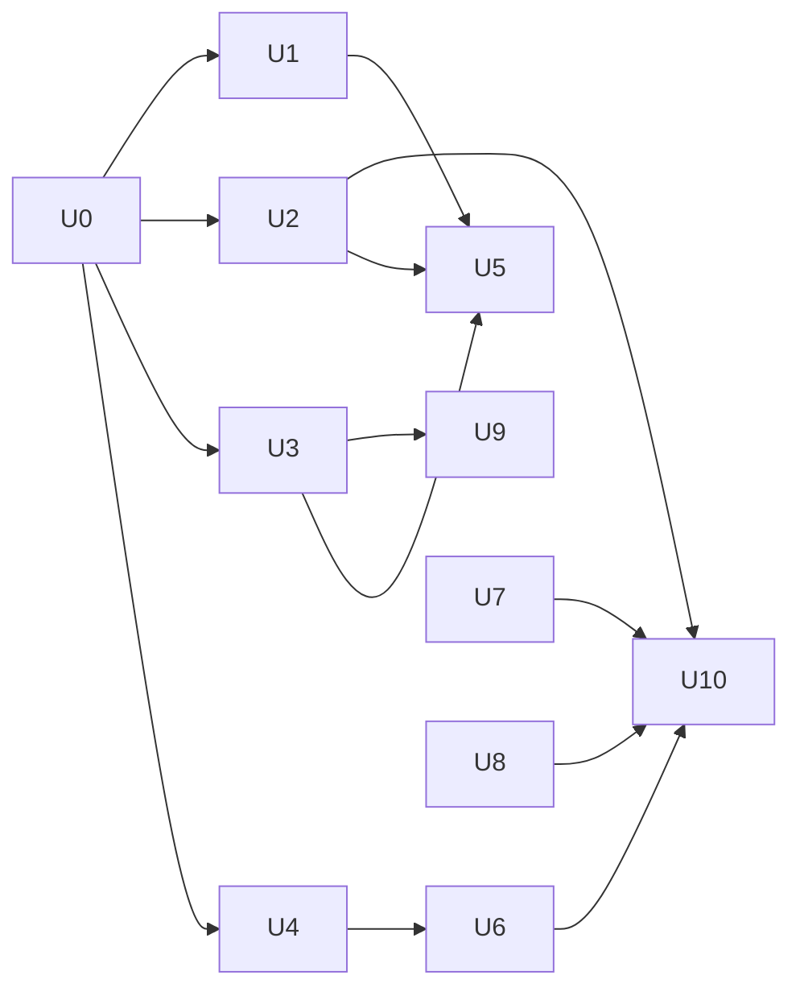

# Harness upgrade: implementation plan (phases U0–U10)

Order by leverage and risk: truth and bounds first (cheap, measurable on the
real kernel for free), measurement next, then the experiments that need paid
runs. Every phase: smallest change, tests first or alongside, KriyaBench-M
before/after where it applies, both repositories' checks, status.md entry.
A switch-gated phase is COMPLETE when built and tested; turning it on by
default is a separate owner decision with KriyaBench-R evidence.

| Phase | Content | Repos | Switch | Exit (measured) | Status |
| --- | --- | --- | --- | --- | --- |
| U0 | Forensic audit, baseline, research, ADRs, docs | both (docs) | — | FORENSIC_AUDIT, RESEARCH, DECISIONS; baseline counts recorded | **COMPLETE** (2026-11-04) |
| U1 | Gateway names a provider's context overflow `context_length_exceeded` (DSH compacts and retries) | Kriya `lib/harness/gateway.ts`, `contract.ts`; client `REFUSALS` | none needed (a refusal that was wrong; additive contract code) | HU-GW-01; HU-M-03 before exit 1 → after exit 0 with one compaction | **COMPLETE** |
| U2 | Turn budget: steps, wall time, identical repeats; one wrap-up notice; `blocked` at a limit | client `plugins/budget`, bundle row, `--budget` | `KRIYA_BUDGET=on` (`--budget`), default off | HU-BG-01…03; HU-M-01 31 → 8 steps, HU-M-02 31 → 4, exit 1 | **COMPLETE** (default-on: owner, after one KriyaBench-R arm) |
| U3 | Model limits: catalogue → `GET /models` → provider row + compaction headroom, capped at 262,144 | Kriya `lib/harness/model-limits.ts`, `/models`, contract; client `modelLimits`, bundle rows | data-driven: no limits → today's defaults | HU-GW-02, HU-CL-01, HU-M-04 (32,768 → 8,192 on a 32k tier) | **COMPLETE** |
| U4 | Bench honesty: per-task spend from the ledger (`kriya usage --json`, `--meter`), Wilson intervals, paired sign test, pass^k, `compare.ts` | Kriya `lib/harness/bench/*`; client `kriya usage` | bench-only | HU-BEN-01…03; CLI test for `kriya usage` | **COMPLETE** |
| U5 | DSH compatibility gate: `check:seams` (10 named seams) in `npm run check` and the release gate; KriyaBench-M in CI (already in `npm test`); bump checklist DSH_UPGRADE.md | client `scripts/check-seams.js`, `package.json` | — | HU-SEAM-01: all present on 0.2.1-rc.5; a renamed hook, missing file or narrowed overflow pattern is named with its Kriya user | **COMPLETE** (2026-11-04); named CI job `dsh-compatibility` added 2026-11-04 |
| U6 | KriyaBench capability set, tool-minimal control arm, paid B0/B3/B4 runs | Kriya `lib/harness/bench/seed-cap.ts`, `task.ts` (`cap`, `exploit`); client bundle rows (`KRIYA_MINIMAL`) | bench-only | Each task: fails as given, passes with its fix, exploit fails (HU-BEN-04); B0 offers 8 tools (HU-M-09); B0/B3/B4 × K=3 with intervals | IN_PROGRESS (2026-11-04): 10 tasks and B0 built; first paid calibration run done (B0 9/10, B3 6/10, B4 5/10, ₹23.02; BENCHMARK_PLAN §6.2): set too easy; 7 saturated tasks retired to `hard`, `cap-date-rules` audited, 4 harder spec tasks added (cap set 7, `989dcfbc9eab`); grading on originals (OA-8 decided); K = 3 run done (B0 15/21, B3 14/21, B4 18/21, ₹114.81, BENCHMARK_PLAN §6.3); arm B5 built (HU-M-10) and run: 13/21, lost to B4 0–5 (p = 0.063), ₹32.47 (BENCHMARK_PLAN §6.4); next: B4 minus one tool group per arm (owner spend) and more spec tasks |
| U7 | Long-horizon drills: crash and resume, compaction fidelity, stream cut mid tool call; fix for what they find (`plugins/anchor`) | client tests on real DSH, `plugins/anchor` | `KRIYA_ANCHOR=on` (`--anchor`), default off | HU-M-05 resume exit 0 with prior work; HU-M-06 requirement lost → kept with `--anchor`; HU-M-07 tool ran once | **COMPLETE** (2026-11-04) |
| U8 | Verification hardening: each verify run records the working tree's fingerprint; a later change makes "verified" stale ("not checked"); at turn end a stale pass is sent back once; a pass names changed test/check files | client `src/verify.js`, `plugins/loop` | under `--loop` | HU-VF-01…03; HU-M-08 (sent back once, 2 passes, verified for the current files) | **COMPLETE** (2026-11-04) |
| U9 | Output cap and model-limits persistence (owner decisions HU-F-05, KU-ADR-09 (a)): `kriya.models` columns via a migration; a bench arm counting `finish_reason: length` | Kriya migration, `lib/models.ts syncCatalogue`, `db/schema.ts` | `harness.*` setting | Migration up/down test; arm data | **COMPLETE** (2026-11-04, owner: "I approve Phase U9"): migration `20270701000000_model_limits` + rollback, `syncCatalogue` fills the columns, `model-limits.ts` reads them, `harness.maxOutputTokens` (default 65,536) replaces the fixed 16,384; HU-DB-01, HU-SYNC-01, HU-GW-02. Production migration and catalogue refresh are the owner's (RELEASE_0.2.0.md) |
| U10 | B4 as the default (loop + budget on, `--no-loop`/`--no-budget`), SAFETY.md and README, version 0.2.0, release notes | client `src/modes.js switchEnv`, `bin/kriya.js`, docs; RELEASE_0.2.0.md | owner decision: on | HU-SW-01; client check green; `release:check` green | **COMPLETE** (2026-11-04, owner: "B4 is our winner"); publish and pilot are the owner's |

## Dependencies

U5, U7 and U8 are free and independent of each other: they can run in
parallel sessions (different files). U6's task writing is free; its runs are
paid.

## Rollback

Every client change is a plugin, a bundle row or an additive launcher env
var: revert the worktree commit, or run without `--budget`. Server: U1 and
U3 are additive (one error code, two optional fields); reverting
`gateway.ts`/`models/route.ts` restores today's answers and old clients are
unaffected either way.
