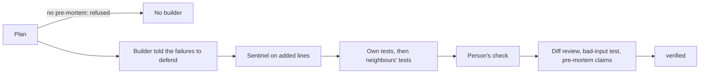

# Kriya defensive engine report (H23)

The owner's "think about what this could break before writing it" brief,
2026-11-05. Built on `feat/top1-coding-harness` in both repositories, **uncommitted
and unpushed**. Client in the worktree `../kriya-harness-evolve`.

> [!IMPORTANT]
> No model was run and no money spent. Two kinds of evidence are below, and they
> mean different things. **Scripted scenarios** prove the mechanism works, on
> defects I wrote to fit the rules. The **real-repo measurements** (bugs injected
> into this codebase, 78 accepted commits replayed) are the honest test of the
> rules. Whether Kriya beats Claude Code was **not measured**: no comparison exists.

## 1. The design

`--defensive` (default off) turns on the strict loop and adds four layers. It
doesn't ask a model whether its own work is safe: a model reviewing itself is the
weakest check there is (R-63), so every layer is code, and every finding is a line
a person can read.

| Layer | What it does | Where |
| --- | --- | --- |
| Pre-mortem | A plan of 2+ steps is refused without at least 2 distinct failure hypotheses, a blast radius and negative scenarios; blanks and repeats don't count | `checkPremortem`, `src/sentinel.js` |
| Claims cost tests | Each hypothesis names `covered_by`, a test file. The plan can't read verified until those files exist | `defensiveAfter`, `src/verify.js` |
| Grounded radius | `kriya_plan` answers with what the harness itself traced, so the agent compares it with what it declared, before any code | `traced`, `plugins/loop` |
| Blast radius | Import graph with relative paths, tsconfig aliases and Python modules, 3 levels out; files naming a changed table; callers of a changed API route; tests naming a changed symbol | `importGraph`, `blastRadius`, `src/recon.js` |
| Neighbour tests | A rung of their own after the code's own tests, so a near failure costs seconds | `ladder`, `src/strict.js` |
| Sentinel | Added lines only: tenant isolation, SQL built from strings, money in floats, identity from the request, secrets. Runs before any test | `sentinel`, `src/sentinel.js` |
| Diff review | Removed exports, broken signatures, changed defaults, sync-to-async against callers **outside** the change; floating promises, dropped awaits, `forEach(async`, unawaited `map(async` | `reviewDiff`, `src/sentinel.js` |
| Negative tests | Anything a caller can newly reach needs an added test with a bad input | `newSurface`, `hasBoundaryTest` |

A hazard counts as unhandled only while code outside the change relies on the old
shape. Update the caller in the same work and it clears. Rules can only stop a step:
passing still means the person's confirmed check exited 0.

## 2. Decisions

| Decision | Why |
| --- | --- |
| Deterministic review, no model reviewer | R-63; no spend per check; repeatable. Considered and left out: a builder that writes a test to break the work. Executable evidence is attractive, but it adds a builder per plan, can't be measured free, and a wrong adversarial test would block good work. First candidate once paid runs exist |
| `--defensive` brings `--strict-loop`; not the reverse | Its checks are rungs of that ladder, and `--strict-loop` alone stays one measurable factor for KRHE |
| No escape comment for the sentinel | An agent could write it. A real false alarm is for the person: `--no-defensive` |
| Tenancy rule only where `withUser` exists | Other projects don't have that invariant |
| Pre-mortem only for 2+ steps | The brief's rule, and a one-line fix shouldn't pay for it |

## 3. Real-repo measurements

### Injected bugs

12 small bugs in a throwaway clone of this repository (money rounding, GST, delivery
status, retries, gates). The tests chosen by each method ran with vitest.

| Method | Caught | Typical time |
| --- | --- | --- |
| Direct imports (`--strict-loop`) | 9 of 12 | 1–8 s |
| Blast radius (`--defensive`) | **10 of 12** | 13–113 s |

- The extra catch, `undo-label`, is a neighbour's test the direct method can't see.
- **The 2 misses aren't radius failures.** The full suite also passed with `retry-status` and `context-kept` in place (exit 0), so nothing in this repo tests them. That is a real gap in Kriya's tests: 504 isn't tested as retryable, and neither is how many tool outputs stay in context.
- So of the 10 bugs any test here can catch, the radius found all 10, direct imports 9. Small sample; direction, not proof.
- **Cost is real:** about 30–110 s per passing check on files this shared. The 40-test cap also cut up to 104 test files for `lib/money.ts`, and a bug only those tests see would get through to the person's check.

### Replaying accepted commits

Every rule ran over recent real commits, all of which people accepted, so a finding
is a likely false alarm that would have cost an attempt.

| | Commits | Flagged, first version | Flagged, final |
| --- | --- | --- | --- |
| Kriya | 40 | 10 | 2 |
| Client | 38 | not run | 3 |

The first version was too noisy to ship: `Promise.all` entries read as missing awaits,
deliberate `.catch(() => {})` as swallowed errors, `toFixed` in display code as money
math. Those rules were fixed or dropped. Measured against the final code, **5 of 78
commits (6%) would still stop**:

| Finding | Reading |
| --- | --- |
| `fabric-bench.ts` `unsafe` with `${DB}` | Pattern is right, value is a constant: false alarm |
| `seed-cap.ts` `greet()` | Text inside a benchmark fixture: false alarm |
| `plugins/preview/client.js` `tick()` | A real floating promise, deliberate there |
| `src/verify.js` `verdict` gained a parameter | Safe in JS as written; TypeScript would have flagged it |
| `plugins/approvals` `call()` | Not checked further |

None of the 78 is a known bug, so this measures false alarms, not catches. Tuning used
the same commits, which flatters the final number.

## 4. Scripted scenarios

Six scenarios, real DSH and git, scripted model, 3 runs per arm, identical every run.
Raw: `bench/defensive-m1-*.json`, `bench/radius-*.json`.

| Scenario | `--strict-loop` | `--defensive` |
| --- | --- | --- |
| neighbour-break | verified, neighbour broken | caught by neighbour tests, fixed |
| float-money | verified, float math | caught by sentinel, fixed |
| broken-caller | verified, caller left behind | caught by diff review, fixed |
| missing-await | verified, write can be lost | caught by diff review, fixed |
| no-negative-test | verified, happy path only | refused, bad-input test added |
| premortem-enforced | no pre-mortem needed | refused until declared; builders told what to defend |

| 18 runs each | Strict | Defensive |
| --- | --- | --- |
| Tasks done | 3 | **18** |
| False "verified" | 15 | **0** |
| Builders | 21 | 36 |
| Model requests | 99 | 132 (+33%) |
| Prompt chars | 871k | 1,258k (+44%) |

These defects were written to match the rules, so 18 of 18 shows the wiring works,
not how much a real model benefits. The strict scenarios under `--defensive` gave the
same results as `--strict-loop` (9 of 15, 0 false verified).

## 5. Checks

| Check | Result (real output) |
| --- | --- |
| Client `npm run check` | **365/365, exit 0** (was 346); pins, 12 seams, notices, brand ok |
| Client `npm run release:check` | exit 0 |
| Kriya `env -u OPENROUTER_API_KEY npm run check` | **Test Files 263 passed, 5 skipped; Tests 3104 passed, 63 skipped; exit 0**; lint 0 errors, 8 warnings |
| `tests/defensive.test.js` | 19 tests, in the client total |

No existing test was weakened. Off, `--defensive` changes nothing.

## 6. Limits

- **Line rules, not a parser:** anything split across lines is missed, and text inside a string can be flagged.
- **A pre-mortem can be thin:** code refuses blanks and repeats, and makes each claim name a test that exists, but can't judge the thinking or whether that test really covers the claim.
- **Negative test check is a word match:** `null` or `invalid` in an added test line passes it.
- **Sentinel patterns are guesses** at what a violation looks like; a tenant bypass through a helper function won't match.
- **Race detection is two patterns.** Real races are mostly out of reach.
- **Scripted models don't adapt,** so multi-step guard scenarios weren't re-run under `--defensive`.
- **Needs git,** like the strict loop.
- **Cost:** +33% requests in scenarios, and neighbour tests can add minutes per check on heavily shared files.
- **The owner's intent, in part:** the harness can make a model state its failure modes and pay for them with tests. It can't make a weak model imagine a failure it doesn't see.

## 7. Next

1. Owner: review, then say whether to commit.
2. Paid run: B4 against B4 + `--defensive` on the cap and multi sets, K = 3, with `--meter` and `--status`. That, plus the same tasks under Claude Code, is the only way to back a claim of beating it.
3. Write the two missing Kriya tests the mutants exposed.
4. Replace the 40-test cap with a ranking by how close and how often a test fails.
