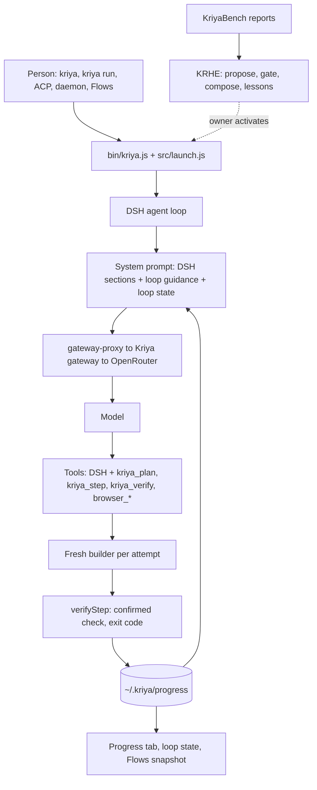

# Kriya: existing architecture audit

Audit of what exists on 2026-11-05, before any change in this programme (track
HU, phase H21). Baseline commits: Kriya `main` at `8d76ac4`, client
`kriya-harness` `main` at `08f4f66`. Every "operational" below was checked in
source, in a test, or by running it; documents were treated as claims.

## 1. The main finding

Kriya has **two execution runtimes and four improvement loops**. They are
separate on purpose, and the brief's "Kriya loop" and "self-improvement engine"
each name one specific thing.

| Name in the brief | What it actually is | Where it lives |
| --- | --- | --- |
| Kriya harness | `@kriya-ai/harness`, a plugin composition on pinned DeepSeek Harness 0.2.1-rc.5 | `../kriya-harness` (separate repository) |
| Kriya loop | `kriya_plan` / `kriya_step` / `kriya_verify`, one tool-driven loop inside DSH's agent driver | `src/loop.js`, `src/verify.js`, `plugins/loop/index.js` (client) |
| Graph execution | Two: loop v2's plan DAG (client, off by default) and Flows (server, `studio.*`) | `src/loop.js`; `lib/flows/*` |
| Self-improvement harness | KRHE, "Kriya Evolve": offline profile search over benchmark reports | `lib/harness/evolve/*` |
| Cloud agents (not the harness) | `runTask` on the Postgres queue, AI SDK `streamText`, role teams | `lib/agent/run-task.ts`, `queue.ts` |

The rest of this audit covers the harness in depth, because that is where the
brief's loop, tools and self-improvement live. The cloud runtime is protected
by tracks A, O and N (`lib/agent/queue.ts`, `policy.ts`, `metering.ts`), so it
is recorded and left alone.

## 2. Baseline

| Check | Result (real output) |
| --- | --- |
| Kriya working tree | `?? docs/kriya_visual_studio/` only (preserved, never touched) |
| Client working tree | Clean |
| Client `npm run check` | pins ok, 10 seams ok, notices ok, brand ok, **300/300 pass**, exit 0, 2 min 24 s |
| Kriya `env -u OPENROUTER_API_KEY npm run check` | typecheck ok, lint 0 errors / 8 warnings, format ok, **Test Files 263 passed, 5 skipped; Tests 3093 passed, 63 skipped**, exit 0, 4 min 54 s |
| Recorded real-model evidence | KriyaBench-R cap set `989dcfbc9eab`, K = 3: B0 15/21, B3 14/21, B4 18/21, B5 13/21; ₹170.30 spent (`BENCHMARK_PLAN.md` §6) |

Measured limits of that evidence: seven tasks, one model (DeepSeek V4.1 Flash
1017), B3 vs B4 is 4–0 with p = 0.125. Loop v2, the router, the anchor and the
default skills have **no real-model measurement at all**.

## 3. The real execution path



| # | Stage | Real implementation | Status |
| --- | --- | --- | --- |
| 1 | Request interpretation | Model reads it. `src/intent.js` + `plugins/router` add a code-written brief | Router: built, **off** (`KRIYA_ROUTER`) |
| 2 | Classification, decomposition | Model decides, from `GUIDANCE` ("several parts: plan first"). No code classifier on the default path | Operational, model-driven |
| 3 | Planning | `kriya_plan` → `validatePlan`, `savePlan`: ≤ 7 steps, ≤ 3 plans | Operational |
| 4 | Graph construction | v2 `after` edges, every edge points back, so no cycle can be written | Built, **off** (`KRIYA_LOOP_V2`) |
| 5 | Graph scheduling | Steps run one at a time; `runStep` refuses out-of-order. DSH runs parallel-safe tool calls (≤ 10) | Sequential by design (`KRIYA_LOOP_V2.md` §6) |
| 6 | Kriya loop | `runStep`: fresh builder, check, retry with output, ≤ 4 attempts, blocked | Operational, on by default since U10 |
| 7 | Provider abstraction | DSH provider rows → `src/gateway-proxy.js` → `lib/harness/gateway.ts`; tier aliases; owner names the models | Operational, model-agnostic |
| 8 | Context construction | DSH sections, compaction-basic, tool-result pruner, image offload, spill, `kriya:loop-state` at order 10250 | Operational; `--anchor` off |
| 9 | Tool selection | The model sees every tool. Hiding tools measurably hurt (B5 vs B4, 0–5, p = 0.063) | Operational |
| 10 | Tool execution | DSH pipeline, timeout policy, spill for large results; `checkpointHook` before file-changing tools | Operational |
| 11 | Error handling | `dsh-llm-retry` (5 retries), `failure.js` classes (v2 only), budget stop | **Gaps found, §5** |
| 12 | Memory | `plugins/kriya-tools` (Kriya memory API, device writes unconfirmed), rules (`src/rules.js`, v2 only) | Operational / off |
| 13 | Subagents | `dsh-subagent-spawn-in-process`, depth 1, builders bounded by `builderGuard` | Operational |
| 14 | Background jobs | `dsh-jobs-local`, `dsh-goal-round-driver`; `kriya daemon`, Control Center dispatch | Operational; daemon behind `harness.controlCenter` |
| 15 | Checkpoint, continuation | DSH JSONL session log with crash closers (HU-M-05); `src/checkpoints.js`; progress files | Operational; **loses the failure text on resume**, §5 |
| 16 | Verification | `verifyStep`, exit code only; U8 stale pass; v2 originals re-run | Operational; **false "verified", §5** |
| 17 | Self-improvement | KRHE: profile → propose → gate → compose → lessons, CLI only | Offline; KRHE-4…7 not started |
| 18 | Trajectory capture | DSH session logs exist; bench records pass, cost, duration only. No per-run loop numbers reach KRHE | **Partial, §5** |
| 19 | Cost monitoring | `kriya.harness_usage`, reservation in SQL, `kriya usage`, bench `--meter` | Operational |
| 20 | Delivery | Final reply; `progress.md`; Progress tab; `kriya run` exit code is DSH's, not the verdict | Operational; no verdict on the CLI, §5 |

## 4. Capability inventory

| Capability | Status | Evidence |
| --- | --- | --- |
| Plan, step, verify loop | Operational | `tests/loop-run.test.js`, real DSH; B4 runs |
| Step checkpoints, `kriya undo`, shadow store outside git | Operational | `tests/checkpoints.test.js` |
| Stale pass detection (U8) | Operational | HU-VF-01…03, HU-M-08 |
| Turn budget (steps, minutes, identical repeats) | Operational; never fired on real runs | §6.3 of BENCHMARK_PLAN |
| Builder limits | Operational | `builderGuard`, tests |
| Loop state after compaction | Operational | HU-M-11 |
| Agent's localhost browser | Operational where Chrome exists | WP-BR-*, on by default since 2026-11-04 |
| KriyaBench (43 tasks, hidden graders, escape and bait probes) | Operational; 7-task cap set below the 30-task floor | HT-BEN-*, HU-BEN-* |
| Model limits, overflow naming | Operational after deploy | HU-GW-* |
| Loop v2 (DAG, classes, set-aside, originals, rules) | Implemented, not connected by default, unmeasured | KV2-* (scripted only) |
| Intent router | Implemented, not connected by default, unmeasured | IR-* |
| Kept request (`--anchor`) | Implemented, not connected by default, unmeasured | HU-M-06 |
| Default skills (10) | Implemented, not connected by default (`harness.defaultSkills`) | HT-DS-* |
| Flows on devices | Partly: seeded plan and snapshot work; `studio.deviceFlows` off, client release pending | `status.md` launch record |
| KRHE-0…3 | Implemented offline; never drives anything | HU-EV-* |
| KRHE-4…7 (text surface, probing, canary, cross-model) | Planned, not implemented | spec §9 |
| Parallel DAG, beam search, recursive decomposition | Planned, deliberately not built | `KRIYA_LOOP_V2.md` §6 |
| Trajectory-based capability extraction | Not implemented anywhere | No code; lessons are profile-level only |

**Four improvement loops, and whether they conflict.** They look duplicated but
own different things, so this audit recommends keeping all four.

| Loop | Scope | Decides | Status |
| --- | --- | --- | --- |
| `lib/improve.ts` (A12) | Cloud prompt wording, recall weights, token budgets | Offline gate, shadow, canary, auto-rollback | Built; `agents.improvement` |
| KRHE | Harness switches and limits | Paired bench gate | Offline |
| Rules (`src/rules.js`) | One project's repeated failures | The person confirms | Behind loop v2 |
| `lib/flows/improve.ts` | One flow | Person adopts, reuses KRHE's gate | Behind `studio.*` |

The one real overlap: `lib/improve.ts`'s `offlineGate` and KRHE's `gate` are two
gates with different statistics. Merging them is not justified: one compares
guard metrics on scenarios, the other paired binary outcomes.

## 5. Defects found by running the code

All six were reproduced on the unmodified client (`08f4f66`) with scripted
builders and checks. Output of the probe, verbatim:

```text
P1 step1 result verdict: verified | currentVerdict: verified | plan: pass,not started,not started
P2 no-change builders spent: 4 status: blocked
P3 provider-error builders: 4 status: blocked stops: error,error,error,error
P4 env-failure builders: 4 status: blocked
P5 builder prompts: 3 | 2nd sees failure: true | after resume sees failure: false
P6 raw verdict with 2 of 3 steps never started: verified
```

| Id | Defect | Why it matters | Root cause |
| --- | --- | --- | --- |
| HU-F-30 | A plan with unstarted steps reads **verified**, and `kriya_step` tells the model so after step 1 of 3 | The product's central claim was false, and it invited the model to stop. `tests/progress.test.js` even pinned it (step 2 `not started`, verdict `verified`) | `verdict()` looks only at steps that have runs |
| HU-F-31 | Nothing stops an agent ending its turn with plan steps open | Premature completion, the failure R-15 names first; the FIRELINE run in `status.md` left `kriya_step` this way | `recheckHook` handles only a stale pass |
| HU-F-32 | A builder that changes nothing gets three identical successors | Up to 3 wasted builders per step | No progress test between attempts |
| HU-F-33 | A check that cannot run (exit 127) uses all four builders | Same; no builder can install the person's tools | Non-retryable failures retried; v2 only words it as a rule |
| HU-F-34 | Provider errors count as failed attempts | An outage permanently blocks healthy steps; blocked survives the session and only ≤ 3 plans exist | `stopReason: "error"` is ignored by `runStep` |
| HU-F-35 | A step resumed after a crash starts blind | The failure text lived only in a local variable; long-horizon recovery repeats work | Output was never persisted |
| HU-F-36 | KRHE cannot see inside a run | Gate and proposer have pass, cost and duration only, so recovery, tool efficiency and false claims are invisible | Bench reads no loop records |
| HU-F-37 | `kriya verify` has no verdict | Headless use has no status or evidence; only the Web UI's Progress tab shows it | No CLI |

Not a defect, checked and left alone: an A–B–A–B repeat escapes the budget's
"identical in a row" count, but no recorded run shows it, and the budget never
fired on a real run. OpenHands' issue #762 shows the false-positive risk of
tightening this for legitimate polling.

## 6. What must not change

Risk classes, approvals, modes and the sandbox; the gateway's reservation and
caps; the DSH pin (no edits, track H rule 5); `lib/agent/*` protected files;
`kriya.*` schema; every default switch without the owner. Each is respected by
everything built in this programme.

## 7. Opportunities the audit supports, and what it does not

Supported by evidence: HU-F-30…37. Unsupported, so not pursued: a new executor
or second loop, parallel DAG (needs worktree-per-step, and R-23 shows
multi-agent hurts sequential work), tool hiding (B5 lost 0–5), any change to the
cloud runtime, merging the gates.

Timed afterwards: `checkpointHook` runs before every shell call, including
read-only ones, at about 92 ms on a 1,644-file clone (140 ms for the first). Not
worth optimizing.
