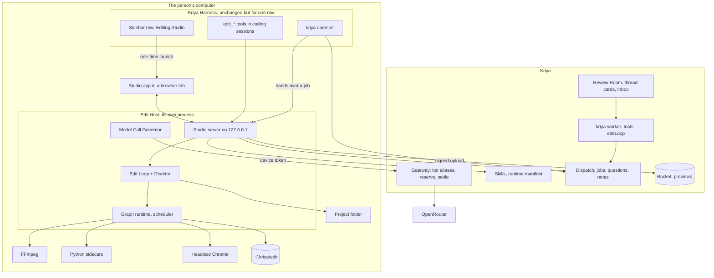
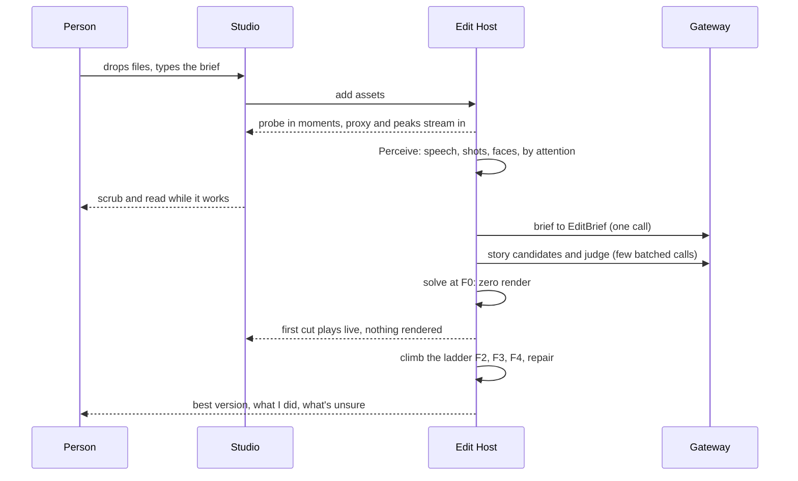

# Architecture (track E: Kriya Editing Studio)

Revised after FORENSIC_AUDIT.md. The main change: the Studio and everything heavy
now live **outside** the coding harness, in their own process and their own web
origin. That is the strongest guarantee this track can give that nothing existing
breaks.

## 1. Picture



Everything heavy runs on the person's computer. Kriya's servers run what they
already run, plus a few routes. No new Render service.

## 2. Parts

| Part | Where | Job | Knows nothing about |
| --- | --- | --- | --- |
| **Harness entry** | `plugins/edit/` | One sidebar row, one launch route, thin `edit_*` tools that call the Edit Host | Media |
| **Studio app** | `studio/` → `studio/dist/` | The editor (STUDIO_APP_AND_BROWSER, UX_SPEC) | FFmpeg, models |
| **Edit Host** | `src/edit/host/` | One process per machine: HTTP server, scheduler, Governor, job ownership | Prompts' content |
| **Edit Core** | `src/edit/core/` | Pure code: time, project, operations, anchors, solvers, compiler, gate logic, hashes. No I/O | Processes, network |
| **Graph runtime** | `src/edit/graph/` | Demand-driven incremental execution (EDIT_LOOP §4) | What a node means |
| **Edit Loop, Director** | `src/edit/loop/`, `src/edit/director/` | The search, stages, bounded model calls (EDIT_LOOP, DIRECTOR_AND_AGENT) | Pixels, beyond the index |
| **Engine** | `src/edit/engine/` | Node implementations: probe, proxy, perception, render, measure | Prompts, the person |
| **Media Runtime** | `~/.kriya/media/<version>/` | Pinned binaries, Python env, Chrome, weights | Everything Kriya |
| **Server parts** | `lib/editing/` | Manifest, job rows, previews, questions, notes, Tavi tools | Footage |

Edit Core is the heart. It runs with no media at all, and a golden test can pin its
output byte for byte.

## 3. Why these boundaries

- **Own process, own origin.** A crash, a stuck FFmpeg or a bad release of the Studio cannot touch a person's coding session. A DSH upgrade cannot break the editor beyond one link. FORENSIC_AUDIT EH-02, EH-03, EH-05, EH-20.
- **Lazy loading.** Nothing under `src/edit/` is imported unless `KRIYA_EDIT` is on, so a bug there can't even load into the harness.
- **The Director is code, not an agent.** Open loops are where a cheap model loses (DIRECTOR_AND_AGENT §2). It also means a Tavi job has no agent loop, so no tools for a hidden prompt to reach.
- **The compiler alone produces render commands.** A model never writes them. That single rule removes the largest class of failures.
- **Children get a clean environment.** FFmpeg, Python and Chrome never see the device token.

## 4. Main flows

### 4.1 First edit



The person can watch and scrub before anything is rendered, because the live
compositor composes proxies and layers in the browser.

### 4.2 A change

1. "Punch in here", with a selection.
2. One model call turns the words into typed operations against the digest.
3. Edit Core validates and applies; the graph recomputes only what changed.
4. The live preview updates at once; changed segments re-render behind it.
5. Only gates whose inputs changed run again.

### 4.3 Export

Master from original sources, never proxies. All gates. A receipt. Platform
variants, and a handoff package if asked.

### 4.4 From Kriya Tavi

TAVI_INTEGRATION. The daemon hands a typed job to the Edit Host, which owns it from
then on and reports to Kriya itself.

## 5. Where things live

```text
<project folder>/                 the person's; may be synced
  <name>.kriya-edit               the project: JSON, small
  exports/                        finished files, receipts, handoffs
  media/                          files dropped in (optional)

~/.kriya/edit/<project id>/       never synced (EF-28)
  ops.jsonl                       append-only history
  versions/                       snapshots
  index.sqlite                    transcript, shots, faces, embeddings
  journal.sqlite                  graph traces, jobs, flight recorder
  cache/                          proxies, peaks, thumbs, segments, tiles, mattes

~/.kriya/media/<version>/         the Media Runtime
~/.kriya/edit/taste.json          confirmed taste rules
~/.kriya/edit/port                the Studio's stable port
```

The project file alone reopens a project: everything under `~/.kriya/edit/<id>/`
can be rebuilt except history, so a compact history is mirrored into the project at
each save.

## 6. Boundaries

```mermaid
flowchart LR
  ui[studio] -- HTTP only --> host[src/edit/host]
  plugin[plugins/edit] -- socket only --> host
  host --> loop[src/edit/loop]
  loop --> core[src/edit/core]
  loop --> graph[src/edit/graph]
  graph --> engine[src/edit/engine]
  core -.never.-> io[node:fs, child_process, network]
  engine -.never.-> gw[gateway]
  srcloop[src/loop.js, src/verify.js] -.never.-> loop
  plugin -.never.-> loop
  serv[lib/editing] -.never.-> conn[lib/connectors]
  serv -.never.-> met[lib/agent/metering.ts]
```

ET-IMP-01 enforces these imports in both repositories.

## 7. Failure and recovery

| Failure | Behaviour |
| --- | --- |
| Edit Host crash | Restarted on next use; jobs resume from the journal with no completed node redone |
| Sidecar crash or hang | Per-node timeout; one retry if idempotent; then a plain reason. Optional layers are skipped |
| Machine restart or sleep | Jobs resume. Studio shows "Paused"; Kriya marks them `lost` until they report again |
| Disk low | Estimated before work; cache evicted; stops cleanly and says how much is needed |
| Model refused, offline, cap reached | Hand editing goes on; the Director pauses with the existing plain message |
| A source file moved | `offline`; relink by content |
| Gate fails after repairs | Delivered with notes, or blocked: never silently passed |
| Corrupt project file | Atomic writes make this unlikely; the last version is in `versions/` |
| Two copies from a sync conflict | Detected by project id; the person chooses (EH-41) |

## 8. Scale

| Concern | Design |
| --- | --- |
| A 3-hour source | Everything streams; index per chunk, resumable |
| Hundreds of clips | Virtualised bin; indexing by attention |
| A long timeline | Canvas in a worker draws what's visible; peaks and thumbs are tiled |
| Many sessions | One Edit Host; slots for `cpu`, `gpu`, `encoder`, `chrome`, `model`, `disk` |
| Weak laptops | Hardware tiers; heavy layers optional; the Studio says what's off |
| Battery and heat | Heavy jobs pause on low battery; speculation stops on battery |
| Harness limits | Governor (EDIT_LOOP §8) |
| Kriya's servers | One preview per job, straight to Storage; progress every 10 seconds at most, on the existing route |
