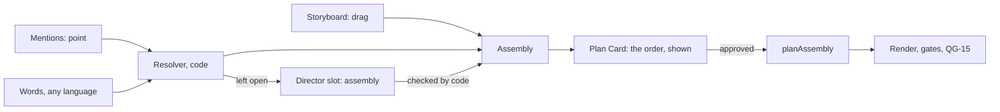

# Assembly and intent (track E, phases TP1–TP4)

Many files in one edit, placed where the person says, and a Studio where saying it is
easy. Closes TG-01…TG-13 of [TOP_TIER_GAP_ANALYSIS.md](TOP_TIER_GAP_ANALYSIS.md).
Phases, tests and switches: [TOP_TIER_PLAN.md](TOP_TIER_PLAN.md). **Status: §2 to §6
built (TP1, TP2; 2026-11-11), behind `editing.assembly`, off. §7 (TP4) is design only.
What was built differently, and what isn't built, is in `status.md`, Phase TP2.**

## 1. The idea

There are three ways to say "this file first, that part in the middle": drag it, point
at it, or say it. All three produce **one typed object, the assembly**. Code checks
it, the make follows it, and a gate proves the film has it. The model fills in only
what the person left open, and never overrules what they said.



## 2. Names: the clip handle (TP1)

Today the person sees `beach-final2.mov` and the Director sees `a2` (TG-02). From TP1
every file in the bin has one handle, shown the same way in the bin, the storyboard,
chat, the Plan Card and "What I did".

| Part | What | Set by |
| --- | --- | --- |
| Number | `1`, `2`, … in the order added. **Computed, never stored:** a file's place among the files the person added (EH-54, EH-72) | Code |
| Label | Up to 40 characters, e.g. "intro", "beach" | The person (double-click or F2, as with a word) |
| Role | `aroll`, `broll`, `screen`, `music`, `sfx`, `logo`: the field assets already have | Code proposes from the index (speech share, screen detector, audio only); the person can change it |
| Facts line | "Talking · 2:14 · starts 'So today I want…'" | Code, from the index |
| Thumbnail | One frame, the sharpest in the first three seconds | Code (`thumbArgs`) |

- **Nothing is added to an existing project on read.** Every version in a project's
  history stores a hash of the whole project (`core/history.js`), and the project's
  shape check refuses any field it doesn't know. A number written onto old assets would
  make every stored version of every existing project fail its hash (EH-54). So the
  number is computed from position: assets are only ever appended (no operation removes
  one), and files Kriya wrote itself (music beds, sound effects) and references are
  skipped. If an operation that removes an asset is ever added, stop and ask: numbers
  would then need storing.
- The project stays on schema 1. The only new field on an asset is the optional
  `label?`, absent until the person sets one, so an untouched project is byte for byte
  what it was.
- New operation `describe_asset { asset, label?, role? }`. A label is the person's
  alone (`author: person`); a role may come from code. No existing operation changes
  (EH-57).
- **File names and labels are untrusted text** (rule 11). The person sees them. The
  model gets them only as data inside the view, cleaned to letters, digits and spaces,
  40 characters at most, under the marker the views already use for transcript text.
  Code, not the model, matches them to words in a request. Neither counts as "the
  person's own words" for what may be drawn on screen: a file named after a claim must
  not license that claim as a title (EH-71).
- The bin gains thumbnails, a search box (label, file name, and words spoken:
  `words_fts`), sort (added, recorded, length, name) and groups by folder and by day
  recorded (TG-09). The list is virtual above 60 rows.

## 3. The assembly

One object on the project, changed only by the operation `set_assembly`, so it has
history and undo like everything else.

```text
assembly: {
  version: 1,
  parts: [
    { id, asset, from?, to?, use, at?, fit?, why? }
  ]
}
```

| Field | Meaning |
| --- | --- |
| `asset` | The file. Must be in the bin and not a reference |
| `from`, `to` | A stretch of that file: word anchors where it has speech, else integer flicks (rule 7). Absent: the whole file |
| `use` | `story`: a talking part the Director cuts (fillers, retakes, a hook). `whole`: plays as it is. `over`: its picture plays over another part's voice. `sound`: heard, not seen (a voice-over or a song) |
| `at` | Only for `over` and `sound`: `{ part, where: "start" \| "middle" \| "end" }`, `{ part, word }` or `{ part, t }` in flicks |
| `fit` | How a picture of another shape sits in the frame: `fill`, `fit`, `blur` (§6.2) |
| `why` | Who decided: `person`, `storyboard`, `director`, `default`. Shown on the Plan Card |

- **The array's order is the film's order** for `story` and `whole` parts: the spine.
- **"In the middle of file 1"** is not a special case: code splits part 1 at the
  sentence boundary nearest the place asked for and puts the other part between the
  halves (`splitAt`). "The middle" is half the kept length of that part; "after I say
  X" is a transcript search; "at 0:30" is that time in the cut.
- The graph is untrusted input like any other: at most 200 parts and 64 files, every
  id and range checked by the operation, no field for a path, command, URL or code.
- One file, no assembly: the make is the reel it is today, to the byte (ET-ASM-REG-01).
- **A make follows an assembly only when it is in that make's own brief.** The Studio
  sends the storyboard with Make it and with Approve. A job from Tavi, a watch folder,
  the command line or the bench never reads a storyboard stored on the project: Tavi's
  person approved an exact call, and a stored order would change the film behind it
  (EH-63, rule 12).
- A part's `fit` is a field of the assembly. The picture effect that draws it is named
  `frame`: `fit` is already the name of the music effect that fits a song to the cut
  (`core/plan.js`, `core/solver.js`), and a second meaning would make a picture clip
  look like fitted music (EH-56).

## 4. Three ways in

### 4.1 The storyboard (TP1)

A strip in Direct mode, above the timeline. It is the assembly, drawn.

```text
┌ Storyboard ─────────────────────────────────────────────── Sort for me ┐
│ ┌──1──────┐  ┌──3──────┐  ┌──1──────┐  ┌──4──────┐                    │
│ │ [thumb] │→ │ [thumb] │→ │ [thumb] │→ │ [thumb] │   + drop a clip    │
│ │ intro   │  │ demo    │  │ intro   │  │ outro   │                    │
│ │ 0:00–0:41│ │ whole   │  │ 0:41–end│  │ story   │                    │
│ └─────────┘  └─────────┘  └─────────┘  └─────────┘                    │
│ Over the voice:   [5 beach → on 1, at "the coast"]                     │
│ Not used:         [2 take-old]  [6 b-roll-park]                        │
└────────────────────────────────────────────────────────────────────────┘
```

| Action | Pointer | Keyboard |
| --- | --- | --- |
| Add a clip to the film | Drag from the bin, or double-click | Enter on a bin row |
| Change the order | Drag a card | Alt+← and Alt+→ on a focused card |
| Use only a part | Select words in the transcript, then "Use only this"; or drag a card's edge | I and O on the source, then U |
| Put one clip inside another | Drop a card on the playhead line of another card: it splits there | S splits at the playhead |
| Play it over the voice | Drag a card to the lower lane, or the card's menu | V |
| Leave it out | Drag to "Not used" | Delete |
| How it fits the frame | Card menu: Automatic (nothing chosen: §6.2 decides), Fill, Fit, Blur behind | — |

- Every action is one `set_assembly`, so Cmd+Z undoes it.
- At 360 px the strip is a list; each row has Move up and Move down, 44 px or more.
- A screen reader hears "Part 2 of 4: clip 3, demo, whole, 0:18".
- "Sort for me" asks the Director for an order (§4.4) and shows it as a proposal the
  person accepts or not. Nothing is reordered without that.

### 4.2 Mentions (TP1)

Pointing, in chat. No language needed.

- Typing `@` opens the clip picker (number, label, thumbnail). Choosing one puts a chip
  in the message: `@3 demo`.
- Dragging a storyboard card, a bin row or a selection of transcript words into the
  chat box adds a chip, with the range when there is one: `@1 0:12–0:20`.
- With a source on the monitor and Mark in and out set, "Mention this" adds the same.
- The message goes to the Host as text with numbered places and a typed list:
  `{ text: "put ⟦1⟧ before ⟦2⟧", mentions: [{ asset, from?, to? }, …] }`. The Host
  checks each id and range. The model sees `⟦1⟧ = clip 3 "demo"`, never a path.

### 4.3 Words (TP2, widened in TP4)

`director/assembly.js` `resolveRefs` reads the person's words by code first:

| Said | Resolved by |
| --- | --- |
| "clip 2", "file 2", "the 2nd video", "the last one" | The number. Digits work in every language |
| "the intro", "beach" | The label, then the file name's cleaned words; one match only, a near miss (one letter, five letters or more) counts |
| "the screen recording", "the song" | The role, when one file has it |
| "where I talk about pricing" | Transcript search; the best sentence run above a floor |
| "the shot of the beach" | Shot tags, only with the Smart search pack; otherwise open |
| "first", "at the start", "at the end", "in the middle", "after X", "before X", "between X and Y", "at 0:30", "over", "while I say …" | Placement readers, as `trimsIn` reads trims today |

Two candidates, or none, is **never guessed**: it is left open for §4.4, and if the
Director can't settle it either it becomes a choice on the Plan Card (§7).

### 4.4 The Director's slot

One new slot, `assembly`, called only when something is open: an empty storyboard and
a request like "make one film from all of these", or a placement the readers couldn't
resolve.

- **View:** one row per clip: number, label, role, length, how much of it is speech,
  its first and last sentence, one line of its shots, when it was recorded. Then what
  is already fixed: "fixed by the person: 3 first; 5 over 1".
- **Answer:** parts by clip number, with sentence ids for a stretch, `use`, `at`, and a
  short `reason` per part. No path, no free text placed on screen.
- **Checked by `assemblyProblems`:** every id exists; every range is inside its file;
  every fixed line is kept; an `over` part has a host; no stretch plays twice unless
  asked; the total fits the brief's length. A second refusal falls back to the
  storyboard's order, else the order recorded, else the order added, and says which.

**Who wins**, as for format today: this message's mentions and words, then the
storyboard, then earlier messages, then the plan being revised, then the Director,
then the default.

## 5. The Plan Card shows the order

Before anything renders, the card has an **Order** section: the storyboard strip,
small, with each part's number, label, stretch and use, and one line per decision that
wasn't the person's: "5 over 1 at 0:22: you say 'the coast' there". The person can drag
it right there. Approve sends exactly the assembly shown, as it sends the settings.

## 6. The make: `recipes/assembly.js`

`planAssembly` runs when the assembly has two or more spine parts or any `over` or
`sound` part. It reuses the reel's steps; it doesn't replace them.

### 6.1 Steps

1. **Story, per talking part.** The reel's story step, scoped to that part's stretch,
   under the same task name `story`, one call per part through the Governor, in spine
   order. A single take is asked exactly as today: the same prompt, once (EH-58,
   EH-59). A part's story is kept by part id, so a later reorder asks nothing (TG-08).
2. **Spine.** `keep_range` with `after`, in order. A join between two files is a real
   cut, never a seam.
3. **Conform** each part to the film (§6.2).
4. **Over parts.** `place_broll` at the resolved word or time; the voice carries on.
   Length: the part's own stretch, capped by the sentence it sits on unless asked.
   Each clip the make places carries the mark a plan's graphic carries (`plan: true`),
   and a remake removes the marked ones before placing again. Without that a second
   make shows every cutaway twice, the fault captions had on 2026-11-09 (EH-60).
5. **Sound parts.** A song goes through `set_music`, fitted and ducked as today. A
   voice-over becomes the clock: its words set the timing and the spine's pictures are
   laid over it in order.
6. **Captions, graphics, scenes, sound effects, look.** The existing steps. They
   already key on each word's own file, so they work across parts.
7. **What I did** lists the order as made, part by part.

### 6.2 Conforming mixed sources (TG-06)

| What differs | What code does | Built on |
| --- | --- | --- |
| Shape | `fill` (crop to fill, today's only behaviour), `fit` (whole picture, bars in the look's plate colour), `blur` (whole picture over a blurred, darkened copy of itself). Default: same shape → fill; a face → the subject reframe; a screen recording or a wide shot in a tall frame → blur. `fill` is the absence of the effect, so a compiled plan for today's cuts has no new key (EH-59) | New picture effect `frame`, drawn by the builder; `core/reframe.js` |
| Frame rate | Every piece to the output's rate. A variable-rate phone clip is noted | The `fps` step already in `core/ffmpeg.js` |
| Exposure and colour | `fix_exposure`, then `match_color` toward the longest talking part, inside the limits `engine/color.js` holds. The look goes on after, over all parts. Where the runtime lacks what a match needs (the Colour pack's `lut3d`), the part is left as shot with a note: conforming never fails a make (EH-76) | Operations that exist and no recipe uses |
| Speech loudness | Each part's speech measured and levelled to the same target before the mix | `engine/loudness.js`, `set_level` |
| Room sound | `room_tone` under each join; a two-frame audio fade across it | Operation exists, unused |
| The join itself | A plain cut. A transition only when asked or the playbook says so; MOTION_GRAPHICS §6 already treats "another clip" as a change of moment | `core/transitions.js` |

### 6.3 Gates

| Gate | Change |
| --- | --- |
| QG-12 Brief | Every part asked for is in; nothing from a clip the person put in "Not used" |
| **QG-15 Assembly (new; a note until TPX-04 and its seeded run pass, then it blocks; assembly makes only, EH-70)** | From the rendered file: half a second after each join, the frame matches the expected file at the expected source time (a perceptual hash against the source); parts play in the order asked; each `over` part lies inside its host. A seeded swap, a missing part and a wrong stretch are each caught 10 of 10 (EG-4's rule) |
| QG-07 Picture | An exposure or white-balance jump at a join between two files is a note with a repair rung: `match_color` again, stronger, inside limits |
| QG-06 Loudness | Speech loudness across parts within 1 LU |

### 6.4 Continuity

`last-make.json` keeps the assembly and each part's story. A request that changes only
the order or one part asks the model nothing for the others, replays the person's
edits (`carryEdits`), and after TP3 renders only the draft segments on either side of
a moved join.

- A file without the new keys, written by today's code, still loads: missing keys mean
  "one take", never an error.
- `remapIds` matches footage "by track and shared source". Once one file can be two
  parts, that is ambiguous, and a carried edit could land on the wrong half. It must
  match by the overlap of source stretches (EH-61).
- `set_assembly` and `describe_asset` are never carried: they aren't in `replayable`.
  Carrying one would put the old order back on the new cut (EH-62).

## 7. Intent in any language, and questions (TP4)

### 7.1 The intent frame

Today each kind of request has its own English reader (TG-10). From TP4 every message
becomes one typed frame:

```text
intent: { assembly?, trims?, settings?, graphics?, look?, sound?, reference?,
          choices: [], cannot: [] }
```

1. **Code readers first**: the ones that exist, plus §4.3. Fast, free, and the only
   path with no model.
2. **The model reads the same message** in whatever language it is in and fills the
   same fields, **inside the call that already happens** for that message: the plan's
   schema for a whole-video request, the console's for a change. There is no second
   call per message; one would double what the person's allowance pays and what the
   Governor has to fit beside their live chat (EH-64). For every field it must return
   `evidence`: the exact piece of the person's message it came from.
3. **Code checks the evidence.** A field whose evidence isn't literally in the message
   is dropped, as an ungrounded word on a graphic is dropped today. Numbers and clip
   numbers must be in the evidence. So a Telugu or Hinglish request gets the same check
   an English one does, without a pattern table per language.
4. Where code and the model disagree on a field, code's reading wins and the card says
   what it understood.

### 7.2 Nothing asked is lost

`cannot` holds every piece of the message no field covers: "add a 3D spinning logo".
The Plan Card lists them under **Not in this cut**, in the person's own words, with the
nearest thing Kriya can do if there is one. Silence about a request is a defect
(ET-NL-04).

### 7.3 Questions

A question is a choice on the Plan Card with a default already selected: it never
blocks a plan and never opens a dialog.

- Asked only when the answer changes the cut and code can't decide: "Which one is 'the
  intro'?" with two thumbnails; "Play clip 4 over your voice, or pause the story for
  it?"
- Two at most per plan. A third open point takes its default and is listed with `why:
  default`.
- Answering is the person's alone (rule 13). The answer is stored on the plan, and a
  revision doesn't ask again.

### 7.4 Speaking instead of typing

A "Hold to talk" button beside Send records the microphone, and the **local**
recogniser already in the Media Runtime turns it into text in the chat box, which the
person reads and sends. No audio leaves the computer and no browser speech service is
used. Needs EB-11 (the Whisper weights); without them the button isn't shown. TP4's
preflight settles two things before any code: whether the Studio's headers let the
page ask for the microphone at all, and that a dictation waits behind a running index
or render job rather than taking its slot (EH-75).

## 8. Cases the design must hold

| Case | Behaviour |
| --- | --- |
| A file in the assembly has moved or is offline | Left out with a note; if the person asked for it by name, the make ends `needs_you`, not delivered |
| The same file twice, different stretches | Allowed. The same stretch twice only when asked |
| A horizontal clip in a vertical film | `fit` rule of §6.2; the card shows which |
| No speech in any file | Order from the storyboard; lengths from the song's beats if there is one, else from shots |
| A still image as a part | Three seconds by default, a slow move, `fit` rules as for video. **Not verified:** the operations accept an image on the main picture, but no render of one has been seen. TP2's preflight renders one; if it fails, stills stay out of TP2 and the storyboard says so (EH-78) |
| Two cameras of one moment among other files | They form one group in the bin ("same moment, 2 cameras") once `analyseMulticam` syncs them; the group is one `story` part |
| Files in different languages | Each file already has its own language (EDD-48); captions follow each part's |
| A bin file used in the assembly is removed | The Studio asks first; on yes, its parts go to a note |
| More than 200 parts | Refused by `set_assembly` with a plain message |
| A cold open | Unchanged: its own operation, an echo, ahead of the spine |

## 9. Where the code goes

All client work is under paths CHANGE_IMPACT §5 already lists as this track's own.

| File | Change |
| --- | --- |
| `src/edit/core/project.js`, `project.d.ts` | Optional `label?` on an asset; optional `assembly?` on a sequence; effect `frame`. Schema stays 1; nothing required is added |
| `src/edit/core/ops.js` | New: `describe_asset`, `set_assembly`. **No existing operation's fields or meaning change** |
| `src/edit/core/plan.js`, `core/ffmpeg.js` | `frame` in `pictureChain`, present only when a part isn't `fill` |
| new `src/edit/director/assembly.js` | `resolveRefs`, placement readers, `splitAt`, the `assembly` slot, `assemblyProblems` |
| new `src/edit/director/intent.js` | The intent frame, its fields for the plan's and the console's schemas, the evidence check |
| new `src/edit/recipes/assembly.js` | `planAssembly`, conform |
| new `src/edit/gates/assembly.js` | QG-15 |
| `src/edit/director/plan.js`, `revise.js`, `continuity.js` | The order on a plan; mentions in chat; a story per part |
| `src/edit/host/projects.js`, `server.js`, `loop/make.js` | Routes for labels, the assembly and mentions; the recipe choice |
| new `studio/src/storyboard.js`, `mentions.js`; `main.js`, `styles.css` | §4.1, §4.2, §5 |

Server, first (rule 17): `editing.assembly` and `editing.intent` in `lib/config.ts`, both
off; the features answer gains both names; the contract is regenerated. No table, no
migration, no agent tool. Rows for these are in CHANGE_IMPACT §3 as **proposed**.

## 10. Off-behaviour

With `editing.assembly` off: no storyboard, no `@` picker, no `assembly` slot, the make
route drops `brief.assembly`, and the plan prompt and schema are the objects they were
(ET-ASM-REG-01, unit and on a real Host). With `editing.intent` off: the code readers
only, as today (ET-NL-REG-01). Off, the Studio's page has the elements it has today:
numbers and labels show only with `editing.assembly` on.

Every hazard this design could cause to an existing workflow, its evidence and its
guard, is in [TOP_TIER_FORENSIC_AUDIT.md](TOP_TIER_FORENSIC_AUDIT.md). Read it before
TP1.

## 11. Limits, plainly

- Finding "the beach shot" by what is in the picture needs the Smart search pack, which
  isn't built. Until then pictures are found by label, number, role or pointing.
- The frame match in QG-15 proves the right file at the right time; it can't tell two
  near-identical takes apart, so those joins are also checked by their source audio.
- The intent fields have not run on a real model. Their accuracy per language is unknown
  until Bench-A runs with the owner's go-ahead (EB-07).
- Placement words are read by code in English only; other languages rely on the
  model's reading and its evidence check, and on the storyboard and mentions, which need
  no language at all.
