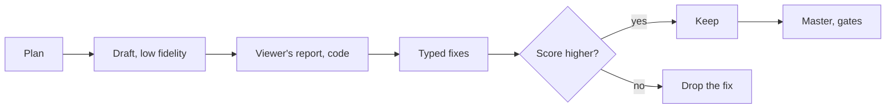

# Craft upgrade (track E, phases TP3, TP5–TP11)

A true preview, effects and keyframes, a reference read for its method, type and a
larger motion kit, a Director that watches its own cut, and sound. Closes TG-14…TG-27
of [TOP_TIER_GAP_ANALYSIS.md](TOP_TIER_GAP_ANALYSIS.md). Phases, tests and switches:
[TOP_TIER_PLAN.md](TOP_TIER_PLAN.md). **Status: design, proposed 2026-11-10
(EDD-63…EDD-69); nothing here is built.**

## 1. The rule that makes a cheap model enough

Every part of this document adds **things code draws and code checks**, and gives the
model a short typed list to choose from. That is the whole method, and it is the one
the motion kit and the transitions already use:

| The model does | Code does |
| --- | --- |
| Picks an effect id and values inside ranges | Writes the FFmpeg chain, checks the runtime has the filter, renders, gates |
| Picks a style pack, a caption look, a graphic kind | Draws it, fits it to the frame, keeps it off faces, holds contrast |
| Says what a reference "is like" only as fixed words | Measures the reference, maps numbers to the kit, measures the result |
| Proposes a fix | Scores the cut before and after, and keeps the better one |

Rule 4 stands: no model writes a filter string, a shell string or a path. A stronger
model is used only in the two places §6.4 names.

## 2. A preview that shows the film (TP3)

### 2.1 The monitor draws every layer

Today the monitor draws cuts, crops and zooms; everything else waits for a render
(TG-24). The fix reuses the code that renders:

| Layer | In the preview | Why it matches |
| --- | --- | --- |
| Captions, graphics, scenes | The same tile HTML (`engine/captions.js`, `graphics.js`, `scenes.js`) in a sandboxed frame over the canvas, each animation's `currentTime` set from the playhead | It is the renderer's own code: Web Animations only, no clock |
| Transitions | The six kinds composited on the canvas from the held frame and the incoming one | Same kind table, `core/transitions.js` |
| Look and effects | Each effect's registry row carries a preview function (canvas filter or shader) | An approximation, labelled so (§2.3) |
| Music, effects, ducking | WebAudio: the same assets, gains from the mix plan (`core/mix.js`) | Same plan |
| `fit` and `blur` framing | Canvas | Same geometry as the builder |

The tile frame has the Studio's existing CSP and no network. Nothing new reaches a
model, and no file leaves the computer.

### 2.2 Only what changed renders

Segments are already cached by what produced them, and a transition already renders in
one segment (ET-TR-M3). TP3 makes a make and a revision use that **for a draft's
picture**: the segments whose key changed render, the rest are joined from the cache
(`joinArgs`). A caption fix on a ten-minute film renders one segment.

Two things stay whole, on purpose (EH-66). The sound is mixed and mastered over the
whole film, because integrated loudness (QG-06) is a property of the whole file. And a
master is still drawn in its one encode (ET-TR-M2), so receipts and QG-01 mean what
they mean today. The gates always judge the joined file, never the pieces.

### 2.3 Honest limits of the preview

- Tiles and geometry are exact. Colour and filters are close, not exact: the preview
  says "Preview" and Finish still plays the real file, which the gates judged.
- ET-PV-01 holds it to that: at sampled times, the tile boxes in the monitor equal the
  rendered ones to the pixel, and the picture's structural similarity stays above a
  floor set at TP3's preflight from real measurements.

### 2.4 Editing by hand

On the timeline: drag a clip's **edge** to trim (`trim`), snapping to word edges and
beats, by a handle a few pixels wide at each end. Every action is an existing
operation. Pressing or dragging anywhere else still scrubs, exactly as today: reorder
lives on the storyboard, not here, so the timeline's one existing gesture doesn't
change meaning (EH-67). A proposal's Accept and Reject show before and after on the
monitor at once.

## 3. Effects, filters and keyframes (TP5)

### 3.1 An effect is a row of data

`core/effects.js`, one registry:

```text
{ id, params: { name: [min, max, default] }, needs: [ffmpeg filters],
  build(params, piece) → filter steps,   // code only
  preview(params) → canvas filter,
  gate: { planned?: "black" | "flash" | "motion" },  // what QG-07 and QG-11 should expect
  weight: "light" | "heavy" }
```

- A **new** operation `add_effect { clip | range, effect, params }` is refused when the
  id or a value is outside the registry, so nothing new can be stored that the render
  can't draw.
- **Existing operations are never made stricter** (EH-57). `stabilize` is the case in
  point: the operation exists, stores the effect, and the builder then throws ("this
  render can't do stabilize yet", `core/ffmpeg.js`). The fix is to draw it, or where the
  runtime lacks the filter to skip it with a note at render. Refusing it at the
  operation would stop any project whose history already holds one from replaying.
  (A picture `fade` is in the builder's list too, but no operation can set one, so
  nothing is broken there: it is simply unbuilt.)
- With `editing.craft` off the compiled plan of today's cuts has no new key: an effect
  is a key that exists only when used (EH-59).
- Each row's `needs` is checked against the runtime's own filter list
  (`engine/capabilities.js`). A filter the runtime lacks removes that effect on that
  machine and says so; it is never faked. (Found the hard way: one FFmpeg build had no
  `drawtext`.)

### 3.2 The first set

All from filters FFmpeg ships; each is confirmed against the signed runtime in TP5's
preflight before it gets a row.

| Group | Effects |
| --- | --- |
| Focus | Blur, background blur, sharpen, vignette (built) |
| Texture | Grain, glow, soft bloom, film look (curve, grain and vignette as one) |
| Frame | Letterbox, picture in picture, split screen (two or three up), mirror |
| Energy | Shake, colour split, glitch (seeded, so the same every render), flash, pixelate |
| Light | Light leak and sweep, drawn by code as gradients: no downloaded footage |
| Colour | Duotone, black and white, tint, invert |
| Composite | Blend modes, colour key with spill control, box and oval masks |
| Time | Reverse (bounded length), freeze (built), smooth slow motion (Slow motion pack only) |
| Steadying | Stabilise, when the runtime has the filter |
| Transitions | More kinds from `xfade`'s list, on the same "the cut never moves" rule |

- **A range, not only a clip:** `add_adjustment { from, to, effect }` covers a stretch of
  the cut on its own track and is compiled into the segments it crosses.
- **Tracked masks** (blur a face through a shot) need the Track and mask pack and stay
  out of TP5.

### 3.3 Keyframes

`key { target, param, points: [{ at, value, ease }] }`: at most 16 points, `at` a word
anchor or integer flicks, `ease` one of `linear`, `in`, `out`, `inOut`, `hold`. Code
turns the points into one piecewise expression, from numbers only, as `zoomSteps` does
for a zoom today. The model mostly doesn't write points: it picks a **named move**
("slow push in", "pulse on the beat", "ease out of the blur") and code expands it.

### 3.4 Looks

- A look becomes data: grade, grain, vignette, optional curve. From five to about
  fifteen, made by Kriya. A LUT is written by code from a look; no third-party LUT
  ships without passing the licence gate.
- Every part is balanced first (`fix_exposure`, white balance), then matched, then the
  look goes on (ASSEMBLY_AND_INTENT §6.2).
- **Skin guard:** inside detected face boxes, a look may move skin hue and saturation
  only within a limit; beyond it the look is eased on that clip and the note says so.

### 3.5 Restraint is code

A playbook sets `effects: none | light | rich` and a cap per minute. Never an effect on
a line the playbook marks personal; never two `heavy` effects at once; `rich` only when
the person asks. A top editor's cut is mostly not effects, and the default says so.

### 3.6 Proof per effect

ET-FX-M1, for every row, on frame-barcoded footage with the real FFmpeg: the same
number of frames; frames outside its range identical; frames inside changed; the same
bytes twice (EDD-11); QG-07 and QG-11 find no fault they shouldn't.

## 4. Reading a reference for its method (TP6)

### 4.1 What is measured

Edit DNA 2. Everything is measured on the person's computer by code, kept as numbers
and fixed words, and proved to be only that by `checkDna` (EDD-23, rule 9). Frames and
samples are read through a pipe and dropped.

It is heavier than today's measure, so it runs as a job with progress and a cancel,
over a bounded number of sampled frames, and never inside a plan or a make (EH-73).
Its cache has a new version name; an older cached analysis is ignored and measured
again, never read as the new shape. The caption traits use the OCR helper, which is
Apple Vision: on any other system they report "couldn't read" until TPX-05 finds a
stand-in.

| Trait | Measured from | Becomes |
| --- | --- | --- |
| Cut rhythm | Shot lengths; how they change across the video; share of cuts within two frames of a beat | Pace, punch-in count, cuts on beats |
| Opening | Time to the first cut; motion in the first three seconds; whether text is up in the first two | Hook style: cold open, title first, straight in |
| Transition mix | Each shot boundary's frame-difference shape: hard cut, dissolve, through black, through white, moving edge, scale | A rate per minute per kind, from Kriya's own kinds |
| Zooms and moves | The scale part of motion inside a shot; shake energy | Punch-in rate, scale, eased or snap; shake |
| Captions | Text regions per sampled frame: where, how tall, how many lines, characters per page (counted, never kept), colour change inside a region over time, box or outline, how a page arrives | A caption look, size, words per page, highlight, animation, from the kit |
| Graphics | Text and shapes that aren't captions: per minute, how long, full-frame share, a recurring lower-left band | Motion kit density and the kinds allowed |
| Colour | OKLab statistics (built), drift across thirds, contrast curve, grain in flat areas, corner falloff, bars | A **measured** match against the person's own footage (`engine/color.js`), plus grain, vignette, letterbox |
| Sound | Loudness (built), music share, tempo, music level in speech against gaps, non-speech hits per minute, silence | Bed mood and tempo, duck depth, effect density |
| Structure | Length, sections by energy, share of shots with no face | Section plan, B-roll share |
| Format | Shape, rate, where text keeps clear | Format, safe zones |

Each trait carries a confidence. A trait code can't read well is reported as "couldn't
read", never guessed.

### 4.2 The style brief

DNA 2 becomes a style brief: settings and densities, each trait marked `matched`,
`nearest` or `cannot`. The reference's card shows it in plain words:

```text
From this reference
  ✓ A cut about every 2.1 s                      matched
  ✓ Slides on a third of the cuts                matched
  ≈ Large word-by-word captions, lower third     nearest: Pop, 5.2% of the height
  ≈ Nine graphics a minute                       I can place six: they need room to be read
  ✗ A 3D logo spin                               not something I can draw yet
```

The person unticks any line, as they choose an aspect today.

### 4.3 "Better than the reference", made exact

The reference sets the **method**; the gates still set the **floor**. Where they
disagree the gates win and the card says where: "Your reference's captions run under
the app's buttons. I kept mine clear of them." A reference never lowers contrast,
loudness, cut hygiene or safe zones.

A talking cut can't change picture faster than its sentences allow, so code reaches
the reference's rate of visual change with punch-ins, angles, B-roll and graphics, and
says how.

### 4.4 QG-16, reference fit (new, a note)

After the make, the same code measures the made cut's DNA 2 and compares trait by trait
within a tolerance: "followed 9 of 11". A missed trait the person kept ticked is a note
with a repair rung (more or fewer punch-ins, a transition rate, a caption size). It
never blocks: the film is the person's, not the reference's. QG-13 still fails any
reference pixel or sound in the output.

### 4.5 A model's eyes on a reference: off, and owner-gated

Some traits (how a caption animates, what kind of graphic it is) are easier for a
vision model. That would send frames of someone else's video to a model, so it is a
separate decision (EDD-66, with EQ-10): behind `editing.frameVision`, with the
project's consent (EDD-14), answers as fixed words only, nothing described in free text
and nothing stored but the enum. **The default path is local and has no model in it.**

## 5. Type and the motion kit (TP7)

### 5.1 Fonts that ship

Today every font is the computer's own (TG-20). TP7 puts fonts in the signed Media
Runtime, each an artifact with its hash and licence, loaded by tiles from a local file.
The same project then draws the same on every computer (EDD-11), and Indian scripts are
guaranteed a font.

Three guards, each from the code (EH-68, EH-69):

- **Fonts ship as a pack**, through the pack mechanism ED13 built
  (`platforms.<id>.packs.<pack>.artifacts`), not as a new section of the manifest. Every
  client in use reads the same manifest route; a shape its `checkManifest` doesn't
  expect could stop `kriya edit setup` for people who never asked for fonts. Before the
  new manifest is served on the stable channel, the previous client release must
  install from it unchanged (ET-TY-REG-02).
- **A tile must be able to read the file.** The tile's own policy allows `font-src 'self'
  data:` (`engine/motion.js`) and the OS sandbox limits what Chrome may read. TP7's
  preflight proves a font loads inside the sandbox before anything depends on it; if it
  can't, fonts are embedded in the tile as data.
- **An existing project keeps its look.** A different font changes every measure of
  every line. The type kit is stored on the project when the person or an approved plan
  chooses it; a project made before keeps the system stacks, and a remake of it draws
  the same text boxes it drew.

- Only fonts whose licence allows embedding in video (SKILLS §2); the Open Font License
  is on the allowed list. **Candidates, each to be checked at its pinned version before
  it enters the manifest:** a neutral sans, a condensed display face, a geometric sans, a
  serif for stories, a mono, a hand, and the Noto families for Telugu, Devanagari,
  Tamil, Kannada, Malayalam, Bengali, Gujarati and Gurmukhi. No font is named as cleared
  in this document.
- **Script picks the font.** Code reads each run's Unicode script and chooses a font
  that has it; a mixed line gets a fallback chain. A Telugu caption never falls to boxes.
- **QG-10 for scripts the reader can't read:** every cluster has a glyph (no missing
  glyph, checked in the runtime's Chrome), and the shaped cluster count equals the
  text's. Which scripts the OCR helper reads is unknown today and is measured in TP7's
  preflight (EQ-17).
- An older runtime with no fonts keeps today's system stacks and says so.

### 5.2 A type kit, and the person's brand

One per film: a heading face and a text face from a fixed table of pairs, a size scale
tied to the frame's height, tracking, case and weight. The brand kit grows from five
accents to the person's own colours: typed as hex, checked for contrast, with the plate
or outline chosen by code so text still holds 4.5:1. A logo in the bin (role `logo`)
becomes a corner bug, an FFmpeg overlay across the cut.

### 5.3 Caption looks

From five looks to about fourteen, as data: words per page (1 to 5), lines, how a word
arrives (pop, rise, fade, type on), how the spoken word is marked (colour, box,
underline, size), how an emphasised word differs, and where the page sits. Web
Animations only. QG-08 and QG-09 judge each as they do now.

### 5.4 Motion kit 2

New kinds, drawn by code under MOTION_GRAPHICS §3.2's rules (words are the speaker's or
the person's own; code places and times them):

| Kind | Notes |
| --- | --- |
| Full-frame title and quote cards | Needs the solver's new full-frame box |
| List and steps | Each line arrives on its word |
| Callout: arrow, ring, box | At a point the person marks on the frame (TP9), or on a face box |
| Progress bar, chapter bar, logo bug | Span the cut, so they are FFmpeg overlays, not tiles |
| Lower thirds, four more styles | — |
| Number that counts up | To a number that was said |
| Handle and call-to-action straps | Words typed by the person only |
| Screen frame | A plain drawn frame round a screen recording; no brand's device |
| Speaker in a corner over a scene; text behind the speaker | EV4; `text_behind` exists and needs the Cut-outs matte |

The layout solver gains boxes: full frame, thirds, corners, and a point. Everything
still clears faces, safe zones and captions.

### 5.5 Style packs

A style pack is one name for a whole look: type kit, caption look, graphic styles,
transition, colour look, sound density. Data, like a recipe: no command, path, URL or
model (ET-RCP-01's rule). Ten to twelve by Kriya ("Clean explainer", "Bold promo", "Warm
story"). The person picks one, the Director proposes one from the playbook, and a
reference's style brief lands on the nearest pack and then adjusts it.

## 6. A Director that watches its cut (TP8)

### 6.1 The loop



Two fix rounds at most, inside the job's budget. A fix that doesn't raise the
code-computed score is dropped: the loop never keeps a worse attempt (EDIT_LOOP).

### 6.2 Watching by code (free, always)

From the rendered draft, per five-second window: how often the picture changes, face
share, text on screen, loudness, speech rate, motion. It finds a dull stretch for the
playbook's pace, a crowded one (caption, graphic and scene together), dead air, the
same B-roll twice, a level jump. Each finding maps to one typed fix: a punch-in, a moved
graphic, a trimmed pause.

### 6.3 Watching by model (optional)

With `editing.frameVision` and the project's consent (EDD-14), a contact sheet of the
person's **own** draft at the findings and at each cutaway, with closed questions:
"Does the cutaway show what the line says? yes, no, unsure". Answers are fixed words.
Without consent, the Local eyes pack does the same on the computer once it is built.

### 6.4 Where a stronger model is used

Two places only, both measured in the bench before they stay:

1. A slot whose answer passed its schema and failed its code check twice may be asked
   once on `balanced`.
2. Custom motion (TP9).

Both need the owner's model choice (EB-06). With none chosen, nothing escalates and the
loop still runs.

A slot is only ever sent on a tier the server lists for this person. On 2026-11-03 a
tier the plan didn't allow made every turn fail with 400 `tier_not_allowed`; an
escalation that isn't allowed, or that errors, keeps the `budget` answer and says
nothing went wrong, because nothing did (EH-65).

The loop's rounds are the make's existing rounds, not more on top of them, and a cut
that passes its gates is never replaced by one that doesn't (EH-74).

### 6.5 B-roll by meaning, and openings to choose from

- With the Smart search pack, each shot gets local tags and a cutaway is matched to its
  sentence; without it, B-roll comes from the storyboard, labels and roles.
- "Give me three openings" makes three low-fidelity drafts of the first eight seconds
  on the Variations wall (open since ED6); the person picks one.

## 7. Custom motion and pointing at the frame (TP9)

- **MG2:** a request no kit graphic covers is written by a model as a Web Animations
  composition, behind `editing.customMotion`, on `balanced`: AST lint, CSP, the OS
  sandbox, words grounded, QG-08…11, a preview on the Plan Card, the person's approval.
  `customComposition` exists in `engine/motion.js` and has no caller today.
- **Drawing on the frame:** the person draws a box, a ring or an arrow on the monitor.
  It goes with the message as `{ x, y, w, h, at }` and means "this": a callout here,
  blur this, zoom here, mask this.

## 8. Sound (TP10)

| Today | TP10 |
| --- | --- |
| Four code-made effects | About twenty, still written by code: whooshes, pops, clicks, risers, hits, swells, ticks |
| Three beds, fixed loops | Ten moods with sections, **arranged to the cut**: code knows where every join is, so a bed's bars and hits are composed to land on them |
| No ambience | A quiet bed from the footage's own silent stretches, under joins |
| Cuts on beats in a montage only | For B-roll and graphic joins in any cut with music; a word cut is never moved to a beat |
| Hard audio cuts between files | J and L cuts at talking joins (`trim`'s `audioLead` and `audioLag`, unused today) |
| FFmpeg filters for voice | The Clean voice pack's engine, once it is in a signed manifest (EB-09) |

A licensed sound and music library is the owner's decision (EQ-07). Until then every
sound Kriya adds is one it wrote.

## 9. Platforms and Tavi (TP11)

- Windows and Linux: Chrome's sandbox per OS (EQ-11), the pipe's access rule on Windows
  (status, 2026-11-10), a runtime manifest per platform.
- Tavi: a brief may name an order by the labels and numbers the computer advertised;
  an order card joins the file and take cards. Server first; the client sends no field
  the server hasn't advertised (rule 17).

## 10. Limits, plainly

- Reading a reference's graphics by code gives counts, sizes and places. It can't name
  what a graphic depicts; that needs §4.5, which is off.
- The preview's colour is an approximation; only the rendered file is judged.
- No effect, font or sound in this document has been rendered or licence-checked for
  it. Each list is a design target, and each item enters only through its preflight.
- None of this shows that people prefer the result. Only TP12 can.
