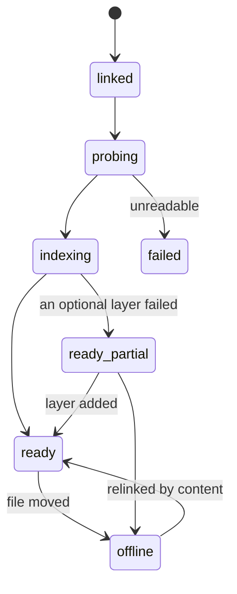

# Data model and state machines (track E)

Most data stays on the person's computer. Kriya's database holds only what Tavi
needs: jobs, previews, decision cards, notes and a plan cap.

## 1. Where data lives

| Data | Where | Sent to Kriya? |
| --- | --- | --- |
| Raw footage, audio, images | The person's folders | Never by default |
| Project (`.kriya-edit`) | Project folder | No |
| History, index, cache, journal | `~/.kriya/edit/<project id>/` | No |
| Taste rules | `~/.kriya/edit/taste.json` | No |
| Brief text, transcript slices, digests | Sent to the model through the gateway for each call | Passes through, not stored by the gateway beyond its existing logs |
| Contact sheets | Only with `editing.frameVision` and the project's consent | Same |
| Job rows and verdict | `kriya.edit_jobs` (Tavi jobs only) | Yes |
| Decision cards, timecoded notes | `kriya.edit_questions`, `kriya.edit_notes` | Yes |
| Preview, poster, clips for a card, report (JSON) | Bucket `kriya-edit-previews` (plan cap) | Yes, small, expiring |
| A new recording's name and duration | `kriya.edit_questions`, only with a watch folder on | Yes |

## 2. The project file

JSON, schema-versioned, validated on load. Written atomically: temp file, fsync,
rename. A newer schema than the client knows is refused with a plain message,
never partly read. Migrations are pure functions `v(n) → v(n+1)`, tested on
golden files.

| Object | Fields |
| --- | --- |
| `Project` | `schema`, `id` (nanoid), `name`, `canvas`, `assets[]`, `sequences[]`, `active`, `look`, `deliverables[]`, `brief?`, `nextId` (never reissues a removed id), `head` (version id), `history` (compact log) |
| `Canvas` | `width`, `height`, `fps {n,d}`, `color {primaries,transfer,range}`, `workingBitDepth` |
| `Asset` | `id`, `kind` (`video`,`audio`,`image`,`document`,`data`,`font`,`lut`,`reference`), `fingerprint`, `sha256?`, `path` (relative when in the project, else absolute), `linked` (bool), `rights` (`own`,`licensed`,`public_domain`,`unknown`), `rightsNote?`, `role?` (`aroll`,`broll`,`screen`,`music`,`sfx`,`logo`), `facts` (probe summary: `duration`, `fps`, `vfr`, `width`, `height`, `rotation`, `hasAudio`, `sampleRate`, `channels`, `color`, `peak`) |
| `Sequence` | `id`, `name`, `tracks[]`, `markers[]`, `clips[]`, `parent?` (nesting for long form) |
| `Track` | `id`, `role`, `order`, `muted`, `locked` |
| `Clip` | `id`, `track`, `source {asset,in,out}` (null for a generated clip), `at` (null on base: list order), `until?`, `duration?`, `peak?`, `loop?`, `effects[]`, `speed {n,d}`, `linkGroup?`, `audioLead?`, `audioLag?`, `createdBy` |
| `Effect` | Tagged union: `reframe`, `zoom`, `matte`, `grade`, `lut`, `stabilize`, `fade`, `transition`, `caption`, `block`, `level`, `eq`, `duck`, `freeze` |
| `Caption` | `words[]` (ids), `text?` (only if corrected), `look`, `placement?` (from the solver), `emphasis[]` |
| `Block` | `blockId`, `version`, `variables` (typed); its time is its clip's `at` and `duration` |
| `Look` | `id`, `caption`, `color`, `motion`, `sound`, `brand` |
| `Deliverable` | `id`, `preset`, `size`, `fps`, `codec`, `audio`, `loudness`, `burnCaptions`, `gates` |
| `EditBrief` | `format`, `targetDuration`, `audience?`, `tone?`, `mustKeep[]`, `mustCut[]`, `language?`, `effort` (`fast`,`best`) |
| `Anchor` | EDIT_ENGINE §5 |
| `Version` | `id`, `parent`, `name?`, `author`, `opsRange`, `hash`, `at` |

`ops.jsonl`, one line each: `{ id, parent, author, ops[], promptRef?, hash, at }`.
Operations are validated against the same schema when read back.

## 3. Local databases

`node:sqlite`, WAL mode, in `~/.kriya/edit/<project id>/`. Everything here can be
rebuilt, apart from the `corrections` table.

### 3.1 `index.sqlite`

| Table | Columns |
| --- | --- |
| `layers` | `asset`, `layer`, `model_version`, `status`, `updated_at` |
| `words` | `asset`, `id`, `start`, `end`, `text`, `lang`, `speaker`, `conf`, `flags` (filler, restart, low confidence) |
| `words_fts` | FTS5 over `text` |
| `corrections` | `asset`, `word`, `text`, `at` (the person's fixes) |
| `sentences` | `asset`, `id`, `start`, `end`, `first_word`, `last_word`, `speaker`, `take_group?`, `score` |
| `takes` | `group`, `sentence`, `rank`, `signals` (JSON) |
| `shots` | `asset`, `id`, `start`, `end`, `kind`, `blur`, `exposure`, `shake`, `motion` |
| `faces` | `asset`, `shot`, `t`, `box`, `eye`, `chin`, `identity`, `gaze` (sampled) |
| `speakers` | `asset`, `id`, `identity?`, `name?` |
| `cursor` | `asset`, `t`, `x`, `y` |
| `text_regions` | `asset`, `t`, `box`, `text` |
| `beats` | `asset`, `t`, `downbeat`, `strength` |
| `events` | `asset`, `start`, `end`, `kind`, `conf` |
| `embeddings` | `asset`, `shot`, `vec` (Float32 blob) |
| `moments` | `id`, `asset`, `start`, `end`, `kinds`, `summary`, `sentence_ids` |
| `tree` | `id`, `parent`, `level`, `summary`, `first_sentence`, `last_sentence` |

As built in ED5: rows are keyed by `media` (the asset's fingerprint) instead of
`asset`, so the same file added twice shares one set of results, and ids are made
per asset on read (`a1:w0`, `a1:s0`, `a1:g0`, `a1:sh0`). A new `assets` table maps
asset to media; `layers` gains `notice` and `data` (small results: probe facts and
VFR timestamps, the loudness curve); silences are `events` of kind `silence`; word
flags are written by L5. Not created yet, because no layer fills them: `speakers`,
`cursor`, `text_regions`, `beats`, `embeddings`, `moments`, `tree`.

Times are integers in flicks. Text from media stays marked as untrusted wherever
it's read out (ES-04).

### 3.2 `journal.sqlite`

| Table | Columns |
| --- | --- |
| `jobs` | `id`, `kind`, `project_version`, `status`, `progress`, `error`, `started_at`, `finished_at`, `dispatch?` |
| `steps` | `job`, `id`, `kind`, `input_hash`, `status`, `attempts`, `resources`, `output_key`, `log` |
| `traces` | `id`, `version`, `deps`, `output_hash`, `value`: the graph's verifying traces (EDIT_LOOP §4) |
| `calls` | `job`, `task`, `tier`, `input_tokens`, `cached_tokens`, `output_tokens`, `ms`, `result` (no prompt text) |
| `measurements` | `job`, `gate`, `key`, `value`, `at_time?` |

## 4. Server: two migrations

As built in ED14, by the owner's brief: `20271101000000_harness_dispatch_edit.sql` (the
kind check) and `20271102000000_editing_tables.sql` (the plan cap, all four tables,
`reserve_edit_preview`), each with a rollback under `supabase/rollback/`. So the
questions and notes tables exist from ED14, unused until ED15. ED15 added
`20271103000000_editing_review.sql`: `edit_notes.sent_in` (the revision a sent note went
into) and several clips per job, for a decision card. Differences from the sketch below, each found by running
it: `revision_of` is a composite foreign key with `user_id` (a policy reading its own
table recurses); `edit_jobs.beat` is the computer's last progress counter, the worker's
only sign of life; `edit_deliverables.uploaded_at` marks an upload the device says
finished; `reserve_edit_preview` isn't `security definer`, as `reserve_harness_spend`
isn't: it's revoked from sessions and called `privileged`, with the limits passed in.
Drizzle types in `db/schema.ts` mirror them, and `HARNESS_DISPATCH_KINDS` gains `edit`.
If another track takes a timestamp first, use the next free one and record it.

```sql title="20271101000000_editing.sql"
-- plan cap: bytes of previews a person may keep in Kriya; 0 = none
alter table kriya.plans add column editing_preview_bytes bigint not null default 0;

-- the dispatch kind; read the constraint's real name first
alter table kriya.harness_dispatches drop constraint harness_dispatches_kind_check;
alter table kriya.harness_dispatches add constraint harness_dispatches_kind_check
  check (kind in ('run','doctor','rule_confirm','rule_dismiss','handoff','pull',
                  'serve_start','serve_stop','edit'));

create table kriya.edit_jobs (
  id uuid primary key default gen_random_uuid(),
  user_id uuid not null references auth.users (id) on delete cascade,
  device_id uuid not null references kriya.harness_devices (id) on delete cascade,
  dispatch_id uuid references kriya.harness_dispatches (id) on delete set null,
  thread_id text,                        -- threads.id; null for a job from the Review Room
  project text not null,                 -- folder id the computer offered
  revision_of uuid references kriya.edit_jobs (id) on delete set null,
  recipe text,
  brief text not null check (char_length(brief) <= 4000),
  status text not null default 'queued' check (status in (
    'queued','running','delivered','delivered_with_notes','blocked',
    'failed','canceled','expired','lost')),
  stage text,
  percent smallint check (percent between 0 and 100),
  verdict jsonb check (verdict is null or pg_column_size(verdict) <= 16384),
  notified_at timestamptz,               -- the thread message went out, once
  accepted_at timestamptz,               -- the person said it looks good
  created_at timestamptz not null default now(),
  updated_at timestamptz not null default now(),
  finished_at timestamptz
);
create trigger edit_jobs_transition before update of status on kriya.edit_jobs
  for each row when (old.status is distinct from new.status)
  execute function kriya.check_transition('edit_job');
-- plus rows in kriya.allowed_transitions, §5.5

create table kriya.edit_deliverables (
  id uuid primary key default gen_random_uuid(),
  job_id uuid not null references kriya.edit_jobs (id) on delete cascade,
  user_id uuid not null references auth.users (id) on delete cascade,
  kind text not null check (kind in ('preview','poster','clip','report')),
  status text not null default 'pending' check (status in ('pending','ready','rejected')),
  storage_path text not null,
  bytes bigint not null check (bytes > 0),
  sha256 text not null check (sha256 ~ '^[0-9a-f]{64}$'),
  duration_flicks bigint,
  created_at timestamptz not null default now(),
  expires_at timestamptz not null,
  deleted_at timestamptz
);
```

```sql title="20271102000000_editing_review.sql"
create table kriya.edit_questions (
  id uuid primary key default gen_random_uuid(),
  user_id uuid not null references auth.users (id) on delete cascade,
  device_id uuid not null references kriya.harness_devices (id) on delete cascade,
  job_id uuid references kriya.edit_jobs (id) on delete cascade,  -- null for a found recording
  kind text not null check (kind in ('take','hook','file','name','taste','found')),
  prompt text not null check (char_length(prompt) <= 500),
  options jsonb not null check (pg_column_size(options) <= 8192),
  default_option smallint,
  answer jsonb check (answer is null or pg_column_size(answer) <= 2048),
  status text not null default 'open' check (status in ('open','answered','defaulted','expired')),
  created_at timestamptz not null default now(),
  expires_at timestamptz not null,
  answered_at timestamptz
);

create table kriya.edit_notes (
  id uuid primary key default gen_random_uuid(),
  user_id uuid not null references auth.users (id) on delete cascade,
  job_id uuid not null references kriya.edit_jobs (id) on delete cascade,
  at_flicks bigint not null check (at_flicks >= 0),
  body text not null check (char_length(body) between 1 and 1000),
  status text not null default 'open' check (status in ('open','sent','done','removed')),
  created_at timestamptz not null default now()
);
```

| Table | RLS | Writes |
| --- | --- | --- |
| `edit_jobs` | Owner reads own rows | Insert under `withUser` by the tool or the person's action; status and verdict `privileged` after `authenticateDevice`, scoped by person and device; `accepted_at` by the person |
| `edit_deliverables` | Owner reads own rows | `privileged` in the reserve route and the worker's verification |
| `edit_questions` | Owner reads own rows; may set only `answer`, `status`, `answered_at` (a column grant, as on dispatches) | Insert `privileged` after `authenticateDevice` |
| `edit_notes` | Owner reads and writes own rows | The person, under `withUser`. Devices only read them, through their route |

Indexes: `edit_jobs (user_id, created_at desc)`, `edit_jobs (dispatch_id)`,
`edit_deliverables (job_id)`, `edit_deliverables (expires_at) where deleted_at is null`,
`edit_questions (user_id, status)`, `edit_notes (job_id, created_at)`.

**`kriya.reserve_edit_preview(user_id, job_id, bytes)`** (`security definer`,
`search_path = ''`): under a per-user advisory lock, sums live deliverable bytes,
compares with the plan's `editing_preview_bytes` and `editing.previewMaxBytes`, and
inserts a `pending` row or raises. Limits are in SQL (invariant 7).

`resource_usage_kind_check` is dropped and recreated with `edit_preview_bytes` added,
**listing every existing kind, including `flow_design`**. `kriya.charges` and
`kriya.usage_events` are untouched.

The bucket `kriya-edit-previews` is private, created by the owner (OPERATIONS_RUNBOOK
§1) as `kriya-files` was, and isn't in a migration.

`tests/db/editing-rls.test.ts` holds ET-DB-01…06; `tests/db/migrations.test.ts` gains
the down and up cases.

## 5. State machines

### 5.1 Asset (local)



### 5.2 Engine step (local)

`pending → running → done | failed | skipped`. On restart, `running` becomes
`pending`. A step runs only when its inputs are `done`. An existing output key
means the step is `done` with no work, which is what makes resume cheap and safe.
Retries: idempotent steps only, at most once (track N rule 9's spirit).

### 5.3 Director run (local)

`brief → recipe → index → story → assemble → dress → prove ⇄ repair → offer`, then
`revise → prove` per change; `paused` from any stage (cap, offline, person). Each
run is a branch, rebased onto HEAD when it lands (EDIT_LOOP §9).

### 5.4 Version (local)

Append-only. HEAD moves; `undo` moves it to the parent. New work after an undo
starts a branch, and nothing is deleted. Named versions are kept by cache
eviction's rules for longer.

### 5.5 Edit job (server)

| From | To | Who | Evidence |
| --- | --- | --- | --- |
| — | `queued` | Tool or person's action under `withUser` | Dispatch row |
| `queued` | `running` | Device route | Dispatch claimed |
| `queued` | `expired` | Worker | Dispatch expired |
| `queued`, `running`, `lost` | `canceled` | Device route, after the person cancels | Dispatch canceled |
| `running` | `delivered`, `delivered_with_notes`, `blocked` | Device route | Verdict JSON and, with previews on, a stored hash |
| `running` | `failed` | Device route | Reason code |
| `running` | `lost` | Worker, after `editing.jobLostMinutes` of silence | Time |
| `lost` | `running` | Device route, on reconnect | A report |

These are rows in `kriya.allowed_transitions` for entity `edit_job`, enforced by
`kriya.check_transition`, the codebase's own mechanism (EH-29). No model and no
browser can set a terminal status: the tools have no such input, and the person's
session only cancels.

`delivered` here means "the computer reports the gates passed", and is labelled
so (TAVI_INTEGRATION §6).

## 6. Retention

| Data | Kept |
| --- | --- |
| Local cache | Size cap, least-recently used. Person can clear it |
| Local index and history | As long as the project; `kriya edit forget` removes them |
| Preview, poster, clips, report in Storage | `editing.previewDays` (default 14), then deleted by `janitor()`, which also sweeps objects whose rows are gone, such as after account deletion (EH-26) |
| Answered questions, notes | With the job |
| `edit_jobs` | With the account; deleted with it by cascade |

## 7. Tests

ET-DB-01…06 in TEST_STRATEGY: two users can't read each other's rows; a device
can't write another device's job; a person can't set a status; the cap holds
under concurrent reservations; rollback leaves dispatch rows of the eight old
kinds unchanged; every new table has RLS and a policy (`tests/db/lint.test.ts`).
