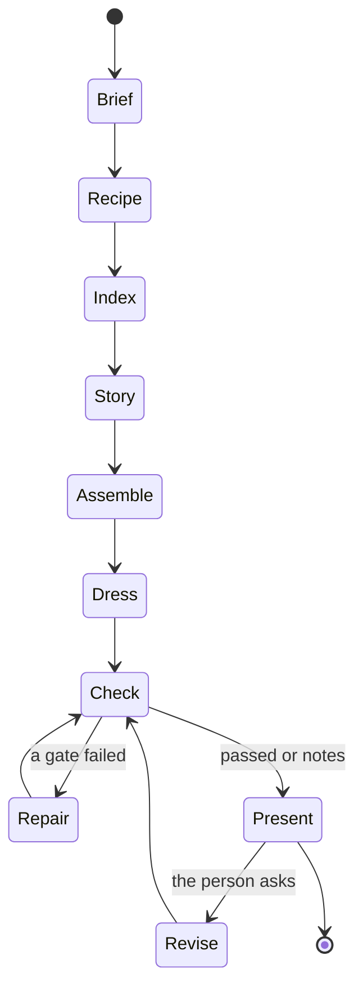

# The Director and the agent (track E)

How a cheap model produces a good edit: by never being asked to do anything
except make one small, well-framed decision.

## 1. Three ways in, one Director

| Way in | What it is | Who drives |
| --- | --- | --- |
| **Console** | The Studio's prompt box. A request goes straight to the Director: no chat session, so one request is one small call | The person |
| **Agent** | A normal coding session or `kriya run` calling `edit_*` tools | The model, within the tools |
| **Job** | `kriya edit run`, or a Tavi job handed to the Edit Host. No agent loop at all, so no tools exist for a hidden prompt to reach | Code |

The Director is the craft: code holding the plan, inside the Edit Loop (EDIT_LOOP.md),
which owns search, ranking, the ladder and the Governor. This document covers what a
model is asked to do.

## 2. Why code leads

Each row is a place a free agent loop with a cheap model goes wrong.

| Free loop | Director |
| --- | --- |
| Model plans the work, may skip steps | Stages are fixed per recipe |
| Long conversation re-read every turn | Stateless calls with only their slice |
| One long output must all be right | Many small outputs, each validated alone |
| A wrong step poisons the rest | A failed slot retries alone |
| Quality swings run to run | Variance is bounded by the plan and the checks |

This is the core bet of the track, and it is tested directly: arm A5 in
EVALUATION_PLAN runs the same cheap model in a free loop with the same skills.

## 3. Stages



| Stage | Input | Model's job | Code's job | Output |
| --- | --- | --- | --- | --- |
| **Brief** | The person's words, media list | Fill `EditBrief`: format, length, audience, must keep, must cut, tone | Defaults; ask **one** question only if a required field can't be defaulted | `EditBrief` |
| **Recipe** | Brief, content class from the index | Nothing if clear; else pick from a short list | Match by keywords and content class (the `src/intent.js` way) | `Recipe` |
| **Index** | Assets | Nothing, then L14 in the background | Perception | Index |
| **Story** | Moments or paper edit, brief | Propose selections and order, as sentence ids; judge pairs | Generate windows, enforce limits, run the tournament | Selected ranges |
| **Assemble** | Selection | Nothing | Solver | Timeline |
| **Dress** | Timeline, look | Choose emphasis words, B-roll beats, where motion helps | Captions, B-roll search, music fit, SFX rules, reframing | Full project |
| **Check** | Project, draft | Critic notes, advisory | Gates | Verdict |
| **Repair** | Failures | Only on rung 2 of the ladder | Ladder (QUALITY_GATES §4) | A better attempt |
| **Present** | Everything | A short summary, from facts | Report, alternatives | Preview |
| **Revise** | Person's words, selection | Words to operations | Validate, apply, partial render | New version |

## 4. A model call, precisely

Every call goes through one function:

```ts title="src/edit/director/ask.ts"
ask({ task, tier, schema, view, maxOutput }) → { value, usage } | { fallback }
```

Every `ask` goes through the Model Call Governor (EDIT_LOOP §8), and several slots
are batched into one call wherever the views allow.

1. **Schema first.** Sent as a tool definition with `tool_choice`, or `response_format`: the gateway passes both through (EH-35). EX-08 measures which this model follows best.
2. **Small.** One decision, one schema, a fixed output budget. `max_tokens` is always set, so the gateway's reservation stays small (EH-36).
3. **Validated twice.** Syntax by schema; meaning by Edit Core (does the id exist, does it fit the time).
4. **One repair.** A failure sends back the exact diagnostic once. Then the slot takes its code default, and the run says so. It never loops.
5. **Logged.** Task, tier, tokens, cached tokens, latency, result class, into the journal. Prompts stay on the machine.

Every slot has a **default that needs no model**: keep everything, use the last
take, the recipe's caption style. So model trouble degrades an edit; it never
stops one.

## 5. Context policy

ghost-editor found the real cost isn't looking at frames; it's context re-read
each turn (EF-24). Its answer was a fresh helper per reel, with the generator as
the state. Kriya goes further:

- **The project is the memory.** A Director call carries no conversation.
- **The agent's session stays short.** `edit_*` tools return a few lines and ids, never transcripts or frames.
- **Tool results are compact by rule**: a result over 2 KB is a bug.
- **Revisions are stateless**: the person's sentence plus the digest and the selection.
- **The agent's tool list is small**: ten tools in a focused preset, not the whole coding toolset, if EX-07 confirms the seam. If not, the intent router's hint points the agent at them.

## 6. Prompt layout and caching

The brief's GBNF and VRAM pinning don't exist on this route (EF-02). What does
exist: providers cache a stable prefix, and OpenRouter lists a read price of
$0.003 per million for Flash-1017 against $0.15 uncached.

So every prompt is ordered from most to least stable:

| Block | Content | Changes |
| --- | --- | --- |
| 0 | Director core, operation schema | Per release |
| 1 | Recipe and look notes | Per project |
| 2 | Digest or view | Per version |
| 3 | The task and the person's words | Per call |

Nothing volatile, such as a date or a run id, goes in blocks 0 and 1. Whether
cached tokens are reported through the gateway, and at what rate they hit, is
measured in EX-08 (`next.promptCache` records that no route was proven in track
N). The design doesn't depend on it, but the cost table does.

## 7. Model routing

The Director names tier aliases only (track H rule 4).

| Work | Tier | Why |
| --- | --- | --- |
| Almost everything | `budget` | One bounded decision |
| Story for long form, top level | `balanced` if it differs | More context judgement |
| Custom motion code, a hard repair, a critic on a contact sheet the budget tier failed | `escalation` | Rare, decided by code |

Escalation is triggered by code, from facts, not a prompt classifier:

| Trigger | Move |
| --- | --- |
| A slot failed validation after its repair, and the recipe marks it important | Retry once on the next tier |
| Story candidates all score below the floor | Next tier for that stage |
| Custom motion block requested | `escalation`, then drop back |
| Budget for the job nearly spent | Never escalate; finish on defaults |

Today all tiers may be one model (EF-32). Then escalation changes nothing, and
that's fine: the design holds, and the owner can set a better model later.

Image input is used only if `GET /models` says the tier takes images **and**
`editing.frameVision` is on **and** the project allows it.

## 8. Candidates and the tournament

Cheap tokens buy options. For decisions where taste matters (the hook, a clip's
boundaries, a title), Kriya generates several and picks.

1. **Generate** N candidates by code where possible: windows that start and end on sentence boundaries and fit the length, with measured signals. The model proposes only when code can't.
2. **Filter by code**: coherence red flags ("as I said earlier", a dangling pronoun at the start), mid-sentence ends, overlap, spacing between clips.
3. **Rank pairwise.** A model compares two candidates at a time against the recipe's rubric, each pair in both orders to cancel position bias. Scores come from a Bradley-Terry fit. Absolute 0 to 100 scores from a small model are noisy; pairwise choices are steadier.
4. **Show** the top three when the person wants a say, with the reasons from the rubric.

The rubric is the 5-dimension one from `claude-shorts`, used as guidance:
hook, standalone sense, emotion, value density, payoff. Its output is a ranking
for *this* footage. It is never shown as a prediction of views (EDD-16).

Budget: N and the pairs are capped per recipe. Comparing all pairs of 8 in both
orders is 56 judgements, so a Swiss-style schedule of about N log N pairs is used,
and **many pairs are judged in one batched call**: the Governor allows few calls,
and the gateway strips `n`, so N-way sampling costs N calls (EH-14, EH-35).

## 9. The agent's tools

Full contracts in TOOLS_AND_CONTRACTS §2.

| Tool | What it does |
| --- | --- |
| `edit_status` | Project, jobs, version, gates |
| `edit_find` | Search words, moments, shots |
| `edit_look` | A view: paper edit, slice; a contact sheet if allowed |
| `edit_make` | Runs the Director from a brief |
| `edit_change` | One revision in the person's words |
| `edit_apply` | Typed operations, for exact work |
| `edit_undo` | Moves to a version |
| `edit_render` | Draft or master, with gates |
| `edit_export` | Deliverables and handoff |
| `edit_motion` | Custom motion block: the one escape hatch (§11) |

All of them act only inside the project (ES-01). None takes a shell string or a
path outside it.

## 10. Skills

Skills guide the agent and the Director's prompts; they don't replace code. See
SKILLS_AND_OPEN_SOURCE §4. The intent router's brief finds them with no change.

## 11. The escape hatch: custom motion

Sometimes a request has no template: "a 3D spinning version of my logo". Only
then does a model write code, through `edit_motion`:

1. It writes a HyperFrames composition from a scaffold, with the skill's rules in context, on the `escalation` tier.
2. Lint by code: HyperFrames' `lint` and `check`, no network, no `Date.now`, no unseeded `Math.random`, no GSAP while EDD-09 stands, only true removed APIs flagged (EF-11).
3. Render in Chrome inside the OS sandbox (ES-05). Needs `editing.customMotion` on, and is refused on an OS without confinement.
4. Gates QG-08, QG-09, QG-11 on the tile.
5. Two attempts, then it says it couldn't and offers the nearest template.

The result is a saved block in the project, and the person can reuse it.

## 12. Taste ledger

Kriya learns how a person edits, from what they do, not what they say.

- **Signals.** Accepted or undone operations, chosen candidates, manual changes to captions, pace, zoom, music level.
- **Aggregation by code.** Over projects: the sizes, speeds and levels they keep choosing.
- **Proposal, then confirmation.** After a pattern repeats (at least twice, as Loop v2's rules do): "You usually make captions larger. Use this by default?" Only the person confirms. Track-A rules 8 and 11 apply.
- **Storage.** `~/.kriya/edit/taste.json`, outside any project, written only by code. Nothing is sent to Kriya except as memory the person chooses to save, which stays unconfirmed there (track H rule 6).
- **Use.** Confirmed rules feed defaults in the Look. They're visible and removable in one screen.
- **As built (ED16).** `src/edit/host/taste.js`. Learned: the caption look and the zoom, the two a make job can use; pace and music level aren't learned yet, since nothing could apply them. A value repeats across at least two projects before it's proposed, once. An undo removes its signal. The rule routes refuse the Host's socket, so only a Studio session or the person's answer on a card confirms. The brief always wins, and a job's report says which rule it used. A "Remember this?" card sends Kriya that one sentence, which goes further than this section's "nothing is sent": it's the card TAVI_INTEGRATION §5 specifies, and it stays behind `editing.review`.

## 13. Budgets

Enforced by code, per job. Starting values, tuned after EX-08; they are limits,
not forecasts.

| Item | Short form | Long form |
| --- | --- | --- |
| Director model calls | 40 | 200 |
| Input tokens, uncached | 300 k | 3 M |
| Output tokens | 40 k | 300 k |
| Repair rounds | 3 per fidelity | 3 per scene |
| Contact sheets | 12 | 60 |
| Spend | The person's cap and the existing harness reservation | Same |

Calls are few because they're batched: a 2-hour transcript is about 40 k tokens, and
the model holds 1 M. They still aren't free: with 1 or 2 answers open at a time, 200
calls is 25 to 50 minutes (EX-12, with assumed answer times). So a **first cut uses at
most 8 calls**, and the rest improves it in the background.

Over budget, the job finishes on defaults and says so.

## 13a. As built in ED7

Client `src/edit/director/`: `ask.js` (§4: schema sent as `response_format`, checked
by a small validator and by Edit Core, one repair with the exact reasons, then the
slot's default; blocks 0 and 1 byte-stable; each call journalled without its
prompt), `revise.js` (the console: a request and the selection become a proposal of
console-safe operations, described by code), `gateway.js` (the device the Host reads
itself). Recipe `reel-talking-head` in `src/edit/recipes/reel.js`: two model slots,
story and emphasis, both with defaults. Routes: `POST /projects/{id}/ask`,
`POST /projects/{id}/proposals/{id}`, `POST /projects/{id}/make`. Not built yet: the
agent's `edit_*` tools (§9), escalation (§7), the tournament (§8), the taste ledger
(§12).

## 14. What the person sees

The Director's stages appear as a plain progress list. Each decision of note
appears in **What I did**, built from operations and measurements, never from
model prose (track-A rule 7). Anything uncertain appears as a short list:
"Check this: I wasn't sure about the name at 0:31."
