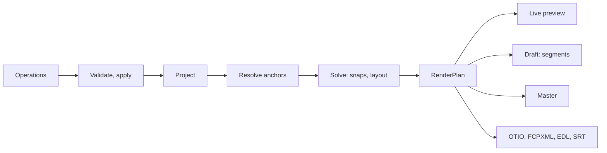
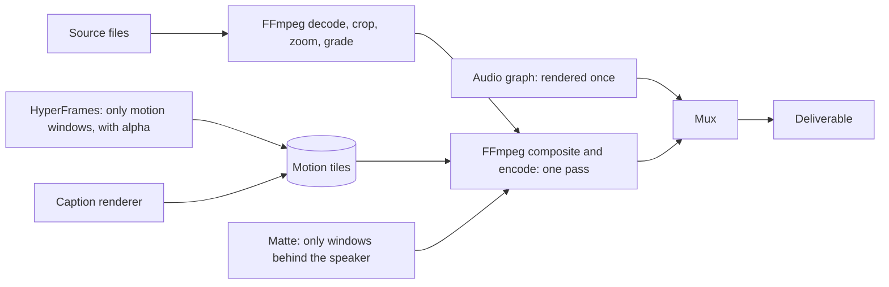
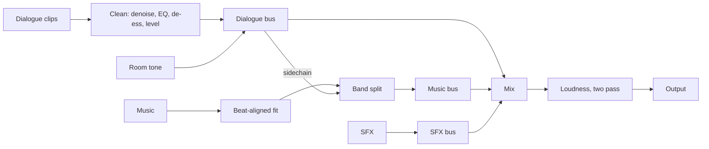

# The edit engine (track E)

How a project is represented, changed, compiled and rendered. This is the part
that makes a cheap model safe: everything here is deterministic code.

## 1. The pipeline



One compiler, four outputs. The RenderPlan is plain data with no I/O, so golden
tests can pin it without a single video file. All of it runs as nodes of the graph
runtime (EDIT_LOOP §4), which is what makes every change incremental.

## 2. Time: integer flicks

Every time in Kriya is an integer count of **flicks**: 1/705,600,000 of a second.

| Rate | Flicks per unit | Exact? |
| --- | --- | --- |
| 24 fps | 29,400,000 | Yes |
| 23.976 (24000/1001) | 29,429,400 | Yes |
| 25 fps | 28,224,000 | Yes |
| 29.97 (30000/1001) | 23,543,520 | Yes |
| 30 fps | 23,520,000 | Yes |
| 59.94 (60000/1001) | 11,771,760 | Yes |
| 60 fps | 11,760,000 | Yes |
| 120 fps | 5,880,000 | Yes |
| 44.1 kHz sample | 16,000 | Yes |
| 48 kHz sample | 14,700 | Yes |
| 96 kHz sample | 7,350 | Yes |

So video frames and audio samples share one exact clock, with no rounding drift
at all. A JavaScript `Number` holds integers exactly up to 2^53, which is 147
days of flicks; a 2-hour timeline is about 5.1 × 10^12. No `bigint` is needed
in hot paths, and JSON stays plain.

- Frame rates are rationals `{ n, d }`, never decimals.
- Variable-frame-rate sources (most phones) keep their real timestamps in the
  index. Clips reference **source time**, and the compiler maps to frames by
  timestamp lookup, so a VFR file doesn't drift against its audio.
- Conversion to seconds happens only at the edge: the FFmpeg argument builder
  and the UI.
- Rule: no float seconds cross a module boundary (ET-CORE-01 fails a build that
  adds one to the schema).

## 3. The project (KEP, the Kriya Edit Project)

One JSON document, versioned by `schema`, validated on every load. Types below
are the contract; DATA_MODEL_AND_STATE_MACHINES §2 has every field.

```ts title="src/edit/core/project.d.ts"
type Project = {
  schema: 1
  id: string
  canvas: { width: number; height: number; fps: { n: number; d: number }; color: ColorSpec }
  assets: Asset[]            // what was brought in, by content id
  sequences: Sequence[]      // usually one; long form nests scenes
  active: string             // sequence id
  look: Look                 // captions, colour, motion, sound defaults
  deliverables: Deliverable[]
  brief?: EditBrief
}

type Clip = {
  id: string
  track: string
  source: { asset: string; in: TimeRef; out: TimeRef } | null  // null: generated
  at: TimeRef | null         // where it sits; null on base, which lays end to end
  until?: TimeRef            // where a span ends, as an anchor...
  duration?: Flicks          // ...or as a length
  peak?: Flicks              // a sound's peak, so the peak lands on the anchor
  loop?: boolean
  effects: Effect[]          // typed: reframe, zoom, freeze, grade, matte...
  speed: Rate
  audioLead?: Flicks         // J and L cuts: sound before or after the picture
  audioLag?: Flicks
}

// A time is a number only when it truly is one; edits usually point at content
type TimeRef = Flicks | Anchor
```

Track roles: `base` (the main picture), `broll`, `matte`, `overlay`, `caption`,
`dialogue`, `sfx`, `music`, `ambience`. Tracks stack by role, so "behind the
speaker" is a stacking rule, not a coordinate.

Clips live in `Sequence.clips`. Base clips lay end to end in list order, so their
`at` is null. Everything else is placed by its own `at`, which is what lets it
follow its anchor. A **generated clip** has no source: a caption, a title, a card
or a punch-in. A punch-in is a generated clip on the overlay track carrying a
`zoom` effect, not an effect on the clip below it, so it follows its word through a
re-cut, and losing that word is reported (EF-36).

The project holds **decisions**, never derived data. Transcripts, faces and
shots live in the index and can be rebuilt.

## 4. Operations: how anything changes

Every change, from a person or a model, is a typed **operation**. There is no
other way to edit a project.

```json title="a change, as the model emits it"
[
  { "op": "punch_in", "at": { "word": "a1:w812", "edge": "start" }, "scale": 1.12, "ease": "snap" },
  { "op": "add_sfx", "asset": "sfx:whoosh-soft", "peak_at": { "word": "a1:w812", "edge": "start" } }
]
```

| Family | Operations |
| --- | --- |
| Selection | `keep_range`, `remove_range`, `use_take`, `reorder`, `trim`, `split`, `ripple_delete` |
| Picture | `punch_in`, `reframe`, `place_broll`, `speed`, `freeze`, `transition`, `stabilize`, `set_camera` |
| Words on screen | `caption_style`, `caption_edit`, `caption_emphasis`, `add_title`, `add_lower_third`, `add_motion`, `text_behind` (ED8) |
| Sound | `add_sfx`, `set_music`, `music_shape`, `duck`, `clean_voice`, `set_level`, `room_tone` |
| Colour | `grade`, `match_color`, `apply_lut`, `fix_exposure` |
| Project | `set_format`, `add_deliverable`, `set_look`, `mark`, `name_version` |

Two more aren't edits. `set_brief` (ED7) records what the edit is for, so QG-12 can check it.
`add_asset` isn't an edit either: the Host records a file it brought in, so a replay
sees the same assets. Only code may use it, so an agent or a person can't name a file
through an operation (ES-01).

Why typed operations and not JSON patches (EF-16):

- **They carry intent.** `punch_in` at a word is still right after a re-cut; `replace /tracks/0/clips/7/x` is not.
- **They validate semantically.** Unknown word, B-roll longer than its source, a caption outside the frame: refused with a reason the model can fix.
- **They are small.** Fewer tokens out, and output tokens are the expensive ones.
- **They are the history.** Undo, diff, "what I did" and the taste ledger all read the same log.
- **They replay.** Take a revision, apply it to another cut or another format.

History is an append-only log. Each entry: `id`, `parent`, `author` (`person`,
`agent`, `code`), the operations, the prompt that caused them, and a hash of the
result. Undo moves HEAD; nothing is deleted. A branch is a named version: "Cut
A", "Cut B".

`apply(project, ops, ctx)` is a pure function that returns the new project plus
diagnostics. `ctx` carries the index, because an anchor can't be validated without
it: with no index, a word anchor is refused. An operation either applies fully or
not at all. There is no inverse per operation: a version is rebuilt by replaying
the log from the root.

## 5. Anchors and the solver

An **anchor** names content instead of a time:

| Anchor | Meaning |
| --- | --- |
| `{ word: "a1:w812", edge, exact? }` | A word in an asset's transcript |
| `{ shot: "a2:s14", edge? }` | A shot boundary; `edge` defaults to `start` |
| `{ beat: "m1:b33" }` | A musical beat or downbeat |
| `{ marker: "hook" }` | A named marker |
| `{ clip: "c9", edge, offset }` | Relative to another clip |

Word and shot ids are stable across re-indexing for a given transcript version.
If a source is re-transcribed, ids are remapped by alignment, and any anchor
that can't be remapped is reported, not guessed.

`exact` marks a cut that takes no pad. A split sets it, because a split is one
continuous cut and a pad on either side would repeat footage.

**Why this is the core idea.** Delete a sentence and a reel made by a tool that
stores seconds is broken: every caption, zoom and sound after it is now wrong.
Here they point at words, so they follow. The model can also say "at the word
*fifty*" without doing arithmetic, which is where cheap models slip.

The **solver** turns anchors into exact times, in this order:

1. **Resolve** every anchor against the index.
2. **Sequence**: lay kept ranges end to end.
3. **Snap cut points.** Video to frame; audio to a zero crossing within ±2 ms.
   Pads around words default to 120 ms in, 240 ms out, and follow the recipe
   (brief's values kept as defaults, tuned in EX-11).
4. **Air rules**: extend after a punchline when a sound or reaction follows.
5. **Reconcile J and L cuts** so picture and sound can part by a set amount.
6. **Lay out on-screen items**: captions and cards against face boxes and safe
   zones (§5.1).
7. **Check the budget**: target duration, minimum shot length, no flash frames.

It reports what it couldn't satisfy. It never silently drops a request.

### 5.1 Layout solver

Inputs: per-shot face box and chin line from the index, the platform's safe
zones (from ffmpeg-skill's delivery tables, reviewed), the look's preferred
position. Output: a placement for each caption and card.

Priority: never on a face; inside safe zones; stable (a caption doesn't jump
between lines unless the speaker moved a lot); then the look's preference. It
searches a small set of candidate positions per caption page and picks the
lowest-cost sequence by dynamic programming, so stability is decided across
time, not per caption.

### 5.2 Reframe solver

For 16:9 to 9:16 and friends. Input: subject track per shot (face, active
speaker, or cursor). Output: a crop path that moves like a camera operator:
still when possible, smooth when not.

Kriya solves it as **L1 trend filtering**: minimise distance to the subject plus
a penalty on the path's first and second differences. L1 gives what a person
does: long holds, then decisive moves, not constant drift. One small ADMM solves
both penalties, in about 100 lines of JavaScript with no dependency, per shot. A
deadzone drops micro-movement before solving. Two faces at once switches to a stacked
split layout when the recipe allows it; a shot change resets the path.

### 5.2a As built in ED11

Client `src/edit/core/reframe.js`, `plan.js`, `ffmpeg.js`, `faces.js`. The subject track
carries L8's box width, and the crop keeps the whole box in, not just its centre. After
the trend filter a speed limit (`maxSpeed`, one crop width a second in the compiler)
caps every move: a forward and a backward pass, averaged, so the ramp is centred on the
subject's move. Keeping the face in frame wins over the limit: a subject that jumps
further than the crop's slack still gets a fast move. Between samples the crop glides:
`ffmpeg.js` draws straight lines between the path's knots (only points where the slope
changes), each segment carries one point either side unless a shot change lies between,
and `faces.js` maps faces the same way. A punch-in can now name a focus (`x`, `y` in
thousandths of the framed picture) and `ease: "smooth"`; those draw with `zoompan` on the
finished frame, smoothstep over 0.3 s at each end, and the Engine refuses them on an
FFmpeg without `zoompan`. Not built: the stacked two-face layout, retimed crop paths on
sped-up pieces, and mapping caption layout faces through the crop (QG-08 checks the
output meanwhile).

## 6. The layer-split render

This is the main speed idea, and the one thing the brief's design misses.

ghost-editor and claude-shorts send **the whole video** through headless Chrome. But
most frames of most edits contain no motion graphics. Captions, cards and titles
are a small layer over footage.

Measured in EX-10 on a 60-second reel: **about 1.3× faster on a first render
(23 s against 31 s) and about 5× on a change (5.8 s against 31 s)**. Revisions are
where people spend their time, so that is the point of it. Tiles cost about 4 s of
fixed setup each, so they are batched in one warm browser.

Kriya splits the frame into layers and renders each with the right tool:



- **Base picture** in FFmpeg: decode, crop path, zoom, speed, LUT, in one filter
  graph, in the source's precision.
- **Motion tiles** in HyperFrames: only the time ranges that have motion, on a
  transparent background, as ProRes 4444 or lossless WebM, cached by content.
  A 60-second reel with 8 seconds of cards renders 8 seconds in Chrome.
- **Captions**: rendered by the same tile path by default, so preview and final
  match. Simple styles can compile to ASS and burn in FFmpeg, which skips Chrome
  altogether (chosen per look).
- **Depth**: the order is base → cards → speaker matte → captions. Behind-the-head
  text is `overlay` with the matte's alpha, and only for those seconds.
- **One generation.** The source is decoded once and encoded once. Tiles are
  lossless intermediates, so there is no quality loss from layering.
- **A tile is its own short composition**, because `--start` and `--end` are MP4-only.
- **Colour is normalised first.** An untagged source fell to SSIM 0.80 through Chrome with wrong colour, against 0.97 tagged and 0.98–0.99 split (EX-10). Probe flags untagged sources, and the plan assigns their tags before anything else reads them.

If the win doesn't hold on a real project, the fallback is whole-composition
HyperFrames, which is a compiler backend, not a redesign.

### 6a. As built in ED8

- **Tiles.** The Engine's `tile` node (scheduler slot `chrome`, one at a time) writes each caption page or block as its own HyperFrames composition (`src/edit/engine/motion.js`, `captions.js`): `data-no-timeline`, a CSP with `default-src 'none'` and `connect-src 'none'`, springs baked into WAAPI keyframes, no GSAP, no Remotion. It runs `hyperframes render --format mov --prores-profile 4444` from `<runtime>/hyperframes/` with the manifest's `chrome-headless-shell`, telemetry off, inside `sandbox-exec` (ES-05). A tile is cached by its plan node; `ENGINE_VERSION` is `ed8-1`, so earlier caches don't mix.
- **Depth.** Whatever their start times: base, then text behind the speaker, then the speaker's matte, then cards, then captions (ET-HR-01). Overlay windows are end-exclusive (`gte(t,a)*lt(t,b)`): `between` had shown every layer one frame too long.
- **Matte.** `text_behind` moves a caption or block to a track under the `matte` track and adds a `matte` clip on the same anchors. The plan maps L8 faces onto the output through the crop path, the punch-in and the final scale (`core/faces.js`), and the compositor cuts the speaker out of the base with a head-and-shoulders mask drawn from the face box (`geq`, `alphamerge`). With no face under the window, the text is drawn in front and the plan says so. Shortcut: a box, not a segmentation; MediaPipe's selfie segmenter (EDD-49) replaces it when the runtime ships it.
- **Captions.** Pages of 2 to 5 words from the kept words, broken at clause ends, never an orphan, a number or a name kept whole. Looks `clean`, `karaoke` (the spoken word lit, from the L2 times) and `boxed`; a page's font steps down until it fits its placement. Safe zones per deliverable preset (`core/layout.js` `SAFE_ZONES`) are Kriya's working margins, **not platform-published figures** (to be checked against each app's current layout before EG-8). The reel recipe captions when the brief names a look.
- Measured on this Mac: a 2 s 540×960 tile, with its master, 5.8 s; a 45 s reel with 20 caption pages, from `make` to delivered, 167 s.

## 7. Segments and the cache

Everything expensive is a graph node, cached by the hash of what produced it:

`key = sha256(engine version ‖ runtime version ‖ inputs' content ids ‖ resolved plan node ‖ output settings)`

| Item | Unit | Reused when |
| --- | --- | --- |
| Proxy, peaks, thumbs | Asset | Always, until the source changes |
| Index layers | Asset, layer, model version | Always |
| Motion tile | One overlay window | Same template, variables, size, fps |
| Matte | Source range, model version | Same range |
| Draft segment | Span between cut points | Nothing inside it changed |
| Audio mix | Whole timeline | Any audio change redoes it (cheap) |

**Segments follow the edit, not the clock.** The brief's 1-second GOPs (EF-18)
waste bits on keyframes and put a seam every second. Kriya starts a segment at a
shot boundary, where a keyframe is free, and splits long shots at about 6
seconds. Changing the last caption re-renders the last segment only.

Rules that keep joins clean:

- Closed GOPs; identical encoder settings and timebase across a project's segments.
- **Audio never lives in segments.** It is rendered once and muxed once, so AAC priming gaps cannot appear at joins.
- A join is checked by QG-05 like any cut.
- **Drafts** join segments by `concat` with stream copy, in seconds.
- **Masters** use one continuous encode from the sources with tiles from the cache: Chrome isn't re-run, and there are no seams. Long form may encode long segments in parallel, closed GOP, with the join check on.

Source identity uses a fast fingerprint for caching (size, modification time,
sha256 of sampled blocks), so a 40 GB file is not read in full before work
starts. The full sha256 is computed in the background for the receipt.

The cache is bounded by a size the person sets, evicted by least recent use,
and never holds anything that can't be rebuilt.

## 8. Encoding and colour

| Deliverable | Video | Audio | Note |
| --- | --- | --- | --- |
| Reels, Shorts, TikTok | H.264 High, 8-bit, 1080×1920, source frame rate | AAC 48 kHz | Dither from a higher-precision pipeline |
| YouTube | H.264 8-bit, or HEVC 10-bit when the source is HDR and the person asks | AAC | Bitrates per ffmpeg-skill's `export.py` presets, reviewed |
| Master | ProRes 422 HQ or HEVC Main 10 | PCM or AAC | For archive and handoff |
| Overlay handoff | ProRes 4444 or VP9 alpha | None | For NLEs |
| Tavi preview | H.264 720p, capped bitrate | AAC | Small by design |

- **Frame rate follows the source** (the dominant rate across the project). It is never raised for free (EF-14).
- **Encoders by capability.** `kriya edit doctor` lists what the build and hardware offer. Flags live in one table per encoder (`libx264`, `h264_videotoolbox`, `hevc_videotoolbox`, `h264_nvenc`…). `-spatial_aq` is NVENC's alone.
- **Quality first for masters**: software x264 where its licence is settled (EQ-02), hardware for drafts. A per-title mode may search CRF for a target VMAF; VMAF needs a build with `libvmaf`, so it is optional.
- **Colour.** Every asset's primaries, transfer and range come from probe. Sources convert to the working space once, in 10-bit or better. iPhone HDR (HLG, Dolby Vision) tone-maps to BT.709 through a `.cube` LUT computed by `src/edit/core/tonemap.js`, because the alpha's FFmpeg has no `zscale` (EF-37), and outputs carry correct tags on the frames as well as in the flags. QG-07 checks the tags.
- **Grade** is a `.cube` LUT plus simple lifts. The OKLab transfer is in EDITOR_WORKFLOWS §6.

### 8.1 Rules for FFmpeg

The compiler is the only caller, through one builder.

- `spawn` with an argument array. Never a shell. Never a string from a model.
- Typed filter nodes; text values escaped by one tested function.
- An effect the builder can't render yet is refused, never skipped.
- What a build can do is read from it, never assumed (EF-37).
- Each input seeks with `-ss`, so a segment of a long file isn't decoded from its start.
- Always `-nostdin -hide_banner`, and `-protocol_whitelist file,pipe`.
- Inputs are absolute paths the project already knows.
- `concat` lists are written by us, with `-safe 1` on relative names.
- A step has a timeout scaled to its duration, and its stderr is parsed into a typed failure, in the spirit of `src/failure.js`.

## 9. Preview

Three levels, and the person normally stays on the first.

| Level | What it is | Latency | Used for |
| --- | --- | --- | --- |
| **Live** | The browser's own compositor: WebCodecs, WebGPU, AudioWorklet (STUDIO_APP_AND_BROWSER §4, §5). Nothing is rendered | Immediate | Editing and scrubbing |
| **Draft** | 720p segments from the cache | Seconds to minutes | Exact pixels, and what gates read |
| **Master** | Full quality | Minutes or more | Export |

Live and final can differ by a pixel at most in overlays, since HyperFrames'
player and renderer share a runtime; base-picture colour may differ more because
the proxy is 8-bit. The UI says "Preview" until a draft exists for that span.

**Proxy.** H.264, 960×540, **GOP 30, no B-frames**, about 1.5 Mbps, audio kept.
Starts on import with priority on what the person is viewing. EX-03 measured 0 wrong
frames in 200 random seeks of a 2-hour file, at 10 ms typical and 24.5 ms worst.
All-intra saves only 3 ms and costs nearly twice the disk (EF-17). A 2-hour proxy is
about 1.4 GB.

**Timeline assets.** Audio peaks at several zoom levels; thumbnail sprite sheets
per asset. Both tile on demand.

## 10. Audio graph

Rendered once per mix, at 48 kHz, 32-bit float inside.



| Step | Method |
| --- | --- |
| Cuts | Zero-crossing snap, then a short equal-power crossfade (about 15 ms); every boundary gets one, so no pops |
| Room tone | A quiet stretch of the same recording is found by the index and looped under gaps, so a jump cut doesn't suck the air out |
| Voice clean | DeepFilterNet where installed; otherwise FFmpeg `afftdn`. Levels per speaker |
| Ducking | Split the music into bands with `acrossover`, apply `sidechaincompress` from the dialogue to the 300 Hz to 3.5 kHz band only, recombine. Bass and air stay (brief §E2). Attack and release from the recipe |
| Music fit | Cut and crossfade at downbeats to hit the target length, so the song ends on a real ending (EDITOR_WORKFLOWS §5) |
| SFX placement | `peak_at` aligns a sound's internal peak (found once by onset analysis) to the anchor |
| Loudness | Two-pass `loudnorm` per deliverable: −14 LUFS and −1 dBTP as the default; the table per platform is data, reviewed in ED9 |

### 10a. As built in ED9

- **Stems first.** The Engine's `audio` node (version 2) renders one 48 kHz stem per bus that has sound (dialogue, music, effects, room, by track role: `core/audio.js` `busOf`), keeps them in the cache for QG-06 and handoff, then sums them losslessly and masters to the deliverable. The dialogue renders first: its measured loudness puts the music bed 12 LU and effects 6 LU under the voice (`MUSIC_UNDER_VOICE`, `SFX_UNDER_VOICE`, untuned), unless the person set a level.
- **Voice clean** is FFmpeg's own chain (`highpass`, `afftdn`, two `equalizer` bands, `deesser`, `acompressor`), strength 0 to 1. DeepFilterNet isn't in the runtime. No per-speaker levelling yet: L4 Speakers isn't built.
- **Ducking.** `acrossover` at 300 Hz and 3.5 kHz, and only the middle band is multiplied by a gain curve made from the **speech times on the output** (the dialogue items' L2 words, `speechSpans`), with the recipe's attack and release. Deviation: a curve from the plan, not `sidechaincompress`, so the depth is exact and the same every render; the speech times are in the plan, so a new transcript gives a new mix key. Measured (ET-ENG-13): under speech the speech band drops 11.6 dB for a −12 dB duck; bass −0.01 dB, air −0.06 dB.
- **Music fit.** `music_shape` with `fit: true` adds a `fit` effect; the plan removes whole bars from the middle (or repeats bars when the song is short) on the song's downbeats from L12, within a bar of the length, keeps the first and last bars, and takes the rest off the head inside the first piece, so the song's own ending lands on the last frame. Pieces join with 50 ms equal-power crossfades. With no beat grid it is cut at the end and the plan says `no_beats`.
- **SFX.** `peak_at` as in ED3; effects closer than 1 s are reported (`sfx_crowded`, the rule of restraint).
- **Mastering** stays ED7's measured gain and limiter (not two-pass `loudnorm`), now also lowering the limiter when the encoded true peak overshoots the ceiling. `LOUDNESS_TARGETS` per preset: EBU R128 and Apple's podcast spec are published; the social and YouTube values are common targets, not published specs.
- A draft reads sound files as they are: only pictures have proxies (before ED9 a draft with music would have asked for an audio file's proxy).

## 11. Handoff to other editors

| Format | Library | Contains |
| --- | --- | --- |
| OpenTimelineIO (`.otio`) | Written directly from the plan (a JSON format); `opentimelineio` (Apache-2.0) validates it, by hand at ED3 and in `test:media` from ED4 | The whole timeline |
| FCPXML | Own writer | Final Cut, Resolve, Premiere via import |
| EDL (CMX 3600) | Own writer | Simple cuts |
| SRT, VTT | Own writer | Captions |
| Stems | Audio graph | Dialogue, music, effects as WAV |
| Overlay clips | Tiles | ProRes 4444 for motion layers |

Media paths are relative, and the package carries a manifest for relinking.
ET-INT-01 round-trips each format through its parser. What a format can't carry is
listed, never silently dropped: speed and freeze reach OTIO as its own effects, and
FCPXML and EDL report them as omitted, along with whatever else they don't hold.

**As built in ED12:** chapters travel as markers: OTIO `Marker.2` on the stack, FCPXML
`chapter-marker` inside the spine clip under each, `chapters.txt` in YouTube's form. Two
absolute sources with one file name get their asset id in front in the package. Connected
sound in FCPXML moves to the nearest frame (Final Cut takes edits on frames); every FCPXML
time is a whole number of frames. `writeHandoff` (client `src/edit/host/deliver.js`)
writes a new folder `exports/<name>-handoff[-n]` with the `.otio`, `.fcpxml`, `.edl`,
`.srt` (when the cut has captions), `chapters.txt` (when it has markers) and
`manifest.json` (media with fingerprints, chapters, what each format omitted); the media
are symbolic links to the person's files at the relative paths the files name, never
copies, and a package that is moved relinks from the manifest. The Host serves it as
`POST /projects/{id}/export/handoff`; Finish mode has **Export for another editor**. In
`test:media`, OTIO 0.18.1's own parser reads the package back: every clip's position,
source start and length equal the plan's frames, every media path exists, the timeline is
as long as the rendered master to the frame; FCPXML passes `xmllint`. Not built: copying
media into the package, stems and overlay clips in the package, a DTD check of FCPXML
(Apple's DTD isn't on this Mac), import into Final Cut, Resolve or Premiere.

## 12. Determinism and receipts

Same project and runtime version: the same RenderPlan always, a tested guarantee.
Pixels are **close, not identical**: EX-02 found 4 of 150 frames differing at text
edges between two renders on one machine. So the cache keys on inputs, never on output
pixels, and no claim of identical pixels is made anywhere (EDD-11).

Each export writes `<name>.receipt.json`: project hash, parent version, each
source's full sha256, each tool's version, the RenderPlan hash, every gate's
measurements and verdict, and tokens and money from the gateway's replies. It
is proof of what was done, and the input to `kriya edit verify`, which re-measures
a file against its receipt. As built in ED10: QUALITY_GATES §6d. Input hashes are each used input's full sha256, not the sampled fingerprint the cache keys on.
