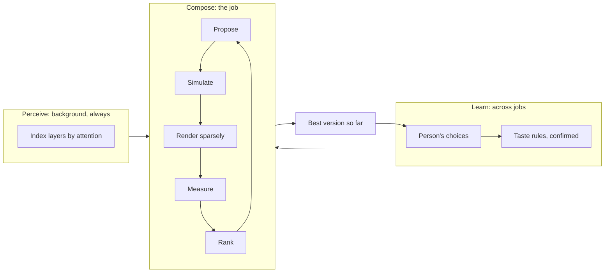
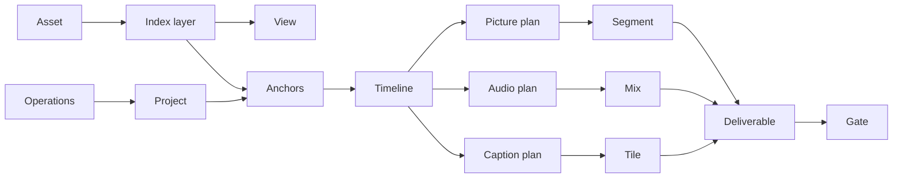

# The Edit Loop (track E)

Editing gets its own execution loop, built for media, and it shares nothing with
the coding loop. Owner, 2026-11-07: "adding the separate execution loop for this
in a more advanced way, only for the video editing harness."

## 1. Why a separate loop

`src/loop.js` is good at what it does, and wrong for this job:

| | Coding loop | Edit Loop |
| --- | --- | --- |
| Truth | A check's exit code | 14 measurements of a rendered file |
| An attempt | Files in a git tree | A version in an operation log |
| Cost of one try | A model turn and a test run | Minutes of render, unless avoided |
| Better | Binary: pass or fail | A ranking; taste has no exit code |
| Restore | Git refs | Move HEAD |
| Work shape | Steps in order | A graph, most of it unchanged between tries |
| Who is present | Often nobody | A person may be editing the same project |

Keeping them apart also protects the coding harness completely: `src/edit/loop/`
imports nothing from `src/loop.js`, `src/verify.js` or `src/checkpoints.js`, and
the reverse. The idea it does borrow from Loop v2 is the rule: **never keep a
worse attempt.**

## 2. Three loops, three speeds

- **Perceive** never stops and never blocks: it fills the index, starting with what the person is looking at.
- **Compose** searches for a good edit under a budget.
- **Learn** turns choices into rules the person confirms (DIRECTOR_AND_AGENT §12).

## 3. The model, formally

**State.** Σ = (P, I, T, B): project versions P, index I, trace store T, budget B.

**Best-so-far.** At every moment one version b ∈ P is valid and playable. This is
the *anytime guarantee*: a person, a crash or an empty budget can stop the loop at
any point and still have a finished, checked edit.

**Rank.** Each attempt a has a vector, compared lexicographically, lower is better:

    ρ(a) = (blocking gate failures, brief misses, notes, −q(a))

q is a quality score from the recipe's weights over measured signals, plus the
tournament's result. **Accept a′ only if ρ(a′) < ρ(b).** A repair that scores worse
is set aside, and it stays in history, so nothing is lost.

**Stop**, whichever comes first:

| Id | Condition |
| --- | --- |
| S1 | Satisfied: no blocking failures, no brief misses, q ≥ the recipe's floor |
| S2 | Budget spent |
| S3 | No improvement in 2 rounds |
| S4 | The person interrupts, or takes over |
| S5 | `effort` is `fast` and S1's first two terms hold |

Every limit is finite, so the loop always ends: rounds ≤ 3 per fidelity,
candidates ≤ the recipe's cap, model calls ≤ the job budget.

## 4. The graph runtime

Everything between footage and export is one **demand-driven incremental graph**.
This is the engine's most important idea after anchors, taken from build systems
research: Mokhov, Mitchell and Peyton Jones, *Build Systems à la Carte* (ICFP 2018).

- A **node** is a pure function: `key(inputs) → output`.
- Each result stores a **verifying trace**: the hashes of what it read, and of what it produced.
- **Demand-driven**: nothing runs until something asks. "Show frame 412" asks only for what frame 412 needs.
- **Early cutoff**: if a node re-runs and its output hash is unchanged, everything downstream is skipped.

Why this beats a pile of caches: changing a caption's colour reruns the caption
plan and its tiles, and **cuts off** at the picture and audio plans, because their
hashes didn't change. No code decides that; it falls out of the hashes. The same
runtime serves the live preview, draft, master and gates, so they can't disagree.

Nodes declare their resources (`cpu`, `gpu`, `encoder`, `chrome`, `model`, `disk`).
The scheduler runs what the person is waiting for first, then what is likely next:
the span around the playhead, then the rest. Idle resources **speculate**: they
render segments ahead of playback, and index the next asset, and any such work is
cancelled the moment real demand needs that resource. Speculation never spends
model tokens.

Implementation: `src/edit/graph/`, a few hundred lines over `node:sqlite`, no
dependency.

## 5. The fidelity ladder

Rendering is the expensive check. So candidates climb a ladder, and most die low.
This is successive halving, the idea behind Hyperband, applied to edits.

| Level | Costs | Sees | Catches |
| --- | --- | --- | --- |
| **F0 Plan** | Milliseconds | The compiled plan | Length, must-keep, layout collisions, reading speed, flash frames, anything geometric |
| **F1 Text** | One batched model call for many | Paper edit | Story, hook, dangling references |
| **F2 Sound** | Seconds | Audio-only mix | Loudness, pops, ducking, round-trip speech, since audio renders far faster than picture |
| **F3 Sparse** | Seconds | Frames at risk points only | Text on a face, contrast, overlay timing, colour jumps |
| **F4 Draft** | Minutes | Changed segments | Everything but final encode |
| **F5 Master** | Longest | The deliverable | All gates, on the real file |

With K candidates and a keep rate of 1/η per level, render cost falls geometrically:
8 story candidates can be ranked at F0 and F1, 3 reach F2, 1 reaches F4.

**Sparse verification.** At F3 Kriya doesn't render the video to check it. It lists
the *risk points*: each cut ±2 frames, each overlay's first and last frame, each
caption page, each transition's midpoint. It renders those frames alone, in **one
FFmpeg pass with a `select` filter**. EX-10: 150 risk frames in 0.8 s, against 9.5 s
seeking to each, and 5.5 s for a full draft of a 60-second reel.

## 6. The search

For one job, Compose runs:

1. **Frame.** Brief, recipe, what must be true.
2. **Story search.** Code generates candidates; a tournament ranks them at F0 and F1.
3. **Assemble.** The solver lays the winner out; the plan is checked at F0.
4. **Dress.** The crew (§7) works in parallel.
5. **Prove.** Climb the ladder, repairing at the lowest level that shows a failure.
6. **Offer.** Present the best, plus a close alternative when two scored near each other.

Story selection is real optimisation, not prompting. Given per-sentence values from
the index and the model, picking a cut that fits a length with coherent transitions
is a dynamic program over sentences (a knapsack with adjacency costs); take choice
is Viterbi over take groups; multi-camera switching is a shortest path. The model
supplies judgement as numbers and labels, and **code finds the optimum**.

## 7. The crew

Editors work in departments, and so does the loop. A role is a prompt, a view and
a schema, run as bounded calls: it isn't a separate agent.

| Role | Owns | Reads |
| --- | --- | --- |
| Story editor | Selection, order, hook | Paper edit, moments |
| Cutter | Rhythm, breaths, J and L cuts | Timeline, signals |
| Caption editor | Emphasis, line breaks, spelling | Words, look |
| Colourist | Match and look | Shot statistics |
| Sound designer | Music shape, effects | Timeline, beats |
| Motion designer | Where graphics help | Beats, look |
| Blind reviewer | A fresh opinion | Only the output (below) |

After picture lock, roles work in parallel, and their operations touch different
track roles, so they merge with no conflict by construction. The Governor (§8) still
rations their calls.

**The blind reviewer** sees only what a viewer gets: the round-trip transcript and a
contact sheet, never the plan or brief. It answers: what is this about, what is the
hook, where did you lose interest? Code then compares its answer with the brief. A
reviewer who can't name the main point is a real signal. Being blind avoids the
anchoring of a critic who knows what was intended. It feeds QG-14 as a note, never a
verdict.

## 8. The Model Call Governor

The harness shares its limits with the person's own work. The forensic audit found
what happens otherwise (EH-13, EH-14): three open answers per person across all
devices, and 60 requests a minute per device for every route.

**All Director calls go through one queue in the Edit Host.**

| Rule | Value |
| --- | --- |
| Open answers | At most 2. At most 1 while anything else of this person's is live (a DSH session running, Remote Control on) |
| Rate | 20 per minute, leaving two thirds of `harness.rpm` for everything else |
| Backoff | On 429: honour `retryAfter`; halve the rate; recover slowly (AIMD) |
| `max_tokens` | Always set, to the slot's budget, so reservations stay small (EH-36) |
| Batching | Many slots per call: a model with 1 M tokens of context reads a whole 2-hour transcript at once |
| Bodies | Through the existing relay encoding (EH-15) |
| Priority | The person's revision first, then the running job, then background meaning |
| Cap reached | Pause, and say so |
| Tiers | Read from `GET /models`; aliases only |

EX-12 measured the difference on a model of the real limits: with naive fan-out a
live chat took 310 rate-limit errors and fell from 240 answers an hour to 61; with
the Governor, none, and no loss.

**The limit that matters is open answers, not calls a minute.** At an assumed 10 to
20 seconds an answer, 200 calls take 50 minutes with something else live and 25
without. So the critical path to a first cut is at most **8 model calls**. Everything
else is background refinement that improves the best-so-far version.

Everything else in the system assumes this limit: the job budgets, batching and
tournament design. ET-GOV-01 and -02 prove a job can't starve a live session.

## 9. The person always wins

A person may edit while the loop works. So:

- The project is an operation log, and the loop's work is a **branch**.
- The person's operation lands on HEAD at once, and any running node it invalidates is cancelled.
- When the branch is ready, its operations are **rebased** onto HEAD. Anchors make this usually trivial. An operation that conflicts with something the person did is dropped and listed; the person's edit never moves.
- In **Proposal mode** (UX_SPEC §4), the result is shown as ghost clips, and nothing lands until accepted.

## 10. Flight recorder

Every job records, in `journal.sqlite`, each node's inputs and hashes and each model
reply (kept locally, deleted with the project). So:

- `kriya edit replay <job>` re-runs a job with **no model cost and no randomness**, for debugging and for tests. As built (ED10): each slot's final answer is kept in `journal.sqlite`'s `answers` table (never the prompt); the replay answers from it in order, refuses a slot it has no answer for, lands nothing, and compares verdict, plan hash and gates.
- A bug report can be reproduced from a journal if the person chooses to share one.
- A new engine version can be **shadow-compiled** against recorded jobs: compare RenderPlans before release, so a compiler change that alters old projects is seen before anyone is affected.

## 11. Failure classes

`src/edit/loop/failure.js`, its own table, in the spirit of `src/failure.js`.

| Class | Example | Goes to |
| --- | --- | --- |
| `input` | Unreadable file | The person |
| `environment` | Missing pack, no disk | Setup or the person |
| `render` | FFmpeg error | One retry, then a simpler plan |
| `plan` | Solver can't satisfy a constraint | Re-solve, then the person |
| `quality` | A gate failed | The repair ladder |
| `model` | Refusal, bad output | Slot default |
| `limit` | Budget, cap, rate | Pause |
| `interrupted` | The person changed something | Rebase |

## 12. What the model can't do

It can't choose a gate, change a threshold, mark anything passed, write a render
command, reach a file, end the loop early as "done", or see more than its slot's
view. Pass, fail and done come from code (AGENTS.md track E rule 6).

## 13. Off means off

The Edit Loop runs only in the Edit Host, which exists only with `KRIYA_EDIT` on.
With it off, no file in `src/edit/` is even imported.

## 13a. As built in ED7

Client `src/edit/loop/`: `governor.js` (§8: 2 open, 1 while a harness Web UI with the
Studio row pinged in the last minute, 20 a minute, AIMD on 429 with `retryAfter`,
`max_tokens` required, the person's revision first), `loop.js` (§3: ρ, best-so-far,
S1 to S5 and a round cap), `make.js` (a make job: candidates judged at F0 on the plan,
and only a sound plan rendered as a master and gated, F5; the winner lands as one
history entry, rebased if the person edited meanwhile). Not built yet: F1 to F4, sparse
verification (§5), the crew (§7), the blind reviewer, the tournament, the flight
recorder's replay and shadow compile (§10), and the relay encoding for bodies (§8).

## 13b. As built in ED11

`short-from-long` (client `src/edit/recipes/short-from-long.js`) is the first story
search (§6 step 2): code makes candidates and a tournament ranks them at F0 (each
candidate's plan compiled, its issues counted) and F1 (text only: the opener stands
alone, one topic, density against the recording's own pace, length, a finished last
sentence, no line leaning on a cut one). Every pair meets once; a candidate takes a pair
when it is ahead on more criteria, then on the sum; ranks go by wins. Nothing renders
until the winner reaches F5. The F1 criteria are measured by code, with no model call;
EDD-16 holds: the numbers order candidates for one video and are never shown as a
forecast. Sentence vectors are lexical (hashed content words) until L11 exists.

## 14. Proving it

Each mechanism is an ablation in EVALUATION_PLAN, so it stays only if it pays: no
ladder, no tournament, no Director (arm A5), no blind reviewer.
