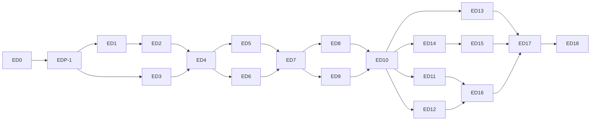

# Implementation plan (track E)

Phases `ED0`–`ED18`. Work happens in two repositories: the client in a new worktree
`../kriya-harness-edit` on branch `feat/editing-studio`, the server in this
repository. One phase per session. Progress goes in `status.md`, section "Track E".

The order kills the riskiest unknowns first, gets a real end-to-end edit by ED8, and
touches nothing existing until the Studio has proved itself: **until ED14 the only
existing code that changes is one switch, one command and one sidebar row.**

## 1. Phases

| Phase | Name | Depends on | Decisions | Holds (existing files) | Exit checks |
| --- | --- | --- | --- | --- | --- |
| ED0 | Blueprint and decisions | — | — | `AGENTS.md`, `status.md` | Documents consistent (REAUDIT, FORENSIC_AUDIT); owner-gated decisions marked |
| EDP-1 | Baseline re-check, both repositories | ED0 | — | — | `npm run check` in both, exit 0, counts ≥ baseline, recorded |
| ED1 | Spikes EX-01…EX-14 (§2): throwaway code, measured results | EDP-1 | — | none | `SPIKES.md` holds real numbers; documents corrected where a spike disagreed; owner reads the verdict before ED2 |
| ED2 | Media Runtime, `kriya edit setup` and `doctor`, manifest route | ED1 | EDD-05, EDD-06, EDD-33, EDD-45 | Client: `src/modes.js`, `bin/kriya.js`. Server: `lib/config.ts`, `app/owner/config/page.tsx`, `lib/harness/contract.ts` | ET-RT-01…04; ET-REG-01, -03; clean install on the first platform |
| ED3 | Edit Core: time, project, operations, anchors, solvers, compiler, handoff writers | EDP-1 (beside ED1, ED2) | EDD-10, EDD-36 | none | ET-CORE-*, ET-OPS-*, ET-ANC-*, ET-SOL-*, ET-CMP-*, ET-INT-01, ET-IMP-01 |
| ED4 | Edit Host, graph runtime, Engine: process, server, jobs, probe, proxy, peaks, cut-path render, journal | ED2, ED3 | EDD-03, EDD-04, EDD-12, EDD-13, EDD-18, EDD-39 | none | ET-HOST-*, ET-GR-*, ET-ENG-01…07, -09…-12 |
| ED5 | Footage Index v1: L0–L2, L5–L8, views | ED4 | EDD-21 | none | ET-IDX-01…05, -08; ET-HR-08, -09 |
| ED6 | Studio app: shell, bin, live compositor, transcript, timeline, harness row | ED4 | EDD-02, EDD-32, EDD-41 | Client: `bundle/cordis.patch.yml`, `expected/*`, `src/profiles.js`, `scripts/check-seams.js`, `package.json` | ET-UI-01…03, -05; ET-SEC-09; ET-REG-02; browser check with screenshots |
| ED7 | Edit Loop, Director, Governor, tools, first recipe (`reel-talking-head`), QG-01, -02, -05, -06, -12 | ED5, ED6 | EDD-14, EDD-15, EDD-30, EDD-37, EDD-38, EDD-40 | Server: `lib/config.ts` | ET-LOOP-*, ET-GOV-*, ET-DIR-*; ET-RCP-02; **a raw fixture take becomes a checked reel with a scripted model**; moved from ED6 by the owner (2026-11-07): ET-UI-02's prompt with a selection, Proposal mode, Variations wall and drawing on the frame, and ET-UI-03's WebGPU compositor (one GPU device across 1,000 clip switches) and watchdog |
| ED8 | Captions and motion: Looks, blocks, HyperFrames tiles, matte, confinement | ED7 | EDD-07, EDD-08, EDD-09, EDD-17, EDD-44 | Server: `lib/config.ts` | ET-ENG-08; ET-SEC-02, -04; ET-HR-01, -04; QG-08, -09; browser check |
| ED9 | Audio engine: voice clean, music fit, ducking, SFX, mastering | ED7 | — | none | ET-ENG-13; QG-06 complete; EDITOR_WORKFLOWS §5, §11 cases |
| ED10 | All gates, repair ladder, report, receipt, `verify`, `replay` | ED8, ED9 | EDD-19, EDD-20 | none | ET-QG-01…14, -20, -21; ET-DIR-11; **EG-4** |
| ED11 | Long to short, reframing, tutorial zooms | ED10 | EDD-16 | none | Recipes `short-from-long`, `tutorial`; ET-SOL-03; tournament on fixtures |
| ED12 | Long form: story tree, multi-camera, chapters, handoff in the UI | ED10 | — | none | ET-IDX-06, -07; `youtube-longform`, `podcast-multicam`; **EG-6** |
| ED13 | Reference, colour, recipes, skills, capability packs | ED10 | EDD-22, EDD-23, EDD-24, EDD-25, EDD-43 | Server: `skills-harness/index.ts`, `skills-harness/NOTICES.md`, `lib/harness/default-skills.ts`, `lib/config.ts` | ET-SK-01, -02; ET-RCP-*; ET-PK-*; ET-SEC-07, -08; ET-LIC-01 |
| ED14 | Kriya Tavi core: migration, dispatch kind, tools, cards, previews, `editLoop` | ED10; owner approves EDD-28, EDD-30, EDD-46 | EDD-26, EDD-28, EDD-30, EDD-46 | CHANGE_IMPACT §3 and §4 rows for ED14 | ET-DMN-*, ET-DB-*, ET-API-*, ET-TV-*, ET-POL-*; ET-UI-06; browser check; ET-REG-01 (server) |
| ED15 | Review Room, decision cards, notes, watch folders | ED14 | EDD-42, EDD-47 | CHANGE_IMPACT §3 rows for ED15 | ET-RV-*; browser check at 360 px |
| ED16 | KriyaEditBench and taste ledger | ED11, ED12 | EDD-31, EDD-35 | none | ET-TST-01; bench-M green; grader reviewed; dry run with the owner's go-ahead; EG-8 only after a full paid run |
| ED17 | Security, scale, release readiness | ED13, ED15, ED16 | — | none | EG-2, EG-3, EG-5; EG-6's 2-hour soak (deferred from ED12 by the owner, 2026-11-08); all ET-SEC-*; second platform |
| ED18 | Controlled pilot | ED17 | New decision for any public copy (RG-9) | — | 14 days, named users, real numbers in `status.md`; EG-7 |

## 2. ED1 spikes

The design rests on these, and each can change it. Run them in a scratch folder
outside both repositories, with no product code. **Results are in SPIKES.md**: 12 of
14 ran on 2026-11-07, and the architecture stood. EX-04 needs real samples, and EX-08
needs a paid go-ahead.

| Id | Question | Method | If it fails |
| --- | --- | --- | --- |
| EX-01 | Can HyperFrames render alpha tiles for a time range, from our process, at a usable speed? | `@hyperframes/producer` with `--start`, `--end`; 5-second card to ProRes 4444 and WebM on macOS arm64 | PNG sequence; then whole-composition render |
| EX-02 | Real Chrome launch flags and capture per OS; repeatability; WebGL and WebGPU | Same composition twice per OS; frame hashes; ms per frame; dump the arguments | Claim less; WebGL only |
| EX-03 | Is WebCodecs preview frame-accurate on a 2-hour proxy? Best proxy settings? | Mediabunny; burned-in counter; size and seek time for GOP 15, 30, 60 | Shorter GOP; frames served by the Host |
| EX-04 | ASR accuracy and word timing in English, Hindi, Telugu, Hinglish, Tenglish | Hand-labelled samples from the owner; faster-whisper and alternatives; word error rate, timing error, speed | Language warnings; per-language engine |
| EX-05 | BiRefNet speed and stability | 10 seconds on the reference machines; temporal flicker measure | Depth effects `Best` only |
| EX-06 | Does the Studio's own origin work? | Throwaway server: launch token, cookie, Range, `<video>`, COOP and COEP with the player's iframe, 10 GB streaming upload, fence against foreign origins | Relax COEP; keep the rest |
| EX-07 | Is entry from DSH clean? | Throwaway plugin: row, launch route, navigate, back; session state kept | Open in a new tab |
| EX-08 | How does Flash-1017 behave as the Director's model? | Through the gateway on staging, owner's go-ahead: structured output, tool schemas, cached tokens, image input, one batched task × 200 runs; read `supports_images` | Adjust slots; owner picks another model |
| EX-09 | What does the runtime cost to install? | `uv` lock and pinned builds on clean macOS, Windows, Linux; size, time; FFmpeg `-buildconf` | Slim Core; defer platforms |
| EX-10 | Do the layer split and sparse verification win? | One reel: whole-browser render against split, and F3 against a full draft; time and frame difference | Whole-composition backend; denser sampling |
| EX-11 | Do round-trip speech and retake thresholds work? | Seeded clipped words at 20, 50, 100 ms; labelled retakes; sweep thresholds | QG-04 advisory; person checks retakes |
| EX-12 | Does the Governor protect a live session? | Fake gateway with the real limits; a burst during a scripted chat; count 429s | Lower the rate |
| EX-13 | Does the WebGPU compositor hold up? | VideoFrame to external texture, LUT and crop at 1080p; scrub latency; laptop power | Canvas 2D; lower preview size |
| EX-14 | Can FFmpeg and Chrome be confined on each OS? | A profile per OS; prove no network and no reads outside; check GPU still works | Keep `editing.customMotion` off on that OS |

ED1 ends with a one-page verdict: what held, what changed, whether the plan stands.
**The owner reads it before ED2.**

## 3. Lanes

Lanes with no shared files: ED1 with ED3; ED5 with ED6; ED8 with ED9; ED11, ED12,
ED13 and ED14 after ED10. Parallel sessions use their own worktree and the board.

## 4. How each phase is run

1. Claim it on the board. Write the plan in `status.md`.
2. Read AGENT_MASTER_PROMPT and the documents it names.
3. Tests first, from TEST_STRATEGY.
4. Keep every switch off by default.
5. Run the phase's exit checks and record real output.
6. Update `status.md`: files, commands, output, deviations, blockers, next exact action.
7. Mark `COMPLETE` only if every exit check passed.
8. Release the board row. Ask the owner before any commit, push or deploy.

## 5. Rollout

**Server ships before client, every time** (FORENSIC_AUDIT §3).

| Stage | Who | State |
| --- | --- | --- |
| 1 | Internal | Code ships with `KRIYA_EDIT` off, every `editing.*` off, every plan's preview cap 0 |
| 2 | Owner | Local stack: migration, fixture manifest, one Mac |
| 3 | Owner | Staging: `editing.studio` on; runtime published; a test plan; two devices |
| 4 | Owner | `editing.skills`, `editing.tavi`, `editing.review` on staging; a job from a phone |
| 5 | Named users | ED18 pilot, production, chosen plans |
| 6 | Owner | Default on for the client only after the gates, by decision |

## 6. Rollback

| Level | Action | Effect |
| --- | --- | --- |
| A person | `--no-edit` | The row goes; projects stay |
| Review | `editing.review` off | Cards and notes stop; jobs use defaults |
| Tavi | `editing.tavi` off | Tools vanish; running jobs finish |
| Previews | `editing.previews` off | Uploads refused; cards show no video |
| Studio | `editing.studio` off | Routes 404; the client hides the row |
| A runtime | Manifest points back | Next start uses it |
| A client release | npm deprecate; `harness.minClientVersion` | Forces an upgrade |
| Data | Down migrations after `editing.*` is off | Dispatch rows of kind `edit` are removed first |

The person's footage and projects are never affected by any rollback.

## 7. Size honesty

This is the largest track so far: a timeline editor, a real-time compositor, a media
engine and a perception stack. ED3, ED4, ED6, ED7, ED8 and ED10 will each take
several sessions. If ED1 shows a pillar won't work, the plan changes first and the
code second.
