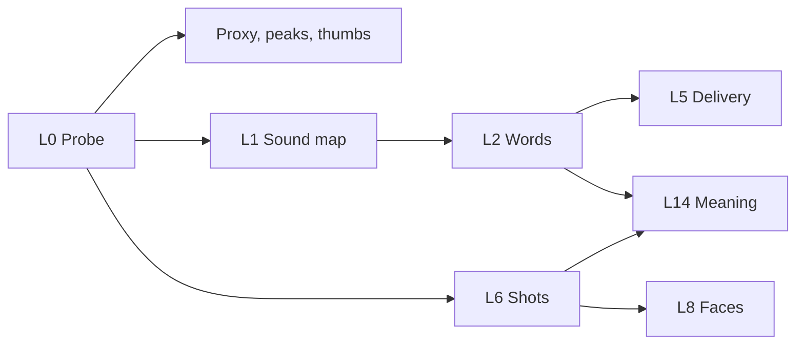

# Perception and the Footage Index (track E)

A model can't watch a two-hour file. So Kriya watches it once, with small local
tools, and writes down what it found. After that, everything reads the index:
the Director, the solver, the gates, the search box.

## 1. Rules

1. **Run once.** Results are cached per asset, layer and model version.
2. **Measure locally, describe sparingly.** Local code does the measuring. A model is used only where meaning is needed, and its output is cached too.
3. **Layers are independent and optional.** A missing layer lowers what's possible; it never breaks the edit. The Studio says what's unavailable.
4. **Everything is on the flick clock**, tied to source time.
5. **Everything from media is untrusted.** Transcripts and on-screen text are data, never instructions (SECURITY_AND_THREATS ES-04).

## 2. Layers

| Layer | What it gives | Tool (candidate, settled in ED1) | Licence | Tier |
| --- | --- | --- | --- | --- |
| L0 Probe | Duration, streams, real fps, VFR, rotation, HDR, channels, timecode | `ffprobe`, ffmpeg-skill `probe.py` | MIT tool | Core |
| L1 Sound map | Loudness curve, silence, voice activity, peaks | FFmpeg `ebur128`, silero-vad | MIT | Core |
| L2 Words | Word-level transcript, confidence | Whisper `large-v3-turbo`, by platform: **mlx-whisper on Apple silicon** (12.4× real time here, against 3.2× on CPU), faster-whisper with CUDA on NVIDIA, CPU otherwise (EX-04) | MIT | Core |
| L3 Word timing | Tighter word edges | WhisperX-style forced alignment | BSD-2 | Standard |
| L4 Speakers | Who speaks when | pyannote-audio (code MIT; weights gated, licence to read) or sherpa-onnx diarization | EQ-05 | Standard |
| L5 Delivery | Fillers, stutters, restarts, retakes, breaths, emphasis | Own code on L1 to L4 | Own | Core |
| L6 Shots | Cut points, shot list | PySceneDetect; TransNetV2 for hard cases | BSD-3, MIT | Core |
| L7 Picture quality | Blur, exposure, shake, per shot | OpenCV | Apache-2.0 | Core |
| L8 Faces | Boxes, identity clusters, eye and chin lines, gaze | MediaPipe Face Landmarker, YuNet, SFace | Apache-2.0, MIT, Apache-2.0 | Core |
| L9 Screen | Cursor track, text regions, screen vs camera | OpenCV frame difference | Own | Standard. **ED11 v1, own code, no OpenCV** (`index/layers/screen.js`): 160×90 grey frames at 5 a second; cells that changed; a change that reverts the next frame is the cursor; the action is what changed in the last second minus the cursor's trail. Not yet stored by the Host's index job; the `tutorial` recipe takes the track directly. No text regions or screen-vs-camera split yet |
| L10 Text on screen | OCR | PaddleOCR (or macOS Vision through a small helper) | Apache-2.0 | Standard |
| L11 Search | Natural-language search over shots | SigLIP-class embeddings, ONNX | Check per weight | Standard |
| L12 Music | Beats, downbeats, sections, energy | `beat_this`, librosa | MIT, ISC | Pack. **ED9 v1, own code, core:** onset envelope, tempo by weighted autocorrelation, beats by dynamic programming, downbeats where the low end hits hardest, bar energy; sound files only. On synthetic drums 80–150 BPM it is exact to 1 BPM and ±6 ms; 174 BPM reads as half-time (87); 4/4 is assumed. Untested on real music |
| L13 Sound events | Laughter, applause, music under speech | PANNs or YAMNet-class, ONNX | Check per weight | Pack |
| L14 Meaning | Topics, story beats | The Director's cheap model, batched | n/a | Needs model |
| L15 Local eyes | Shot descriptions with **no frame leaving the machine** | A small local vision model (CAPABILITY_PACKS) | Per weight | Pack |

Tiers decide the download: **Core** always, **Standard** on capable machines,
**Pack** on demand. Sizes and speeds come from EX-04, EX-05 and EX-09; none are
assumed here.

**As built in ED5** (client `src/edit/index/`): L0 is the Engine's `ffprobe`
probe. L1 is one FFmpeg pass (`ebur128`, `silencedetect`, `astats`) at 100 ms; no
voice activity yet. L2 runs mlx-whisper or faster-whisper from the Media Runtime,
offline; the runtime's manifest carries no model weights yet, so on a real machine
L2 reports "not installed" until it does. L5 is §4 without the hidden-stumble and
noise checks (they need pitch, L3 and L4). L6 is FFmpeg `scdet`, hard cuts only.
L7 is measured in code on small grey frames; its blur and shake scales are
uncalibrated. L8 uses Apple's Vision framework through a small helper compiled
once on the Mac, boxes and tracks only; MediaPipe or YuNet (other systems,
landmarks, gaze) come with the runtime. Views built: the paper edit and a shot
digest.

## 3. Job order: first look fast

The person should be doing something within moments of dropping a file. Jobs
are ordered by what unblocks them:

Audio extraction comes first, because the words drive editing and are the
slowest layer that matters. Priority follows the person: the clip they're
viewing jumps the queue. On a long file, words stream in chunk by chunk so the
transcript fills while it runs.

## 4. Delivery layer: finding the real take (L5)

This is what separates "transcribed" from "edited". It builds on the brief's
Pipeline A, as Kriya's own work (EF-10).

**Restart detection.** A *take group* is a run of attempts at one line. Kriya
builds them from: restart phrases in the speaker's language ("okay again",
"wait", "ek minute", "malli"); repeated word prefixes between neighbouring
sentences (Jaccard on word trigrams, threshold from the brief, 0.65, tuned in
EX-11); and a long gap followed by a near-repeat.

**Hidden stumbles.** ASR drops what it can't parse. For each gap over 180 ms
with no words, Kriya looks for voiced sound (pitch present between 75 and 400 Hz
by YIN, energy above the local floor). If it is there, that span is re-run alone
through ASR, and anything found is added and marked low confidence.

**Noises.** Short voiced bursts with no phoneme confidence and a falling pitch
are tagged throat clears and sighs. They are removed only when the recipe says
so, and never when they carry meaning (a laugh).

**Choosing within a group.** Code scores each attempt: fluency (no fillers),
completeness (ends the thought), delivery (energy near the speaker's own norm,
pitch movement, no trailing off), and picture (eyes on lens, no blur, from L7
and L8). The last clean take usually wins, and the Director can overrule it with
a reason, such as a better energy earlier on.

Rules alone, on a synthetic take (EX-11): 0 false cuts in 13 good lines, and 6 of 9
bad lines caught. That's the safe direction: code removes what it's sure of, and the
Director's take slot decides the rest. Thresholds are tuned on real labelled clips,
not on that fixture, because a wrong retake cut is the most visible error a
talking-head edit can make.

**Fillers.** A per-language list ("um", "uh", "matlab", "basically", "ante") is
checked with timing: a filler in a pause is cut; a word used normally is not.
The person can set how aggressive this is.

## 5. Languages

India is first-class here. Code-mixed speech (Hinglish, Tenglish) is normal, and
Whisper's accuracy in Telugu is unproven for this use.

- **Language is set by the person, never detected.** Whisper took Telugu for Tamil and produced nonsense (EX-04). English can be detected; an Indian language is asked once per project, with a sensible default from their account.
- Code-mixed speech comes back in one script: Hinglish arrived in Devanagari. Script is a separate choice, handled after recognition.
- Captions keep the script the person wants: native script, or romanised.
- Reading-speed limits and line breaks are per script (EDITOR_WORKFLOWS §7).
- EX-04 measures word error rate and timing on recorded samples in English, Hindi, Telugu, Hinglish and Tenglish, with faster-whisper and at least one alternative: `sherpa-onnx` models, AI4Bharat IndicConformer.
- Even clean synthetic Hindi and Telugu measured WER near 0.4, so **captions in those languages always go to the person to check** until real samples prove otherwise. The Studio labels them "Please check".
- A cloud speech option can be added only as a person's choice, because it sends audio off the machine (EQ-06).

The person can always correct a word. A correction updates captions and search,
and doesn't change the anchor.

## 6. The index

`index.sqlite`, one per project (DATA_MODEL §3): assets, words (with FTS5),
sentences, take groups, shots, faces, speakers, beats, events, and embeddings in
a blob column. Search over embeddings is a brute-force dot product: an hour at
one vector per two seconds is 1,800 vectors, which needs no vector database.

## 7. What the model sees

Models never receive the index. They receive **views**, built by code, within a
token budget.

| View | Size target | Contents |
| --- | --- | --- |
| **Digest** | About 1 to 3 k tokens | Assets, durations, speakers, language, topics, current cut as a list of sentence ids, look, brief |
| **Paper edit** | Scales with the cut | The current cut as text, one line per sentence with its id, speaker, and flags: `[s12 A] We built this in a week. (take 3 of 3, energy high)` |
| **Slice** | On request | One scene or range in detail: words with ids, shots, faces |
| **Candidates** | Per task | Exactly what one decision needs, such as eight hook windows |
| **Contact sheet** | One image | A filmstrip with timecodes, only with `editing.frameVision` on and the person's consent |
| **Local descriptions** | Text | From L15 when installed: vision with nothing leaving the machine |
| **Story tree** | Long form | Sentence → beat → scene → act summaries, with pointers down |

This is the idea behind video-use's packed transcript, extended: its model reads
a phrase list; Kriya's reads a list with ids it can point at, plus measured
flags it would otherwise have to infer.

## 8. The story tree (long form)

A 2-hour talk is about 40 k tokens, so the whole transcript fits one call of a
1 M-token model. Reading it in few large calls matters, because the harness allows
only a few model calls at a time (EH-13, EH-14).

1. Split at topic shifts, using pauses, speaker changes and embedding distance. No fixed window.
2. **Batched** calls, each covering many chunks: a two-line summary, topics, entities, quotable lines with sentence ids, and whether each stands alone. Batch size is set by EX-08, since a model's accuracy across a very long input is not assumed. Cached forever.
3. Merge upward to scenes and acts.
4. The Director reads the top, and descends only where it needs to.

So a transcript is read once and never again. Every summary keeps its sentence ids,
so a claim can be traced to its words.

**As built in ED12** (client `src/edit/index/story.js`, no model call): sentence vectors
are content words hashed into 256 dims and weighted by idf within the recording, so a
speaker's stock phrases don't read as a topic (lexical until L11). Scene breaks are
TextTiling depth over six-sentence windows either side, plus 0.1 for a pause of 4 s or
more; a break slides to the lowest similarity within two sentences (flat valleys), and
no scene is under 45 s. Beats (a pause of 2 s, a speaker change, or 8 sentences) sit
inside scenes, never across a break. Acts are Opening, Body and Close by where each
scene's middle falls (the first and last quarters). Summaries are extractive: a scene's
first sentence and its most central one, by id; titles are its two most distinctive words
(tf-idf across scenes); quotable lines are those that open well and finish. Beat reads are
cached by a hash of their sentence ids and text, so an edited sentence re-reads one beat.
On synthetic talks of 6 to 40 minutes every topic block came out as exactly one scene.
Not built: step 2's batched model summaries (EX-08), persisting the cache in
`index.sqlite`, and serving the tree as a view to the Director.

## 9. Moments

A **moment** is a reusable unit the Director can select from: a sentence range
with what makes it interesting: quotable, a story, a number, a joke, a strong
emotion, a demonstration. Moments carry measured signals (energy peak, laughter,
pause before a punchline) plus the cheap model's tags.

They make most selection tasks into choosing from a short, well-described list,
which cheap models do reliably.
