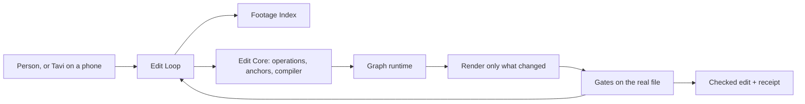

# Kriya Editing Studio (track E)

A full video editor reached from Kriya Harness. The person drops footage, says what
they want, and gets a finished, checked edit they can change by asking, from a
15-second reel to a two-hour film. Cheap models make small decisions; the harness
does the rest. Kriya Tavi is the producer on the phone.

**Status: blueprint, with its riskiest assumptions tested.** No product code exists
yet. [SPIKES.md](SPIKES.md) holds real measurements from throwaway experiments. Start
with `status.md`, section "Track E".

`information.md` is the owner's original brief, kept as written. It was checked claim
by claim, and [SOURCE_AUDIT.md](SOURCE_AUDIT.md) holds what's true. Where they differ,
the audit wins. [FORENSIC_AUDIT.md](FORENSIC_AUDIT.md) records every way this plan
could have damaged existing workflows, with its evidence and its fix.

## The design in ten lines

1. **Separate by construction.** The Studio is its own local web app, on its own origin, run by the Edit Host, its own process. The coding harness gains one sidebar row. A Studio bug can't reach a coding session.
2. **Edit Core** is pure code: integer time, typed operations, edits anchored to words and shots, one compiler with four outputs.
3. **Footage Index**: local tools watch and listen once; models read compact views with ids.
4. **The Edit Loop** is its own execution loop: search under a budget, a best version always ready, and never keeping a worse attempt.
5. **Graph runtime**: everything is an incremental node, so a change recomputes only what it must.
6. **Fidelity ladder**: most candidates and checks never touch a render; only risky frames are checked early.
7. **Layer-split render**: FFmpeg does the picture in one pass; Chrome renders only the seconds with motion graphics.
8. **14 quality gates** measure the rendered file, including listening to its own output. Verdicts are code.
9. **A real-time compositor in the browser** (WebCodecs, WebGPU, AudioWorklet): scrub a finished-looking edit with nothing rendered.
10. **Producer and post house.** Tavi briefs, decides on the phone and leaves timecoded notes; footage never leaves the computer; only a small preview comes back.

Off by default. With the switches off, Kriya and the harness are exactly as they are.

## The documents

| Document | What it decides |
| --- | --- |
| [information.md](information.md) | The owner's brief (unchanged) |
| [FORENSIC_AUDIT.md](FORENSIC_AUDIT.md) | **Every hazard to existing workflows, with evidence**; deployment order; workflow protection matrix |
| [SPIKES.md](SPIKES.md) | **Measured results of ED1**, and what they changed |
| [SOURCE_AUDIT.md](SOURCE_AUDIT.md) | Every claim in the brief, checked: licences, models, speeds |
| [REPOSITORY_AUDIT.md](REPOSITORY_AUDIT.md) | What exists in both repositories; the rules that bind us; what to reuse |
| [VISION_AND_SCENARIOS.md](VISION_AND_SCENARIOS.md) | Why a cheap model can win; who it's for; scenarios E01–E22 |
| [ARCHITECTURE.md](ARCHITECTURE.md) | Parts, flows, boundaries, failure, scale |
| [EDIT_LOOP.md](EDIT_LOOP.md) | The separate execution loop: graph runtime, ladder, search, crew, Governor, flight recorder |
| [EDIT_ENGINE.md](EDIT_ENGINE.md) | Time, project, operations, anchors, solvers, render, cache, encoding, audio, handoff |
| [STUDIO_APP_AND_BROWSER.md](STUDIO_APP_AND_BROWSER.md) | The app's origin and sign-in; live compositor; every browser capability used |
| [PERCEPTION_AND_INDEX.md](PERCEPTION_AND_INDEX.md) | Layers L0–L15, retakes, languages, views, the story tree |
| [DIRECTOR_AND_AGENT.md](DIRECTOR_AND_AGENT.md) | Model calls, context and cost policy, routing, tournament, tools, taste |
| [QUALITY_GATES.md](QUALITY_GATES.md) | QG-01…14, the repair ladder, verdicts, the report |
| [EDITOR_WORKFLOWS.md](EDITOR_WORKFLOWS.md) | How an editor works; recipes for every format; music, colour, captions, B-roll, multi-camera, long form |
| [SKILLS_AND_OPEN_SOURCE.md](SKILLS_AND_OPEN_SOURCE.md) | The licence gate; what's taken from each project; skills, recipes, looks, blocks |
| [CAPABILITY_PACKS.md](CAPABILITY_PACKS.md) | Optional advanced tools: Smooth cut, Local eyes, masks, object removal and more |
| [UX_SPEC.md](UX_SPEC.md) | Modes, screens, signature interactions, keyboard, copy, browser checks |
| [TAVI_INTEGRATION.md](TAVI_INTEGRATION.md) | Harness and Tavi together: jobs, decision cards, Review Room, watch folders |
| [DATA_MODEL_AND_STATE_MACHINES.md](DATA_MODEL_AND_STATE_MACHINES.md) | Project file, local databases, migrations, state machines |
| [TOOLS_AND_CONTRACTS.md](TOOLS_AND_CONTRACTS.md) | Host API, agent tools, routes, command line, dispatch, Tavi tools |
| [SECURITY_AND_THREATS.md](SECURITY_AND_THREATS.md) | ES-01…24, rights and synthetic media, release gates EG-1…8 |
| [COST_AND_METERING.md](COST_AND_METERING.md) | Who pays, caps, controls, unknowns |
| [EVALUATION_PLAN.md](EVALUATION_PLAN.md) | How "better than Claude Code with Opus 5.5" gets tested |
| [TEST_STRATEGY.md](TEST_STRATEGY.md) | Test ids ET-… |
| [IMPLEMENTATION_PLAN.md](IMPLEMENTATION_PLAN.md) | Phases ED0–ED18, spikes EX-01…14, lanes, rollout, rollback |
| [CHANGE_IMPACT_AND_SAFETY.md](CHANGE_IMPACT_AND_SAFETY.md) | **Read before editing any existing file**; settings |
| [DECISIONS.md](DECISIONS.md) | EDD-01…50, open questions EQ-… |
| [OPERATIONS_RUNBOOK.md](OPERATIONS_RUNBOOK.md) | Turning it on, runtimes, support, incidents |
| [REAUDIT.md](REAUDIT.md) | The consistency check of this set |
| [AGENT_MASTER_PROMPT.md](AGENT_MASTER_PROMPT.md) | The prompt for implementing agents |

## Reading order

- **The owner:** this page, FORENSIC_AUDIT §1, DECISIONS §1 and §3, IMPLEMENTATION_PLAN.
- **An implementing agent:** AGENT_MASTER_PROMPT.
- **Someone curious about the ideas:** VISION_AND_SCENARIOS §2, EDIT_LOOP §4 and §5, EDIT_ENGINE §5 and §6, UX_SPEC §4.

## How progress is tracked

`status.md` holds it, as for every track: the overview row per phase, a Session plan
before work, a Session result after, with real command output. A phase is `COMPLETE`
only when every exit check passed.

## Ids

| Prefix | Meaning | Where |
| --- | --- | --- |
| `ED…` | Phases | IMPLEMENTATION_PLAN |
| `EX-` | Spikes | IMPLEMENTATION_PLAN §2 |
| `EDD-` | Decisions | DECISIONS |
| `EQ-` | Open questions | DECISIONS §3 |
| `EF-` | Source findings | SOURCE_AUDIT |
| `EH-` | Hazards found by the forensic audit | FORENSIC_AUDIT |
| `ES-` | Threats | SECURITY_AND_THREATS |
| `EG-` | Release gates | SECURITY_AND_THREATS §6 |
| `QG-` | Quality gates in the product | QUALITY_GATES |
| `ET-` | Tests | TEST_STRATEGY |
| `EC-` | Cost unknowns | COST_AND_METERING |
| `EB-` | Blockers | `status.md` |
