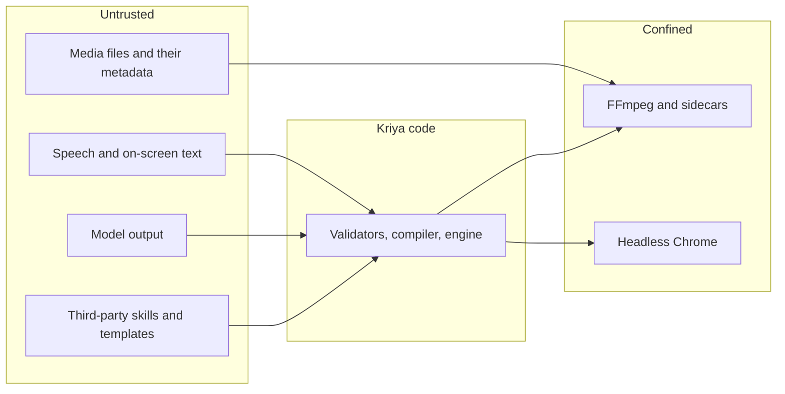

# Security and threats (track E)

Editing brings three new kinds of risk: untrusted media files, code running in a
headless browser, and other people's rights. Existing invariants stay as they
are. Nothing here changes a risk class, a mode, a limit or the gateway.

## 1. Boundaries

## 2. Threats and controls

| Id | Threat | Control | Test |
| --- | --- | --- | --- |
| ES-01 | An `edit_*` tool or engine request reaches outside the project | Opaque ids; paths resolved and checked against the project's asset list, its cache and `exports/`; symlinks resolved first | ET-ENG-03 |
| ES-02 | Source footage is changed or deleted | No write path to sources. A run ends by comparing sampled fingerprints. Imports are clones or copies; linked files are opened read-only | ET-ENG-04 |
| ES-03 | A crafted media file exploits FFmpeg or a decoder | FFmpeg runs as a separate process with no shell, `-protocol_whitelist file,pipe`, CPU, memory and time limits, and under the OS sandbox where one exists (`sandbox-exec` on macOS, bubblewrap on Linux; Windows is EQ-11). No network in the sandbox. Runtime updated for security releases **As built (ED17):** on macOS every `ffmpeg` and `ffprobe` Kriya runs is wrapped in `sandbox-exec` with a no-network profile (`(deny network*)`); file access isn't narrowed for them yet. `probe` and the index layers that read a source pass the whitelist too, and `probe` has a time limit. Linux and Windows have the whitelist only (EQ-11) | ET-SEC-01 |
| ES-04 | Prompt injection through speech, on-screen text, file names, metadata, subtitles or a reference | All such text is data, under an untrusted notice in every view. `kriya edit run` is a plain program with no agent loop, so it has no tools to misuse. A Studio session keeps its mode's rules, so Ask mode still asks before a shell command. Memory written after it stays unconfirmed. Operations are validated, so injected text can at most become a caption the person sees | ET-SEC-03 |
| ES-05 | Code in a composition escapes the render | HyperFrames launches Chrome with `--no-sandbox` (EH-27), so **the OS sandbox is the boundary**: the whole Chrome process runs confined, with no network and file access limited to the composition and runtime (`sandbox-exec` on macOS, deprecated by Apple though still shipped; bubblewrap on Linux; Windows is EQ-11). **Every** Chrome render is confined, since HyperFrames itself doesn't block the network: EX-14 showed a composition reaching the internet mid-render without it. Model-written compositions also need `editing.customMotion`, and are refused on an OS without confinement. Variables typed and escaped; `edit_motion` output linted. **As built (ED8):** the profile denies `network-outbound` except to `localhost`, and file reads and writes under `/Users`, `/Volumes` and the temporary folders except the runtime and the tile's work folder; no unix sockets. A `local ip` rule opened every connection, and was found and removed. **Residual risk:** SBPL's `localhost` is every address of this computer, so a composition could reach a service on it; Kriya's CSP (`connect-src 'none'`, `default-src 'none'`), prepended to any model-written composition, and the lint (network APIs, addresses including `//host`, clocks, randomness) are the barrier there, and ET-SEC-04 tests both. **Accepted by the owner, 2026-11-08:** CSP and the lint are the sufficient barrier for services on this computer (`status.md`, Track E owner approvals) | ET-SEC-04 |
| ES-06 | Filter-graph or subtitle injection through text | Compiler builds nodes from types; one tested escaper; text goes through files, not arguments, where FFmpeg allows | ET-SEC-02 |
| ES-07 | Malicious playlist, `concat` or HLS input reads other files or calls out | Protocol whitelist; `concat` lists written only by Kriya; input formats limited to an allow-list after probing. **As built (ED17):** `probe` refuses any container outside an allow-list (`mov`, `matroska`, `avi`, `mpegts`, `mxf`, `wav`, `w64`, `aiff`, `caf`, `mp3`, `aac`, `flac`, `ogg`, still images), so HLS playlists and `ffconcat` lists are refused at import whatever their extension | ET-SEC-01 |
| ES-08 | A poisoned runtime artifact | Manifest from Kriya over HTTPS with the device token; exact versions; sha256 on each artifact, verified before use; no install scripts run from wheels or npm where avoidable (`--ignore-scripts`, wheels only). Manifest signing: EDD-05 | ET-RT-02 |
| ES-09 | A third-party skill carries instructions | Read by a person; rewritten as `kriya-*`; owner approves each version; nothing fetched at run time | ET-LIC-01, review |
| ES-10 | Frames or transcripts reach a model provider without the person knowing | First-run notice for text; `editing.frameVision` plus per-project consent for images. Local-only mode: hand editing and code features work with no model at all | ET-SEC-05 |
| ES-11 | A web page reaches the Studio's local server | `Host` fence against DNS rebinding, `Origin` and `Sec-Fetch-Site` checks, one-time launch token, `HttpOnly; SameSite=Strict` cookie, no CORS, strict CSP (STUDIO_APP_AND_BROWSER §3). Media ids are unguessable. **As built (ED17):** another port on 127.0.0.1 counts as the same site, so the Strict cookie would go with its requests; a `same-site` request is let through only as a navigation (the harness's link) | ET-SEC-09 |
| ES-12 | Personal data in logs | No prompts or transcripts in logs. Phone numbers and names found in footage aren't logged. `journal.calls` holds counts only. Remote Control lines carry no media text beyond what the person turned on | ET-SEC-06 |
| ES-13 | Someone uses it to fake a real person | No voice cloning or face generation by default; `editing.generative` off; with it on, only the person's own voice, with a consent record. Refusal of named real people, tested. See §4 | ET-SEC-07 |
| ES-14 | Copying someone's video | Reference is numbers only; output checked for reference material; link import off (EDD-22, EDD-23) | ET-SEC-08 |
| ES-15 | A Tavi session is stolen and used to read footage | The capability is on the computer; only offered folders; approval of the exact job; no file contents in results; a job can't exfiltrate media, since only previews of its own output upload | ET-TV-04 |
| ES-16 | An uploaded preview abuses storage or hosts bad content | Private bucket limited to video, image and JSON; size cap in SQL; the worker checks hash and container; the report is JSON, never HTML (EH-28); served with `Content-Disposition`; expiry | ET-TV-05 |
| ES-17 | Disk or CPU exhaustion | Estimates before work, cache cap, per-resource slots, per-step timeouts. **As built (ED17):** the cache cap is `KRIYA_EDIT_CACHE_BYTES` per project (20 GB by default). After each render, older renders (`out`, `master`, `segments`, `tiles`, `match`, `audio`) go first, never the current render's stems; proxies, peaks and thumbnails stay; a pruned file is made again when needed. Before ED17 nothing was ever deleted. A damaged `index.sqlite` or `journal.sqlite` is set aside as `<name>.damaged-<ms>`, never deleted, and the project says to index or render again | ET-ENG-09 |
| ES-18 | Runaway model spend | Job budgets in code; the gateway's SQL reservation and plan cap above them | ET-DIR-06 |
| ES-19 | A running edit denies service to the person's own chat | The Governor: 2 open answers at most, 1 when anything else is live; 20 a minute; AIMD on 429 | ET-GOV-02 |
| ES-20 | Text in a timecoded note or an answer is treated as more than a request | A note is the person's own words, but it passes through the same operation validation as any request; it can't widen what a job may do | ET-RV-03 |
| ES-21 | Watch folders leak what a person records | Off by default, per folder, set on the computer; only name and duration leave; nothing runs until tapped | ET-RV-05 |
| ES-22 | Synthesised frames pass as real footage | Packs that generate pixels (Smooth cut, Remove object) are marked in the receipt, and have their own quality check | ET-PK-02 |
| ES-23 | A device token leaks to a child process | Children get a built environment, never an inherited one | ET-HOST-05 |
| ES-24 | Third-party telemetry from a person's machine | HyperFrames' CLI reports to PostHog by default (EH-43): `HYPERFRAMES_NO_TELEMETRY=1` and `DO_NOT_TRACK=1` always set, and the sandbox blocks it anyway | ET-SEC-10 |

Invariant 4 holds: no provider key reaches the device. A person's own keys for a
service aren't asked for or stored.

## 3. Privacy notes

- **Footage holds other people.** Faces and voices of bystanders are personal data. Local processing helps; sending frames to a model is a choice that must be informed.
- **Face clusters** stay local and aren't named unless the person names them. They're used for editing only, never for identifying anyone. `kriya edit forget` removes them.
- **Sensitive values** on screen (cards, Aadhaar, OTPs) aren't stored in memory (track-A rule 8). The `redact` operation can blur them on request. A detector for them is a later option, and isn't promised.
- **Children and sensitive scenes.** No special processing is added, and no such content is uploaded by default. Counsel's question EQ-09 covers this.

## 4. Rights and synthetic media

| Topic | Position |
| --- | --- |
| Reference videos | Analysed only if the person supplies them and confirms they may. Numbers only (EDD-23). Whether measuring a work's style has any legal limit is a question for counsel (EQ-10) |
| Link import | Off by default. Platform terms restrict downloading: YouTube's allow it only where expressly authorised (EF-09). If the owner ever enables it: an attestation per link, no cookies or login, no evasion, no use as B-roll |
| Music | The person's files are marked `unknown` until they say otherwise. QG-13 reports it. Kriya doesn't claim anything is cleared for Content ID |
| Starter sound pack | Bundled only with a licence that allows redistribution (EQ-07). Mixkit's isn't assumed to: ghost-editor downloads it on the user's machine rather than shipping it |
| Fonts | Only those with embedding rights; OFL by default |
| Generated voices, faces, images | Off. If enabled: disclosure in the report, and labelling as the law and platforms require (EQ-09) |
| Who owns the output | The person. Terms need counsel's words (HQ-C1, EQ-09) |

## 5. Questions for counsel

EQ-02 FFmpeg and codec licensing; EQ-07 sound and stock licences; EQ-09 synthetic
media labelling, DPDP and consent for faces in footage; EQ-10 reference analysis.
None of these is settled here, and none should be guessed.

## 6. Release gates

Each is checked by the phase named, with evidence in `status.md`. The ED17 brief (2026-11-08) also named the
gates by other contents: EG-2 a secrets and privacy audit, EG-3 fuzzing and crash recovery, EG-5 the
supply chain. ED17 checked both readings; `status.md` records which test stands for which.

| Gate | Requirement | Phase |
| --- | --- | --- |
| EG-1 | With every switch off: ET-REG-01 passes in both repositories; existing suites at or above baseline | Every phase |
| EG-2 | Licence audit: every shipped item recorded; ET-LIC-01 passes; EQ-01 and EQ-02 answered or their features off | ED17 |
| EG-3 | Security suite ET-SEC-* passes; fuzzing of probe and index on malformed media shows no crash outside the sandbox | ED17 |
| EG-4 | Seeded-defect suite meets EVALUATION_PLAN §4's detection and false-alarm limits | ED10 |
| EG-5 | Reliability: 100 mixed jobs on fixtures, no lost project, every crash resumed; source fingerprints unchanged | ED17 |
| EG-6 | Soak: a 2-hour source to a finished cut on the minimum hardware tier, disk and memory bounded. The ED12 session brief (2026-11-08) adds: handoff files read back by their parsers with exact timecodes and source references, no clip missing, no relink failure. ED12 met the brief's part; the 2-hour soak is not yet run. Owner decision 2026-11-08: the soak is deferred to ED17 | ED12 (handoff); ED17 (soak) |
| EG-7 | Counsel's sign-off on EQ-02, EQ-09, EQ-10 before any public release | ED18 |
| EG-8 | Quality claim: KriyaEditBench run and passed before any comparative copy (RG-9) | ED16 |
