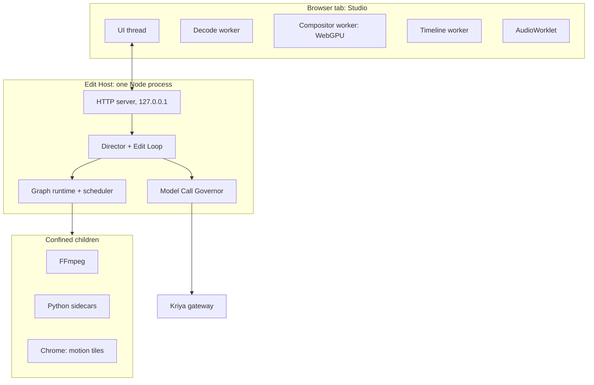
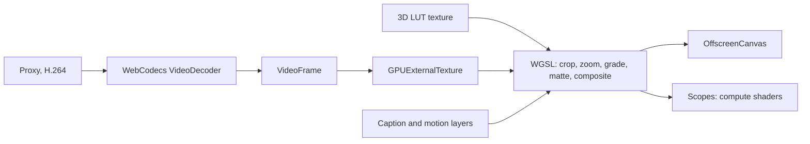

# Studio app and browser engineering (track E)

How the Studio is hosted, and how it uses everything a modern browser can do.
Replaces the first design, a page inside DSH, which the forensic audit showed
wouldn't work (EH-20).

## 1. Decision

**The Studio is its own local web app, served by the Edit Host on its own loopback
origin.** DSH keeps one sidebar row and one small route.

| | Page inside DSH (first design) | Own origin (chosen) |
| --- | --- | --- |
| Routes | Exact paths only; relative assets can't load | Any path |
| React | DSH's 18 | Ours |
| Headers | None of ours | COOP, COEP, CSP: all ours |
| A DSH bump | Could break the editor | Can only break one link |
| A Studio crash | In the person's coding session | In its own tab |
| Keyboard | Fights DSH's shortcuts | All ours |
| Runs without DSH | No | Yes: `kriya edit` is enough, and starts faster |

It also **gives the owner's "complete dashboard replaced" literally**: clicking
**Editing Studio** navigates the whole tab to the Studio. **Back to Kriya Harness**
navigates back. No overlay tricks.

This is the single biggest protection for existing workflows: the Studio shares no
process, no bundle, no React tree and no CSS with the coding harness.

## 2. Processes



**One Edit Host per machine**, guarded by a lock file, started on demand, detached,
so closing a tab, the harness or the daemon doesn't stop a render (EH-05). It exits
when idle for a while with no jobs. It reads the device token itself from
`~/.kriya/device.json`. Children never get the token: their environment is built
from scratch, not inherited.

## 3. Origin and sign-in

- Listens on `127.0.0.1` only, on a stable port kept in `~/.kriya/edit/port`, so an installed app and its storage keep working.
- `127.0.0.1` is a secure context, so WebCodecs, WebGPU and Service Workers all work without TLS.
- **Launch.** The harness row calls `POST /api/kriya.edit.launch` (owner peers only) or `kriya edit` mints it directly: a one-time token, valid 60 seconds.
- **Exchange.** The browser opens `http://127.0.0.1:<port>/launch#<token>`. The page posts it once and gets an `HttpOnly; SameSite=Strict` session cookie. The token is in the fragment, so it never reaches logs, and it's single-use.
- **Fence**, on every request, the same logic DSH uses (`dsh-client-connection`): `Host` must be our loopback authority (DNS rebinding can't forge it), `Origin` when present must match, and `Sec-Fetch-Site: cross-site` is refused. No CORS, ever.
- Media URLs carry opaque ids, never paths.

```text title="Headers on every document"
Cross-Origin-Opener-Policy: same-origin
Cross-Origin-Embedder-Policy: require-corp
Content-Security-Policy: default-src 'self'; connect-src 'self';
  img-src 'self' blob: data:; media-src 'self' blob:;
  worker-src 'self' blob:; frame-src 'self'; object-src 'none';
  base-uri 'none'; form-action 'self'; frame-ancestors 'none'
```

Those two COOP and COEP lines make the page `crossOriginIsolated`, which unlocks
`SharedArrayBuffer` and precise timers. A DSH page couldn't have them.

The motion preview iframe has its own stricter CSP, with `sandbox`, and no network.

## 4. The live compositor

The monitor is a small real-time compositor in the browser. **This is why a person
can scrub a finished-looking edit with nothing rendered.**



- **Decode** in a worker with WebCodecs; hardware where the OS offers it; frame-accurate, from the nearest keyframe.
- **Frames to the GPU** as `GPUExternalTexture`, which Chrome documents as sampling video data, potentially with no copy.
- **One WGSL pass** applies the same crop path, zoom, LUT and matte the final render will. Parameters come from the same RenderPlan, so preview and final can't diverge in intent.
- **Captions and blocks** render through `@hyperframes/player` into a layer, or from cached tiles when a span is unchanged.
- **Double-buffered decoders** make a cut play seamlessly: the next clip's decoder is primed before the playhead reaches it.
- **One GPU device for the Studio's whole life**, never one per clip. Per-clip devices hung intermittently in EX-13, for a reason not found; one device ran 1,000 clip switches and 31,000 frames with no hang. A **watchdog** still rebuilds the worker if a frame takes over 2 seconds.
- **Fallback:** no WebGPU, then Canvas 2D at lower quality. No WebCodecs, then the last draft through `<video>`. The Studio says what it's doing.

**As built in ED6** (client `studio/`, plain DOM, bundled by esbuild with no
runtime dependency): the fallback path only. Proxies play through `<video>`
elements, two per asset so the next piece is already seeked, drawn to one Canvas
2D with the cut's crop, zoom and safe zones; reverse play seeks frame by frame,
muted. Measured on one Mac, headless Chrome, a 640×360 proxy: scrub to frame on
screen p50 7 ms, p95 11 ms. Not built yet: WebCodecs decode, the WebGPU pass, LUTs
and mattes in the preview, the watchdog, the AudioWorklet mix and meter, workers
and OffscreenCanvas, the Service Worker and the app manifest. Scopes run on the CPU
over the canvas.

The harness row (`plugins/edit`) asks its node half for a link; that half reaches
the Host only through its owner-only socket and passes the harness page's origin,
which the Host keeps as the Studio's "Kriya Harness" link only when it is a
loopback `http` origin on another port.

Colour honesty: the proxy is 8-bit SDR, so it says **Preview** for colour-critical
work until a draft exists for that span.

## 5. Audio

- A graph on an **AudioWorklet**: the same buses as the final mix, with ducking and levels live.
- `SharedArrayBuffer` ring buffers feed it, so it doesn't glitch when the UI is busy.
- A **BS.1770 loudness meter** runs in the worklet: momentary, short-term, true peak.
- Waveforms from pre-computed peaks, drawn in a worker on `OffscreenCanvas`.

Live audio is a close preview. F2 in the Edit Loop is the measured truth.

## 6. Scopes

GPU compute over the same frames: histogram, waveform, vectorscope, and false colour
for exposure. Editors need these for colour work, and they cost almost nothing
because the frame is already on the GPU.

## 7. Timeline

Drawn on `OffscreenCanvas` in a worker, only what's visible, so it stays smooth at
thousands of clips. DOM only for focus and screen readers: a hidden, focusable list
mirrors the visible clips, so the keyboard and assistive tech have real elements.

## 8. Browser features used

| Feature | Use | If missing |
| --- | --- | --- |
| WebCodecs | Frame-accurate decode | Draft through `<video>` |
| WebGPU | Compositor, scopes | Canvas 2D |
| AudioWorklet | Live mix, meters | Web Audio nodes |
| OffscreenCanvas, Workers | Smooth UI | Main thread |
| SharedArrayBuffer | Frame pools, audio rings | `postMessage` |
| Service Worker | App shell offline; tile cache | Network to loopback |
| Web App Manifest | **Install as an app**: its own window and icon, no Tauri | A normal tab |
| Window Management API | Program monitor on a second screen, full-screen | One screen |
| Document Picture-in-Picture | Floating monitor while reading the transcript | None |
| `MediaRecorder` to local ASR | Speak a change; audio stays on the machine | Type |
| Pointer Events, pressure | Draw on the frame | Mouse |
| WebHID | Jog wheels, later | Keyboard |

Supported browsers are set by EX-03 and EX-13, not assumed. The Studio checks at
start and says plainly what will be limited.

## 9. Motion rendering in Chrome

Separate from the person's browser: **headless Chrome from the Media Runtime**, for
motion tiles only.

HyperFrames launches Chrome with `--no-sandbox` (EH-27), and on macOS and Windows
it uses screenshot capture (EH-32). So:

- Kriya's own blocks are trusted code, and run as HyperFrames expects.
- The whole Chrome process runs inside the OS sandbox (ES-05), with network denied and file access limited to the composition and the runtime. EX-14 proved it on macOS, GPU included, and proved it's needed: without it a composition reached the internet mid-render.
- `HYPERFRAMES_NO_TELEMETRY=1` and `DO_NOT_TRACK=1` are always set, since its CLI otherwise reports to PostHog.
- Model-written compositions need `editing.customMotion`, off by default, and refused on an OS where confinement isn't available.

## 10. Where else the browser helps

| Use | How | Limits |
| --- | --- | --- |
| **Layout truth** (QG-08) | HyperFrames' headless Chrome reports real text boxes from the DOM | Local |
| **Block authoring** | Blocks preview live in the Studio with hot reload | Local |
| **Testing the Studio itself** | The agent's `browser_*` tools and Playwright run the UI on localhost (`plugins/browser`, `kriya-browser-test`) | Development |
| **Platform preview** | The video in a phone frame with the platform's interface drawn over it, from reviewed safe-zone data | Our own drawing, no platform assets |
| **Research for a script** | In Tavi: existing `web_search` and `web_fetch`, sources kept with the brief | Facts on screen need their source |
| **Stock media** | An official API through a Kriya server route, so keys stay on the server | Off; EQ-07 |
| **Publishing** | Official APIs only (`instagram_publish` exists), with approval. Never browser automation of a platform | Track-A rule 5 |

## 11. Offline

With the app shell cached, the Studio opens with no internet. Hand editing, indexing
and rendering all work. Only asking for changes needs the gateway, and the Studio
says so.

## 12. Budgets

Targets for ED6. EX-13 measured scrubbing at 14 ms p95 on a proxy and 94 ms on a long-GOP source, on one fast Mac, headless.

| Measure | Target |
| --- | --- |
| Scrub to frame on screen | Under 100 ms |
| Play across a cut | No visible stall |
| Timeline at 2,000 clips | 60 fps pan |
| Studio cold start | Under 2 seconds to interactive |
| Memory | Bounded frame pool; never a whole clip |
