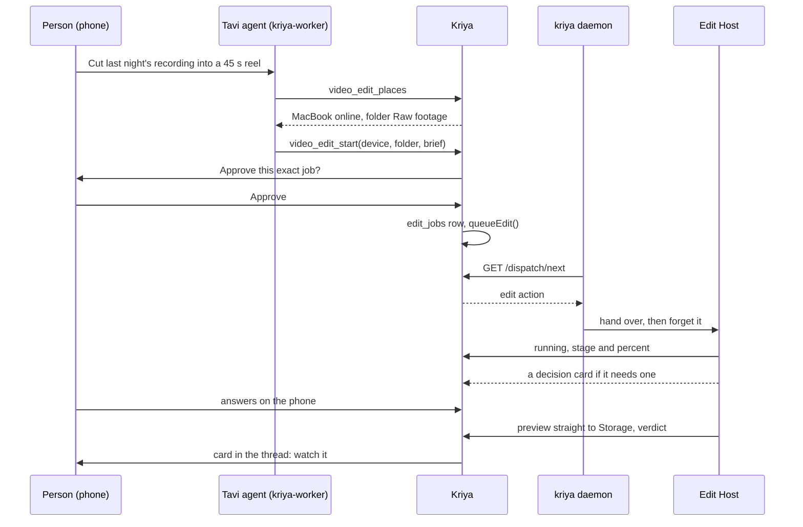

# Kriya Harness and Kriya Tavi together (track E)

The owner's ask: the best engagement between the two. The shape that fits how video
work really happens:

> **Tavi is the producer. The harness is the post house.**

A producer is on a phone, knows the brand, the audience and the calendar, gives
notes, and approves. A post house has the footage and the machines. Today a creator
is both, and neither tool talks to the other. Here they do.

| | Tavi (phone, web) | Harness (computer) |
| --- | --- | --- |
| Holds | Goals, brand, memory, calendar, connected accounts | Footage, compute, the project |
| Does | Briefs, notes, approvals, decisions, delivery | Indexing, editing, rendering, checking |
| Never does | Touch raw footage | Publish, or decide for the person |

## 1. The core path



The daemon's only part is the handover (EH-02, EH-03, EH-05). From then on the Edit
Host owns the job and reports to Kriya itself, so a closed harness or a restarted
daemon doesn't matter.

## 2. Making an editing agent

A person can just ask any agent once the switch is on. For a named one, the agent
dialog offers a **Video editor** preset, passed in through `getFeatures()`.
`lib/templates.ts` is **not** changed, because client components share it and a
server switch can't reach them (EH-11). `components/dialogs/agent-dialog.tsx` shows
the extra preset only when `features.editing` is true.

Guidance lives in the tools' descriptions, which exist only with the switch on. No
library skill and no prompt line are added (EH-12, EH-38).

## 3. Whose computer, which folder

Existing rules hold (CC-D1…D9, RC-D1):

| Rule | Effect |
| --- | --- |
| CC-D2: folders are the computer's to offer | The agent picks from `video_edit_places`. A path typed in Kriya is never used |
| CC-D3: escalation is set on the computer | `capabilities.edit` comes from the computer: **Allow editing from Kriya**, beside Allow serving in Remote Control, or `kriya daemon --allow-edit`. A stolen web session can't raise it |
| CC-D4: approvals unchanged | `video_edit_start` waits for approval of the exact call |
| CC-D5: only the server runs it | The person and the tool queue; device routes report |
| CC-D6: online within a minute | An offline computer is refused at once, with what to do |

`capabilities.edit` is an **optional** field added on the server first, and the
client sends it only after `/editing/manifest` answered 200 (EH-01).

`dispatchAction` can't start an edit: `queue()` refuses the kind, and only
`queueEdit()` accepts it (EH-06).

Which media? The brief says it in words: "last night's recording". The job matches
by name and date inside the offered folder. If it isn't sure, it asks (§5).

## 4. Running

The job is the Director in the Edit Host: **plain code with no agent loop**, so there
are no shell, file or browser tools for a hidden prompt to reach (ES-04). It uses
the device's token, so spend counts against the plan's harness cap, reserved in
SQL, under the Governor, which keeps room for the person's own chat (EH-13, EH-14).

Progress reaches Kriya as `{ stage, percent }`, at most every 10 seconds, on the
existing `POST /dispatch/{id}`. No transcript, and no file names (CC-D8).

`worker/index.ts` gains `editLoop` behind `editing.tavi`, in the pattern of
`flowLoop`. It mirrors dispatch status into `edit_jobs`, marks silent jobs `lost`,
verifies uploaded previews, and on a terminal status posts **an assistant message
with a stable id and `onConflictDoNothing`**, exactly as `lib/voice/thread-summary.ts`
does. No model call, no fake user message, no daily-limit hit (EH-16).

As built in ED14, the limits to know: the brief's words choose the file (most words in
its name, then the newest) and the length ("45 s"); the Director doesn't read the rest of
a first brief yet. ED15: when two files fit equally it asks, and a revision's notes and
change do reach the Director. Only `reel-talking-head` reaches
a make job, so any other recipe is refused. Only the preview and a card's clips upload, no poster or
report. A job lost for over 30 days isn't looked at again. Cancelling is the Review Room's Stop or the Control
Center's.

## 5. Decision cards: the phone as a second brain

The most useful thing a phone can do during an edit is answer a question in one
tap. When the loop reaches a real choice, it doesn't guess and doesn't stop dead:

| Card | When |
| --- | --- |
| **Which take?** | Two takes score close: two 5-second clips, tap one |
| **Which hook?** | Three openings, side by side |
| **Is this the file?** | The brief was unclear; candidates by name |
| **Check this name** | The transcript is unsure of a proper noun |
| **Remember this?** | A taste proposal to confirm |

It follows the approvals pattern (`POST /approvals`, `GET ?wait=25`): the Edit Host
posts a question with its small preview, keeps working on what doesn't depend on
it, and long-polls. Each question has a default and a timeout, so a person who never
answers still gets an edit, with the default noted. **Answers are the person's
alone**: only a session can write one (track-A rule 11, ET-POL-01).

As built in ED15: **Is this the file?** (two files fit the brief equally) and **Which take?**
(two takes within 10% of each other, two 5-second clips, at most two cards a job, and only
if the clips uploaded) are asked. **Which hook?** and **Check this name** have their kinds
in the route and the Inbox, and nothing asks them yet: they need the Director to offer
alternatives and its unsure words. **Remember this?** came with ED16: one proposal at a job's
end, never waited on; silence leaves it for the Studio's own screen.

## 6. The Review Room

A page in Kriya, `/edits/[id]`, built for a phone. This is where a person spends
time with a cut.

```text
+--------------------------------+
| ← Pricing reel       Cut B  ▾  |
|                                |
|        [ preview video ]       |
|  ▮▮▮▮▮▮▮▮▮●▮▮▮▮▮▮▮▮▮▮▮▮▮▮▮▮    |
|     ●       ●           ●      |
|                                |
|  ✓ Checked on your computer    |
|  0:12 "Bigger captions here"   |
|  0:31 "Wrong name, it's Ravi"  |
|                                |
|  [ 🎙 Add a note at 0:44 ]      |
|  [ Send 2 notes ]  [ Looks good ] |
+--------------------------------+
```

- **Timecoded notes.** Tap the video, type or speak. A note is pinned to a moment.
- **Notes become anchors.** On the computer each is resolved to a word or shot, so it survives re-cuts, and it appears as a pin on the Studio's timeline.
- **Send notes** starts a revision. This is the person's own action, so no tool approval is involved.
- **Compare** two versions with one swipe.
- **Looks good** closes the job.
- **Share for review** (later) uses a share link, which only the person can create (track-A rule 11), so a client can leave notes with no account.

Notes are stored as `edit_notes`, with no footage. A note's words are the person's,
so the Director reads them as instructions for that one change, after validation.

As built in ED15: not built are speaking a note, a swipe (two buttons compare, and keep
your place), and Share for review. A revision takes each note through the Director's
console and then one render and verdict, with no repair ladder. A note it can't turn into
an edit (captions aren't console operations yet) is counted and left on the cut for the
person, never forced.

## 7. Live presence

`/harness` and `/edits` show what's happening on the computer: stage, percent, how
long it's been running, and which step it's on. Opt-in **poster updates** send one
small frame per stage, so the phone shows the edit taking shape. Off by default,
since a frame is a frame leaving the machine.

## 8. Kriya notices: watch folders

Off by default, per folder, set on the computer.

The person says: "Watch `Raw footage`." When a new recording settles, the Edit Host
reports only its **name and duration**, and Tavi shows a card: "New recording, 34
minutes. Make shorts?" One tap starts a job. **Nothing runs and nothing is spent
until the person taps.**

As built in ED15: `kriya edit watch <folder>`, a look every minute, told once a file holds
its size between two looks. What's there when a folder is added counts as old. The card
offers a reel, since that's the recipe that runs. The Host stays up while any folder is on
the list, and the daemon wakes it at each hello. Without a daemon nothing restarts it after a
reboot.

## 9. The content engine

Because Tavi already has goals and schedules (track A) and jobs (track O), a person
can say: "Every Monday, cut the latest podcast into three shorts." At that time the
schedule runs, an approval card arrives (`video_edit_start` is R3 and not grantable,
so a person sees each one), and the edit happens on their computer.

The agent can enrich a brief from memory: audience, brand voice, what performed
before, if the person's memory holds those. The brief it sends is shown in the
approval, so nothing is hidden.

After a job, it may suggest posting. Publishing is a separate decision for a later
phase: `instagram_publish` exists and is approval-gated, and it needs its own
review of how a video reaches it (EDD-47). Kriya never posts by itself.

"Call me when it's ready" works if the person asks for it, as a phone-call reminder
(voice rule 10). Nothing else calls or messages them: approvals and cards use the
existing in-app notifier (track-A rule 10).

## 10. What Kriya can and cannot prove

What runs on the person's machine is untrusted to Kriya (`plugins/kriya-tools` says
so too).

| Claim | Basis | Label |
| --- | --- | --- |
| A preview exists and is this file | Hash, size and container checked by the worker | Verified by Kriya |
| The gates passed | Reported by the computer | "Checked on your computer" |
| Spend | Kriya's own ledger | Verified by Kriya |

Track N's delivered status doesn't treat a device report as verified evidence, and
`video_edit_start`'s capability says `verification: "file"`, meaning only the
uploaded file. The preview is what a person judges with their own eyes.

## 11. Files

| Direction | What | How |
| --- | --- | --- |
| Tavi to computer | Reference images or clips attached in the thread | `references[]`, fetched by a short signed link; max 5 (`MAX_ATTACHMENTS`) |
| Computer to Tavi | Preview, poster, report (JSON) | **Straight to Storage** by signed upload, into bucket `kriya-edit-previews`; the worker verifies; plan cap in SQL |
| Never | Raw footage, the project, masters | Stay on the computer (EDD-21) |

Previews stay under 45 MiB, because the platform's default object limit is 50 MiB
(EH-23). A long edit gets a lower-bitrate preview, or a highlights cut. Video seeks
through a 1-hour signed link, not the 60-second link for files (EH-25). If the
plan's cap is 0, the card shows the verdict with no video and says where the file is.

When an account is deleted, rows cascade but objects don't, so the worker sweeps the
bucket against live rows, as `lib/cloud/janitor.ts` does (EH-26).

## 12. Failure modes

| Case | Behaviour |
| --- | --- |
| Computer offline | Refused at once |
| Lid closed mid-job | `lost` after `editing.jobLostMinutes`; on wake it resumes and returns to `running` |
| Studio not set up there | `runtime_missing`, and a line telling the person to open the Studio |
| Harness cap reached | Paused, then `failed` with the existing message. **As built:** a model that refuses for any reason, the cap included, gives slots their defaults, so the job still delivers a cut made by code alone, with a note (found by ED16's bench; owner to decide) |
| Person cancels | `canceling`; the Edit Host stops and reports `canceled`. An unknown job gets `canceled` at once from the daemon (EH-04) |
| Two jobs at once | The Edit Host queues them, and says so |
| Device revoked | Existing behaviour; the job ends `lost` |
| Question never answered | Its default, noted in the report |
| Revision after a project moved | `source_offline` |

A failed job is never re-queued automatically. The agent may propose a new one,
which needs a new approval (track N rule 9).

## 13. Not in the first release

Rendering in the cloud with no computer online (EDD-29); uploading raw footage;
automatic posting; editing inside a room (track R) or as a Flows step (track S);
brand kit sync across devices. Each needs its own decision.
