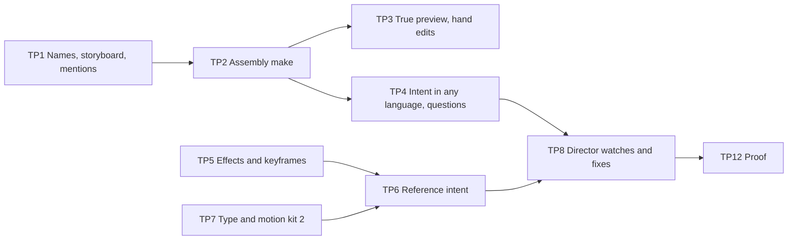

# Top-tier gap analysis (track E, phases TP0–TP12)

Owner's brief, 2026-11-10: many files in one edit, placed where the person says; a
Studio where telling the Director that is easy; a Director that reads intent, takes
what a reference does and makes a more professional film; effects, filters, fonts and
text at a top editor's level; all of it from the harness, not from a bigger model.

This file says where the Studio stands, measured against the code, and every gap
between that and the aim. The designs that close the gaps are in
[ASSEMBLY_AND_INTENT.md](ASSEMBLY_AND_INTENT.md) and
[CRAFT_UPGRADE.md](CRAFT_UPGRADE.md); the phases, tests and switches are in
[TOP_TIER_PLAN.md](TOP_TIER_PLAN.md).

Read against client `kriya-harness` `5720384` (0.2.5) and Kriya `5710890`, on
2026-11-10. Nothing was run for this document: every "as built" line below is from
reading the code and `status.md`, and each names its file.

## 1. What "top 1%" means here

It is the aim, not a claim. Track E rule 14 forbids a comparative or "best" claim
before gate EG-8 and a fresh RG-9, and only people preferring the output in
KriyaEditBench can show it (EVALUATION_PLAN). No real model, real device or real
speech recogniser has run yet (EB-07, EB-09, EB-11), so today nothing is known about
how the output compares with anyone's.

So the bar is written as things code can check and a person can feel:

| Bar | Measured by |
| --- | --- |
| **Say it once.** A person places any file or part of a file anywhere in the cut in one message or one drag, in their own language | Bench-A (TOP_TIER_PLAN §6): scripted assembly requests, share made right the first time |
| **See it before it renders.** What the monitor shows is what the file will show | ET-PV-*: monitor frame against rendered frame |
| **Nothing asked is lost.** Every instruction is in the cut or named as not done | QG-12, QG-15 |
| **A professional's craft list is covered** (§2) | The matrix in §2: each row reachable from a plan, from chat and by hand |
| **A reference's method is matched, in numbers** | QG-16: the made cut's own Edit DNA against the reference's, per trait |
| **People prefer it** | KriyaEditBench-R, EG-8 |

"Better than the reference" can only mean two things here, and both are testable: the
cut passes gates the reference itself would fail (legibility, loudness, cut hygiene,
safe zones), and people prefer it in a blind comparison. Nothing else is promised.

## 2. The craft list, and where each row stands

What a professional editor does on most jobs. "Reach" is who can do it today: **P**
the plan, **C** chat, **H** the person by hand in the Studio.

| Craft | As built | Reach | Gaps |
| --- | --- | --- | --- |
| Assemble several files in a chosen order | The engine can: `keep_range` with `after`, `reorder` (`core/ops.js`). Only the montage and multicam recipes use more than one video | C in part | TG-01…09 |
| Cut the talk: fillers, retakes, hook, cold open, trims by time | Built for one take (`recipes/reel.js`) | P C H | TG-01 |
| Pace: punch-ins, angles, speed, ramps, freeze | Built | P C | TG-18 |
| Transitions | Six kinds, drawn by FFmpeg `xfade` (`core/transitions.js`) | P C | TG-17 |
| Colour: looks, match, exposure, LUT | Five looks; `grade` with temperature, vibrance, vignette; `match_color`, `fix_exposure`, `apply_lut` exist as operations that no recipe and no chat reaches | P C in part | TG-06, TG-19 |
| Picture effects and filters | `grade`, `lut`, `reframe` render. `stabilize` can be stored by its operation and is then refused by the builder ("this render can't do … yet", `core/ffmpeg.js`); a picture `fade` is unbuilt and nothing can set one | — | TG-17, TG-18 |
| Captions | Five looks, three font stacks (`engine/captions.js`), karaoke highlight, off faces | P C H | TG-20 |
| Titles and motion graphics | Seven kinds in a caption-sized box (`engine/graphics.js`); seven scene kinds (`engine/scenes.js`) | P C | TG-21 |
| Sound: clean voice, music, ducking, effects, loudness | FFmpeg voice chain; three code-made beds; four code-made effects; fit and duck; QG-06 | P C | TG-22 |
| B-roll and cutaways | The person's other clips by rhythm; licensed stills and cited definitions (DP4, DP6) | P | TG-23 |
| Multi-camera | Sync and switching for a podcast (`recipes/multicam.js`) | P | — |
| Follow a reference | Pace, colour, caption band, loudness, tempo, per aspect (`engine/dna.js`, `engine/reference.js`) | P | TG-14…16 |
| Review before export | The final cut in Finish, gates' verdict | H | TG-24, TG-25 |
| Hand off to another editor | OTIO, FCPXML, EDL, SRT; transitions not exported | H | — |

## 3. The gaps

Severity: **A** blocks the owner's brief; **B** holds the craft below a professional's;
**C** polish or proof. "Closed by" names a phase in TOP_TIER_PLAN.

### 3.1 Many files in one edit

| Id | Gap | Evidence | What the person meets | Sev | Closed by |
| --- | --- | --- | --- | --- | --- |
| TG-01 | A make cuts **one take** | `host/projects.js` `make()`: `request.asset ?? video[0]?.id`; `planReel({ asset })`. Other videos enter only as B-roll by rhythm (`brief.broll === "own"`), as cameras, or as montage shots | "Put the intro file first, then the interview" makes a film of the first file added | A | TP2 |
| TG-02 | A file has **no name both sides share** | Chat's view lists `a1 (video, 12 s)` (`director/revise.js`, the `bin` line); the Studio shows the file's name; assets have no label (`core/project.js`) | "The beach clip" means nothing to the Director; "a2" means nothing to the person | A | TP1 |
| TG-03 | **Nowhere to set an order** | The bin is a list whose only action is "show this source" (`studio/src/main.js`, `renderBin`); the timeline's pointer only seeks (`studio/src/timeline.js`) | The person has to describe an order in a paragraph | A | TP1, TP3 |
| TG-04 | **No pointing at a file, or a part of one**, in chat | Mark in and Mark out mark a stretch of the cut only; nothing carries a file or a source range with a message | "This part" can't be said about raw footage | A | TP1 |
| TG-05 | **Order and placement can't be expressed** | `PLAN_SCHEMA` (`director/plan.js`) has no field for which file goes where; code reads format, trims and settings from words, never "first", "in the middle", "after" | The model can't answer even when it understands | A | TP2 |
| TG-06 | **Mixed sources aren't conformed** | Every piece is scaled to fill and centre-cropped (`core/ffmpeg.js`, `scale … increase` then `crop`): a wide clip in a 9:16 cut loses its sides with no choice. `match_color`, `fix_exposure`, `room_tone` and J and L cuts (`trim`'s `audioLead`, `audioLag`) exist as operations no recipe uses | Files from a phone, a camera and a screen recording look and sound like three videos | A | TP2 |
| TG-07 | **No gate checks order** | QG-12 checks must-keep, must-cut, length, format | A wrong order can be delivered as passed | A | TP2 |
| TG-08 | **Continuity is for one take** | `continuity.js` `storyFor` keeps one story; `last-make.json` holds one | "Move the demo before the intro" would re-ask every story | B | TP2 |
| TG-09 | **The bin doesn't scale** | No thumbnail, search, sort or group; one row per file | Forty files are a wall of file names | B | TP1 |

### 3.2 Reading intent

| Id | Gap | Evidence | What the person meets | Sev | Closed by |
| --- | --- | --- | --- | --- | --- |
| TG-10 | **Intent is read by English patterns** | `settingsIn`, `trimsIn`, `formatIn` (`plan.js`), `graphicsIn`, `brandIn`, `codeBeats`, "start over" (`projects.js`) | A request in Telugu, Hindi or mixed speech reaches the model only, with no code check behind it | A | TP4 |
| TG-11 | **The Director can't ask** in the Studio | Decision cards exist for Tavi only: file and take (ED15); hook, name and taste cards aren't wired | It guesses, and a wrong guess costs a render | B | TP4 |
| TG-12 | **Every Director call is on `budget`** | `tier: "budget"` in `plan.js`, `revise.js`, `graphics.js`, `lookups.js`; EB-06 open | A hard request gets the same model as an easy one | B | TP8 |
| TG-13 | **The Director never watches its cut** | No recipe sends a frame (`editing.frameVision` off, no caller); QG-14 reads words only; B-roll is placed by rhythm | A bad frame, a dull stretch or a wrong cutaway is found by the person | B | TP8 |

### 3.3 Following a reference

| Id | Gap | Evidence | What the person meets | Sev | Closed by |
| --- | --- | --- | --- | --- | --- |
| TG-14 | **A reference's method is mostly unread** | `dna.js` measures pace, first cut and last shot, colour, caption band, loudness. Its own header lists what it doesn't: fonts, motion feel, music against speech. Also unread: transition kinds and rate, zoom rate, graphics density and place, caption style class, effect density, cuts on beats, hook length, speed changes, B-roll share | A reference full of motion graphics changes the cut's pace and colour, and nothing else | A | TP6 |
| TG-15 | **Reference colour is a fixed mapping** | `gradeFromStats`: "shortcut: a fixed mapping from 8-bit averages" (`engine/reference.js`); the measured match in `engine/color.js` isn't used for references | "Like this" lands near, not on | B | TP6 |
| TG-16 | **No account of what was taken** | The reference's lines are shown; nothing lists each trait as matched, approximated or not possible, and no gate compares the result | The person can't tell whether the reference was followed | B | TP6 |

### 3.4 Craft

| Id | Gap | Evidence | Sev | Closed by |
| --- | --- | --- | --- | --- |
| TG-17 | **Few picture effects.** No blur or background blur, sharpen, grain, glow, letterbox, shake, split colour, light leak, picture in picture, split screen, blend, key or mask. `stabilize` can be stored and then fails the render, the same fault as the transition bug of MG1b (no chat or plan reaches the operation, so it hasn't been met) | `core/ffmpeg.js` `pictureChain` | A | TP5 |
| TG-18 | **No keyframes.** An effect is one value for a clip; a ramp is five steps | `core/ops.js` | B | TP5 |
| TG-19 | **Five looks, no shot matching in a make.** No white balance or exposure evened across files, no skin-tone guard, no LUT shelf | `recipes/reel.js` `GRADES` | B | TP5 |
| TG-20 | **Type is the computer's fonts.** Three caption stacks, four graphic stacks, all system fonts: the same project draws differently on another OS (against EDD-11), and no Indic script is guaranteed a font. QG-10 doesn't read non-Latin text. No tracking, no pairing, no per-word animation beyond a highlight | `engine/captions.js` `FONTS`, `engine/graphics.js`, QUALITY_GATES §"as built" | A | TP7 |
| TG-21 | **The motion kit is small and boxed.** Seven kinds inside the caption box; no full-frame title, callout, list, progress bar, logo bug, map or device frame; `customComposition` has no caller (MG2) | MOTION_GRAPHICS §4 | B | TP7, TP9 |
| TG-22 | **Sound is code-made.** Four effects and three beds written sample by sample; no licensed library (EQ-07); Clean voice's engine isn't installed (FFmpeg filters stand in); no ambience layer; cuts on beats only in a montage | `engine/sfx.js`, `engine/music-bed.js`, CAPABILITY_PACKS §3a | B | TP10 |
| TG-23 | **B-roll is chosen by rhythm**, not meaning | `recipes/reel.js` "every other story clip"; Smart search and Local eyes packs aren't built | B | TP8 |

### 3.5 Experience and proof

| Id | Gap | Evidence | Sev | Closed by |
| --- | --- | --- | --- | --- |
| TG-24 | **The monitor doesn't show the film.** It draws cuts, crops and zooms; captions, graphics, scenes, transitions, grade and music are seen only after a render that took 437 to 1,245 s on a real take | `studio/src/monitor.js`; EV1 result | A | TP3 |
| TG-25 | **Every change renders the whole cut** | Continuity's limit: "no partial re-render", though segments are cached by key | B | TP3 |
| TG-26 | **Hand editing is thin.** No drag, trim handle or snap on the timeline; Variations wall and drawing on the frame are open since ED6 | `studio/src/timeline.js` | B | TP3, TP9 |
| TG-27 | **macOS arm64 only for anything drawn.** Windows refuses captions, graphics and scenes (EQ-11) | `engine/confine.js` | B | TP11 |
| TG-28 | **Nothing is proven on real use.** No paid model run, no real recogniser, QG-04 and QG-14 `not_checked`, no human preference data | EB-07, EB-09, EB-11 | A for any claim | TP12 |

## 4. What is already strong, and stays

These are the reasons a cheap model can do this at all. No phase below rewrites them.

- Typed operations, word anchors, integer time: a model can't write a broken timeline.
- Verdicts by code from the rendered file: 14 gates, a repair ladder that never keeps a
  worse attempt.
- Words on screen are the speaker's or the person's own; references give numbers only.
- A change lands on the existing cut and keeps the person's edits (`continuity.js`).
- Footage never leaves the computer.

## 5. Order of attack

The owner's brief ranks them: files first, then telling the Director, then the
reference, then craft. Proof runs beside all of it.

## 6. What this plan does not do

| Asked or implied | Answer |
| --- | --- |
| Copy a reference's graphics, fonts, text or sound | No: rule 9. Its method is measured as numbers and fixed words and rebuilt from Kriya's own kit |
| Say Kriya is in the top 1% | Not before EG-8 and RG-9 (rule 14) |
| Depend on a larger model for quality | No: each phase adds code the cheap model chooses among. A stronger tier is used only where a measured task needs it (TP8), and the owner picks it (EB-06) |
| Download effects, templates or fonts from the internet at run time | No: MOTION_GRAPHICS §5. Items pass the licence gate one by one and ship in the signed runtime |
| Generated people, cloned voices, generated video | No: rule 10, EDD-24, EDD-54 |
