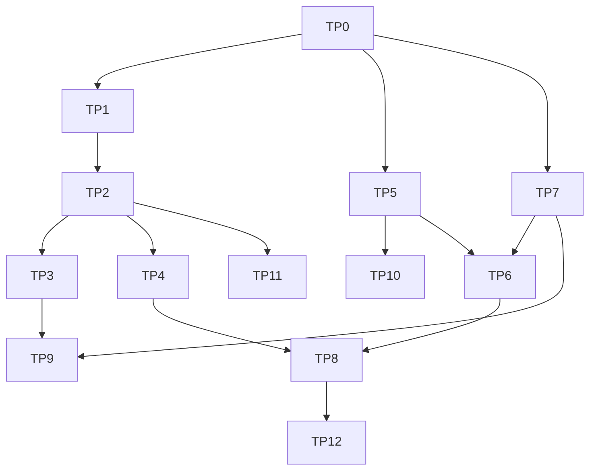

# Top-tier plan (track E, phases TP0–TP12)

How the gaps in [TOP_TIER_GAP_ANALYSIS.md](TOP_TIER_GAP_ANALYSIS.md) get closed: phases,
order, switches, tests, exit checks, spikes and what the owner must decide. Designs:
[ASSEMBLY_AND_INTENT.md](ASSEMBLY_AND_INTENT.md), [CRAFT_UPGRADE.md](CRAFT_UPGRADE.md).

An implementing agent starts from [AGENT_MASTER_PROMPT.md](AGENT_MASTER_PROMPT.md) with
its phase set to one `TP…` id, and every rule there applies. **Before any code it reads
[TOP_TIER_FORENSIC_AUDIT.md](TOP_TIER_FORENSIC_AUDIT.md)**: the hazards these designs
carried, the ten standing rules (§6 there), and the proof that each existing workflow
is untouched (§5 there). Progress goes in
`status.md`, section "Track E", in the shape that section gives.

## 1. Phases

| Phase | Name | Closes | Depends on | Decisions | Switch |
| --- | --- | --- | --- | --- | --- |
| TP0 | Blueprint, gap analysis, decisions | — | — | — | — |
| TP1 | Clip handles, bin, storyboard, mentions | TG-02, -03, -04, -09 | TP0, EDD-59, -60 | EDD-59, -60 | `editing.assembly` |
| TP2 | Assembly make: resolver, slot, recipe, conform, QG-15, continuity, the card's Order | TG-01, -05, -06, -07, -08 | TP1 | EDD-59, -62 | `editing.assembly` |
| TP3 | True preview, partial re-render, hand edits on the timeline | TG-24, -25, -26 | TP2; spike TPX-01, -06 | EDD-63 | `editing.livePreview` |
| TP4 | Intent frame in any language, "Not in this cut", questions, hold to talk | TG-10, -11 | TP2 | EDD-61, -62 | `editing.intent` |
| TP5 | Effects registry, adjustments, keyframes, looks, skin guard | TG-17, -18, -19 | TP0; spike TPX-02 | EDD-64 | `editing.craft` |
| TP6 | Reference intent: Edit DNA 2, style brief, measured colour, QG-16 | TG-14, -15, -16 | TP5, TP7; spike TPX-03 | EDD-65 (EDD-66 stays off) | `editing.referenceIntent` |
| TP7 | Type: fonts in the runtime, type kit, caption looks, motion kit 2, style packs | TG-20, -21 | TP0; EB-09; spike TPX-05 | EDD-67 | `editing.typeKit` |
| TP8 | The Director watches and fixes; B-roll by meaning; openings | TG-12, -13, -23 | TP4, TP6 | EDD-68 | `editing.directorLoop` |
| TP9 | Custom motion (MG2), drawing on the frame, callouts | TG-21, -26 | TP3, TP7; EB-06, EB-07 | EDD-44, EDD-58 (approved) | `editing.customMotion` (exists) |
| TP10 | Sound: effects, arranged beds, ambience, J and L cuts | TG-22 | TP5 | EDD-69 | `editing.craft` |
| TP11 | Windows and Linux; Tavi order and cards | TG-27 | TP2; EQ-11 | EDD-28 (approved) | `editing.tavi` (exists) |
| TP12 | Proof: Bench-A, KriyaEditBench-R, pilot | TG-28 | TP8; EB-05, EB-07, EB-11 | EDD-35 | — |

Every switch is a server key that ships **off**, read by the client from
`GET /editing/features`; a server that doesn't name it means off. Off, the plan prompt,
the schemas, the routes and the make are the objects they were, and each phase has a
regression test that proves it (`…-REG-01`), as ET-MG-REG-01 does for the motion kit.

## 2. Order and lanes

Three lanes can run at once, each in its own client worktree and branch off `main`:

| Lane | Phases | Mostly touches |
| --- | --- | --- |
| A, files and intent | TP1 → TP2 → TP4 | `director/`, `recipes/`, `studio/src/` |
| B, picture and sound | TP5 → TP10 | `core/effects.js`, `core/ffmpeg.js`, `engine/` |
| C, type and motion | TP7 → TP9 | `engine/captions.js`, `graphics.js`, `scenes.js`, the runtime manifest |

**Hot files, one holder at a time on the coordination board:** client `core/ops.js`,
`core/ffmpeg.js`, `core/plan.js`, `core/project.js`, `host/projects.js`,
`host/server.js`, `director/plan.js`, `studio/src/main.js`; server `lib/config.ts`,
`lib/harness/contract.ts`. TP3, TP6 and TP8 cross lanes, so each runs alone.

The owner's order of value is TP1, TP2, TP4, then TP3, then TP5 to TP7, then TP6 and
TP8. If only one agent works, that is the order.

## 3. Spikes, before the phases that rest on them

Throwaway code in a scratch folder, real measurements into SPIKES.md, no product code.

| Id | Question | Method | If it fails |
| --- | --- | --- | --- |
| TPX-01 | Can the monitor scrub with live tiles over it? | The real tile HTML in a sandboxed frame over the canvas; 1, 5 and 20 tiles; frames per second while scrubbing | Tiles drawn only when paused; still frames while scrubbing |
| TPX-02 | Which filters of CRAFT_UPGRADE §3.2 does the signed runtime's FFmpeg have? | Its own filter list, read by `engine/capabilities.js` | Drop the row for that effect; say so in §3.2 |
| TPX-03 | Can code tell a cut from a dissolve, a dip, a wipe and a zoom, and find text regions? | References **Kriya renders itself** with a known mix (its own six transitions, its own caption looks), so the truth is known and no one's video is needed; then EB-05's cleared set | Report the trait as "couldn't read"; keep pace and colour only |
| TPX-04 | Does a frame match at a join survive a look, a crop and an encode? | Luma-gradient hash of the rendered frame against the source frame under the plan's own geometry; sweep the threshold on barcoded and natural synthetic footage | Check the join by source audio and frame count as well; QG-15 notes instead of blocks until it holds |
| TPX-05 | Which scripts does the OCR helper read? What do Windows and Linux have? | Rendered captions in each script through the helper | The glyph check of CRAFT_UPGRADE §5.1 carries QG-10 for that script |
| TPX-06 | Are cached segments exact when joined after a change? | Change one caption; join; compare frames and audio samples with a full render | Re-render the neighbours too |

## 4. What each phase delivers and how it ends

A phase is `COMPLETE` only when every exit check passed and its real output is in
`status.md`.

**Every phase, first and last:** `npm run check` in both repositories, and the
regression rows of TOP_TIER_FORENSIC_AUDIT §5 that the phase can reach, run on today's
`main` before any change and again at the end, with every `TP` switch off and then on.
ET-TP-REG-01…04 are exit checks of **every** phase from TP1 on. A row that was green
and is red is fixed before anything else. Each screen
phase ends with the browser check of operator rule 7 (360 and 1280 px, light and dark,
console clean, targets 44 px or more), screenshots in `screenshots/kriya-editing/<phase>/`.

### TP1 Clip handles, bin, storyboard, mentions

- **Server first:** `editing.assembly` (off); the features answer names `assembly`;
  contract regenerated; `tests/editing/features.test.ts`.
- **Preflight:** EH-77 (does search see corrected words?); ET-ASM-08's behaviour read
  from the code and pinned.
- **Client:** the computed clip number, the optional `label`, `describe_asset`,
  `set_assembly` (checked, bounded); bin thumbnails, search, sort, groups; `studio/src/storyboard.js`, `mentions.js`; the
  Host routes for labels, the assembly and mentions.
- **Exit:** ET-ASM-01…08, ET-ASM-UI, ET-ASM-REG-01. A storyboard order made by drag
  and by keyboard is stored and undone. No model is called anywhere in this phase.

### TP2 Assembly make

- **Preflight:** EH-60a (is today's B-roll placed twice by a second make? If so, fix
  that first as its own change) and EH-78 (does a still render on the main picture?).
- **Client:** `director/assembly.js`, `recipes/assembly.js`, `gates/assembly.js`; the
  `frame` effect; conform; a story per part in `continuity.js`; the Plan Card's Order.
- **Exit:** ET-ASM-10…25, ET-ASM-M1…M5, Bench-A-M (§6) green. QG-15 ships as a note;
  it blocks only once TPX-04 has set its threshold and its seeded defects are caught 10
  of 10 with no false alarm on 10 clean makes (EG-4's rule). **A film from three
  synthetic files in an order given three ways (drag, mention, words) is delivered
  through the Host, and each way makes the same assembly.**

### TP3 True preview, partial re-render, hand edits

- **Exit:** ET-PV-01…06; a caption change on a long fixture renders one draft segment
  (the journal's count) while the sound and any master are made whole; trimming by an
  edge handle is an operation with undo, and scrubbing is unchanged; ET-PV-REG-01.

### TP4 Intent

- **Preflight:** may the Studio's page ask for the microphone under its present
  headers (EH-75)?
- **Exit:** ET-NL-01…09, ET-NL-REG-01. With a scripted model: an answer whose evidence
  isn't in the message is dropped; every uncovered request appears under "Not in this
  cut"; at most two questions; hold to talk hidden without the weights. Accuracy on a
  real model is **not** an exit check: it is Bench-A-R, with the owner's go-ahead.

### TP5 Effects, keyframes, looks

- **Exit:** ET-FX-01…08; ET-FX-M1 for every registry row; ET-FX-REG-01; no operation
  can store what the builder refuses (a test walks every effect type the project schema
  allows); the same bytes twice per effect.

### TP6 Reference intent

- **Exit:** ET-RF2-01…08; ET-RF2-M1: on Kriya-made references each trait is recovered
  within its tolerance; ET-RF2-M2: a make with such a reference follows it, and QG-16
  says so; ET-SEC-08 still passes (no reference pixel or sound in an output); `checkDna`
  refuses anything that isn't a number or a fixed word.

### TP7 Type and motion kit 2

- **Needs:** a new signed runtime manifest carrying the fonts as a pack (EB-09), each
  font's licence checked at its pinned version (EQ-18).
- **Preflight:** a font file loads in a tile inside the OS sandbox; the previous client
  release installs from the new manifest (EH-68).
- **Exit:** ET-TY-01…08; ET-TY-M1: every caption look and kit kind, in every format, at
  its longest text, in each shipped script: nothing clipped, no missing glyph, QG-08 and
  QG-09 pass; the same tile draws the same pixels with the system fonts removed;
  ET-LIC-01; ET-TY-REG-01, ET-TY-REG-02.

### TP8 The Director watches

- **Exit:** ET-DL-01…08; a seeded dull stretch, a crowded one and a repeated cutaway
  are each found by the viewer's report and fixed; a fix that lowers the score is
  dropped; with no `balanced` model chosen nothing escalates; ET-DL-REG-01.

### TP9 Custom motion and pointing

- **Exit:** ET-SEC-02 and -04 on the new caller; ET-MG2-01…05; a drawn box reaches a
  callout and a blur as typed data. A real model's composition needs EB-06 and EB-07.

### TP10 Sound

- **Exit:** ET-SD-01…06; a bed's hits land within 30 ms of the joins they were arranged
  to; QG-06 passes on every bed; J and L cuts pass QG-05.

### TP11 Platforms and Tavi

- **Exit:** IMPLEMENTATION_PLAN's "second platform" check; ET-TV-* for the order field,
  server first.

### TP12 Proof

- **Exit:** Bench-A-R and KriyaEditBench-R run with the owner's go-ahead and their real
  numbers in `status.md`; EG-8. Until then no document, screen or message says "best",
  "top" or compares Kriya with anyone (rule 14).

## 5. Tests

Ids continue TEST_STRATEGY's. Unit tests are instant and use no media; `-M` tests use
the real FFmpeg and Chrome on synthetic fixtures; `-UI` tests drive the Studio in
headless Chrome on an isolated home with a fake Kriya. No test calls a real model.

| Id | Proves |
| --- | --- |
| ET-ASM-01 | `set_assembly` refuses an unknown file, a reference, a range outside its file, an `over` part with no host, more than 200 parts |
| ET-ASM-02 | A clip's number is computed from its place, skips references and what Kriya wrote, and opening a project writes nothing to it |
| ET-ASM-03 | A label is the person's only; a model-authored `describe_asset` label is refused |
| ET-ASM-04 | File names and labels reach a view cleaned and marked as data |
| ET-ASM-05 | A mention carries the file and range; a made-up id is refused by the Host |
| ET-ASM-06 | Storyboard actions are one operation each, and undo restores the order |
| ET-ASM-07 | The bin's search finds by label, file name and spoken words |
| ET-ASM-08 | The previous client release, given a project that has a label or an assembly, refuses it whole and writes nothing (EH-55) |
| ET-ASM-10…14 | `resolveRefs`: numbers, labels, roles, transcript search, each placement word; two candidates are left open, never guessed |
| ET-ASM-15 | `splitAt` lands on a sentence boundary; "the middle" is half the kept length |
| ET-ASM-16 | `assemblyProblems` refuses each bad answer; the fallback order is said plainly |
| ET-ASM-17 | Who wins: this message, storyboard, earlier messages, the revised plan, the Director, the default |
| ET-ASM-18…20 | Conform: `fit` defaults; loudness within 1 LU; colour matched inside limits |
| ET-ASM-21 | A reorder asks the model for no story |
| ET-ASM-22 | One file and no assembly: the same operations as today (golden plan) |
| ET-ASM-23 | Make twice: every cutaway the make placed is there once (EH-60) |
| ET-ASM-24 | A file used as two parts: an edit carried over a remake lands on the half it was made on (EH-61) |
| ET-ASM-25 | `set_assembly` and `describe_asset` are never carried onto a remake (EH-62) |
| ET-ASM-M1 | Three files, an order: the delivered film's joins are the right files at the right times |
| ET-ASM-M2 | A part in the middle of another; an `over` part on its word; a voice-over as the clock |
| ET-ASM-M3 | A wide clip in a tall film in each `fit` mode |
| ET-ASM-M4 | QG-15 seeded: swap, missing part, wrong stretch |
| ET-ASM-M5 | A file gone offline: left out with a note, or `needs_you` when it was asked for |
| ET-ASM-UI | Storyboard, picker and the card's Order at both widths and themes |
| ET-ASM-REG-01 | Switch off: no storyboard, no slot, the same prompt and schema objects, `brief.assembly` dropped |
| ET-NL-01…03 | The evidence check: kept when literal, dropped when not, numbers must be in it |
| ET-NL-04 | Every uncovered piece of a message is listed under "Not in this cut" |
| ET-NL-05 | Code and model disagree: code's reading wins and is shown |
| ET-NL-06 | At most two questions; a default is always selected; a revision doesn't ask again |
| ET-NL-07 | Hold to talk: local only, hidden without the weights, no network request |
| ET-NL-08 | The same request in English, Telugu, Hindi and mixed speech fills the same frame (scripted model) |
| ET-NL-09 | Model calls per message are what they were: the journal's count for a plan and for a chat change, switch on and off (EH-64) |
| ET-PV-01 | Monitor tiles equal rendered tiles to the pixel; the picture stays above the similarity floor |
| ET-PV-02…05 | Transitions, framing and audio gains follow the plan; one draft segment renders for one change, the sound and a master are made whole (EH-66); joined segments are exact |
| ET-PV-06 | Press and drag on the timeline still scrubs everywhere but an edge handle (EH-67) |
| ET-FX-01…08 | The registry: ranges, `needs`, refusal at the operation, adjustments across segments, keyframes to expressions, named moves, playbook caps, skin guard |
| ET-FX-M1 | Per effect: frame count, untouched outside, changed inside, deterministic, gates quiet |
| ET-RF2-08 | The measure runs as a job that can be cancelled, never inside a plan or a make; an older cached analysis is measured again, not misread (EH-73) |
| ET-RF2-01…07 | Each trait's measure on made fixtures; confidence; `checkDna`; the style brief's three states; gates outrank the reference; QG-16's comparison; nothing stored but numbers and fixed words |
| ET-TY-01…08 | Script picks the font; fallback chain; missing-glyph check; pairs; brand colours hold contrast; looks as data; kit 2 placement; packs are data only |
| ET-DL-08 | A slot is never sent on a tier the server didn't list; a refused escalation keeps the `budget` answer (EH-65) |
| ET-DL-01…07 | Viewer's report windows; each finding's fix; score rule; two rounds; escalation rule; consent gate on frames; budget |
| ET-TY-REG-02 | The previous client release installs from the manifest that carries the font pack (EH-68) |
| **ET-TP-REG-01** | Every `TP` switch on: a one-file brief compiles to the golden plan of ET-CMP-01 and the recipe tests pass unchanged (EH-59) |
| **ET-TP-REG-02** | Projects and logs recorded before TP1 open, and every version replays to its stored hash (EH-54, EH-57) |
| **ET-TP-REG-03** | A job recorded before TP1 replays to the end: no slot is asked that its recording lacks (EH-58) |
| **ET-TP-REG-04** | A project with a stored storyboard, made by a Tavi job, a watch folder, the command line and the bench: each makes what it makes today (EH-63) |
| ET-SD-01…06 | Effects' peaks; beds arranged to joins; ambience from the take's own quiet; beat joins never move a word; J and L cuts; determinism |

## 6. Bench-A: can a person say it once?

A new, small bench for the owner's first requirement. Fixtures are synthetic: frame
-barcoded clips with synthesised speech, so no real person's face or voice.

| Part | What | Cost |
| --- | --- | --- |
| **Bench-A-M** | 40 assembly requests, each given as a storyboard, as mentions and as English words, with a scripted model. Pass: QG-15 against the expected order. The storyboard and mention forms must pass 40 of 40: they are code | Free; an exit check of TP2 |
| **Bench-A-R** | The same 40 as words in English, Telugu, Hindi, Hinglish and Tenglish, on the real `budget` model. Measures right-first-time, questions asked, and wrong "Not in this cut" lines | Paid: the owner's go-ahead (EB-07). No target is set here; the first run sets the baseline |

## 7. Switches, files and migrations

| Key | Default | Meaning | Phase |
| --- | --- | --- | --- |
| `editing.assembly` | off | Storyboard, mentions, the `assembly` slot, the assembly make | TP1, TP2 |
| `editing.livePreview` | off | The monitor draws tiles, transitions, looks and sound; partial re-render | TP3 |
| `editing.intent` | off | The intent frame (fields in the calls that already happen), questions, hold to talk | TP4 |
| `editing.craft` | off | Effects, adjustments, keyframes, looks; the sound of TP10 | TP5, TP10 |
| `editing.referenceIntent` | off | Edit DNA 2, the style brief, QG-16 | TP6 |
| `editing.typeKit` | off | Shipped fonts, type kit, caption looks, motion kit 2, style packs | TP7 |
| `editing.directorLoop` | off | The viewer's report, fixes, escalation | TP8 |

- **No table, no migration, no agent tool, no dependency** is planned in TP1…TP10. A
  phase that finds it needs one stops and asks (CHANGE_IMPACT §9).
- Server files touched, all already in CHANGE_IMPACT §3 for other phases: `lib/config.ts`
  (the keys above), `lib/harness/contract.ts` and the features route (new names in the
  answer), `docs/kriya-harness/contract.json` (regenerated), and for TP7 a new runtime
  manifest under `lib/editing/runtime/`. The rows are added to CHANGE_IMPACT as
  **proposed**; none may be used until the owner approves EDD-59…69 by id.
- Client files are all under `src/edit/**`, `studio/**` and `tests/edit*`, which
  CHANGE_IMPACT §5 lists as this track's own; `contract/contract.json` is regenerated.

## 8. Rollout and rollback

- Server first, then the client, per phase (rule 17). A client never sends
  `brief.assembly`, mentions or an effect to a server that didn't advertise the switch.
- Turn on one switch at a time on a test server, in the order of §1.
- Rollback is the switch: off returns the Studio to today. The project file's new
  fields are optional and absent until used, so a project nobody labelled or
  storyboarded is byte for byte what it was. One that was is refused whole by an older
  client, never partly read (ET-ASM-08): going back a client version after using the
  storyboard needs the newer client to open that project.

## 9. What needs the owner

| # | Needed | For |
| --- | --- | --- |
| EB-12 | Approval by id of EDD-59…EDD-69 and the proposed CHANGE_IMPACT rows | TP1 onward |
| EB-06 | The `balanced` model | Escalation in TP8; TP9 |
| EB-07 | A go-ahead for paid calls | Bench-A-R, TP9 on a real model, TP12 |
| EB-09 | The signed manifest process | Fonts in TP7; the Clean voice engine in TP10 |
| EB-11 | The Whisper weights | Hold to talk; QG-04 |
| EB-05 | Rights-cleared footage and references | TPX-03 on real references; TP12 |
| EQ-07 | A sound and music library, or none | Anything beyond code-made sound |
| EDD-66 | Whether a model may ever see a reference's frames | Stays off unless approved, with counsel on EQ-10 |

## 10. Unknowns, written down

| Id | Unknown | Settled by |
| --- | --- | --- |
| EQ-16 | Which planned filters the signed runtime's FFmpeg has | TPX-02 |
| EQ-17 | Which scripts the OCR helper reads; what stands in on Windows and Linux | TPX-05 |
| EQ-18 | Each candidate font's licence at its pinned version | Read per item before the manifest; ET-LIC-01 |
| EQ-19 | How well code reads transitions and text regions on real references | TPX-03, then EB-05's set |
| EQ-20 | Whether live tiles hold a usable frame rate while scrubbing | TPX-01 |
| EQ-21 | The intent fields' and the `assembly` slot's accuracy per language on the `budget` model | Bench-A-R |
| EQ-22 | The frame-match threshold for QG-15 | TPX-04 |
