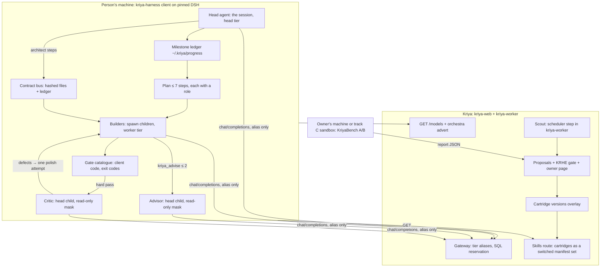
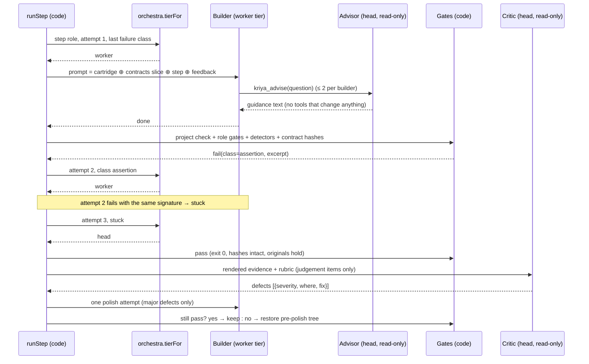

# Harness 2.0: architecture (track H, programme W "the Workforce")

Status: **Proposed** (2026-11-23). Nothing here is built. Owner brief:
`intent.md` in this folder plus the owner's chat message of 2026-11-23.
Track H rules, the harness-upgrade rules (`harness_upgradation/`), Loop v2,
KRHE and AGENTS.md apply in full. Starting point: FORENSIC_AUDIT.md.

## 1. The thesis, made testable

A model's raw skill is fixed. What the harness controls is **how much of a
task the model has to get right unaided**. For a delivered result:

```
P(correct delivery) = P(all gates pass) × (1 − f)
```

where `f` is the probability that the gates pass on wrong work (gate
false-pass rate). Two levers follow, and only two:

1. **Raise P(all gates pass) under a budget**: small steps with one role's
   context, typed contracts, exact failure feedback, best-attempt restore,
   and the strong model only where the cheap one is stuck.
2. **Drive `f` towards 0**: more and better deterministic gates (rendered UI,
   live stack, tenant probes, originals re-run). A gate is worth more than a
   prompt: a prompt raises the chance of good work, a gate refuses bad work.

For a plan of `k` steps in series, `P(plan) = Π P(step_i)`. Seven steps at
0.9 each give 0.48; at 0.98 they give 0.87. So the design spends its effort
on per-step reliability (verifier + retries + escalation), not on longer
prompts. With up to `T = 4` attempts and per-attempt success `p_t`,
`P(step) = 1 − Π_{t=1..T}(1 − p_t)` when attempts are roughly independent;
best-attempt restore (Loop v2) is what keeps a bad attempt from lowering
later `p_t`.

"Frontier-level output from a cheap model" is defined operationally, per
discipline `r`, on its seed set `D_r` (EVALUATION_PLAN §2):

```
pass(worker + harness, D_r) ≥ pass(head solo, D_r) − 5 points
cost(worker + harness, D_r) ≤ 0.4 × cost(head solo, D_r)
safety(worker + harness)    ≤ safety(head solo)    componentwise (escapes, leaks, constraint breaks)
```

These are **targets**. Until EVALUATION_PLAN's runs say otherwise, no
document, screen or release note claims them (F-07).

## 2. Layers



What runs where never changes: model loop and gates on the person's
machine; gateway, skills and owner pages on `kriya-web`; the scout's
fetching and distilling in `kriya-worker`; benchmarks never on Kriya's
servers (KU-ADR-15).

## 3. Intent component → real seam

| Intent (`intent.md` §7) | Harness 2.0 home | Kind |
| --- | --- | --- |
| `dag_planner.py` | `kriya_plan` (existing) + optional `role` per step; `kriya_milestones` (new tool in `plugins/loop`) | Client, switch `KRIYA_MILESTONES` |
| `model_router.py` | `src/orchestra.js` (new, pure): tier for attempt `t` of step `s` | Client, switch `KRIYA_ORCHESTRA` |
| `contract_bus.py` | `src/contracts.js` (new): validate, hash, slice; ledger fields in the progress file | Client, switch `KRIYA_CARTRIDGES` |
| `kriya_loop.py` | Existing `src/loop.js` `runStep` (two new optional inputs: `tierFor`, `afterPass`) | Client |
| `cartridges/*` | `skills-harness/kriya-role-*/` each with `SKILL.md`, an unchanged-format `kriya.json` and a sibling `cartridge.json` | Server data, switch `harness.workforce` |
| `verifiers/*` | `src/gates/*.js` (new): G-UI, G-A11Y, G-STACK, G-API, G-TENANT, G-SAST, G-SECRETS, G-FLAKE, G-DATA, G-IAC, G-SIM, G-SAN, G-EVAL, G-CONTRACT, G-DETECT | Client, switch `KRIYA_GATES` |
| `evolution/domain_scout.py` | `lib/harness/scout/*` + one `schedulerLoop` step | Server, switch `harness.scout` |
| `evolution/sandbox_ab_bench.py` | Existing `lib/harness/bench` with per-discipline seed sets + `--cartridge` | Owner's machine / track C |
| `evolution/proposal_reporter.py` | `lib/harness/scout/proposal.ts` + `/owner/harness/evolve` page | Server |
| `status.md` ledger | `~/.kriya/progress/<project>/<session>.json` (existing) + `milestones.json` | Client |

## 4. One step, end to end (all switches on)



Properties enforced by code, not by prompts:

- **Pass is only an exit code** (existing H14a) plus gate exit codes. The
  critic and the advisor never decide pass, fail or done.
- **Polish is monotone.** A polish attempt is kept only if every hard gate
  still passes; otherwise the tree goes back to the passing snapshot
  (`restoreTree`, already used by v2). Taste can only improve a passing
  result, never break it.
- **Attempts stay ≤ 4 per step** (`MAX_ATTEMPTS`). The polish attempt counts
  as one of the four; it runs only if attempts remain.
- **Contracts can't drift silently.** A step whose role doesn't own a
  contract and changes it fails with class `contract changed` (ORCHESTRA §5).

## 5. Routing and escalation (formal)

Attempt `t ∈ {1..4}` of step `s` with role `r` gets tier

```
τ(s, t) = head    if t > E(r)
          head    if stuck(s, t)
          worker  otherwise
stuck(s, t) = t ≥ 2 ∧ sig(t−1) = sig(t−2)         (same failure signature twice; v2 `sig`)
never escalate when class(t−1) = environment      (a stronger model can't install a tool: blocked, ask)
```

**Interaction with the loop guard (on by default since 2026-11-05).** Today
`runStep` blocks a step as *stalled* when the same failure signature repeats
and the builder changed no file (`src/loop.js` ~l.398). That is exactly a
stuck worker, so without a rule escalation would never reach it. With the
orchestra on: if the stall condition is `untouched` (not `cantRun`), the
attempts used are < 4 and no head-tier builder has run on this step yet,
the next attempt runs on the head instead of stalling; if the head also
repeats the signature untouched, the step stalls exactly as today. A
`cantRun` stall (exit 126/127) is never escalated. Off, the guard is
unchanged (WT-ORC-09).

`E(r) ∈ {0, 1, 2, 3, 4}` is the escalation point per role; default 2
(attempts 3 and 4 on the head), `E = 4` means never, `E = 0` means
head-only. Precedence: the role `architect` is always 0 (code);
otherwise the profile's `escalateAfter` if set, else the cartridge's
default, else 2. `E` is a **`HarnessProfile` field** (`escalateAfter`), so KRHE's
existing propose → probe → gate loop tunes it from measured runs; no new
optimiser is written.

Why a threshold and not a learned router: escalation pays when
`(p_head − p_worker(t)) · V > c_head − c_worker` for task value `V`. The
`p`s per (role, failure class) are unknown until measured; a single integer
per role is attributable, bounded and testable with KRHE's paired sign test,
where a classifier would need data we don't have and could not be gated
(RESEARCH T-03).

Spend bound: worst case per step is `E` worker builders + `(4 − E)` head
builders + `≤ 2` advisor calls per builder + 1 critic. Every call is
reserved in SQL by the gateway before it is sent, against the plan's monthly
cap. Nothing here can exceed the cap; it can only reach it sooner, which the
existing `cap_reached` refusal already handles.

## 6. Configuration surfaces

| Who | Where | What |
| --- | --- | --- |
| Owner | `/owner/config` → Kriya Harness | `harness.workforce`, `harness.orchestraHead`, `harness.orchestraWorker`, `harness.cartridgeOverlay`, `harness.scout`, `harness.scoutEveryDays`, `harness.scoutMonthlyInr`, `harness.scoutMaxFindings` (DATA_MODEL §3) |
| Owner | `/owner/harness/evolve` (new) | Scout sources, findings, proposals, bench evidence, approve / reject / roll back cartridge versions, freeze |
| Owner | Plans | Both orchestra tiers must be in the plan's `allowedTiers`, else the advert is withheld for that person |
| Person | `kriya` flags / env | `--cartridges`, `--orchestra`, `--gates`, `--critic`, `--milestones` (all default off until measured) |
| KRHE | `HarnessProfile` | `cartridges`, `orchestra`, `gates`, `critic`, `milestones` booleans; `escalateAfter` 0–4 |

## 7. Invariants (Harness 2.0 adds none that weaken an existing one)

1. Identity, tenancy, risk classes, modes, approvals, sandbox, egress, caps
   and prices are unchanged. No field in any cartridge, contract, profile or
   proposal can name one of them (E3 list, SELF_EVOLUTION §7).
2. A model never writes a gate, a gate argument, a detector or a pass
   condition. Cartridges reference gates by id from the client's catalogue.
3. The client sends only tier aliases; the server maps aliases to models.
   The orchestra advert names aliases, never model ids.
4. Off means off: every new switch defaults off; off, prompts, schemas,
   tools, `/models`, the skills catalogue and `kriya_verify` output are
   byte-identical to 0.2.5 (WT-REG-01/02).
5. Web content the scout reads is untrusted data. It reaches a cartridge
   only as a proposal the owner approves, after lint and a benchmark; it is
   never executed and never reaches a person's session unreviewed.
6. Every gate targets loopback only; every live stack is local.
7. No claim of superiority over any model or product without
   EVALUATION_PLAN evidence and RG-9.
