# Production delivery and stability

Part of Harness 2.0 (second round, 2026-11-23). How work leaves the
person's machine as a deployed, checked, reversible release, and how the
harness itself stays stable. Client plugin `plugins/deploy`, gates
G-RELEASE and G-DEPLOYED, `kriya doctor` gate self-tests. Switches
`KRIYA_DEPLOY` (default off), `KRIYA_GATES`.

## 1. The path to production

```mermaid
stateDiagram-v2
  [*] --> built: plan done, every step verified
  built --> ready: G-RELEASE passes on this commit (local, production build)
  built --> fix: G-RELEASE fails → new plan step (person says yes)
  ready --> preview: deploy preview (approval; Auto refuses)
  preview --> smoked: G-DEPLOYED passes on the captured preview URL
  preview --> fix: smoke fails
  smoked --> production: deploy production (approval of the exact command, target and commit)
  production --> live_checked: G-DEPLOYED on the production URL
  live_checked --> [*]: receipt written
  production --> rolled_back: smoke fails → rollback offered (approval)
```

Rules enforced by code: no production deploy without a `ready` and a
`smoked` record **for the same commit**; no deploy step in Auto or Read
only; every deploy is an approval card showing provider, target
(preview/production), project, commit and the exact command.

## 2. G-RELEASE (local, before anything leaves)

The person confirms once per project (`kriya release use --build "<cmd>"
--start "<cmd>" --port <n>`), stored in `~/.kriya/release.json`, the same
trust model as `kriya verify use`. Then, on the plan's last verified commit:

| Check | How | Fails when |
| --- | --- | --- |
| Production build | The confirmed build command | Non-zero exit |
| Production server | If the folder sandbox lets a command listen on loopback (W17 spike S2, per platform), the confirmed start command on a free loopback port, stopped in `finally`; otherwise the person starts it and confirms its URL (`kriya release use --app`), as with `kriya stack use`. Wait for the health route (contract `x-kriya-health`, else `/`) | Doesn't answer 2xx within 60 s; neither path available ⇒ the rendered-quality line is `not_checked` and `ready` is withheld |
| Rendered quality | G-UI, G-A11Y (and G-3D where a scene route exists) against the **production** server, not the dev server | As those gates |
| Environment completeness | Detector `REL-ENV`: every `process.env.X` / `import.meta.env.X` / `os.environ["X"]` read in source appears in `.env.example` (names only, never values) | A variable the deployment wouldn't know to set |
| Bundle budget | Sizes of the build output's JS/CSS per route (from the framework's build manifest when present, else the output folder) | Over the budget in `release.json` |
| Migrations | `DB-DROP`, `OPS-MIGRATE-LOCK` as **errors** here (warnings elsewhere): a destructive or locking migration needs an explicit two-step plan in the contract | Unplanned destructive/locking migration |
| Dependencies | Lockfile present and in sync (`npm ci --dry-run` or the package manager's equivalent, offline where it supports it); licences of production dependencies from their `package.json` against an allow-list (MIT, Apache-2.0, BSD, ISC, MPL-2.0 file-level) | Missing/unsynced lockfile; disallowed licence |
| Known vulnerabilities | The package manager's audit, **only if** the person enabled it (`--audit`), because it contacts the registry | Critical advisory in a production dependency |
| Secrets | G-SECRETS over the whole release diff | Any finding |

`ready` is computed by code from these results; the Proof panel shows each
line (HARNESS_UX §4).

## 3. Deploy adapters (`plugins/deploy`)

A deploy runs the provider's own CLI, signed in by the person on their
machine (credentials never read; GROUNDING_AND_CONNECTORS §1). Each adapter
is code with fixed argv, a URL-capture pattern and a host pattern. The
table is the **intended** shape; every flag and pattern is verified against
the provider's current CLI documentation in W17 spike S1 before code, and
an adapter whose CLI behaviour can't be confirmed isn't shipped:

| Adapter | Preview | Production | URL host must match |
| --- | --- | --- | --- |
| Vercel | `vercel deploy` | `vercel deploy --prod` | `*.vercel.app` or a confirmed domain |
| Netlify | `netlify deploy` | `netlify deploy --prod` | `*.netlify.app` or a confirmed domain |
| Cloudflare Pages | `wrangler pages deploy <dir> --branch kriya-<slug>` | `wrangler pages deploy <dir> --branch <production branch>` | `*.pages.dev` or a confirmed domain |
| Fly.io | none (no preview concept assumed) | `fly deploy` | `*.fly.dev` or a confirmed domain |
| Git-push providers (e.g. Render) | Push of a `kriya/*` branch with the provider's preview environments | Merge by a person (never by the harness) | Confirmed domain |

- **The URL is captured by code** from the CLI's output with the adapter's
  pattern, never taken from model text, and must match the host pattern;
  otherwise the deploy is recorded as "URL not confirmed" and no smoke runs.
- **Never run by the harness:** migrations against a hosted database
  (`supabase db push`, `prisma migrate deploy` against a remote URL…),
  changes to production environment variables or secrets, DNS changes,
  deletions. These are the person's (AGENTS.md: never modify production
  data). The harness writes the exact command and why into the receipt for
  the person to run.
- **Rollback:** each adapter names its rollback command where the provider
  has one; it is offered as an approval when a production smoke fails, and
  always written into the receipt.

## 4. G-DEPLOYED (the one non-loopback gate)

GATES rule 4 keeps every gate on loopback. Checking a deployment needs one
narrow exception (decision WD-21):

- Target: only the URL captured in §3, only that host.
- Method: `fetch` with `GET`/`HEAD` only; no browser (the agent browser stays
  localhost-only), no cookies, no credentials, no request body, no probes,
  no fuzzing; ≤ 20 requests per run; redirects followed only within the same
  host.
- Checks: each route in `release.json` answers 2xx with the expected
  content type and a contract text marker; TLS valid; the health route
  answers; security headers present per the project's config
  (`Content-Security-Policy`, `Strict-Transport-Security`,
  `X-Content-Type-Options`, `frame-ancestors`/`X-Frame-Options`), gated
  only for headers the config lists; latency reported, never gated.

## 5. Stability of the harness itself

| Concern | Design |
| --- | --- |
| Crash or kill mid-step | DSH's JSONL session log is the truth; Kriya's ledgers are written temp + rename (`writeJson`); on restart the milestone ledger and checkpoints say where things stand; an attempt cut off mid-build is `interrupted` (existing), not a failure |
| A gate hangs | Per-gate 5-minute limit and the builder's `turnMinutes`; child processes in their own process group, killed on time-out; the dev/production servers a gate started are stopped in `finally` |
| Ports and leftovers | Gates take free loopback ports; started servers and Chrome pages are tracked and closed on exit (existing browser close-on-exit) |
| Flaky verdicts | Gates are deterministic by construction (seeded inputs, medians, fixed thresholds); G-FLAKE exists for the project's own tests |
| Machine differences | `kriya doctor` runs **each gate's self-test** (its clean and mutant fixtures in a temp folder) and prints a capability matrix: which gates work here (Chrome, WebGL, psql, Semgrep, toolchains) and which will read `not_checked` |
| Bug reports | `kriya report` writes a redacted bundle: ledgers, gate results and evidence hashes, versions, profile id; no file contents, prompts, URLs' query strings or secrets; the person attaches it themselves |
| Upgrades of DSH | `check:pins`, `check:seams`, `DSH_UPGRADE.md`; the orchestra's seam (`agentOptions`) and the gates' browser hooks get their own seam tests (WT-ORC-02, WT-GATE-3D-00) |
| The harness's own UI | Its CI runs G-UI and G-A11Y against the Kriya Harness Web UI (dogfooding): 360/1440, light/dark, contrast on the glass panes, no console errors |
