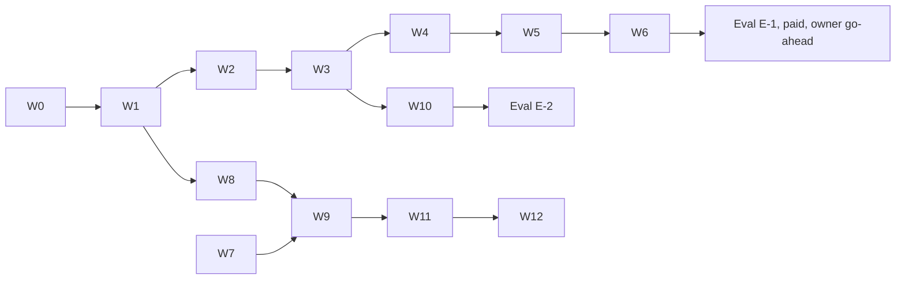

# Harness 2.0: implementation plan (phases W0 – W12)

One phase per session (root `status.md` rules). Each phase lists its
decisions (must be approved first), exact steps, tests, exit checks and
rollback. "Off" in every exit check means all new switches at their
defaults. Commands:

```bash
env -u OPENROUTER_API_KEY npm run check          # Kriya-Tavi
npm test && npm run check:seams && npm run check:pins   # kriya-harness
```

Order and why: spikes first (W0) so no code rests on an unproven DSH seam;
cartridges and gates before the orchestra's benefits can be measured; the
Scout last, because it feeds a pipeline (bench → gate → owner) that must
exist before anything it proposes can be judged.



## W0. Baseline and spikes (no product code)

Decisions: none.

1. `git status` in both repositories; record and keep the person's changes.
2. Run both check commands; record exact counts in `status.md`.
3. **S1 (agentOptions with an alias):** in a scratch test in
   `kriya-harness/tests/workforce/spike-s1.test.js` using the existing
   scripted-model test host, spawn a child with `agentOptions: { model:
   "budget" }` while the parent runs on `balanced`; assert the child's
   requests name `budget` and the parent's `balanced`. Free (scripted model).
4. **S2 (advisor parent and mask):** prove which parent a builder's tool may
   spawn under (`maxDepth`), and that a `masks` entry hides write tools from
   that child before its first step.
5. **S3 (schema validator):** `ajv@8.17.1` is already a direct client
   dependency (MIT); confirm its draft 2020-12 entry loads and validates the
   contract schemas (GATES §4).
6. **S4 (non-invocable skills):** confirm how `plugins/kriya-tools`
   `kriyaSkills` maps account skills into DSH's catalogue and whether
   `invocation.modelInvocable: false` survives the mapping.

Exit: findings recorded in `status.md` with real output. If S1 or S2 fails,
stop: ORCHESTRA needs a revised seam and the owner is told; no fork.
Rollback: delete the spike tests.

## W1. Cartridges as data, served and mounted

Decisions: WD-01, WD-06, WD-10.

1. Server: `lib/harness/cartridges.ts` — `CartridgeFile` zod strict schema
   (CARTRIDGES §2), `buildCartridges(manifests, files)` checking each
   cartridge's `kriya.json` exists in the role set and its gate, detector and
   contract ids are known. The id lists live in `lib/harness/cartridge-ids.ts`
   (the source of truth, server first), are exported into
   `docs/kriya-harness/contract.json` by `scripts/harness-contract.ts`, and
   the client copies them into its `contract/` folder in the same release
   (the existing contract pattern; WT-CT-02 in the client compares its
   catalogue to that copy).
2. Write the 15 `skills-harness/kriya-role-*` folders: `SKILL.md` (≤ 6,000
   chars: mental model, method, rules, anti-patterns with *why*, worked
   example), `kriya.json`, `cartridge.json`. Kriya-native wording, or each
   adapted source recorded in `source` with an allowed licence (NOTICES.md).
3. `skills-harness/index.ts`: `HARNESS_ROLE_SKILL_MANIFESTS`;
   `lib/harness/default-skills.ts`: build together, add only with
   `harness.workforce` on.
4. `lib/harness/skills.ts`: with the switch on, cartridge items carry
   `cartridge` and `invocation: { modelInvocable: false }`;
   `lib/harness/contract.ts` optional fields; regenerate `contract.json`.
5. `lib/config.ts`: `harness.workforce`.
6. Client: `src/modes.js` switch `cartridges`; `plugins/loop` with it on:
   the plan step gains `role` (enum from the contract copy) only; `contracts`
   and `spec_tests` arrive with the phases that give them meaning (W3, W5),
   so the model is never offered a field that does nothing. Selection
   (CARTRIDGES §5); the cartridge section **prepended** to the 0.2.5 builder
   prompt, whose own order is unchanged (re-ordering the rest is a measured
   change for later, ORCHESTRA §6); bodies fetched once per process by
   `src/cartridges.js` (`cartridgeSource`).

Tests: WT-SK-01…04, WT-CT-01/02, WT-CAR-01…05, WT-REG-01/02.
Exit: off → byte-identical `/skills`, prompts, plan schema; on → a builder
for a `.sql` step gets exactly the database cartridge, first in its prompt.
Rollback: switch off; revert the commits (no data).

## W2. Orchestra: head and worker

Decisions: WD-02, WD-03.

1. `lib/config.ts`: `harness.orchestraHead`, `harness.orchestraWorker`;
   `/models` route: `orchestra` + `workforce` advert (DATA_MODEL §4).
2. Client `src/launch.js`: env from the advert; `src/orchestra.js`
   `tierFor({ role, attempt, history, profile, allowed })` (ARCHITECTURE §5);
   `plugins/loop` spawn adds `agentOptions.model` only when the switch is on
   and the advert is present.
3. `kriya_advise` per ORCHESTRA §3 and S2's result.
4. Ledger fields: `tier`, `advice` per run.

Tests: WT-ORC-01…08. Exit: off → spawn request structurally identical;
on, scripted model → attempts 1–2 on worker, 3–4 on head; `environment`
class never escalates; same-signature twice escalates at 2; a disallowed
alias throws before any request. Rollback: switch off.

## W3. Gate framework and the free gates

Decisions: WD-04.

1. `src/gates/index.js` (`runGates`, `REQUIRED`, loopback helper import),
   `src/gates/schema.js` (S3), `src/gates/detectors.js` (all detector ids
   of CARTRIDGES §3, each with fixture tests), G-CONTRACT, G-DETECT,
   G-SECRETS, G-FLAKE, G-TRACE.
2. `src/contracts.js`: ownership, hashing into the progress run record,
   slices by JSON Pointer; `src/failure.js` class `contract changed`.
3. `src/verify.js`: `verifyStep` accepts `gates` and combines (GATES §5).
4. Every gate: mutant fixtures in `tests/fixtures/gates/<gate>/` (GATES §6).

Tests: WT-GATE-00…, WT-CB-01…05. Exit: every gate fails on all its mutants,
passes its clean fixture; off → verify results identical.
Rollback: switch `gates` off.

## W4. Local stack, UI and accessibility gates

Decisions: WD-05.

1. `src/stack.js` + `kriya stack use|show|forget` (loopback-only, refuses
   when the project's env has a non-loopback database URL).
2. G-UI via the agent browser (viewports, schemes, console, network,
   overflow, CLS, targets, screenshots to evidence).
3. G-A11Y (project axe-core if present; built-in subset; glass backdrop
   contrast).
4. G-STACK (up/down/up, schema dump compare, RLS/policy check).

Tests: WT-STK-01…04, WT-GATE-UI-01…08, WT-GATE-A11Y-01…05, WT-GATE-STK-01…05
— all on local fixtures with a loopback server started by the test; the
G-STACK tests need a local Postgres and are skipped (not passed) without one,
recorded as skipped. Exit: as W3; Kriya's own browser check of the
cartridge on this repository's verify stack only (`.env.verify`,
`verify:guard`). Rollback: switches off; `kriya stack forget`.

## W5. API, tenant and SAST gates

1. G-API (examples, seeded boundary inputs, idempotency ×10, latency report).
2. G-TENANT (identity distinctness, paired positive control + probe,
   unchanged-object check).
3. G-SAST (local rules only; never `--config auto`).
4. Plan rules of ORCHESTRA §7: tenant-scoped matrix ⇒ a security step with
   G-TENANT; spec-test steps judged red (`expect: "red"`).

Tests: WT-GATE-API-*, WT-GATE-TEN-* (mutants: an IDOR, a server returning
404 for everything, two identical tenants), WT-PLAN-01…05.

## W6. Critic, polish and the remaining gates

Decisions: WD-13.

1. `src/critic.js`: head-tier read-only child (S2's mask), input = rubric
   judgement items + G-UI evidence paths + contracts slice; output JSON
   `{ defects: [{ id, severity, where, fix }] }` ≤ 12, schema-checked;
   invalid → no defects.
2. `runStep` `afterPass`: if any `major` and attempts remain, one polish
   attempt; keep only if all gates pass, else `restoreTree` to the pass.
3. Designer direction table and token rules in `kriya-role-designer`;
   `FE-GLASS-*`, `FE-TROPE`, `FE-FONT-LICENCE` detectors.
4. G-DATA, G-EVAL (+ `kriya eval baseline confirm`), G-SAN, G-IAC, G-SIM,
   G-SIM-HEADLESS; each `not_checked` without its tool.

Tests: WT-CRI-01…05 (monotonicity: a polish that breaks a gate is
reverted, byte-compare of the tree), WT-GATE-* for the new gates.

## W7. Scout: data, fetch, distil (server)

Decisions: WD-07, WD-14.

1. Migration `20271201000000_harness_workforce.sql` (DATA_MODEL §1–2) with
   rollback; `db/schema.ts`; RLS tests.
2. Settings `harness.scout*`.
3. `lib/harness/scout/{sources,run,distil,findings}.ts`; scheduler step;
   janitor statement; spend through `reserve_scout_spend`.
4. Owner page skeleton: sources (add/disable), runs, findings (read-only).

Tests: WT-DB-01…04, WT-SC-01…08 (lease, cap 0 → no model call, verbatim
quote check, second-fetch rule, dedupe, `FOREIGN` marking, errors don't stop
the scheduler). All with a scripted model and fixture pages; no real fetch
in `npm test`. Exit: owner page browser check at 360/1280, light/dark, on
the verify stack. Rollback: switch off; migration rollback block.

## W8. Per-role KriyaBench seed sets

1. `lib/harness/bench/seed-role-{frontend,backend,security}.ts` first, ≥ 30
   tasks each, each with hidden grader, restored originals, safety probes;
   licences checked per source. Other roles later, same template.
2. `--level role-<role>`.

Tests: HT-BEN-* unchanged; WT-BEN-01 (seed hashes stable, graders hidden).

## W9. Candidates, lint, evidence, owner approval

Decisions: WD-07, WD-08.

1. `lib/harness/scout/{draft,lint,proposal}.ts`; candidates table writes;
   transition functions.
2. Bench flag `--cartridge-candidate`; client `KRIYA_BENCH` /
   `KRIYA_CARTRIDGE_FILE` (bench only).
3. Owner page: proposal view (SELF_EVOLUTION §4), download candidate,
   upload reports, server-side `gate()` verdict, approve / reject / typed
   reason for hold, freeze.

Tests: WT-LINT-01…12 (each rule of §7 with a refusing fixture), WT-PRO-01…06
(rejected can't be approved; evidence hash mismatch refused; verdict
computed only by `gate()`), owner-only access (WT-SEC-01).

## W10. Milestones and KRHE fields

Decisions: WD-12.

1. `src/milestones.js`, `kriya_milestones`, resume section.
2. Profile fields and propose moves (CHANGE_IMPACT §2 rows).

Tests: WT-MS-01…06, HU-EV-01/03 unchanged ids, WT-EV-01/02.

## W11. Overlay, canary, rollback, outcome counts

Decisions: WD-09, WD-15.

1. `harness.cartridgeOverlay`; `deviceSkills` overlay with canary hashing.
2. Version transitions; one-click rollback; ETag change.
3. The HD-24 sharing opt-in on the client: no implementation exists today
   (searched `src/`, `plugins/mirror/`, 2026-11-23). Add `kriya share
   on|off|status` (default off, stored in `~/.kriya`, shown in the Web UI's
   settings) before any count is sent.
4. Mirror `cartridgeOutcomes` (opt-in only); guard rule (SELF_EVOLUTION §6).

Tests: WT-OV-01…07.

## W12. Optional bench dispatch and release

1. Dispatch kind `bench` to the owner's own device under the Control Center
   (owner only, spend cap per dispatch), if the owner wants it.
2. Client release notes; `contract.json`; SAFETY.md lines for gates and
   stack; nothing turned on by default.

## Second round phases (W13 – W19)

Designed 2026-11-23 (THREE_D_AND_CREATIVE, GROUNDING_AND_CONNECTORS,
DELIVERY_AND_STABILITY, HARNESS_UX, DIFFERENTIATORS). They depend on W1–W6;
W13–W19 can start after W6 in this order, except W15 (grounding), which
only needs W1 and is the cheapest lift for cheap models.

### W13. Graphics cartridge and G-3D (WD-17)

1. Spike S1: headless WebGL2 on the installed Chrome (macOS, Linux CI,
   Windows CI): context created? renderer string? Record.
2. `kriya-role-graphics` (SKILL.md, kriya.json, cartridge.json);
   `scene_direction.json` schema; detectors `GX-*`, `FE-ASSET-LICENCE`.
3. `src/gates/three.js`: init-script wrapper, not-blank/alive, budgets with
   code ceilings, leak cycle, context loss, resize/DPR, reduced motion.
Tests: WT-GATE-3D-00…10 on fixture scenes (blank canvas, shader error,
leaking scene, 2,000-draw-call scene, no context-loss handler, uncapped
DPR, clean scene). Exit: every mutant fails, clean passes; no WebGL ⇒
`not_checked`.

### W14. Explore (WD-18)

1. `explore` on plan steps (roles frontend, designer, graphics; 2–3);
   `runStep` explore path with `restoreTree` between takes; direction hints
   by code; winner restore; others listed in `kriya undo --list`.
2. Explore card (UI) with keyboard picks; headless fallback to the critic.
Tests: WT-EXP-01…07 (bound N + 1 ≤ 4; failed take counts; winner tree
byte-equal to its snapshot; no pick ⇒ critic's first; Read only refuses;
dev-server reload wait).

### W15. Grounding (WD-20)

`plugins/grounding`: `api_lookup`, `api_changes`, `api_version`; late
prompt hint. Tests: WT-GRD-01…06 (TS `exports` types resolution,
`@types` fallback, `.pyi`, nothing executed (spy on `child_process` and
`require`), size bounds, offline).

### W16. Repository tools, connect states, CI loop, MCP P3a (WD-19)

0. Spike S0: minimum `gh` version for `--json` on `pr checks` and
   `--body-file` on `pr create`; `git switch` needs git ≥ 2.23. Below the
   minimum, the tool says which version is needed and does nothing.
1. `base` commit recorded by `kriya_plan`; `onOriginals` and the strict
   loop's HEAD reads take it (optional argument, default `"HEAD"`).
2. `plugins/repo` tools of GROUNDING §2 with their rules; Overview →
   Project track states (§3); `.gitignore` check.
2. CI polling as a DSH background job (spike S1: a plugin-owned job via
   `ctx.jobs`; fallback: poll only while the session is open).
3. MCP P3a per `WORKSPACE_PANEL_SKILLS_PLUGINS.md` §5 plus GROUNDING §4
   (spike S2: where `dsh-mcp-client` keeps OAuth tokens).
Tests: WT-REPO-01…15 (branch names; never default branch; never force;
G-SECRETS before push; `.env` never committed; credentials stripped from
remotes; untrusted marking of PR/CI/issue text; Auto refuses outward;
`gh` signed out ⇒ guidance, no credential prompt), WT-MCP-01…05.

### W17. Release, deploy, doctor (WD-21, WD-22)

1. Spike S1: verify each adapter's CLI flags, output and URL pattern from
   the provider's current docs; drop any adapter that can't be confirmed.
   Spike S2: can a command started under the folder sandbox listen on
   loopback (macOS, Linux)? Decides who starts the production server.
2. `kriya release use`; G-RELEASE; `plugins/deploy` adapters; URL capture;
   G-DEPLOYED; rollback offers; refusals of WD-22's actions.
3. `kriya doctor` gate self-tests and capability matrix; `kriya report`.
Tests: WT-REL-01…08, WT-DEP-01…10 (production refused without `ready` and
`smoked` on the same commit; URL from code only; host mismatch ⇒ no smoke;
G-DEPLOYED method/host/request-count limits; hosted-DB migration command
refused), WT-DOC-01…03.

### W18. Interface (WD-23)

1. Spikes: S1 sidebar section seam for Missions; S2 DSH command UI
   registration for Kriya commands. Fallbacks: Missions only in the main
   panel; commands only as buttons.
2. `plugins/runstrip`, gate chip component, tracks Live/Proof/Changes/
   Project (the old track ids kept as aliases for one release if the owner
   chooses), time scrubber, contract map, Mission Control panel, cost by
   tier.
3. Dogfood CI run of G-UI/G-A11Y on the Web UI.
Tests: WT-UX-01…12 (each surface's five states, strip empty when idle =
0 px, no layout shift on chip changes, keyboard map, live-region once per
verdict, 44 px targets at 360), browser check with screenshots at 360/1440,
light/dark.

### W19. Receipts (WD-24)

`receipt.json/.md` at task end; hash chain; `kriya receipt verify`; PR body
from the receipt. Tests: WT-RCP-01…06 (every field traced to ledger/gates;
editing any run record breaks verification at that link; no file contents,
prompts, query strings or secrets in a receipt).

## Evaluations (paid, each needs the owner's go-ahead and budget)

EVALUATION_PLAN E-1…E-5 run between phases as marked in the diagram. No
switch's default changes without its evaluation's evidence and the owner's
decision recorded in `status.md`.
