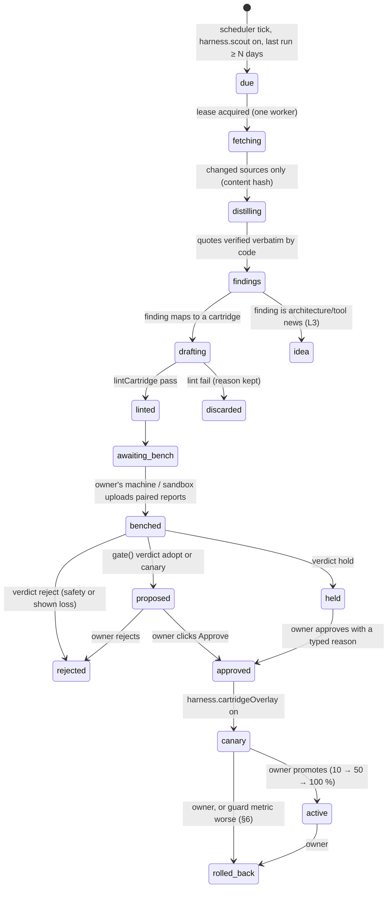

# Self-evolution: the R&D Scout and governed recursive improvement

Part of Harness 2.0. This **extends Kriya Evolve / KRHE**
(`ENGINE_AND_EVOLUTION.md` §4, `RECURSIVE_HARNESS_EVOLUTION.md`); it is not a
second improvement system. Server code in `lib/harness/scout/`, owner page
`/owner/harness/evolve`, switch `harness.scout` (default off).

## 1. What "improves itself" means, precisely

Three things can change, at three speeds, each with its own guard:

| Level | What changes | Proposed by | Decided by | Speed |
| --- | --- | --- | --- | --- |
| L1 Knowledge | Cartridge guidance text, judgement items, added gate/detector ids, activation keywords | Scout (from the web) or failure mining (from runs) | **Owner's click**, after lint + bench (E2, WD-07) | Every `scoutEveryDays` |
| L2 Configuration | `HarnessProfile` fields: `escalateAfter`, `critic`, `gates`, `cartridges`, `orchestra`, budgets | KRHE `propose` (one-factor, from evidence) | KRHE `gate()` + owner activation (KU-ADR-16, unchanged) | Per paid probe turn |
| L3 Capability | New gates, detectors, cartridge roles, architecture | Scout `idea` findings (papers, new tools) | Human-reviewed engineering through this repository's normal process | Never automatic |

The recursion is: runs produce evidence → evidence and new knowledge produce
candidates → candidates are measured on the same verifiers → winners become
the incumbent → the incumbent produces new evidence. The model's weights
never change; the harness around it does, and only through gates that a
candidate can't influence (hidden graders, restored originals, safety
probes; KriyaBench §4.3).

What never changes by itself (E3, §7): risk classes, modes, approvals,
sandbox, egress, gates' pass logic, `REQUIRED`, limits, caps, prices, the
gateway, disclosures, and anything in `lib/agent/policy.ts`.

## 2. The pipeline



### 2.1 Schedule (owner config)

| Setting | Default | Meaning |
| --- | --- | --- |
| `harness.scout` | `off` | The whole pipeline |
| `harness.scoutEveryDays` | `7` | 1–30: a run starts when the last finished run is at least this old |
| `harness.scoutMonthlyInr` | `0` | The scout's model and fetch spend per calendar month, ₹; **0 means it never calls a model** (fetch-and-diff only). Enforced in SQL (§5) |
| `harness.scoutMaxFindings` | `20` | 1–100 findings drafted per run, highest-priority first |

The step lives in `worker/index.ts` `schedulerLoop`, after the fact job,
behind its switch, errors caught. That loop **awaits each step inline every
30 s** (`SCHEDULER_POLL_MS`) and also expires approvals and starts due
schedules, so the scout step must stay short: each tick does **at most one
unit of work** (one fetch, or one distil call, or one draft call, or one
confirming re-fetch), with a 60-second abort signal on it, then returns. A
run is therefore resumable state, not a long job: the run row
(`harness_scout_runs`, unique partial index on `status = 'running'` as the
lease) plus per-source progress (`harness_scout_snapshots`) say what is
next. "Due" is one indexed query on the latest run's `finished_at`.

### 2.2 Sources (owner-listed, empty by default)

`kriya.harness_scout_sources`: `{ discipline, url, kind: changelog |
advisory | standard | paper_feed | guideline, active }`. Only the owner adds
rows (`requireOwner`). As with `FACT_TARGETS`, a source is added only after
a person has read the page. Suggested starting list for the owner to review
(not inserted by any migration):

| Discipline | Candidate sources |
| --- | --- |
| Frontend / designer | MDN web docs release notes, web.dev, W3C WCAG updates, Apple Human Interface Guidelines (Materials), the release notes of the framework the owner's users use most |
| Backend / database | PostgreSQL release notes, Supabase changelog, OWASP API Security Top 10 |
| Security | GitHub Advisory Database, NVD feeds, OWASP Top 10, CWE Top 25 |
| DevOps / cloud | Docker and Kubernetes release notes, OpenTofu releases, CIS benchmarks pages |
| ML / AI | arXiv listing pages for cs.LG and cs.SE (titles and abstracts only), framework release notes |
| QA / SDET | Playwright release notes, the test runners' changelogs |

### 2.3 Fetch and diff

- `webFetch(url, 12_000)` (existing, `lib/web.ts`), one source per tick,
  at most 50 sources per run. Without the web service configured
  (`isWebConfigured()` false) the run ends `failed` with that reason and
  the owner page says so; nothing else is attempted. Each fetch is a `web_fetch` row in
  `kriya.resource_usage` (existing kind).
- The text's sha256 is compared to the source's last hash; unchanged ⇒
  skipped, no model call. Only the hash and the changed paragraphs (≤ 4,000
  chars) are kept, for 30 days.

### 2.4 Distil (one model call per changed source)

- Model: `createGatewayModel(await modelForTier("budget"))` (existing
  helpers), real cost read with `usageFromMetadata`, platform
  cost, metered as kind `scout_model` (new), reserved against
  `harness.scoutMonthlyInr` **before** the call.
- The prompt marks the page as untrusted (`FOREIGN`), asks for JSON only:
  `[{ discipline, kind: practice | deprecation | vulnerability_class |
  tool_change | idea, claim ≤ 300 chars, quote ≤ 400 chars }]`, ≤ 5 per source.
- Code then decides, not the model:
  1. `quote` must be found verbatim (normalised) in the fetched text
     (`quoteFound`, `lib/radar/extract.ts`, reused); otherwise dropped.
  2. `discipline` must be a known role; otherwise dropped.
  3. A second fetch of the same URL ≥ 1 hour later (next scheduler tick)
     must still contain the quote before the finding is drafted (the fact
     job's two-fetch rule).
  4. Findings are deduplicated by (discipline, normalised quote hash).
  5. A finding seen on two different domains is labelled
     `corroborated`; otherwise `single source`. Shown, not blocking.

### 2.5 Draft a candidate

For each finding of kind ≠ `idea`, one model call (same tier and cap)
receives the **current** cartridge text and the finding, and returns a
complete replacement `SKILL.md` body plus optional judgement items and
optional added gate/detector ids. Code then:

1. Runs `lintCartridge` (§7). Fail ⇒ `discarded` with the reason.
2. Bounds the change: ≤ 30% of lines changed, ≤ `maxPromptChars`, ≤ 12
   judgement items; larger ⇒ discarded ("too large to review").
3. Stores the candidate as an immutable `harness_cartridge_candidates` row
   with the diff, the finding ids, and `status = awaiting_bench`.

`idea` findings (a new architecture, algorithm or tool) are shown to the
owner as reading, with the quote and link, and never become a candidate.
Acting on them is engineering (L3).

## 3. Benchmark: old cartridge vs candidate

KriyaBench never runs on Kriya's servers (KU-ADR-15). Two ways, both by the
owner:

1. **Command** (W9): on the owner page, "Bench this" offers the candidate
   as a file (`candidate-<id>.json`: cartridge id, base version, full
   candidate text, its sha256) and shows

   ```bash
   npx tsx lib/harness/bench/cli.ts --agent "kriya run --mode auto" --level role-frontend --profile p.json --meter "kriya usage --json" --cartridge-candidate ./candidate-<id>.json --out cand-1.json
   ```

   `--level role-<role>` and `--cartridge-candidate` are **new flags (W8,
   W9)**; `--agent`, `--profile` and `--meter` exist today. The same command
   without `--cartridge-candidate` is the incumbent arm. Arms are run
   alternately, K = 3 each (by hand until KRHE-5's one-command probing
   exists), with the same model and seed, writing paired reports. The candidate reaches the
   agent through the client's bench-only `KRIYA_CARTRIDGE_FILE` (read only
   when `KRIYA_BENCH=on`, which only the bench runner sets), so no token or
   server route is involved.
2. **Dispatch** (W12, optional): with `harness.controlCenter` on, the owner
   sends a `bench` dispatch to **their own** registered computer, which runs
   the same command under `kriya daemon`, spend-capped per dispatch. Never
   another person's device.

Evidence returns through the owner page (upload of the report files; zod-
validated; each report's sha256 and pinned `profileId`, `seedVersion`,
model id and client version checked to match the candidate's request). The
server then runs the **existing** `gate()` (`lib/harness/evolve/gate.ts`):

- infeasible (any safety count worse) ⇒ `rejected`, whatever the pass rate;
- shown loss ⇒ `rejected`;
- shown gain with cost ≤ +5% ⇒ `adopt`; promising ⇒ `canary`; else `hold`.

Per-discipline seed sets (`seed-role-<role>.ts`, ≥ 30 tasks each before an
`adopt` can be trusted; KRHE §10's power argument) are built in W8. Until a
role has its 30, its candidates can at best read `canary`/`hold`, which is
correct, not a defect.

## 4. Owner digest and approval

When a candidate reaches `proposed` or `held`, the owner gets one in-app
notification (the existing notifier; no email, SMS or push: voice rule 10 /
track-A rule 10). `SKILL_UPDATE_PROPOSAL` is a page, not a file:

| Section | Content |
| --- | --- |
| Summary | Discipline, kind, claim, `corroborated`/`single source` |
| Sources | Each quote verbatim with its URL and both fetch times |
| Diff | Line-by-line against the current version |
| Lint | Every rule checked, all green |
| Benchmark | Incumbent vs candidate: pass, Wilson 95% interval, b/c, p, Δ cost per pass, safety counts, median duration, runs, seed version, model |
| Verdict | `adopt` / `canary` / `hold` from code |
| Actions | Approve (adopt/canary), Approve with typed reason (hold), Reject, Freeze scout |

`rejected` can't be approved by anyone. Every action is an audit event
(`kriya.audit_events`, existing) with the owner's id.

## 5. Spend and abuse bounds

| Resource | Bound | Enforced |
| --- | --- | --- |
| Model spend | `harness.scoutMonthlyInr` per month | SQL: `kriya.reserve_scout_spend(estimate, cap)` sums this month's `scout_model` rows; refuses past the cap; the run stops and records `cap_reached` |
| Fetches | ≤ 50 sources per run, one run per `scoutEveryDays` | Code + run lease |
| Drafts | ≤ `scoutMaxFindings` per run | Code |
| Storage | Changed paragraphs 30 days; candidates and versions forever (immutable, small) | Janitor statement |
| Bench | Owner-started; KRHE's reservation and the plan cap | Existing |

## 6. Delivery: versions, canary, rollback

- `harness.cartridgeOverlay` off (default): approved versions are stored but
  **not served**; devices get the repository's cartridges. To ship, the
  approved diff is applied to `skills-harness/` by a normal reviewed commit
  (the version page offers the patch). This is the safest mode and the
  default.
- `harness.cartridgeOverlay` on: `deviceSkills` (`lib/harness/skills.ts`)
  serves, for each cartridge id, the active version, or the canary version
  to devices where `sha256(deviceId ‖ versionId) mod 100 < canaryPct`.
  Versions are immutable rows; the served version id goes into the
  manifest's `version`, so a device's ledger records exactly what it ran.
- **Rollback** is one click: the version's status becomes `rolled_back` and
  the previous active version is served on the next catalogue fetch (ETag
  changes). Nothing is deleted.
- **Guard metrics** need run outcomes from devices. Devices report, only
  with the person's opt-in (HD-24) and only as counts, per cartridge
  version: steps verified, steps blocked, `not checked`, undo used
  (additive field on the mirror's session summary; no content). With fewer
  than 100 steps on the canary, nothing is automatic; above it, a canary
  whose verified rate is lower than the incumbent's by a one-sided Wilson
  bound is rolled back automatically and the owner is told.

## 7. Lint and E3 guard (`lintCartridge`, pure, server)

A candidate is refused if any of these hold:

1. It changes a field other than `SKILL.md` body, `judgement`, added
   `gates`/`detectors` ids (existing in the client catalogue), or
   `activation.keywords`.
2. It removes a gate or detector, or changes `role`, `owns`, `reads`,
   `escalateAfter`, `maxPromptChars`.
3. The **added or changed lines** contain (the base text of some
   cartridges legitimately says "token" or "secret", so lint judges only what
   the candidate adds, REAUDIT RA-31): a URL; a fenced block tagged `sh`, `bash`, `zsh`,
   `shell`, `powershell`, `cmd`, `console`; the words (case-insensitive,
   whole word) `curl`, `wget`, `sudo`, `chmod`, `rm -rf`, `eval(`,
   `password`, `api key`, `token`, `sandbox`, `approval`, `full access`,
   `--mode`, `ignore previous`, `system prompt`; a tool name from DSH's or
   Kriya's tool list; a mention of `lib/agent/policy.ts` or any E3 path.
4. It names a font, asset or code source without an allowed licence
   (track E rule 8 list).
5. It is over the size bounds of §2.5.

Lint is deliberately over-strict: a refused good idea costs a missed
improvement; an accepted bad one could reach every device. The owner can
still copy a refused idea into a normal reviewed commit.

## 8. Why this can't run away

- No step in the loop executes fetched content; fetched text reaches a
  model only as quoted, `FOREIGN` data, and its output reaches a cartridge
  only after code lint, a benchmark with safety probes, and the owner.
- The grader is out of reach: hidden tests, restored originals, safety
  probes, run outside Kriya's servers, and `gate()` reads only those.
- Spend is capped in SQL; the default cap is 0.
- The owner can freeze the scout and roll back any version in one click;
  with the overlay off, nothing approved is even served.
