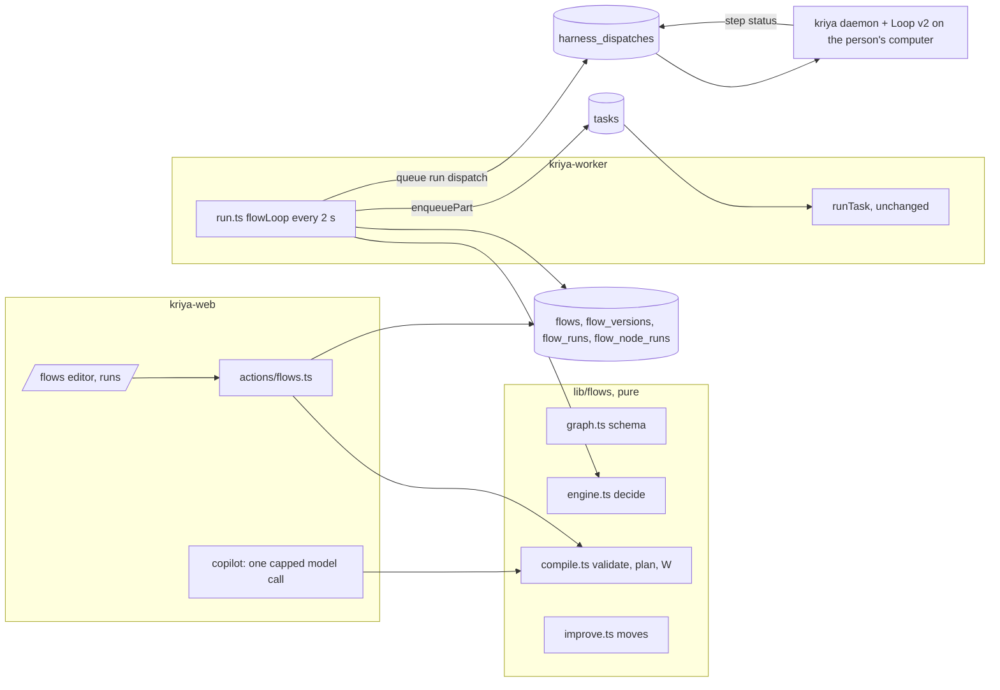
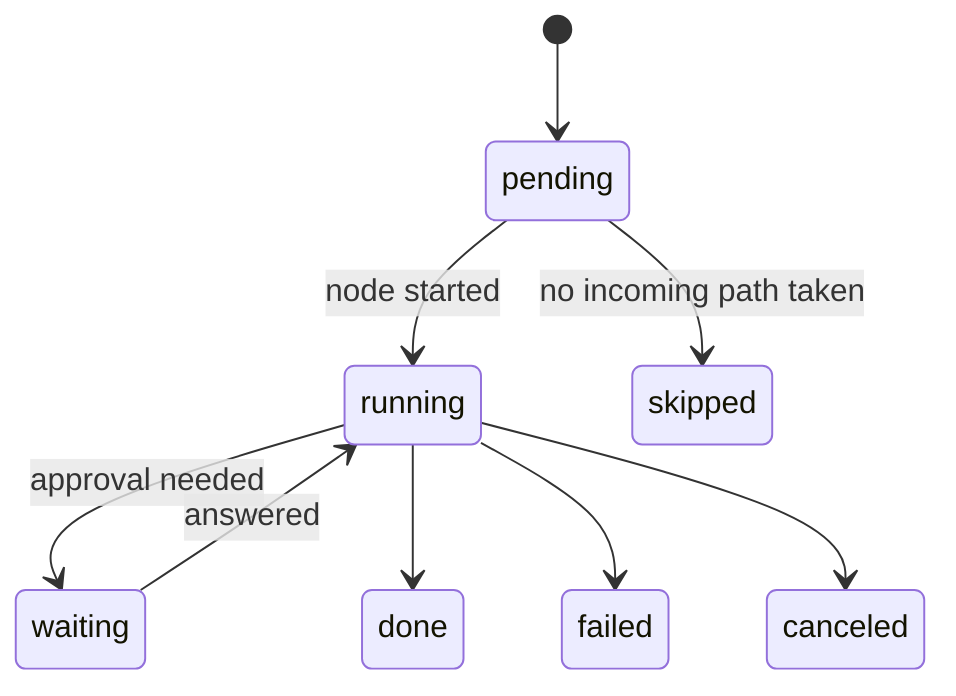
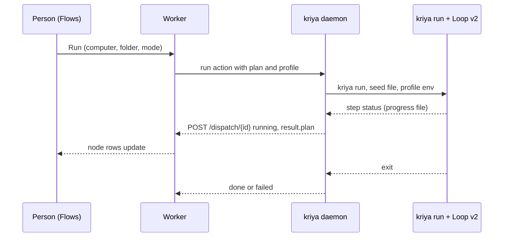

# Architecture (track S: Flows)

Decisions and alternatives: `DECISIONS.md`. Threats: `SECURITY_AND_RELIABILITY.md`.

## 1. Picture



## 2. Ownership

| Concern | Owner | Note |
| --- | --- | --- |
| Graph shape, validity, worst case | `lib/flows/graph.ts`, `compile.ts` | Pure; browser and server share them |
| What happens next | `lib/flows/engine.ts` | Pure |
| Rows, leases, starting nodes | `lib/flows/run.ts` | Worker only; only writer of run rows |
| Running an agent | `runTask` (unchanged) | Tools, approvals, receipts, metering |
| Bounded iteration on a computer | Kriya loop v2 (client, unchanged semantics) | A device flow supplies its plan |
| Agent kernel on a computer | DSH/Cordis (pinned) | Not touched |
| Which configuration is better | KRHE gate (`lib/harness/evolve/gate.ts`) | Reused as it is |
| Risk class, approvals | `lib/agent/policy.ts` | A graph has no field for them |

## 3. Graph model

`lib/flows/graph.ts`, zod `.strict()` throughout, so unknown fields are refused.

```ts title="shape"
FlowGraph = {
  schema: 1, target: "cloud" | "device",
  inputs: [{ key, label, required, long? }],
  nodes: [{ id, type, title, parent?, at: { x, y }, config }],
  edges: [{ id, from, port, to }],
  limits: { budgetInr?: number },
  profile?: HarnessProfile,      // device only
}
```

| Type | Ports out | Config | Runs |
| --- | --- | --- | --- |
| `start` | `out` | — | Code |
| `agent` | `out`, `error` | `agentId`, `prompt`, `retries` 0–2 | A task |
| `check` | `pass`, `fail` | `subject`, `rule` | Code |
| `approval` | `approved`, `declined` | `message`, `expiresHours` | The person |
| `merge` | `out` | — | Code |
| `loop` | `done`, `exhausted` | `maxIterations`, `until` | Region |
| `end` | — | `result` | Code |
| `step` (device) | `out` | `doneWhen`, `files` | Loop v2 |

Check rules: `contains`, `not_contains`, `min_chars`, `max_chars`, `equals`,
`number_at_least`, `number_at_most` on a value, and `tool_ran` (a tool of the
named agent node succeeded at least N times, from `tool_executions`). No regular
expressions: user patterns could hang the worker.

References: `{{input.key}}`, `{{nodeId}}`, and in a loop `{{loop.iteration}}`,
`{{loop.feedback}}` (why the last round's check failed).

## 4. Compile

`compile(graph)` returns `{ ok, issues, plan }`. Issues carry a node id, a
severity and a sentence, and draw on the canvas. Errors: duplicate ids, edges
across a region, a cycle, more than one `start`, no reachable `end`, unreachable
nodes, a reference to something that doesn't run before, a loop without a body
or an `until` in it, depth above 2, W(G) above the cap, size limits, an unknown
port. Warnings: an unconnected `fail` or `declined`, no check at all. Agents are
checked to exist server-side, as the person (`assertAgents`).

`semanticHash` covers everything except positions and titles' whitespace, so a
tidy doesn't make a new version.

## 5. Execution

Rows: `flow_node_runs` (run, node, scope, attempt). `scope` is `""` or
`loop#2` or `loop#2/inner#1`, so an iteration is data, not a new graph.



`decide(plan, rows, ctx)` walks each open scope in topological order:

1. Every incoming edge resolved? A settled source with the matching port is
   *taken*; anything else settled is *dead*.
2. None taken → `skip`. Some taken → `start`.
3. A loop whose body settled: `until` passed → `done`. Otherwise output
   unchanged → `exhausted (no progress)`; at the maximum → `exhausted`; else
   next iteration.
4. A failed node with no `error` edge stops new starts; the run settles when
   nothing is active.

`applyDecisions` runs code nodes in place and repeats until nothing changes, so
a chain of checks costs one pass. Agent nodes go to `enqueuePart` with key
`flow:<node run id>`, in a new thread per attempt (crew pattern). A run claims a
20-second lease first, so two workers never pass it at once; if one dies, the
next pass continues, since every step is idempotent.

Run status: `queued → running ⇄ waiting → completed | failed | canceled`.
`completed` needs an `end` reached and nothing failed. A run that stops short
(a declined gate with nowhere to go) is `failed` with the reason.

## 6. Agent node, step by step

1. Resolve references. Upstream output goes under `FOREIGN` as data, marked
   `FLOW_CONTEXT`, and `FLOW_PRIVATE` if tainted (SD-11).
2. Create the thread (owner's agent), then `enqueuePart` with the ₹ share.
3. Observe the thread's latest task, as crews do: working, needs approval,
   done, failed. Side-effect and private-read flags come from `tool_executions`.
4. Output is the last assistant text, cut to 4,000 characters.

An approval inside an agent shows as `waiting`, is answered in the Inbox or
thread as today, and resumes the same task. An `approval` node is the flow's own
gate: the person answers on the run page or Inbox; expiry counts as declined.

## 7. Device flows



Graph → plan: steps in topological order, `after` from edges (always pointing
back), `title`, `doneWhen`, `files`. `start`/`end` carry the goal and nothing
else. Profile → the env of `toEnv`; `queue()` checks the computer and folder as
for any action.

## 8. Improve and compare

`proposeFlow(graph, evidence)` returns at most five one-factor candidates, each
with its hypothesis, overhead and evidence. **Compare** starts `cases × K × 2`
runs with a shared `comparison_id`, interleaved by arm, after showing the worst
case. Each finished pair becomes a `TaskResult` shape (`passed` = completed, all
checks passed; cost from charges; safety counters zero, since a flow has no
hidden grader), and `gate()` decides. **Reject** requires a shown loss; there is
no scalar score.

## 9. Reads

`queries/flows.ts` as the person. Run pages poll `/api/flows/runs/[id]` every
1.5 s while active, 6 s in lite mode; no new stream. Node costs join
`kriya.charges` by task, and show "not priced" when a charge has no price.
