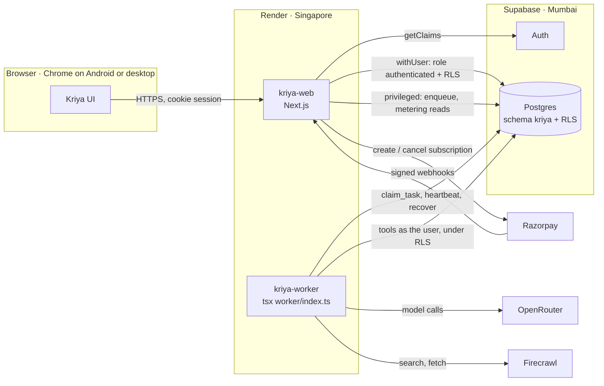
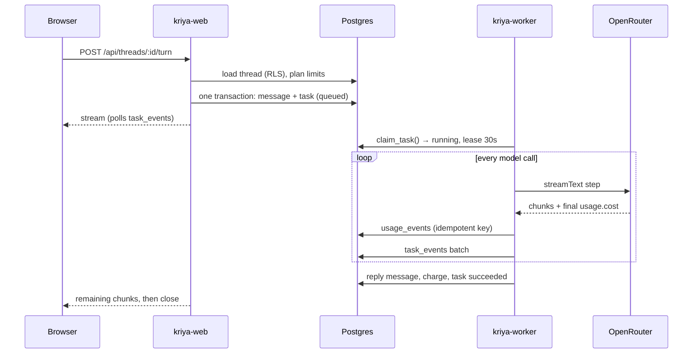

# Kriya Tavi architecture

Kriya Tavi is a Next.js 16 web app and a Node.js worker, both deployed on
Render, around one Supabase project (Auth + Postgres). Agents think through
OpenRouter and read the web through Firecrawl. Every piece of state that
matters is in Postgres; neither Render service relies on its own disk.

## A task from start to finish

1. `app/api/threads/[threadId]/turn/route.ts` authenticates, validates the
   body (text only, size limits), applies a burst limit, and calls
   `enqueueTurn` (`lib/agent/queue.ts`).
2. `enqueueTurn` loads the thread **as the user** (RLS: someone else's thread
   id finds nothing), checks the plan's daily task limit and rupee allowance
   (`lib/entitlements.ts`), resolves the routing tier, and writes the user
   message and a `queued` task in one transaction. A partial unique index
   allows one active task per thread; an idempotency key makes a resent
   message return the same task.
3. The response is a stream that replays `kriya.task_events` for that task
   and follows it. Closing the tab only stops the reading; the task carries on.
   Reopening the thread re-attaches (`GET` on the same route).
4. The worker (`worker/index.ts`) claims tasks with `kriya.claim_task()`
   (`FOR UPDATE SKIP LOCKED`, per-user concurrency from the plan, users with
   fewer running tasks first) and runs them in `lib/agent/run-task.ts`.
5. `runTask` heartbeats every 5 seconds. A heartbeat that finds no lease
   (another worker took over, or the task was deleted) aborts the run; one
   that finds `cancel_requested_at` stops it cleanly. A deadline timer and a
   per-task cost budget abort it too.
6. Every model call is recorded in `kriya.usage_events`; every tool call in
   `kriya.tool_executions`. When the run ends the reply is saved, a charge is
   written once, and the task gets its final status.

## Data and tenancy

All tables live in the `kriya` schema (`supabase/migrations/`). That schema
is **not exposed** through Supabase's REST API, so the browser can't reach
any table even with the publishable key. The server reaches Postgres two ways
(`db/index.ts`):

| Path | Used for | Protection |
| --- | --- | --- |
| `withUser(userId, fn)` | Everything done on a person's behalf: pages, actions, agent tools in the worker | A transaction as role `authenticated` with the user's id in `request.jwt.claims`. RLS policies limit every query to `user_id = auth.uid()` |
| `privileged` | Task bookkeeping, metering, billing webhooks, owner console | Bypasses RLS. Each use is behind its own check: the session's user id, a verified webhook signature, or `requireOwner()` |

Composite foreign keys (`(agent_id, user_id) → agents(id, user_id)`) make it
impossible, in the database itself, to put another user's agent in your
squad or open a thread with it. Message ids come from the client, so their
primary key is `(thread_id, id)`; a forged id can't overwrite someone else's
message. Users can't write tasks, usage, charges, subscriptions or plans at
all: they only have `select` on those tables.

## Queue semantics

| Situation | What happens |
| --- | --- |
| Worker crashes or is redeployed | Lease expires (30s). `kriya.recover_tasks()` requeues with exponential backoff, unless a tool with side effects already ran, attempts are used up, or the deadline passed; then it fails |
| SIGTERM (deploy) | The worker stops claiming, its running tasks release their leases, recovery requeues them on another worker |
| Provider error (429, 5xx, timeout) | The SDK retries twice. If it still fails and nothing irreversible ran, the task is requeued on `OPENROUTER_FALLBACK_MODEL` |
| Model can't produce valid tool calls or output | Requeued once on the escalation tier, if the plan allows it |
| Person presses Stop | `cancel_requested_at` is set; queued tasks cancel at once, running ones at the next heartbeat. What was produced is kept |
| Task waits too long | Failed with `deadline` (plan's max duration + 10 minutes of queue grace) |

Every task has a step budget (plan, capped by `agent.maxSteps`), a cost
budget (plan's `max_task_cost_micro_usd`) and a wall-clock deadline. Retries
are bounded by `max_attempts` (3), so there's no switching loop.

## Models and cost

`lib/models.ts` maps three tiers (Everyday, Balanced, Expert) to OpenRouter
model ids from `/owner/config` or `OPENROUTER_*`. Agents choose a tier; the
plan decides which tiers are open. The model registry (`kriya.models`) holds
catalogue prices and declared capabilities; `npm run models:eval` records
whether a model actually passed tool-calling, structured-output and
streaming-usage checks.

OpenRouter puts `usage.cost` (in credits, 1 credit = 1 USD) in the final
stream chunk. A `metadataExtractor` lifts it into provider metadata, and
`lib/agent/metering.ts` records, per model request:

- **Reported cost**: what OpenRouter says it charged.
- **Estimated cost**: catalogue price × tokens, only where no cost was
  reported. Kept in a separate column.
- **Missing usage**: recorded as `usage_status = 'missing'` with null tokens,
  never as zero.

When a task ends, `chargeTask` writes one row in `kriya.charges`: provider
cost in micro-USD, the FX rate and its source as configured by the owner,
the INR cost, the plan's markup and the **customer charge**. A charge is
`final` (all costs reported), `estimated` (some estimated) or `unpriced` (no
FX rate set). `/owner/operations` reconciles missing costs from OpenRouter's
generation records and reprices only estimated or unpriced charges.

Money is integers throughout: micro-USD, micro-INR and paise in `bigint`,
multiplied in `BigInt` (`lib/money.ts`), with tests for rounding.

## Billing

`lib/billing.ts` supports Razorpay subscriptions (hosted payment link) and a
test provider. Plans change status only through `applyEvent`, from a webhook
whose HMAC-SHA256 signature over the raw body matches
`RAZORPAY_WEBHOOK_SECRET`. Events are stored once by provider event id
(duplicates ignored), applied in a transaction with the subscription row
locked, and ignored if older than the last event applied (out-of-order
delivery). The test provider sends Razorpay-shaped events through the same
function. `kriya.effective_plan_id()` gives a user's plan: a live
subscription, else the default (Free).

## Execution capabilities

Hosted agents today have web research, memory and squad delegation. the original local app's
shell, desktop, file and vault tools ran in Docker on the user's own computer;
they don't exist in the hosted product, because a Render service can't safely
run per-user containers and those tools were never designed for tenants.

The planned browser provider (Stage D) is a separate service with one
short-lived Chromium context per task, no access to the database or
secrets, an egress policy, and per-tool approval for consequential actions
(payments, messages, uploads). `workstation/` keeps the original local app's isolated desktop
image as a starting point. Tools that change the outside world are marked in
`SIDE_EFFECT_TOOLS`; the queue never retries a task that ran one.

## Where things are

| Path | What |
| --- | --- |
| `supabase/migrations/` | Schema, RLS policies, queue and rate-limit functions |
| `db/` | Drizzle types and the two connection paths |
| `lib/agent/` | Queue (web side), task runner (worker side), tools, metering |
| `lib/auth.ts`, `lib/supabase.ts`, `proxy.ts`, `actions/auth.ts` | Sessions and account flows |
| `lib/entitlements.ts` | Plan limits |
| `lib/models.ts`, `lib/money.ts` | Gateway and money |
| `lib/billing.ts`, `app/api/billing/webhook/` | Subscriptions |
| `lib/owner.ts`, `actions/owner.ts`, `app/owner/` | Owner console |
| `worker/index.ts` | The worker process |
| `scripts/` | Migrations, owner bootstrap, model sync and eval |
| `tests/` | PGlite-backed database, pipeline, billing and money tests |
