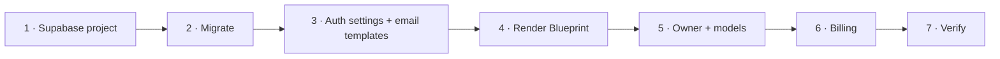

# Deploying Kriya Tavi

Two environments, never sharing a database: **staging** (its own Supabase
project and Render services, test billing) and **production**. Do every step
on staging first.



## 1. Supabase project

1. Create a project, region **Mumbai (ap-south-1)**. Keep the database password
   in your password manager.
2. **Project Settings → Data API → Exposed schemas**: leave it as `public`,
   `graphql_public`. **Never add `kriya`.** Kriya's tables are reachable only
   from the server; exposing the schema would let browsers query it directly
   with the publishable key (RLS would still apply, but the server-side limits
   wouldn't).
3. **Project Settings → API Keys**: copy the publishable key
   (`sb_publishable_…`) and create a secret key (`sb_secret_…`).
4. **Connect**: copy two connection strings:
   - Transaction pooler (port 6543) → `DATABASE_URL` for both services.
   - Session pooler or direct (port 5432) → `MIGRATION_DATABASE_URL`, used
     only from your machine for migrations.

## 2. Apply the schema

From a checkout of this repository:

```bash
npm ci
MIGRATION_DATABASE_URL="postgresql://…:5432/postgres" npm run db:migrate -- --dry-run
MIGRATION_DATABASE_URL="postgresql://…:5432/postgres" npm run db:migrate
MIGRATION_DATABASE_URL="postgresql://…:5432/postgres" npm run db:migrate -- --status
```

`scripts/migrate.ts` records versions in `supabase_migrations.schema_migrations`,
the same table the Supabase CLI uses, so `supabase link` + `supabase db push`
works too.

Check it in the SQL editor:

```sql
select id, active, price_monthly_paise from kriya.plans order by sort;
-- free · true · 0   starter · false · null   pro · false · null

select relname from pg_class c join pg_namespace n on n.oid = c.relnamespace
where n.nspname = 'kriya' and c.relkind = 'r' and not c.relrowsecurity;
-- no rows: RLS is on everywhere
```

## 3. Authentication

**Authentication → URL Configuration**
- Site URL: `https://<your domain>` (production) or the staging URL.
- Redirect URLs: `https://<your domain>/auth/confirm`. Add
  `http://localhost:6796/auth/confirm` **only** on a development project.

**Authentication → Sign In / Providers → Email**
- Confirm email: **on**. Secure email change: **on**.
- Minimum password length: **10** (the app enforces 10 as well).
- Leaked password protection: on, if your plan has it.

**Authentication → Emails → SMTP**: set up a real sender (for example on
your own domain). Supabase's built-in sender is rate-limited and meant for
testing.

**Authentication → Emails → Templates**: the app accepts the default links,
but these token-hash links work across devices (open the email on your phone
even if you signed up on a laptop):

*Confirm signup*
```html
<h2>Confirm your Kriya account</h2>
<p>Tap the button to confirm your email and set up your first agent.</p>
<p><a href="{{ .SiteURL }}/auth/confirm?token_hash={{ .TokenHash }}&type=email&next=/onboarding">Confirm my email</a></p>
<p>If you didn't sign up for Kriya Tavi, you can ignore this email.</p>
```

*Reset password*
```html
<h2>Reset your Kriya password</h2>
<p><a href="{{ .SiteURL }}/auth/confirm?token_hash={{ .TokenHash }}&type=recovery&next=/reset-password">Choose a new password</a></p>
<p>The link works once. If you didn't ask for this, ignore it; your password stays the same.</p>
```

*Change email address*
```html
<h2>Confirm your new email</h2>
<p><a href="{{ .SiteURL }}/auth/confirm?token_hash={{ .TokenHash }}&type=email_change&next=/account">Confirm this address</a></p>
```

## 4. Render

1. **New → Blueprint**, pick the repository and branch. Render reads
   `render.yaml` and creates `kriya-web` and `kriya-worker` in Singapore.
2. Fill every variable it asks for (table below). Choose instance types; the
   worker needs memory more than CPU.
3. Add your custom domain to `kriya-web`, then set `KRIYA_APP_URL` on both
   services to `https://<that domain>` and redeploy.

The web service builds with `npm ci && npm run build` and starts with
`npm start` (`next start` on Render's `PORT`). The worker starts with
`npm run worker`. Both refuse to start in production if a required variable
is missing or points at localhost; the error lists names, never values.

### Environment variables

| Variable | web | worker | Secret | Required | Notes |
| --- | :-: | :-: | :-: | :-: | --- |
| `KRIYA_APP_URL` | ✓ | ✓ | | ✓ | `https://` origin; used in emails and the CSRF check |
| `DATABASE_URL` | ✓ | ✓ | ✓ | ✓ | Transaction pooler, port 6543 |
| `NEXT_PUBLIC_SUPABASE_URL` | ✓ | | | ✓ | Public by design |
| `NEXT_PUBLIC_SUPABASE_PUBLISHABLE_KEY` | ✓ | | | ✓ | Public by design |
| `SUPABASE_SECRET_KEY` | ✓ | | ✓ | for deletion | Account deletion, owner lookups. Server only |
| `OPENROUTER_API_KEY` | ✓ | ✓ | ✓ | ✓ | Web only checks it's present |
| `OPENROUTER_BASE_URL` | | ✓ | | | Defaults to `https://openrouter.ai/api/v1` |
| `OPENROUTER_DEFAULT_MODEL` | ✓ | ✓ | | ✓* | Budget tier. *Or set in `/owner/config` |
| `OPENROUTER_BALANCED_MODEL` | | ✓ | | | Falls back to the budget model |
| `OPENROUTER_ESCALATION_MODEL` | | ✓ | | | Falls back to the budget model |
| `OPENROUTER_FALLBACK_MODEL` | | ✓ | | | Used once after a provider failure |
| `FIRECRAWL_API_KEY` | ✓ | ✓ | ✓ | | Web research; web reads only its presence |
| `KRIYA_FX_USD_INR` | ✓ | ✓ | | | e.g. `84.2500`. Unset → charges are "unpriced" |
| `KRIYA_FX_SOURCE` | ✓ | ✓ | | | Where the rate came from, stored with charges |
| `KRIYA_BILLING_PROVIDER` | ✓ | | | | `razorpay` or `test` |
| `KRIYA_ALLOW_TEST_BILLING` | ✓ | | | | `1` lets `test` run in production mode (staging) |
| `RAZORPAY_KEY_ID` / `RAZORPAY_KEY_SECRET` | ✓ | | ✓ | for paid plans | |
| `RAZORPAY_WEBHOOK_SECRET` | ✓ | | ✓ | for paid plans | Verifies webhook signatures |
| `KRIYA_TOKEN_KEY` | ✓ | ✓ | ✓ | for connected accounts | 32 random bytes, base64. Encrypts OAuth tokens; same value on web and worker. Losing it means everyone reconnects |
| `GOOGLE_CLIENT_ID` / `GOOGLE_CLIENT_SECRET` | ✓ | ✓ | ✓ | for Google | Calendar, Gmail, Drive. Worker uses them to refresh tokens |
| `NOTION_CLIENT_ID` / `NOTION_CLIENT_SECRET` | ✓ | | ✓ | for Notion | Public integration |
| `GITHUB_CLIENT_ID` / `GITHUB_CLIENT_SECRET` | ✓ | | ✓ | for GitHub (A8) | GitHub App: connecting and revoking. Tokens aren't refreshed, so the worker doesn't need them |
| `META_APP_ID` / `META_APP_SECRET` | ✓ | | ✓ | for Instagram (A8) | Meta app with Instagram permissions (app review) |
| `KRIYA_AGENTS_CONNECTORS` | ✓ | ✓ | | | `on` offers GitHub, Sheets, YouTube and Instagram (default `off`; also in `/owner/config`) |
| `KRIYA_AGENTS_UNDO` | ✓ | ✓ | | | `on` turns on the 10-minute Undo; the worker runs it (default `off`) |
| `KRIYA_AGENTS_SKILLS` | ✓ | ✓ | | | `on` lets agents save skills for your approval and replay them (default `off`). Each plan also needs `max_skills` above 0 in `/owner` (default 0) |
| `KRIYA_AGENTS_FILES` | ✓ | ✓ | | | `on` shows Account → Files and Shared links, receipt Download PDF and Share (with `agents.receipts`), and starts the worker's reading loop (default `off`) |
| `KRIYA_FILE_READER_MODEL` | | ✓ | | | A model that reads PDFs and images; unset, those files wait unread. Model reads count toward `agents.maintenanceCapMicroUsd` (default 0 = none) |
| `KRIYA_BROWSER_URL` / `KRIYA_BROWSER_SECRET` on **web** | ✓ | | ✓ | for PDFs (A5) | Receipt PDFs and share snapshots are printed by `kriya-browser`; same values as the worker |
| `KRIYA_AGENTS_LOGIN_PROFILES` | ✓ | ✓ | | | A6: `on` shows Account → Logins (sign in by take-over, save, remove) and lets tasks use a saved login within the site's mode (default `off`). Needs `KRIYA_TOKEN_KEY` on web and worker, `KRIYA_BROWSER_URL`/`SECRET` on web, `KRIYA_BROWSER_LIVE_URL`, and each plan's `max_login_profiles` above 0 in `/owner` (default 0) |
| `KRIYA_BROWSER_LIVE_URL` on **web** | ✓ | | ✓ | for take-over (A6) | The public `wss://` address that reaches `kriya-browser`'s `/live/<session>` route. Render private services aren't reachable from browsers, so this needs a public route to the service (open item, see `status.md` A6) |
| `KRIYA_AGENTS_KITS` | ✓ | ✓ | | | K9: `kit_prepare` and `kit_check`, ready-to-apply text for sites where Kriya doesn't press Save (default `off`) |
| `NEXT_PUBLIC_SUPABASE_URL` / `SUPABASE_SECRET_KEY` on **worker** | | ✓ | ✓ | for files (A5) | Reading uploads and deleting old snapshots in the `kriya-files` bucket |
| `KRIYA_AGENTS_LEDGER` | ✓ | ✓ | | | `on` turns on Accounts (A7): ledger entries, GST invoices, CA export (default `off`). Each plan also needs `ledger_enabled` in `/owner` (default false). Prepared records only: Kriya never files or pays |
| `KRIYA_AGENTS_CROSS_CHECK` / `KRIYA_CROSS_CHECK_MODEL` | | ✓ | | | K7: a budget model judges cited claims the verbatim check couldn't decide, never money (default `off`, no model). Counts toward `agents.maintenanceCapMicroUsd` |
| `KRIYA_AGENTS_WATCHERS` | ✓ | ✓ | | | K5: `schedule_create` can watch a page; unchanged pages make no task or model call. Needs `KRIYA_SCHEDULES_ENABLED=1` on the worker and `FIRECRAWL_API_KEY`. Each fetch is recorded as `web_fetch`, unpriced until the Firecrawl price is entered (RG-11) |
| `KRIYA_AGENTS_IMPROVEMENT` | ✓ | ✓ | | | A12: `on` makes tasks use the active (or canary) policy version from `/owner/improve` and records which one; the worker rolls a canary back when its failure rate or cost worsens. `off` = the code baseline (default `off`). Needs migration `20261114000000` |
| `KRIYA_AGENTS_RADAR` | ✓ | ✓ | | | K4: deadlines with quotes (`/radar`); reminders show in Kriya until phone-call reminders ship |
| `KRIYA_AGENTS_FACTS` | ✓ | ✓ | | | K6: `facts_lookup` and the worker's fact job. Targets are listed in `lib/facts.ts` (empty by default); domains in `kriya.fact_sources` (`gov.in`, `nic.in`). Owner: `/owner/facts` to retract |
| `KRIYA_SUPPORT_EMAIL` | ✓ | | | | Shown on limit and suspension pages |
| `KRIYA_INFRA_MONTHLY_INR`, `KRIYA_PAYMENT_FEE_BPS` | ✓ | | | | Contribution estimate only |
| `WORKER_CONCURRENCY` | | ✓ | | | Tasks per worker (default 4) |
| `DB_POOL_MAX` | ✓ | ✓ | | | Connections per process |

Model ids, the FX rate, finance assumptions and the support email can also be
changed in `/owner/config` without a redeploy; saved values win over the
environment.

## 5. Owner and models

1. Sign up on the deployed site with the owner's email and confirm it.
2. From your machine (never from the web app):
   ```bash
   DATABASE_URL="postgresql://…:6543/postgres" npm run owner:grant -- owner@yourdomain.in
   ```
   `/owner` is now visible to that account and a 404 for everyone else.
3. Pick models from the live catalogue (prices change) and test them:
   ```bash
   DATABASE_URL=… OPENROUTER_API_KEY=… npm run models:eval -- deepseek/deepseek-v4-flash
   ```
   Each run makes three short requests (a tool call, structured output, a
   streamed reply with usage and cost) and records pass/fail in
   `/owner/config`. Only route traffic to models that pass.
4. In `/owner/config`, set the tier models, the FX rate and its source, and
   review the Free plan's limits.

## 6. Billing (Razorpay)

1. In the Razorpay dashboard (test mode first), create a monthly plan in INR
   for each paid Kriya plan. Copy each `plan_…` id into the matching plan in
   `/owner/config`, set the price to the same amount, and mark it available.
2. **Settings → Webhooks**: URL `https://<your domain>/api/billing/webhook`,
   a strong secret (→ `RAZORPAY_WEBHOOK_SECRET`), events `subscription.*`.
3. Buy a plan with a Razorpay test card. The plan turns active only when the
   signed `subscription.activated` / `subscription.charged` webhook arrives,
   never on the redirect back.

Without Razorpay keys, `KRIYA_BILLING_PROVIDER=test` gives a simulated
checkout that runs the same event processing. It's refused in production
unless `KRIYA_ALLOW_TEST_BILLING=1`.

## 7. Connected accounts (Google, Notion)

Optional. Without these, Account → Connected accounts says "not available
yet" and agents don't get the tools.

1. Generate the encryption key once and set it on **both** services:
   ```bash
   node -e "console.log(require('crypto').randomBytes(32).toString('base64'))"
   ```
2. **Google**: in Google Cloud, enable the Calendar, Gmail and Drive APIs.
   Create an OAuth client (Web application) with the redirect URI
   `https://<your domain>/api/connect/google/callback`. On the consent
   screen add the scopes `calendar.events`, `gmail.readonly`,
   `gmail.compose` and `drive.readonly`.
   - While the app is in *Testing*, only test users you list can connect.
   - Publishing needs Google's verification. `gmail.readonly` and
     `drive.readonly` are *restricted* scopes: Google requires a yearly
     third-party security assessment (CASA) before the public can use them.
     `calendar.events` only needs the standard verification.
3. **Notion**: create a *public* integration at notion.so/my-integrations
   with the redirect URI `https://<your domain>/api/connect/notion/callback`
   and read-content capability only.

Adding calendar events and saving Gmail drafts always wait for the person's
approval in the thread; sending email isn't supported.

### GitHub, Sheets, YouTube, Instagram (A8, `agents.connectors`)

Not set up yet (AB-06). Nothing here has been tried against the live
services; check each step against the provider's current documentation.

1. **Sheets and YouTube** are extra scopes on the Google client above:
   `spreadsheets` (sensitive: Google verification before public use) and
   `youtube.readonly`. People tick them in Account; they are never in the
   default request.
2. **GitHub**: create a GitHub App with callback
   `https://<your domain>/api/connect/github/callback`, user authorization
   on, permissions Issues and Pull requests read/write, Contents read/write,
   Metadata read. Turn **off** "Expire user authorization tokens": Kriya
   doesn't refresh GitHub tokens yet, so expiring ones ask the person to
   reconnect every 8 hours.
3. **Instagram**: a Meta app with Facebook Login, redirect URI
   `https://<your domain>/api/connect/meta/callback`, permissions
   `instagram_basic`, `instagram_content_publish`, `pages_show_list`,
   `pages_read_engagement` (app review). Kriya pins Graph API `v21.0`
   (`lib/connectors.ts`); confirm it is still supported (RG-4). Tokens last
   about 60 days, then the person reconnects.

Every write (comment, issue, label, pull request, rows, post) waits for the
person's approval and is read back. With `agents.undo` on, calendar events,
Gmail drafts, GitHub comments and labels can be undone, and GitHub issues
closed, for 10 minutes; the worker runs the undo.

### Agent browser (`kriya-browser`, optional)

A Render **private service** built from `browser/Dockerfile` (in
`render.yaml`). It has no database access and no secret but its own, and
every page load goes through its egress guard. Without it, agents simply
don't get browser tools. For now the browser only reads pages and hands
steps to the person; it never fills or submits forms.

1. Generate a secret once (at least 32 characters) and set
   `KRIYA_BROWSER_SECRET` to the same value on `kriya-browser` and
   `kriya-worker`:
   ```bash
   node -e "console.log(require('crypto').randomBytes(32).toString('base64'))"
   ```
2. On the worker, set `KRIYA_BROWSER_URL` to the private service's internal
   address (`http://kriya-browser:10000`, as shown on the service's page).
3. Give the plans that should have it browser minutes in `/owner` (every
   plan starts at 0), then switch `agents.browser` on in `/owner/config`.
4. Not yet measured (blocker AB-08): whether Render allows Chromium's
   sandbox in a private service, and how many sessions one instance holds.
   Keep `BROWSER_MAX_SESSIONS` at 3 until that is measured on staging. The
   sandbox is never turned off to make it start.

Browser time is recorded in `kriya.resource_usage` as `browser_seconds`,
unpriced until a hosting cost basis is entered.

### Files and shares (A5, `agents.files`, optional)

1. In Supabase → Storage, create a **private** bucket named `kriya-files`
   (blocker AB-05). Don't add storage policies: only the server, with
   `SUPABASE_SECRET_KEY`, reads or writes it. Objects are stored at
   `<user id>/<file id>`. Not yet verified on a real project: that the
   browser's direct `PUT` to the signed upload link isn't blocked by CORS.
2. Set the web and worker variables above, and set each plan's
   `max_file_mb`, `storage_mb` and `max_shares` in `/owner` (defaults 10,
   100 and 5).
3. Switch `agents.files` on. Receipt Download PDF and Share also need
   `agents.receipts` and `kriya-browser`.

`/share/<token>` is public on purpose (no sign-in), sends `noindex` and
`no-referrer`, and shows only the snapshot made when the person shared.
Each render is recorded in `resource_usage` as `pdf_render`, unpriced.

### Voice service (`kriya-voice`, not yet in use)

A Render **web service** in `render.yaml` (voice phase 2,
`docs/voice-assistant/`). It accepts the telephony provider's media
WebSocket for a connected call and never places calls. Nothing places calls
yet (voice phases 3 and 5), so it sits idle; leaving it out of the Blueprint
changes nothing else.

| Variable | Secret | Required | Notes |
| --- | :-: | :-: | --- |
| `DATABASE_URL` | ✓ | ✓ | Same pooler URL as the worker; it reads only the connected stream's attempt |
| `KRIYA_VOICE_STREAM_SECRET` | ✓ | ✓ | At least 32 random characters (same command as `KRIYA_BROWSER_SECRET`). Basic auth on `wss://…/media/exotel`; given to the provider in the stream URL in voice phase 5 |
| `DB_POOL_MAX` | | | `4` in `render.yaml` |

It starts with `npm run voice`, answers `GET /health` with
`{ ok, accepting, calls }`, and on a deploy (SIGTERM) stops taking new
streams and waits for live calls to end, up to `maxShutdownDelaySeconds:
300` (Render's maximum), before closing them.

## 8. Verify

- [ ] `GET /api/health` returns `{"ok":true}`.
- [ ] Sign up → email arrives → link confirms → onboarding → first agent.
- [ ] A task streams in the browser; close the tab mid-task, reopen the
      thread, and it's still running or finished.
- [ ] The Activity panel shows the model level, tool calls and a cost in ₹.
- [ ] `/owner/finance` shows the request with a **reported** cost. If it
      says *estimated* or *unmetered*, the model isn't returning usage; run
      the eval again.
- [ ] Press Stop during a task: it stops within seconds and keeps what it wrote.
- [ ] Restart the worker during a task: it's requeued and finishes
      (`/owner/operations` shows the attempts).
- [ ] A second account can't open the first account's thread URLs (404).
- [ ] Forgot password → email → new password works; the old one doesn't.
- [ ] On an Android phone in Chrome: sign up, run a task, read the Activity
      sheet, and use the bottom tabs.
- [ ] Billing in test mode: plan activates; a replayed webhook does nothing.

## Rollback

- **Code**: Render → service → *Events* → roll back to the previous deploy.
  Roll back the worker and web together if a release changed both.
- **Database**: migrations are forward-only in production. Make a migration
  backwards-compatible with the previous release before deploying it (add
  columns, don't rename or drop in the same release). For a failed *first*
  deploy or a staging reset only,
  `supabase/rollback/20261016000000_kriya_core.down.sql` drops the `kriya`
  schema and **all its data**.
- **Data loss**: restore from Supabase backups (daily on paid plans;
  point-in-time recovery as an add-on). Restores have **not been rehearsed**
  yet. Do one on staging before launch and write down how long it took.
