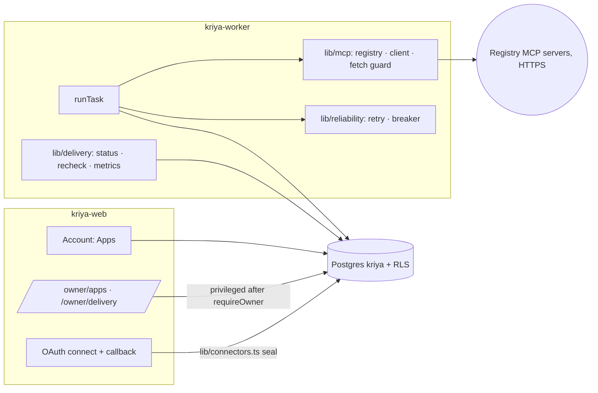
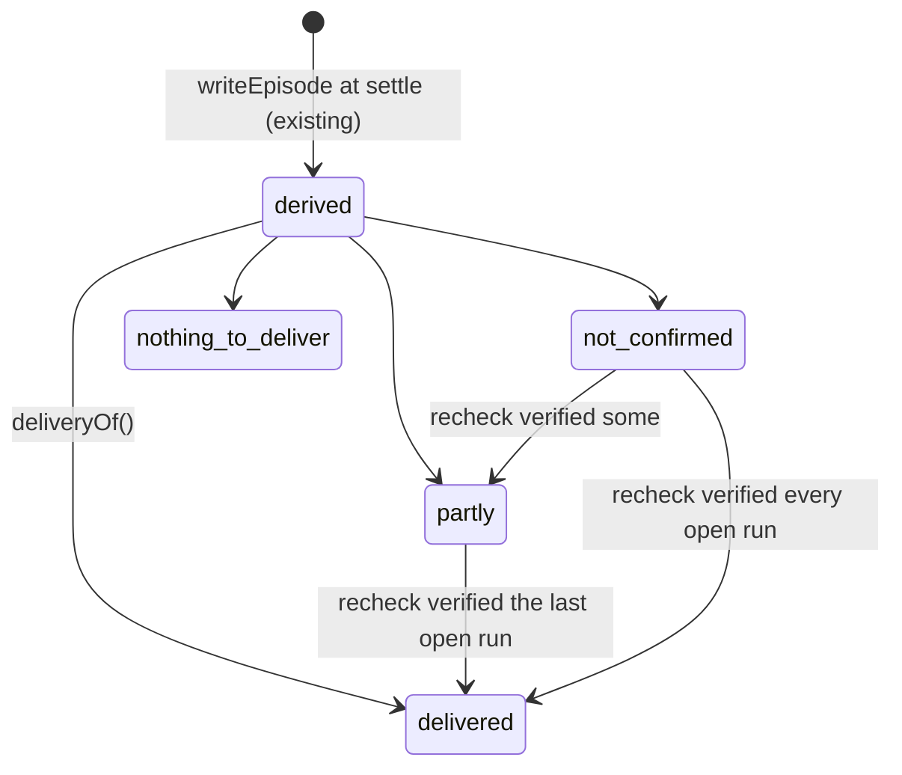

# Architecture (next platform, track N)

Extends `docs/agent-platform/ARCHITECTURE.md` and
`docs/operator/ARCHITECTURE.md`; read those first. Track N adds **no new
service and no change to the task queue** (ND-01). It adds three small
server modules (`lib/delivery/`, `lib/reliability/`, `lib/mcp/`), one pure
policy function, tables in `kriya`, two worker steps, and UI. Every runtime
change sits behind a `next.*` switch that defaults off, except the belt
guard (ND-21), which is proven to remove nothing today.

## 1. Where the new pieces sit



| Service         | Change                                                                                   | New secrets                                                                        |
| --------------- | ---------------------------------------------------------------------------------------- | ---------------------------------------------------------------------------------- |
| `kriya-web`     | Apps section, owner pages, the MCP OAuth redirect and callback (no MCP tool call ever)   | Only a confidential client's secret, if a registry server needs one (`secret_env`) |
| `kriya-worker`  | MCP client per task, guarded fetch, retry and breaker wrappers, re-check and drift steps | Same as web, for token refresh                                                     |
| `kriya-browser` | **None**                                                                                 | —                                                                                  |
| `kriya-voice`   | **None**                                                                                 | —                                                                                  |

## 2. A task with an MCP app, end to end

```mermaid
sequenceDiagram
  participant P as Person
  participant W as Worker (runTask)
  participant R as lib/mcp/registry
  participant C as MCP client (guarded fetch)
  participant S as MCP server
  participant DB as Postgres
  P->>W: "Create a Linear issue for the GST bug"
  W->>R: pinned tools for apps this agent may use (next.mcp on)
  R->>DB: mcp_servers, mcp_tools (status pinned), mcp_enablements, connection exists
  W->>C: createMCPClient(transport http, authProvider from lib/connectors.ts, fetch guard)
  C->>S: tools/list
  W->>W: hash each pinned tool; drifted → left off, row → drifted
  W->>W: belt += mcp_<app>_<tool>; classes via classifyMcpTool; approvals merged
  W->>W: belt guard (ND-21)
  W-->>P: approval card: exact input, app name and domain
  P->>W: approve
  W->>S: tools/call (worker only)
  S-->>W: result
  W->>W: { notice: FOREIGN, result }; read-back mapping if pinned (ND-12)
  W->>DB: tool_executions (risk, verification); episode at settle
  W->>W: client.close() in finally
  Note over W,DB: Later: recheck once if unverified (ND-04); delivery status on the card (ND-03)
```

## 3. Components

| Path (new unless marked)                                         | Purpose                                                                                                                                 | Runs in       | Phase  |
| ---------------------------------------------------------------- | --------------------------------------------------------------------------------------------------------------------------------------- | ------------- | ------ |
| `lib/delivery/status.ts`                                         | Pure `deliveryOf(episode, checks)` (ND-03)                                                                                              | web, worker   | N2     |
| `lib/delivery/metrics.ts`                                        | NM1–NM10 SQL aggregates                                                                                                                 | web (owner)   | N2     |
| `lib/delivery/recheck.ts`                                        | `recheckDeliveries(now, limit)`: worker step, one read-back per eligible run (ND-04)                                                    | worker        | N3     |
| `lib/reliability/retry.ts`                                       | `withReadRetry(tool, system)` wrapper; typed transient errors                                                                           | worker        | N4     |
| `lib/reliability/breaker.ts`                                     | Per-process, per-system circuit breaker                                                                                                 | worker        | N4     |
| `lib/mcp/registry.ts`                                            | Load servers, pinned tools and the person's enablements for a task (`withUser` for enablements, `privileged` for registry rows, scoped) | worker, web   | N5     |
| `lib/mcp/hash.ts`                                                | `definitionHash(def)` = sha256 of `canonical` (exported from `lib/agent/episodes.ts`, not copied)                                       | worker, web   | N5     |
| `lib/mcp/fetch.ts`                                               | Guarded `fetch` (ND-10)                                                                                                                 | worker, web   | N5     |
| `lib/mcp/client.ts`                                              | `openMcp(userId, server)`: `createMCPClient` with the guarded fetch and `mcpAuthProvider`                                               | worker        | N5     |
| `lib/mcp/tools.ts`                                               | Turns pinned tools into AI SDK tools: pinned schemas, FOREIGN wrapping, read-back mapping, classes map                                  | worker        | N5     |
| `lib/agent/tools.ts` (existing)                                  | `createMcpTools(env, mcp)` factory (invariant 5: tools live here; it delegates to `lib/mcp/tools.ts`)                                   | worker        | N5     |
| `lib/agent/policy.ts` (existing)                                 | `classifyMcpTool` (ND-08)                                                                                                               | worker, tests | N5     |
| `lib/mcp/drift.ts`                                               | Worker step: recheck pinned servers' definitions daily for the owner page (tasks also check per run)                                    | worker        | N7     |
| `actions/apps.ts`, `queries/apps.ts`                             | Person: connect, disconnect, enable per agent. Reads for the Account page                                                               | web           | N6     |
| `actions/owner-apps.ts`                                          | Owner: add server, pin tool, set risk, approve drift, suspend (`requireOwner`, `privileged`, audited)                                   | web           | N7     |
| `app/api/connect/mcp/[serverId]/route.ts`, `…/callback/route.ts` | OAuth start and callback through `lib/connectors.ts`                                                                                    | web           | N6     |
| `components/account/apps.tsx`                                    | The Apps section                                                                                                                        | web (client)  | N6     |
| `app/owner/apps/page.tsx`, `app/owner/delivery/page.tsx`         | Owner registry and delivery metrics                                                                                                     | web           | N7, N2 |
| `components/thread/delivery-status.tsx`                          | The status line on the "What I did" card                                                                                                | web (client)  | N2     |
| `tests/fixtures/mcp/server.ts`                                   | A local fixture MCP server (Streamable HTTP, no auth or a fixture OAuth) with read, write, drift and injection tools                    | tests         | N5     |

Boundaries (static test NT-IMP-01):

- `lib/delivery/*`, `lib/reliability/*`, `lib/mcp/*` import no `next/*`.
- `lib/mcp/*` imports `lib/connectors.ts` **only** for `mcpAuthProvider`
  (tokens stay there) and `browser/egress.ts` **only** for
  `isBlockedAddress`/`isBlockedHost`; nothing from `lib/browser/*` or
  `lib/voice/*`.
- `lib/delivery/status.ts` is pure and synchronous, like `policy.ts`.
- Client components import types and pure label modules only.

## 4. The runner, phase by phase (all in `lib/agent/run-task.ts`)

```ts title="lib/agent/run-task.ts (sketch of every track-N line)"
// Read once with the other settings
const delivery = inbox && (await getSetting("next.delivery")) === "on" // N2 (no runner change)
const reliable = (await getSetting("next.reliability")) === "on" // N4
const mcpOn = inbox && (await getSetting("next.mcp")) === "on" // N5
// After loadContext; failure → no MCP tools, never a failed task
const mcp = mcpOn ? await loadMcp(task, current).catch(logAndNull) : null // N5
// In the belt
...(mcp ? createMcpTools(env, mcp) : {}),
// After the kill list
if (reliable) wrapReads(tools) // N4: R0, non-side-effect, idempotent only
guardBelt(tools, mcp?.classes) // ND-21: always; removes nothing today
// Approvals: today's map, plus MCP entries only when MCP tools exist
const base = mcp ? { ...TOOL_APPROVALS, ...mcp.approvals } : TOOL_APPROVALS
const toolApproval = jobGrants.length ? withGrants(base, jobGrants, consume) : base
// onToolExecutionStart
const sideEffect = SIDE_EFFECT_TOOLS.has(name) || (mcp?.sideEffects.has(name) ?? false)
// … risk: mcp?.classes.get(name) ?? null (ND-22)
// finally
await mcp?.close().catch(logError)
```

Identity proofs (NT-REG-01): with `next.mcp` off, `base` **is**
`TOOL_APPROVALS` (the same object, as O4 requires for grants); no MCP
module is imported at runtime beyond the module graph; the belt names and
the prompt equal the AT-REG-01 / OT-REG-01 snapshots. `withGrants` never
matches an MCP tool (not grantable), so grants behave as before.

`loadMcp` order: switch on → person has `mcp_enablements` for this agent
(or all agents) → each enabled server is `active` and has a connection
row → open the client → `tools/list` → keep pinned tools whose hash
matches → apply `operator.disabledTools` → cap at `next.mcpMaxTools` →
classes and approvals. A server that fails to open is skipped with its
reason in the prompt line ("Linear isn't reachable right now"), and the
breaker records it.

Squad members on an `assign` part never get MCP tools (same reason they
get no connectors: nobody can approve, `run-task.ts` comment).

## 5. Delivery status and the re-check



The status is **computed at read time** from `episodes` and
`delivery_checks`; it is never stored, so a late check simply changes the
next read. `recheckDeliveries` runs in `schedulerLoop` (own `try`, only
with `next.recheck` on), at most 50 runs per tick, each in its own
transaction, errors logged and skipped. Eligible: `tool_executions` with
`side_effect = true`, `status = 'succeeded'`, verification `unverified`
or null, finished 2–30 minutes ago, no `delivery_checks` row yet, the
tool has a re-check reader (table in TOOLS_AND_CONTRACTS §3).

## 6. Reliability wrappers

`wrapReads(tools)` replaces `execute` of eligible tools with:

```ts
;async (input, options) => {
  breaker.assertClosed(system) // throws a typed "app not responding" error
  try {
    return await retryTransient(() => original(input, options), { attempts: 3 })
  } catch (error) {
    breaker.record(system, error)
    throw error
  }
}
```

The tool's schema, description and name are untouched (the prompt and
tool definitions stay identical: NT-REL-05 compares them).

## 7. Failure modes

| Failure                                                         | Behaviour                                                                                                                                                                  |
| --------------------------------------------------------------- | -------------------------------------------------------------------------------------------------------------------------------------------------------------------------- |
| MCP server down or slow                                         | Client open fails or times out (10 s): its tools aren't on the belt; prompt line says so; breaker opens after 5                                                            |
| Token expired, refresh fails                                    | `ConnectorError` with the reconnect message (existing pattern); Account shows "Needs reconnect"                                                                            |
| Server changes a pinned tool (rug pull)                         | Hash mismatch: tool left off every belt, row `drifted`, owner notified on `/owner/apps`                                                                                    |
| Server returns injected instructions                            | FOREIGN notice; `untrustedSeen` → memory quarantine; `privateContentSeen` → web tools ask (ND-11)                                                                          |
| Server redirects or points OAuth metadata at a private IP       | `redirect: 'error'`; guarded fetch refuses blocked hosts and addresses; logged with the server id only                                                                     |
| Worker dies after an approved MCP side effect                   | The run is a side effect (`sideEffects` true): `recover_tasks` won't requeue (existing rule)                                                                               |
| MCP call succeeded, read-back inconclusive                      | "Ran, but wasn't checked"; one re-check later (ND-04)                                                                                                                      |
| Owner suspends a server                                         | Next task: no tools from it; connections stay; the person sees "Paused by Kriya"                                                                                           |
| Switch turned off mid-task                                      | Read once per task: the running task finishes as it started; the next task has no MCP tools                                                                                |
| `next.reliability` wraps a read that is secretly not idempotent | Only tools whose capability says `idempotent: true` are wrapped; the flag is set per tool by a reviewed row; MCP tools only if R0 **and** the owner marked them idempotent |
| Embedding provider down (N9)                                    | Recall falls back to today's FTS order; logged                                                                                                                             |

## 8. What doesn't change

`kriya.tasks` and its functions, `lib/agent/metering.ts`, `kriya.charges`,
`lib/billing.ts`, `lib/secrets.ts`, `lib/auth.ts`, `db/index.ts`, the
notifier, `kriya-browser`, `kriya-voice`, every voice rule, `receiptHash`,
`canonical`'s output, `verifyChain`, `lib/agent/verify.ts`, values in
`TOOL_CLASSES`, `approvalFor`, the browser policy, `GRANTABLE`, the
`grants.tool` check, `guardWeb`'s rule (it only learns the `mcp_` prefix),
existing connector functions.
