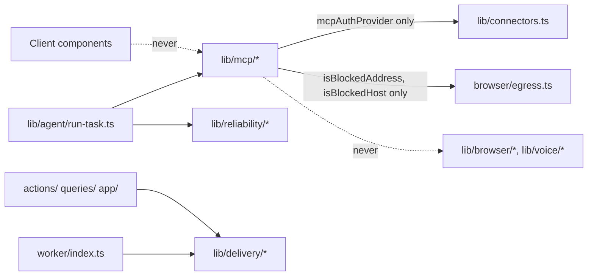

# Change impact and safe execution (next platform, track N)

What track N may touch in the existing product, exactly how, and the test
that proves nothing broke. Read this **before editing any existing file**.
A change not listed in §3 needs the owner's approval and a new row here
first. Where track A's, track O's or the voice track's CHANGE_IMPACT also
lists a file, **all** the rules apply, and the file is held on the shared
Coordination board in `status.md` by one agent at a time.

Verified against `038c2e3` (worktree `claude/dreamy-noether-dd685d`, clean)
on 2026-10-24. **Baseline:** `env -u OPENROUTER_API_KEY npm run check` →
typecheck pass; lint 0 errors / 2 warnings (existing); format pass; Test
Files 135 passed | 3 skipped (138); Tests 1590 passed | 27 skipped (1617);
exit 0.

## 1. Protected (never touch without the owner's explicit approval)

Everything in track A's CHANGE_IMPACT §2, track O's §1 and the voice
track's §2, plus:

| Path                                                                                         | Why                                               | Track N's only exception                                                                                |
| -------------------------------------------------------------------------------------------- | ------------------------------------------------- | ------------------------------------------------------------------------------------------------------- |
| `browser/egress.ts`                                                                          | Track-A rule 6: never relaxed                     | **Imported**, read-only, for `isBlockedAddress`/`isBlockedHost` (ND-10); no edit                        |
| `lib/agent/verify.ts`                                                                        | Claim and citation rules                          | None in track N (NF-05 stays a documented limitation)                                                   |
| `lib/agent/episodes.ts` `receiptHash`, `canonical` (body), `verifyChain`                     | Changing the hash body breaks every chain         | `canonical` gains the `export` keyword only (ND-07 reuse); `deriveEpisode` one expression (ND-22)       |
| `lib/connectors.ts`, `kriya.connections`                                                     | Token handling                                    | N6 only, owner-approved: additive `mcpAuthProvider`, `mcpDisconnect`; `kriya.connections` never changes |
| `lib/secrets.ts`, `lib/agent/metering.ts`, `lib/billing.ts`, `lib/auth.ts`, `db/index.ts`    | Encryption, metering, payments, identity, tenancy | None                                                                                                    |
| `lib/agent/queue.ts`, `kriya.tasks` and its functions                                        | Queue semantics                                   | None                                                                                                    |
| `lib/agent/policy.ts` **values** (`TOOL_CLASSES`, `approvalFor`, browser policy)             | The safety floor                                  | Additions only: `classifyMcpTool`, two `PERSON_ONLY_WRITES` rows, `export` on `wordsPattern`            |
| `lib/agent/capabilities.ts` `GRANTABLE`, `lib/operator/grants.ts`, `kriya.grants.tool` check | OD-03                                             | None (MCP tools are never grantable)                                                                    |
| `lib/voice/**`, `voice/**`, `lib/agent/call-tools.ts`, `browser/**`, `lib/browser/**`        | Voice rules; track-A rule 6                       | None                                                                                                    |
| Every applied migration                                                                      | Invariant 2                                       | None; fix forward                                                                                       |

## 2. Prerequisites

| Id   | Change                                                                                                                | Test                                |
| ---- | --------------------------------------------------------------------------------------------------------------------- | ----------------------------------- |
| NP-1 | None. Re-run `env -u OPENROUTER_API_KEY npm run check` on the current `main` and record the counts. If it fails, stop | Exit 0; counts ≥ the baseline above |

## 3. Existing files that change, and how

| File                                                                              | Phase       | Allowed change                                                                                                                                                                                                                                                                                                                                                           | Must stay true                                                                                        | Regression test                                                                                                        |
| --------------------------------------------------------------------------------- | ----------- | ------------------------------------------------------------------------------------------------------------------------------------------------------------------------------------------------------------------------------------------------------------------------------------------------------------------------------------------------------------------------ | ----------------------------------------------------------------------------------------------------- | ---------------------------------------------------------------------------------------------------------------------- |
| `db/schema.ts`                                                                    | N1          | Add `mcpServers`, `mcpTools`, `mcpEnablements`, `deliveryChecks` mirroring the N1 migration; add nullable `risk` to `toolExecutions`; types `McpVerify`, `DeliveryCheckRow`                                                                                                                                                                                              | Existing definitions unchanged; `CONNECTION_PROVIDERS` unchanged                                      | `npm run typecheck`; `tests/agent/regression.test.ts` unchanged                                                        |
| `db/schema.ts`                                                                    | N6, N9      | N6: `mcpConnections`. N9: `memories.embedding`, `embeddingModel`, `embeddedAt` (nullable)                                                                                                                                                                                                                                                                                | Same                                                                                                  | Same                                                                                                                   |
| `tests/db/migrations.test.ts`                                                     | N1, N6, N9  | Down/up case per track-N migration; older cases roll back track-N migrations first (newest first, as O2 and A12 did)                                                                                                                                                                                                                                                     | Existing assertions unchanged                                                                         | Itself                                                                                                                 |
| `lib/config.ts`                                                                   | N2–N10      | `next.*` keys of ND-02 in one block under `// Next platform (track N)`, same shape as `operator.*` (`env`, `fallback`, `pattern`, `hint`)                                                                                                                                                                                                                                | Existing keys untouched                                                                               | Settings parse tests; NT-REG-01                                                                                        |
| `app/owner/config/page.tsx`                                                       | N2          | One `GROUPS` entry: "Next platform", prefix `["next."]`                                                                                                                                                                                                                                                                                                                  | Existing groups and forms unchanged                                                                   | Owner page renders (NT-UI-03)                                                                                          |
| `actions/inbox.ts` (`whatIDid`)                                                   | N2          | Each record gets `delivery` only when `next.delivery` and `agents.inbox` are on (one extra query through `queries/episodes.ts`)                                                                                                                                                                                                                                          | Off → the returned object is deep-equal to today's                                                    | NT-DLV-03                                                                                                              |
| `queries/episodes.ts`                                                             | N2          | New export `deliveryForTasks(userId, taskIds)` (`withUser`)                                                                                                                                                                                                                                                                                                              | `episodesForTasks`, `jobsForExecutions`, `recentEpisodes`, `goalEpisodes` unchanged                   | NT-DLV-05; existing episode tests                                                                                      |
| `components/thread/what-i-did.tsx`                                                | N2          | Render `<DeliveryStatus>` at the top of a record when `record.delivery` exists                                                                                                                                                                                                                                                                                           | No `delivery` → identical markup                                                                      | NT-UI-01 (baseline screenshot); `tests/agent/transcript.test.ts`                                                       |
| `components/owner/nav.tsx`                                                        | N2, N7      | "Delivery" (`/owner/delivery`), "Apps" (`/owner/apps`) links                                                                                                                                                                                                                                                                                                             | Existing links unchanged; `proxy.ts` untouched (`/owner` already in `PROTECTED`)                      | Typecheck; NT-UI-03                                                                                                    |
| `worker/index.ts`                                                                 | N3, N7      | In `schedulerLoop`, one new `try` block each: `recheckDeliveries()` with `next.recheck` on; `checkDrift()` with `next.mcp` on                                                                                                                                                                                                                                            | Other steps untouched; their errors caught and logged                                                 | NT-RCK-05; typecheck                                                                                                   |
| `lib/agent/run-task.ts`                                                           | N4          | Read `next.reliability` with the other settings; after the kill list `if (reliable) wrapReads(tools, …)`                                                                                                                                                                                                                                                                 | Off → every `execute` is the original function                                                        | NT-REL-06; AT-REG-01                                                                                                   |
| `lib/agent/run-task.ts`                                                           | N5          | Read `next.mcp`; `loadMcp` after `loadContext` (errors → null); belt line `...(mcp ? createMcpTools(env, mcp) : {})`; `capabilities.apps` only when MCP tools exist; `guardBelt` after the kill list (ND-21); approvals `mcp ? { ...TOOL_APPROVALS, ...mcp.approvals } : TOOL_APPROVALS`; `sideEffect` and `risk` in `onToolExecutionStart`; `mcp?.close()` in `finally` | Off → `TOOL_APPROVALS` object itself passed (identity); prompt and belt identical                     | NT-REG-01; NT-POL-01; OT-REG-01 (`tests/operator/runner-grants.test.ts`) unchanged                                     |
| `lib/agent/run-task.ts`                                                           | N8          | Pass `catalog: CATALOG_V2, unicode: true` to `resolveSkills` only with `next.skillsV2` on                                                                                                                                                                                                                                                                                | Off → the same call as today                                                                          | NT-SKL-03; `tests/agent/runner-skill-library.test.ts` unchanged                                                        |
| `lib/agent/run-task.ts`                                                           | N9          | Read `next.memoryRerank`/`next.embeddingModel`; pass an optional `rerank` to `recallNotes` through `loadMemoryV2`                                                                                                                                                                                                                                                        | Off or unset → same call                                                                              | NT-MEM-05; AS-MEM unchanged                                                                                            |
| `lib/agent/tools.ts`                                                              | N5          | New `createMcpTools(env, mcp)` (delegates to `lib/mcp/tools.ts`); `McpTask` type export; `privateContentSeen` and `untrustedSeen` also match names starting `mcp_`                                                                                                                                                                                                       | Existing factories, `SIDE_EFFECT_TOOLS`, `PRIVATE_READ_TOOLS`, `FOREIGN` text, `KriyaTools` unchanged | AT-REG-01 tool-definition snapshot; NT-MCP-07/08; existing tool tests                                                  |
| `lib/agent/policy.ts`                                                             | N5, N8      | N5: `classifyMcpTool`, `McpPolicyInput`; `PERSON_ONLY_WRITES` += `"mcp_enablements"`, `"mcp_connections"`. N8: `export` on `wordsPattern`                                                                                                                                                                                                                                | No existing value changes                                                                             | `tests/agent/policy.test.ts`, `tests/agent/tool-policy.test.ts` (AT-POL-07) unchanged; NT-POL-02                       |
| `lib/agent/capabilities.ts`                                                       | N4, N5      | N4: optional `idempotent` in `Facts` for the reads in TOOLS_AND_CONTRACTS §4. N5: `UNCLASSIFIED_OK`, `unclassifiedTools`                                                                                                                                                                                                                                                 | `CAPABILITIES` risk/sideEffect/writes/grantable unchanged; `GRANTABLE` exactly the four               | OT-CAP-01, OT-CAP-02 (`tests/operator/capabilities.test.ts`) unchanged                                                 |
| `lib/agent/episodes.ts`                                                           | N5          | `export` on `canonical` (body unchanged); `Run` gains optional `risk`; `deriveEpisode` uses `run.risk ?? classifyTool(…)`; `writeEpisode` selects `tool_executions.risk`                                                                                                                                                                                                 | `receiptHash`, `verifyChain`, `canonical` output byte-identical; existing tools' episodes identical   | AT-RCP-02; `tests/agent/episodes.test.ts` unchanged; NT-DLV-04                                                         |
| `lib/agent/approvals.ts`                                                          | N5          | `actionTitle`: one branch before `default` for names starting `mcp_` → "Use/Used <tool words> in <app id>" derived from the name only                                                                                                                                                                                                                                    | Every other branch unchanged                                                                          | Existing approval tests; NT-MCP-02                                                                                     |
| `lib/agent/instructions.ts`                                                       | N5          | `Capabilities.apps?` and `APPS_LINE`, emitted only when set                                                                                                                                                                                                                                                                                                              | Not set → byte-identical prompt                                                                       | AT-REG-01 snapshots                                                                                                    |
| `components/thread/tool-call.tsx`, `components/workbench/activity.tsx`            | N5          | A case for part types starting `tool-mcp_` (approval card with app name and domain, exact input) and a label fallback for `mcp_` names                                                                                                                                                                                                                                   | Other tools render and label as before                                                                | Typecheck; NT-UI-01 neighbours                                                                                         |
| `package.json`                                                                    | N5, N11     | N5: `"@ai-sdk/mcp"` in `dependencies` at the installed version (2.0.73; already in the lockfile through `@ai-sdk/react`). N11: script `"next:eval"`                                                                                                                                                                                                                      | No other dependency                                                                                   | `npm ci`; `npm run build` (with the verify env)                                                                        |
| `lib/connectors.ts` (**protected; owner approval at N6 start**)                   | N6          | Additive `mcpAuthProvider(userId, serverId)` and `mcpDisconnect(userId, serverId)` reading/writing `kriya.mcp_connections` with `seal`/`open`                                                                                                                                                                                                                            | Existing functions, `ConnectionProvider`, `kriya.connections` unchanged                               | `tests/connectors.test.ts`, `tests/connectors/oauth.test.ts`, `tests/connectors/rotation.test.ts` unchanged; NT-CON-04 |
| `lib/readiness.ts`                                                                | N6          | The key-id query in `databaseChecks` also counts `kriya.mcp_connections` tokens (rotation readiness)                                                                                                                                                                                                                                                                     | Existing checks unchanged                                                                             | `tests/readiness/readiness.test.ts`                                                                                    |
| `app/(workspace)/account/page.tsx`                                                | N6          | Render `<Apps>` after Connections only with `next.mcpConnect` on                                                                                                                                                                                                                                                                                                         | Off → same page                                                                                       | NT-UI-02                                                                                                               |
| `components/dialogs/agent-dialog.tsx`, `queries/workspace.ts` (`getSystemStatus`) | N6          | `getSystemStatus` adds `apps` (null with the switch off, the `skills` pattern); the dialog's Apps section only when `status.apps`                                                                                                                                                                                                                                        | Off → same dialog and status object                                                                   | `tests/agent/skill-picker.test.ts` pattern; NT-UI-02                                                                   |
| `lib/skill-library.ts`                                                            | N8          | `manifestSchema.activation` gains optional `keywordsIntl` (array of words, any script); `CATALOG_V2`; `resolveSkills` input `unicode?: boolean` (Unicode lookarounds via `wordsPattern`, matching `keywords ∪ keywordsIntl`)                                                                                                                                             | Without `unicode` → today's matcher on `keywords` only; `CATALOG` unchanged                           | NT-SKL-03; `tests/agent/skill-library.test.ts` unchanged                                                               |
| `skills/index.ts`, `skills/*/kriya.json`                                          | N8          | `SKILL_MANIFESTS_V2` (new skills); existing manifests may gain `activation.keywordsIntl` only                                                                                                                                                                                                                                                                            | Existing ids, versions, `keywords`, `SKILL.md` files unchanged                                        | Same                                                                                                                   |
| `queries/skills.ts`, `actions/agents.ts`                                          | N8          | Use `CATALOG_V2` (and `checkSkillPrefs(…, CATALOG_V2)`) only with `next.skillsV2` on                                                                                                                                                                                                                                                                                     | Off → today's catalogue                                                                               | `tests/agent/{skill-options,agent-skills-actions}.test.ts` unchanged; NT-SKL-05                                        |
| `lib/memory/retrieve.ts`                                                          | N9          | `recallNotes` optional `rerank?: (candidates) => Promise<order>`; default absent                                                                                                                                                                                                                                                                                         | Callers without it unchanged                                                                          | AS-MEM (M1 40/50) unchanged; NT-MEM-01                                                                                 |
| `lib/memory/maintenance.ts`                                                       | N9          | An `embed_notes` job kind run by the existing loop within `withinCap` (kind added to `maintenance_jobs` check by the N9 migration)                                                                                                                                                                                                                                       | Existing job kinds unchanged                                                                          | `tests/agent/maintenance.test.ts` unchanged; NT-MEM-04                                                                 |
| `lib/models.ts`                                                                   | N10         | `createGatewayModel` passes provider cache options only for model ids on the NRG-2 verified list and only with `next.promptCache` on                                                                                                                                                                                                                                     | Off → request bodies identical                                                                        | NT-CST-02                                                                                                              |
| `docs/kriya/deployment.md`                                                        | N6, N12     | Optional `KRIYA_MCP_*` secrets (names only), the registry review step                                                                                                                                                                                                                                                                                                    | —                                                                                                     | —                                                                                                                      |
| `render.yaml`                                                                     | N12         | A registry server's `KRIYA_MCP_*` secret as `sync: false` on web and worker, only when the owner adds one                                                                                                                                                                                                                                                                | Existing keys untouched                                                                               | Blueprint diff reviewed                                                                                                |
| `tests/agent/tool-policy.test.ts`                                                 | N5          | Only if its tables are exhaustive over `PERSON_ONLY_WRITES`: add the two rows                                                                                                                                                                                                                                                                                            | AT-POL-07's meaning unchanged                                                                         | Itself                                                                                                                 |
| `AGENTS.md`                                                                       | N0          | The "Next platform (track N)" section (done in N0)                                                                                                                                                                                                                                                                                                                       | Invariants and other tracks' text unchanged                                                           | —                                                                                                                      |
| `status.md`                                                                       | every phase | Own section and board rows only                                                                                                                                                                                                                                                                                                                                          | Other tracks' sections untouched                                                                      | —                                                                                                                      |

**New files** (no row needed): everything under `lib/delivery/`,
`lib/reliability/`, `lib/mcp/`, `lib/memory/embed.ts`, `actions/apps.ts`,
`actions/owner-apps.ts`, `queries/apps.ts`, `components/account/apps.tsx`,
`components/thread/delivery-status.tsx`, `app/owner/apps/`,
`app/owner/delivery/`, `app/api/connect/mcp/`, `skills-v2/delivery-proof/`,
`skills-v2/indian-documents-reading/`, `lib/skills-v2.ts` (NF-10), `tests/next/`, `tests/db/next-*`,
`tests/fixtures/mcp/`, `tests/eval/memory-ml.eval.test.ts`,
`scripts/next-eval.ts`, the three track-N migrations and rollbacks,
`screenshots/next-platform/`.

**Dependencies:** only `@ai-sdk/mcp` moves from transitive to direct
(no new package in the lockfile). The fixture MCP server uses Node's
`http`.

## 4. Module boundaries

Static tests: NT-IMP-01 (`lib/delivery`, `lib/reliability`, `lib/mcp`
import no `next/*`; the two narrow imports above are the only ones from
`lib/connectors` and `browser/`), NT-IMP-02 (`browser/egress.ts` imports
only Node built-ins), NT-IMP-03 (MCP tool execution only from worker
modules; client components import no `lib/mcp`). AT-IMP-01 (track A)
unchanged.

## 5. Cross-track check (other CHANGE_IMPACT docs, 2026-10-24)

| File held by another track's row                                        | Conflict?                                                                                                                                                               | Rule                                                                                         |
| ----------------------------------------------------------------------- | ----------------------------------------------------------------------------------------------------------------------------------------------------------------------- | -------------------------------------------------------------------------------------------- |
| `lib/agent/run-task.ts` (A, O, voice rows)                              | No overlapping lines: track N adds its own settings reads, one belt line per phase, the guard after O1's kill list, and composes approvals **before** O4's `withGrants` | Hold on the board; O4's identity rule preserved (`base` is `TOOL_APPROVALS` when MCP is off) |
| `lib/agent/tools.ts` (A, O, voice)                                      | Voice F8: `KriyaTools` gains nothing from track N; call tools untouched                                                                                                 | —                                                                                            |
| `lib/agent/policy.ts` (O §1 values protected)                           | Additions only                                                                                                                                                          | —                                                                                            |
| `lib/connectors.ts` (A §2, O G2, OD-22)                                 | Additive functions only, owner-approved at N6 start                                                                                                                     | Same approval pattern as A8, A11, G2                                                         |
| `lib/agent/episodes.ts` (O §1 hash protected)                           | `canonical` export keyword only; `deriveEpisode` expression; hash unchanged                                                                                             | ND-22 owner gate                                                                             |
| `worker/index.ts` (A, O, voice F6)                                      | New `try` blocks in `schedulerLoop`; no new loop, no shared `running` map                                                                                               | Hold on the board                                                                            |
| `lib/config.ts`, `db/schema.ts`, `package.json`                         | Hot spots                                                                                                                                                               | One holder at a time                                                                         |
| `components/thread/what-i-did.tsx`, `actions/inbox.ts` (A3, A5, A8, O4) | Additive field and component, absent when off                                                                                                                           | NT-DLV-03                                                                                    |
| `app/owner/config/page.tsx` (OF-18, skill library)                      | One more `GROUPS` entry                                                                                                                                                 | —                                                                                            |

## 6. Preflight for every session

1. `git status --short` — anything you didn't make: stop and ask; never
   discard it.
2. `env -u OPENROUTER_API_KEY npm run check` passes. If it fails before
   you start: stop.
3. Every decision your phase lists is Approved in "Track N owner
   approvals"; owner-gated ones (DECISIONS table) approved by id.
4. Your phase and the files you'll hold are free on the board; claim them.
5. A migration timestamp is claimed and sorts last.
6. No local run uses `.env` or `.env.local` (live database): export
   `.env.verify` and pass `npm run verify:guard` first (operator rule 6).

## 7. Stop conditions

Stop and ask the owner when:

- you'd touch a §1 file or a file not in §3, or a §3 file beyond its row;
- an existing test fails and the cause isn't clearly your change;
- the AI SDK MCP client, a table or a function behaves differently from
  these documents (record a new NF id in VISION_AND_GAP_ANALYSIS §4);
- you're about to make an MCP tool grantable, lower a class, relax the
  guarded fetch, add a registry server, or let MCP run on the web server;
- you need a secret, an account, money, a deploy, a real model call, a
  real MCP server, a real connector call or a real site;
- a local run would reach the live database.
