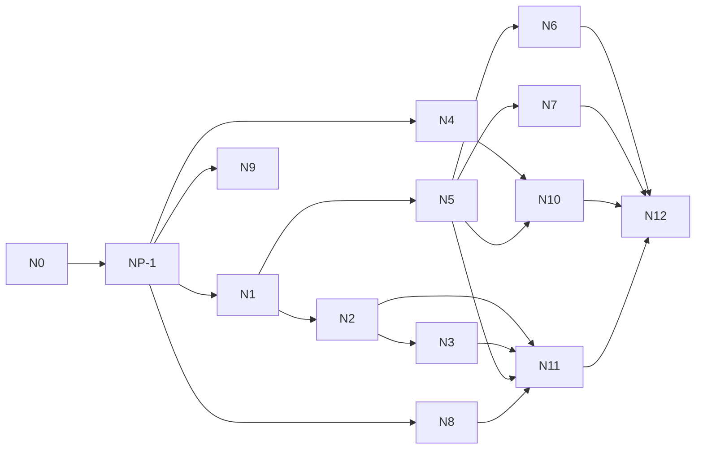

# Implementation plan (next platform, track N)

The per-phase status lives in the root **`status.md`**, section "Next
platform (track N)", which is canonical. This document gives the order,
the parallel lanes, the files each phase holds, the exit checks, the
configuration, rollout and rollback. Allowed edits to existing files are
only those in CHANGE_IMPACT_AND_SAFETY.md §3.

## 1. Phases

| Phase | Name                                                | Depends on                 | Decisions (must be Approved)                                  | External needs                                                             |
| ----- | --------------------------------------------------- | -------------------------- | ------------------------------------------------------------- | -------------------------------------------------------------------------- |
| N0    | Blueprint and decisions                             | —                          | —                                                             | Owner review                                                               |
| NP-1  | Baseline re-check on the current `main`             | N0                         | —                                                             | —                                                                          |
| N1    | Data model (one migration)                          | NP-1                       | ND-02, ND-04, ND-07, ND-13, ND-22                             | —                                                                          |
| N2    | Delivery status, owner delivery page                | N1                         | ND-03, ND-17, ND-23                                           | P-3 stack for the browser check                                            |
| N3    | Late re-check                                       | N2                         | ND-04                                                         | —                                                                          |
| N4    | Reliability: read retries, breaker                  | NP-1                       | ND-05                                                         | —                                                                          |
| N5    | MCP runtime on the fixture server                   | N1                         | ND-06, ND-07, ND-08, ND-10, ND-11, ND-13, ND-21, ND-22, ND-25 | Owner approves the `package.json` row (NRG-6)                              |
| N6    | MCP connect (OAuth), Account Apps, agent enablement | N5                         | ND-09, ND-13, ND-25                                           | Owner approval for `lib/connectors.ts`                                     |
| N7    | Owner registry, drift review, read-back mapping     | N5                         | ND-07, ND-12                                                  | —                                                                          |
| N8    | Skills v2                                           | NP-1                       | ND-14                                                         | —                                                                          |
| N9    | Memory recall v2 (gate, then rerank)                | NP-1 (gate); N1 not needed | ND-15                                                         | Embedding key and paid eval: owner go-ahead                                |
| N10   | Cost measurement and prompt caching                 | N4, N5                     | ND-16                                                         | Paid AS-CST: owner go-ahead; NRG-2                                         |
| N11   | Golden scenarios and eval harness                   | N2, N3, N5, N8             | ND-19                                                         | Paid `next:eval`: owner go-ahead                                           |
| N12   | Readiness gates and controlled pilot                | N6, N7, N10, N11           | ND-20, ND-24                                                  | Staging, real registry servers (NRG-1), counsel NQ-1/NQ-3, external review |
| N13   | Kriya as an MCP server                              | —                          | ND-18 (deferred; a new decision replaces it)                  | —                                                                          |

## 2. Parallel lanes and file holds

Agents work **one phase each**. After NP-1, four lanes can run at the same
time; after N1, two more. Files marked **hot** are held on the
Coordination board by one agent at a time, across all tracks; hold them
for the shortest edit, release, and let the next agent rebase on top.

| Lane | Phases        | Files it creates                                                                                                                                                                                                                                                                                                  | Existing files it edits (CHANGE_IMPACT §3)                                                                                                                                                                                                                                                                                                                                                                                                                                                                                      |
| ---- | ------------- | ----------------------------------------------------------------------------------------------------------------------------------------------------------------------------------------------------------------------------------------------------------------------------------------------------------------- | ------------------------------------------------------------------------------------------------------------------------------------------------------------------------------------------------------------------------------------------------------------------------------------------------------------------------------------------------------------------------------------------------------------------------------------------------------------------------------------------------------------------------------- |
| A    | N1            | `supabase/migrations/20270101000000_next_platform.sql`, its rollback, `tests/db/next-mcp-rls.test.ts`, `tests/db/next-delivery-rls.test.ts`                                                                                                                                                                       | **hot** `db/schema.ts`; `tests/db/migrations.test.ts`                                                                                                                                                                                                                                                                                                                                                                                                                                                                           |
| B    | N2 → N3       | `lib/delivery/{status,metrics,recheck}.ts`, `components/thread/delivery-status.tsx`, `app/owner/delivery/page.tsx`, `tests/next/{delivery,recheck}.test.ts`                                                                                                                                                       | `actions/inbox.ts`, `queries/episodes.ts`, `components/thread/what-i-did.tsx`, `components/owner/nav.tsx`, `app/owner/config/page.tsx`; **hot** `lib/config.ts`, `worker/index.ts` (N3)                                                                                                                                                                                                                                                                                                                                         |
| C    | N4            | `lib/reliability/{retry,breaker}.ts`, `tests/next/reliability.test.ts`                                                                                                                                                                                                                                            | `lib/agent/capabilities.ts`; **hot** `lib/agent/run-task.ts`, `lib/config.ts`                                                                                                                                                                                                                                                                                                                                                                                                                                                   |
| D    | N5 → N6 / N7  | `lib/mcp/*`, `tests/fixtures/mcp/server.ts`, `tests/next/mcp-*.test.ts`; N6: N6 migration + rollback, `app/api/connect/mcp/[serverId]/{route,callback/route}.ts`, `actions/apps.ts`, `queries/apps.ts`, `components/account/apps.tsx`; N7: `actions/owner-apps.ts`, `app/owner/apps/page.tsx`, `lib/mcp/drift.ts` | N5: **hot** `lib/agent/run-task.ts`, `lib/agent/tools.ts`, `lib/agent/policy.ts`, `lib/agent/instructions.ts`, `lib/config.ts`, `package.json`; `lib/agent/capabilities.ts`, `lib/agent/episodes.ts`, `lib/agent/approvals.ts`, `components/thread/tool-call.tsx`, `components/workbench/activity.tsx`. N6: **protected** `lib/connectors.ts` (owner), `lib/readiness.ts`, `app/(workspace)/account/page.tsx`, `components/dialogs/agent-dialog.tsx`, `db/schema.ts`. N7: `components/owner/nav.tsx`, **hot** `worker/index.ts` |
| E    | N8            | `skills/delivery-proof/*`, `skills/indian-documents-reading/*`, `tests/next/skills-v2.test.ts`                                                                                                                                                                                                                    | `lib/skill-library.ts`, `skills/index.ts`, `skills/*/kriya.json` (keywords only), `queries/skills.ts`, `actions/agents.ts`; `lib/agent/policy.ts` (export `wordsPattern` only); **hot** `lib/agent/run-task.ts` (one line), `lib/config.ts`                                                                                                                                                                                                                                                                                     |
| F    | N9            | N9 migration + rollback, `lib/memory/embed.ts`, `tests/next/memory-rerank.test.ts`, `tests/eval/memory-ml.eval.test.ts`                                                                                                                                                                                           | `lib/memory/retrieve.ts`, `lib/memory/maintenance.ts`, **hot** `db/schema.ts`, `lib/agent/run-task.ts`, `lib/config.ts`                                                                                                                                                                                                                                                                                                                                                                                                         |
| G    | N10, N11, N12 | `tests/next/golden/*`, `scripts/next-eval.ts`, `lib/delivery/metrics.ts` additions (N10)                                                                                                                                                                                                                          | `lib/models.ts` (N10, cache markers), `package.json` (`next:eval`), **hot** `lib/agent/run-task.ts` (N10, if markers go there)                                                                                                                                                                                                                                                                                                                                                                                                  |

Rules:

1. One migration writer at a time across **all** tracks (N1, N6, N9 each
   claim their timestamp and must sort last when claimed).
2. `lib/agent/run-task.ts` is edited by N4, N5, N8, N9, N10. Each adds
   its own lines in the place ARCHITECTURE §4 shows; hold, edit, run
   `npm run typecheck && npx vitest run tests/agent tests/operator
tests/next`, release. Never reformat the file.
3. `lib/agent/policy.ts`: N5 adds `classifyMcpTool`, the
   `PERSON_ONLY_WRITES` rows; N8 only adds `export` to `wordsPattern`.
   No value changes ever.
4. `lib/config.ts`: each phase appends its own keys in one block under a
   `// Next platform (track N)` comment; no edits to other keys.
5. `worker/index.ts`: N3 and N7 each add one `try` block in
   `schedulerLoop`; never at the same time as another track's phase that
   holds it.
6. Never fix another phase's or track's failing test: record it on the
   board and tell the owner.

## 3. Exit checks per phase

Every phase also needs: `npm run check` exit 0 with the existing counts
not lower than at its start; NT-REG-01 passing; `npm run build` if it
touched `app/`, `components/`, `worker/` or `actions/` (**only** with
`.env.verify` exported and `npm run verify:guard` passing — `npm run
build` loads `.env`, which points at the live project, operator rule 6);
`status.md` Session result with real output.

| Phase | Exit checks (all must pass, output recorded)                                                                                                                                                                                                      |
| ----- | ------------------------------------------------------------------------------------------------------------------------------------------------------------------------------------------------------------------------------------------------- |
| NP-1  | `env -u OPENROUTER_API_KEY npm run check` exit 0; counts recorded (2026-10-24 baseline: 135 files passed / 3 skipped; 1590 tests passed / 27 skipped)                                                                                             |
| N1    | NT-DB-01…06, NT-DB-08, NT-MIG-01 (N1 case); `tests/db/lint.test.ts` zero; `db/schema.ts` mirrors the SQL (typecheck); not applied to any Supabase project                                                                                         |
| N2    | NT-DLV-01, 02, 03, 05, 06; NT-REG-01 (first version, all `next.*` off); NT-IMP-01; browser check NT-UI-01 on the P-3 stack                                                                                                                        |
| N3    | NT-RCK-01…05; NG-17 and NG-18 at unit level; worker step behind `next.recheck`                                                                                                                                                                    |
| N4    | NT-REL-01…06; NT-REG-01 with `next.reliability` off; AT-REG-01 unchanged                                                                                                                                                                          |
| N5    | NT-POL-01…03; NT-MCP-01…04, 06…19; NT-DLV-04; NT-SEC-01, 03; NT-IMP-02, 03; NT-REG-01 with `next.mcp` off (identity of `TOOL_APPROVALS`); OT-REG-01 and AT-RCP-02 unchanged; the guarded-fetch unknown (MCP_CONNECTIVITY §5) settled and recorded |
| N6    | NT-DB-07, NT-MIG-01 (N6 case), NT-CON-01…06, NT-SEC-02; `tests/connectors.test.ts` and `tests/connectors/oauth.test.ts` unchanged and passing; browser check NT-UI-02                                                                             |
| N7    | NT-MCP-05, 20; NT-OWN-01…04; browser check NT-UI-03                                                                                                                                                                                               |
| N8    | NT-SKL-01…05; AS-SKL-ML false activations 0; with `next.skillsV2` off the existing skill suites unchanged                                                                                                                                         |
| N9    | Gate recorded (AS-MEM and AS-MEM-ML M1 on today's code); if continuing: NT-MEM-01…05, NT-MIG-01 (N9 case), M1 gain > noise over 3 paid runs (owner go-ahead); otherwise phase closes as "gate not met" with numbers                               |
| N10   | NT-CST-01…03; AS-CST before/after recorded (owner go-ahead) or marked not run with the reason; NRG-2 closed or `next.promptCache` stays unused                                                                                                    |
| N11   | NG-01…NG-24 in `npm test`; AS-DLV statuses as expected; AS-MCP-SEC scripted 200 runs NM8 = 0                                                                                                                                                      |
| N12   | NR-1…NR-9 evidence in `status.md`; pilot NM1–NM10 for ≥ 14 days with NM8 = 0                                                                                                                                                                      |

## 4. Configuration

All in `SETTINGS` (`lib/config.ts`), edited in `/owner/config` under a new
"Next platform" group (prefix `next.`). Defaults and effects: DECISIONS
ND-02. No new environment variable is **required**; optional ones are a
registry server's `KRIYA_MCP_*` client secret (owner adds on Render, web
and worker) and nothing else.

## 5. Rollout

Settings are global (`getSetting` has no per-person scope), and the
`agents.allowList` setting that track A §5 and track O §4 describe does
**not** exist in `lib/config.ts` (checked 2026-10-24, NF-09). So track N
rolls out: dark → the isolated stack (P-3) → staging with test accounts →
production for everyone, one switch at a time, each step dated in
`status.md`. For MCP the registry adds a natural narrowing: no one can use
an app until the owner activates its server and the person connects it.
A per-person gate is not built by track N; if the owner wants one, it is a
new decision (shared with tracks A and O). Order: `next.delivery` → `next.recheck` →
`next.reliability` → `next.skillsV2` → `next.mcp` (fixture/staging only
until NR-1…NR-9) → `next.mcpConnect` → `next.memoryRerank` (only if N9's
gate passed and ND-15 approved) → `next.promptCache` (only if NRG-2).

## 6. Rollback

| Phase | Rollback                                                                                                   |
| ----- | ---------------------------------------------------------------------------------------------------------- |
| N1    | Down migration (tested); no callers before N2/N5                                                           |
| N2    | `next.delivery` off: the card renders as before                                                            |
| N3    | `next.recheck` off: the step stops; existing rows stay and are ignored                                     |
| N4    | `next.reliability` off: no wrappers on the next task                                                       |
| N5    | `next.mcp` off: no MCP tools on the next task; the belt guard stays (it removes nothing today)             |
| N6    | `next.mcpConnect` off: Apps section gone; connections stay; down migration drops tokens (switch off first) |
| N7    | Hide the owner links; registry rows stay                                                                   |
| N8    | `next.skillsV2` off: `CATALOG` and the old matcher                                                         |
| N9    | `next.memoryRerank` off or `next.embeddingModel` unset: FTS order; down migration drops vectors            |
| N10   | `next.promptCache` off                                                                                     |
| All   | Owner emergency: `next.mcp` off + suspend every server; `operator.disabledTools` for single tools          |

## 7. Branching and commits

As the other tracks: a branch per phase only if the owner authorises
commits; otherwise uncommitted in place. Conventional Commits
(`feat(delivery): …`, `feat(mcp): …`, `test(mcp): …`). Never push to
`origin`.
