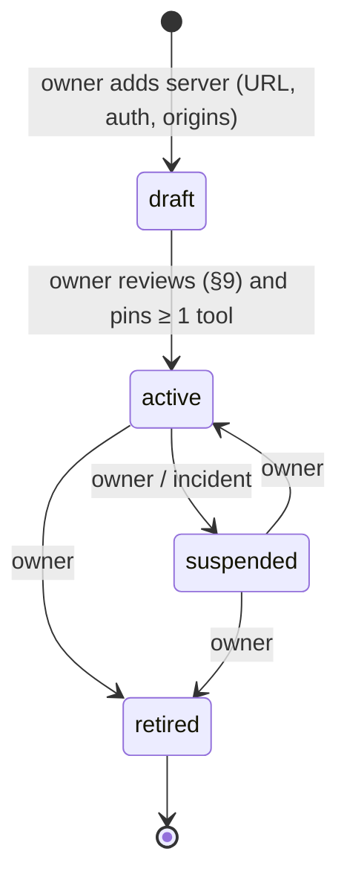
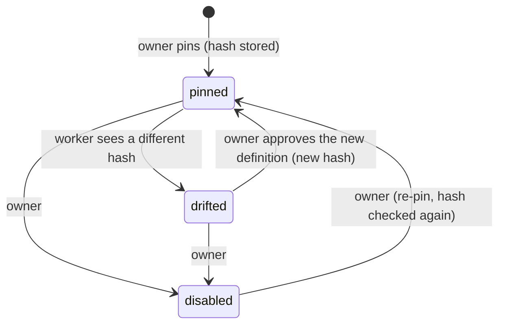

# MCP connectivity (track N)

How Model Context Protocol servers plug into Kriya safely. Decisions:
ND-06 … ND-13, ND-21, ND-22, ND-25. Facts about the protocol and the AI SDK
client are in COMPETITOR_RESEARCH.md §2 (Primary, dated 2026-10-24).

People see **apps**; "MCP" is an internal word (UX_SPEC §3).

## 1. The model in one table

| Question                    | Answer in Kriya                                                                                                                  |
| --------------------------- | -------------------------------------------------------------------------------------------------------------------------------- |
| Which servers?              | Only remote HTTPS servers in the owner's registry (`kriya.mcp_servers`), each reviewed (§9)                                      |
| Which tools?                | Only tools the owner pinned (`kriya.mcp_tools`), loaded with `client.tools({ schemas })` so nothing else is loaded               |
| Which risk class?           | `classifyMcpTool` in `lib/agent/policy.ts`: owner floor, annotations only raise, payments → R5 (ND-08)                           |
| Who approves?               | The person, for every R2–R4 call, exactly as for Gmail or GitHub; never grantable (ND-25)                                        |
| Where do calls run?         | Only in `kriya-worker`, inside `runTask` (invariant 5)                                                                           |
| Where are tokens?           | `kriya.mcp_connections` (one row per person per server), sealed by `lib/secrets.ts`, opened only in `lib/connectors.ts` (ND-09)  |
| What can the server reach?  | Nothing of Kriya's: it receives only the arguments of approved or R0/R1 calls; Kriya's egress to it is guarded (ND-10)           |
| What does the model see?    | Results wrapped in `FOREIGN`; counted as private and untrusted (ND-11)                                                           |
| How is "done" proven?       | A pinned read-back tool (ND-12) and one later re-check (ND-04); otherwise "Ran, but wasn't checked"                              |
| What if the server changes? | Drift: the tool leaves every belt until the owner re-approves (ND-07)                                                            |
| How is it switched off?     | `next.mcp` off (all), server `suspended` (one app), `operator.disabledTools` (one tool), the person's Disconnect (their account) |

## 2. Lifecycle





Transitions are enforced by `kriya.allowed_transitions` +
`kriya.check_transition()` (entities `mcp_server`, `mcp_tool`), the
mechanism goals, schedules and mandates use. `pinned → drifted` is the only
worker transition; it runs through `privileged` with an explicit server id.

## 3. Connecting (N6)

1. Account → Apps lists `active` servers (name, domain, what it can do,
   each pinned tool with "asks you first" or "reads only").
2. **Connect** → `GET /api/connect/mcp/<serverId>`: `requireUser()`,
   server `active`, `next.mcpConnect` on; then the OAuth start through
   `lib/connectors.ts` `mcpAuthProvider` (PKCE, `state` single-use 10 min
   cookie like `OAUTH_STATE_COOKIE`, CIMD or pre-registered client id).
3. Callback `…/callback`: `state` and `iss` checked;
   `validateAuthorizationServerURL` allowed only the server's
   `allowed_auth_origins`; tokens sealed into `kriya.mcp_connections`,
   scopes recorded.
4. **Enable**: the person picks "all my agents" or named agents
   (`kriya.mcp_enablements`, `withUser`). Without an enablement no agent
   gets the app's tools.
5. **Disconnect**: `mcpDisconnect` revokes at the server if it offers
   revocation, deletes the connection row and the enablements, in one
   transaction (the token row is deleted even if revocation fails, like
   Google's Disconnect).

Scopes: the registry stores the minimum scope list; Kriya requests only
those (MCP spec "Scope minimization"). A step-up challenge from the server
during a task fails the call with "<App> needs more permission: reconnect
it from Account → Apps" (no in-task OAuth).

## 4. Per task (N5)

`loadMcp(task, agent)` in `lib/mcp/registry.ts` + `lib/mcp/client.ts`:

1. `next.mcp` on (read once with the other settings), `agents.inbox` on.
2. Enablements for this agent (`withUser`), servers `active`, connection
   rows present (`privileged` count by user id, never the token).
3. For each server (max 5 servers per task, sequential open, 10 s each):
   `createMCPClient({ transport: { type: 'http', url, authProvider:
mcpAuthProvider(userId, id), fetch: guardedFetch(server), redirect:
'error' } })`.
4. `listTools()`; compute `definitionHash` for each pinned name; mismatch →
   drift (row update, log `mcp tool drifted` with ids only), tool skipped.
5. `client.tools({ schemas })` with the **pinned** `inputSchema` for each
   kept tool (zod built from the pinned JSON Schema with
   `additionalProperties: false` enforced; inputs over 32 KB refused).
6. Names mapped to `kriya_name`; `operator.disabledTools` applied; cap
   `next.mcpMaxTools`.
7. Classes: `classifyMcpTool({ ownerRisk, annotations (pinned), category })`.
   R5 → dropped. Approvals: `"user-approval"` for R2–R4. Side effects:
   class ≥ R2.
8. Wrap `execute`: input re-validated against the pinned schema; result →
   `{ notice: FOREIGN, result }` with text over 20,000 characters cut (as
   `MAX_TEXT` in `lib/connectors.ts`); `isError` results returned as a
   tool error; read-back (ND-12) for side effects with a `verify` spec.
9. `close()` in the runner's `finally`.

A failure anywhere in 2–8 drops that server's tools for this task and adds
one line to the prompt; the task never fails because of MCP.

## 5. Guarded fetch (ND-10)

```ts title="lib/mcp/fetch.ts (contract)"
export function guardedFetch(server: {
  url: string // https only
  allowedAuthOrigins: string[] // https origins
}): typeof fetch
```

Rules, each tested (NT-MCP-10…14): scheme `https:`; host = server host or
an allowed origin's host; `isBlockedHost(host)` false; every address from
`dns.lookup(host, { all: true })` passes `isBlockedAddress`; the request is
sent to the checked address with the original `Host`/SNI (so a DNS answer
that changes between check and use can't reach a private range, the
TOCTOU note in the MCP spec); `redirect: "error"`; 10 s timeout; response
body capped at 2 MB; no cookies; headers limited to what the transport
sets. Test fixtures map host names in code, never from env (the
`browser/egress.ts` rule).

> [!NOTE]
> Sending to the checked address while keeping TLS validation for the
> name needs a custom `undici` dispatcher or Node's `https.request` with
> `lookup`. Node's built-in `fetch` is undici; whether a `lookup` hook can
> be passed without adding `undici` as a dependency is **unknown**.
> N5's first test settles it; if it can't, `lib/mcp/fetch.ts` uses
> `node:https` with a `lookup` function (no new dependency).

## 6. Classification examples

| Pinned tool (illustrative)         | `ownerRisk` | Annotations             | Category   | Class | Belt?     |
| ---------------------------------- | ----------- | ----------------------- | ---------- | ----- | --------- |
| Search issues                      | R0          | `readOnlyHint: true`    | —          | R0    | yes, runs |
| Search issues (server omits hints) | R0          | none                    | —          | R3    | yes, asks |
| Create issue                       | R3          | `readOnlyHint: false`   | —          | R3    | yes, asks |
| Post a message to a channel        | R3          | `openWorldHint: true`   | —          | R4    | yes, asks |
| Delete page                        | R4          | `destructiveHint: true` | —          | R4    | yes, asks |
| Create payment link                | R3          | any                     | `payments` | R5    | **never** |

These rows are examples of the rule, not claims about any real server.

## 7. Read-back mapping (ND-12)

```json title="mcp_tools.verify (shape)"
{
  "tool": "get_issue",
  "args": { "id": "/structuredContent/id" },
  "expect": { "/structuredContent/title": "/input/title" }
}
```

The read tool must be pinned, R0 and on the same server. Run by the worker
right after the side effect, without the model, through the same client.
Match → `verification: { status: "verified", method: "api_readback",
evidence: [{ kind: "provider_id", value }] }`. Mismatch → `failed`.
Unreadable → `unverified` (re-checked once later, ND-04).

## 8. What MCP never does in Kriya (v1)

- No tool call ever runs on the web server, a person's device, or
  `kriya-browser` (the web server only does OAuth and the owner's
  `tools/list` at pin time, ND-10).
- Never receives a Kriya token, an OAuth token of another provider, or a
  secret (token passthrough is forbidden by the MCP spec; Kriya sends only
  the token issued for that server).
- Never gets a standing grant; never reaches R5 categories.
- Never adds an MCP server from model output, a page, an email or a skill.
- Never uses resources, prompts, sampling, elicitation, apps or events.
- Never shares one person's MCP client, session or state handle with
  another person's task (client per task, closed after).

## 9. Owner review checklist before a server becomes `active`

Recorded in `kriya.mcp_servers.review` (text) and in `status.md`:

1. Official source: the provider's own docs name this URL as its remote MCP
   server (link, date) — NRG-1.
2. Terms allow a hosted third-party client acting for its users (clause,
   date). If unclear: don't activate; ask counsel.
3. Auth: OAuth with PKCE (public client or CIMD), or a confidential client
   whose secret the owner puts in Render as `secret_env`. Authorization
   server origins listed exactly.
4. Data region and retention stated by the provider, or "unknown"
   recorded.
5. Each tool to pin: read the full definition (description, both schemas,
   annotations); look for instructions aimed at a model (tool poisoning);
   set `ownerRisk`, `category`, Kriya name, optional `verify` spec.
6. Scopes: the minimum for the pinned tools.
7. A fixture test (or recorded fixture responses) for every pinned tool
   (NT-MCP-20) before activation.
8. Privacy notice lists the provider as a recipient of the person's
   requests when they use the app (A11 legal drafts, "Draft, pending legal
   review").
