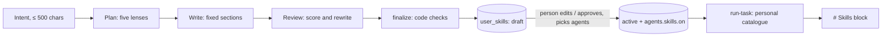

# Skill Studio

People describe a skill in a few words; Kriya designs it the way an expert
would, a strict reviewer improves it, code checks it, and the person reads,
edits and approves it for the agents that should use it. Behind
`next.skillStudio` (default **off**, needs `agents.skillLibrary`). Built
2026-10-30 at the owner's request, together with the curated
`linkedin-presence` skill (`skills-v2/`, with `next.skillsV2`).

A personal skill is a library skill the person owns: **text only**. It adds
no tool, account, permission, approval or grant. It loads through the same
resolver (`resolveSkills`) after every platform section, under the same
precedence preamble and the same 5-skill / 12,000-character budget.

## 1. Flow

1. **Design** (`actions/skill-studio.ts designSkill` → `lib/skill-studio`):
   three OpenRouter calls on `next.skillStudioModel` (default
   `deepseek/deepseek-v4.1-flash-1017`, the owner's choice). Each must answer
   with JSON: the schema goes in the instructions and code parses and checks
   the reply (`parseJsonReply`), with one repair try that names the problem
   (`-retry` usage row). The OpenRouter adapter in `lib/models.ts` doesn't
   pass a response schema (no `structuredOutputs`), so Output.object can't be
   relied on; this keeps every other caller's requests unchanged.
   Output budgets 8,000 / 16,000 / 16,000 tokens leave room for a reasoning
   model's hidden reasoning (at 8,000 a review ran out mid-reply).
   - *Plan*: the practitioner, the person, a demanding reviewer, risk and
     ethics, edge cases; scenarios, pitfalls, what Kriya can't do there,
     fitting tools, assumptions.
   - *Write*: Markdown with fixed sections (When to use, Before you start,
     Procedure, Quality bar, Edge cases, Never, Done means), tools only from
     the list, keywords, sample requests.
   - *Review*: scores on expertise, specificity, safety, edge cases and
     verifiability, and the rewritten instructions, given the same tool list
     (without it the reviewer stripped real tools as "invented"). A failed
     review leaves the draft standing. Instructions over 6,000 characters
     fail the schema and get the repair try ("tighten, don't drop a
     section") rather than being cut.
   All three prompts carry Kriya's platform rules (approvals, assisted
   sites, R5, no bulk actions or scraping, no invented facts, phone-only
   reminders). The person's words are passed as data.
2. **Code checks** (`lib/skill-studio/design.ts finalize`), never the model:
   - frontmatter, HTML and links removed; 200–6,000 characters, cut at a
     paragraph;
   - tools: only names in `TOOL_CLASSES` (plus `propose_call`); every tool
     the text names in backticks is declared, so `skillRisk` sees it;
   - `scrub` removes every line that directs something Kriya never does
     (passwords and codes, CAPTCHAs and bot detection, card/bank/identity
     numbers, bulk or automatic actions, scraping, fake engagement, acting
     without approval) unless the sentence rules it out, leaves it to the
     person, or sits under a prohibition heading ("## Never"); removed lines
     are shown to the person;
   - keywords normalised and deduplicated (≤ 30, longer than 40 characters
     dropped, never cut); `tuneKeywords` adds, for each "activate" sample no
     keyword picks, the longest word of the phrase keywords that it contains
     and no "skip" sample does; sample requests run through the real
     resolver (`checkEvals`) and shown as "Uses it" / "Doesn't use it";
   - names and descriptions end at a word with "…", never mid-word.
   - **No tool is ever required** (`toManifest`): the person chose the
     agents, so the skill loads for them and a step whose tool is missing is
     skipped and said so (the Skills preamble); every tool still counts for
     `skillRisk`. A model marking `kit_prepare` as required would otherwise
     hide a LinkedIn skill whenever `agents.kits` is off.
3. **Draft.** Stored in `kriya.user_skills` with the design (perspectives,
   scores, fixes, removed lines, checks). A draft never loads.
4. **Edit.** The person can change the name, description, keywords and
   instructions; `lint` refuses a forbidden sentence with the sentence
   quoted. Editing an active skill bumps its version.
5. **Approve.** The person's alone (`PERSON_ONLY_WRITES "user_skills"`; no
   tool writes the table). The skill becomes active and is added to the
   agents they ticked. An agent with no saved choice (`skills` null) first
   gets its role's defaults written down, so what it used before is
   unchanged. Later assignment and removal use the agent dialog's Skills
   section, which lists personal skills as "You (Skill Studio)".
6. **Run.** With the switch on, `run-task` puts the person's active skills
   first in the catalogue (`personalCatalog`, under `withUser`) with a
   loader for them, so among skills picked the same way the approved one
   comes before a library default; required safeguards still lead (by
   mode). Found on a real task: appended last, library skills filled the
   12,000-character budget and the approved skill was skipped. A failed
   read means no personal skills, never a failed task.
   Activation rows record the random id (`my-xxxxxxxxxx`) only, never the
   person's words.
7. **Retire / delete.** Removes it from every agent; retire keeps the row
   (restore makes it a draft again).

## 2. Limits (server, SQL)

| Limit | Where |
| --- | --- |
| 5 designs per hour per account, 20 per address | `kriya.hit_rate_limit` via `allowAll` |
| `next.skillStudioDaily` designs per person per day (default 10) | count of `resource_usage` plan rows |
| 50 personal skills per person | count in the insert's transaction |
| 30 skills per agent | `skillPrefsSchema`, checked on assign |
| Body 200–6,000, intent 3–500, manifest ≤ 16 KB, design ≤ 32 KB | table checks |

Each call's tokens and cost go to `resource_usage` as `skill_design`: a
platform cost, never a customer charge, and separate from
`maintenance_model` so it can't use up memory upkeep's cap. Output tokens
per call: 1,500 / 3,000 / 3,000.

## 3. Data

Migration `20270103000000_skill_studio.sql` (additive): `kriya.user_skills`
(RLS `own_rows`; `active` needs `approved_at`; id `^my-[a-z0-9]{10}$`) and
`skill_design` added to `resource_usage.kind`. Rollback
`supabase/rollback/20270103000000_skill_studio.down.sql` takes personal ids
off every agent, drops the table and the cost rows.

## 4. Switches and rollout

| Setting | Default | Meaning |
| --- | --- | --- |
| `next.skillStudio` | off | The page, the actions, personal skills in the Creator and the runner |
| `next.skillStudioModel` | `deepseek/deepseek-v4.1-flash-1017` | OpenRouter model id (needs JSON replies; structured-output support not required) |
| `next.skillStudioDaily` | 10 | Designs per person per day |

Off: `/agents/skills` is a 404, the actions refuse, the Agents page has no
link, `skillOptions` and `normalize` use today's catalogue, and the runner's
prompt is byte-identical (NT-STU-04). Turning it off later is the kill
switch: approved skills stay stored but never load.

Rollout: apply the migration on staging, deploy web and worker together,
switch on for staging, design two or three skills (one LinkedIn, one
unrelated), approve one, and check a real task's "Used N skills". Then
production.

## 5. LinkedIn (`linkedin-presence`, skills v2)

Adapted in Kriya's own words from `sergebulaev/linkedin-skills` (MIT,
commit `8f8bc4b40a`, profile optimizer, post writer, content planner).
Left out on purpose: its Publora auto-posting, Apify scraping of posts,
commenters and engagers, the custom-poster script and every script (Kriya
never runs skill code). LinkedIn stays `assisted` (AD-06; its User Agreement
§8.2 forbids bots posting, messaging or connecting): Kriya prepares
profile sections with `kit_prepare`, posts, a weekly plan and individual
comments and notes; the person applies each one; `kit_check` reads profile
changes back. "Maintaining" a profile means a rhythm the person approves
(`schedule_create` waits for their OK), not unattended posting. Moving
LinkedIn to `supervised` needs AB-04 (terms review and owner approval).

## 6. Tests

`tests/next/skill-studio.test.ts` (NT-STU-01…04: checks, resolver,
design → approve → retire on PGlite with a scripted model, RLS, runner on
and off); `tests/next/skills-v2.test.ts` (the nine v2 skills). Model calls in
tests are scripted; no real model is called.

## 7. Known limitations

- The forbidden-content check is pattern-based; it errs towards removing a
  line. Platform enforcement (tools, approvals, `browserDecision`) is what
  actually stops an action.
- Relevance is keyword-based like every library skill; the person adjusts
  keywords if a sample request doesn't pick it.
- The design is in English; Indian-language keywords are suggested and used
  with `next.skillsV2` on.
- Model quality is judged on four live designs (§8), not a benchmark. A
  model can still name a tool for the wrong job (one design read a profile
  with `kit_check` before any kit existed); the person reads the skill
  before approving it, and the platform refuses what a tool can't do.
- With the switch off, `/agents/skills` renders the app's 404 page with
  HTTP 200, like other switched-off workspace pages (`/radar`): the
  workspace `loading.tsx` streams the response before `notFound()`.

## 8. Live check (2026-10-30, local Supabase stack, real OpenRouter)

Owner go-ahead for real calls in chat; `verify:guard` OK before every
command; key from `.env`, never printed; database `127.0.0.1:54322`.

| Request | Result | Time, cost |
| --- | --- | --- |
| LinkedIn, final-year CSE, SDE internships (1st) | Failed: adapter dropped the schema, reply unparseable → JSON-in-instructions fix | — , US$0.0008 |
| Same (2nd) | Stored, but 2 of 3 samples missed (phrase keywords), "Never" lines scrubbed, cut at 6,000 → three fixes | ~110 s, US$0.0083 |
| Same (3rd) | All 7 sections, 5/5 samples, nothing wrongly removed; reviewer stripped real tools → tool list given to the reviewer | ~37 s, US$0.0055 |
| GATE CSE study plan | 5/5 samples, real tools; review ran out of tokens twice (`length`) → budgets raised | ~90 s, US$0.0125 |
| Seed-stage SaaS investor update | 5/5 samples, review passed first try, uses `sheets_total` for totals | ~60 s, US$0.0083 |

Approved the LinkedIn skill for Kavya (career coach) and asked her twice on
the worker with the same model. The first run skipped it (library skills
filled the budget) → personal skills first. The second loaded it
(`my-seh39t36oz`, 5,322 characters, matched "linkedin"); the reply used only
the facts given, left labelled blanks for the rest, said the person pastes
it on LinkedIn, and questioned an unsourced benchmark. Total real spend for
the check: US$0.046.

Browser (screenshots in `screenshots/next-platform/skill-studio/`,
git-ignored): 360 and 1280 px, light and dark; console 0 errors on a fresh
load; no horizontal scroll at 360; 0 unnamed controls (agent checkboxes
gained `aria-label`); inputs raised to 44 px on phones (only the app shell's
logo link is under 44 px, as on every page); delete with confirmation,
approval, a refused forbidden edit ("can't direct passwords or one-time
codes"), the agent dialog listing the personal skill; switch off → 404 page
and no link; Home, Agents, Inbox, Tasks, Usage, Account and a thread load
without errors.
